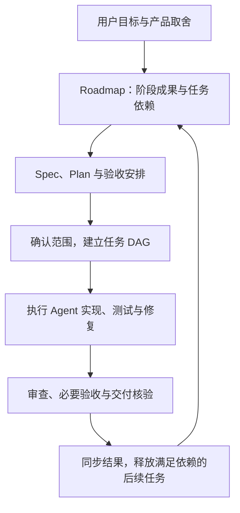

# SteerLine

**SteerLine 是一个 AI Workshop：以多 Agent 编排为基础，深度参与项目流程的 AI 开发系统，同时提供开发方法与配套工具。**

## 产品类别：AI Workshop

**AI Workshop 是 SteerLine 定义的新产品类别，对照的现有类别是 AI Agent。** AI Agent 通过循环与外部工具调用，让 LLM 能够多次调用模型和工具，逐步完成长任务。AI Workshop 以多 Agent 编排为基础，并通过对项目流程的干预、流程相关脚本和提示词注入，将多个 Agent 的工作组织成持续推进的项目开发流程。

| 类别 | 基础机制 | 工作组织方式 |
| --- | --- | --- |
| AI Agent | LLM 调用循环与外部工具调用 | Agent 逐步执行任务，根据工具结果继续行动 |
| AI Workshop | 多 Agent 编排、流程干预、流程脚本与提示词注入 | 主 Agent 与人交互并管理项目流程，多个执行 Agent 承担具体任务 |

在 SteerLine 的产品设计中，主 Agent 负责与用户交互，承担需求澄清、规划和流程管理；多个执行 Agent 负责实现、测试、修复等任务执行。用户已有的 Codex、Claude 等 Agent 可以接入，依据明确的 Spec 和 Plan 开展工作。

项目流程是 AI Workshop 的核心组成部分。SteerLine 以 Roadmap 驱动，将项目规划、任务依赖、规格文档、开发执行、测试验收和交付衔接起来；通过流程脚本落实检查与推进，通过提示词注入向 Agent 提供当前工作所需的流程要求，让项目最佳实践成为实际开发约束。

**项目尚未发布。** 下文先介绍开发理念与目标工作方式；已实现能力及其边界在「当前阶段」中单独说明。

## 从执行任务到持续开发项目

**我们认为，AI 开发要进一步提升效率与规模，从单个 Agent 走向多 Agent 编排是必经之路。** 当多个 Agent 大幅提升生成效率后，人的注意力仍然有限。如果协调任务、跟踪进度和检查每一步都依赖人，生成能力的增长就会转化为人的管理负担。人的注意力应当集中在更重要、无法被 AI 替代的事项上，例如确定产品目标、作出价值判断和关键取舍。

因此，我们的判断是：由主 Agent 统一协调多个执行 Agent，并向项目注入开发流程，以提升工程可控性，几乎是这条发展路线下唯一可行的路径。主 Agent 承接日常协调和流程管理，通过流程脚本、提示词与检查机制约束执行，让人能够围绕目标、决策和关键结果参与项目。

多个 Agent 能同时写代码，并不意味着项目已经具备持续推进的开发流程。目标可能尚未拆清，后续任务可能依赖未稳定的接口，文档可能跟不上实现，而一次测试通过也未必回答了最初的产品需求。

SteerLine 将这些问题纳入开发系统本身：目标怎样变成可交付任务，任务之间怎样衔接，执行者依据哪些文档工作，哪些结果可以证明完成，以及哪些事项需要人决定。它既提供组织这些工作的开发方法，也提供承载任务关系、执行过程和交付事实的工具。

这里的最佳实践覆盖规划、文档、实现和验收。通用规范定义共同要求，项目补充自己的技术栈、环境和验证方式。SteerLine 的方向是让 Agent 按这些要求协作，并通过流程检查落实约束，使项目能够在多轮开发、多个执行者之间保持连续性。

## Roadmap 驱动任务 DAG

Roadmap 将产品目标转为阶段成果和相互关联的开发任务。每项任务通过 Spec 明确成果、范围和通过条件，通过 Plan 安排实现与验证，再用任务 DAG（有向无环依赖图）表达推进关系。

依赖关系决定任务何时具备开工条件：需要前置交付的任务等待相应成果，边界独立的任务可以并行开展。拆分的依据是独立成果和明确的交接关系，合理的并发来自这些边界。

一个完整的开发闭环按以下方式组织：

草稿用于探索目标和备选方案；正式任务承载已经确认的执行范围。启动时固定任务依据，执行中出现需求变化时核对受影响的任务与成果。实际交付再回到 Roadmap，为后续安排提供依据。

例如，某项功能依赖公共接口，接口任务就需要明确交付内容和验证条件；消费接口的任务据此安排开工。执行者报告完成后，还需核验相应的测试和交付事实，才能判断依赖是否满足。Roadmap 因而成为连接规划与开发结果的持续工作依据。

## 测试与验收从规划开始

任务在规划时就应回答「怎样算通过」。Spec 定义通过条件，Plan 安排验证方式，专属验收记录保存具体行为、实际结果和证据。实现工作与验证准备一同安排，缺少必要环境或测试能力时也能提前识别。

测试按验证目的分层：最小代码检查、核心流程冒烟、可独立并行的功能测试，以及临界情况等可复用测试，各有明确职责。项目维护可读说明与结构化清单，让执行者和系统都能找到应验证的内容、环境与入口，并按变更影响选择必要范围。

测试回答某个版本的行为是否符合预期，验收还要判断任务承诺的成果是否成立。自动验证与人工判断分别安排：可自动完成的部分进入执行计划；体验、产品取舍等人工事项记录参与安排、待验状态和实际阻塞范围。允许后置的人工项保留待验标记，关键前置和真实失败继续阻塞相关推进。

结果必须能追溯到具体版本、实际执行范围和证据。失败、跳过、未验和通过分别保留，补测关联原失败。代码生成、编译成功或 PR 创建都是过程事实，任务完成还需要相应的验证与交付依据。

## 文档分层，让开发依据持续有效

SteerLine 将文档作为开发流程的工作依据。不同层次回答不同问题，并通过引用关联：

| 层次 | 回答的问题 | 主要内容 |
| --- | --- | --- |
| 通用规范 | 项目应遵循哪些共同开发要求？ | SteerLine 提供的项目规范、Spec/Plan 编写规则和测试架构规范 |
| 项目约定与长期文档 | 要求在本项目中怎样落实？项目当前怎样工作？ | 项目流程、环境、测试指南，以及持续维护的产品设计和架构说明 |
| 规划与任务文档 | 本轮做什么，按什么顺序，怎样实现与验证？ | Roadmap、Spec、Plan 和任务专属验收安排 |
| 结果与证据 | 某个版本实际做到了什么，还有哪些未完成？ | 测试报告、验收结果、交付记录及原始证据定位 |

通用规范由 SteerLine 统一提供；项目维护自己的落实方式。Roadmap 管理整体推进，Spec 定义任务成果，Plan 安排实施，报告记录实际结果。有效的长期设计随着项目演进持续维护，过期材料保留必要追溯入口。

这种分层让规则有明确维护位置，也让 Agent 能找到与当前工作相符的依据。任务执行时固定相关版本；结果产生后更新对应记录；涉及长期行为的变更同步维护设计与规范。计划、实现现状和历史证据因此能够各自保持清晰。

## 用户、SteerLine Agent 与执行 Agent

**产品方向是由 SteerLine Agent 承担主要的用户交互和项目流程管理。** 用户通过它讨论需求、审阅规划、作出产品决定并了解开发结果。原本直接交给通用 Agent 的项目协作，由 SteerLine 提供的 Agent 在统一流程下承接。

| 参与者 | 职责 |
| --- | --- |
| 用户 | 决定产品目标、优先级、关键取舍和授权范围，参与必要的人工验收与交付决策 |
| SteerLine Agent 与系统 | 澄清需求，组织 Roadmap 和任务文档，维护依赖与流程要求，监督执行并汇总需要用户决定的事项 |
| 接入的执行 Agent | 在任务 Spec 和 Plan 明确后，完成实现、测试、修复、提交和 PR 等具体开发工作 |

这一分工让项目流程由 SteerLine 持续管理，用户自己的 Agent 则可以作为执行器参与。模型和执行工具可以有不同选择，项目仍使用明确的任务依据和交付要求。

约束由 Agent 与工具共同落实：Agent 负责理解需求、提出方案和处理复杂工作；系统检查任务材料、依赖条件、执行资格与交付事实。需要用户决定或超出授权的事项回到用户，后续推进依据明确的决定继续。

## 当前阶段

上述理念描述完整产品方向，当前版本已具备其中一部分能力：

- **任务与执行：** 已有任务 DAG、依赖检查、独立执行候选、会话反馈和真实 PR 合并核验；核验交付后释放满足依赖条件的后继任务。
- **Roadmap 转正：** 已接入 Markdown 读取与解析、任务关系确认、Spec/Plan/验收文档生成、文档发布和正式入图。真实 Runner、浏览器与 GitHub 文档 PR 主链已有验证，人工体验等未验范围见[专属验收](SteerlineFlow/testing/acceptance/roadmap-promotion.md)。
- **流程材料与测试：** 已维护通用项目规范和 SteerLine 自身的分级测试、结构化清单、验收记录与按提交保存的测试历史。相关约定和工具已有落实，完整流程仍在持续建设。
- **交互与执行接入：** Web 是当前交互前端；通过独立 SteerRunner 接入本地 Codex、本机 Orca 和远端 Orca 路径。各组合的可执行资格与已验范围，按[执行方案](docs/product-design/execution-configuration.md)及对应验收记录判断。

**面向用户的 SteerLine 主 Agent、贯穿完整项目周期的流程管理，以及授权范围内的有限自主推进，仍是后续产品方向。** 当前已有的解析、生成和执行能力，尚不构成完整的主 Agent 产品体验。验收记录中的固定版本、环境和范围决定了各项能力的实际验证边界。

长期愿景是通往工程 AGI，让 AI 能持续承担复杂软件项目的开发。SteerLine 将逐步完善这套流程与工具体系；阶段目标见[产品愿景](SteerlineFlow/Roadmap/product-vision.md)，具体能力与未闭合项见[验收记录](SteerlineFlow/testing/acceptance/README.md)。

## 继续阅读与开发入口

| 阅读目的 | 入口 |
| --- | --- |
| 准备项目接入 SteerLine | [项目接入指南](SteerlineProjectGuideDoc/README.md) · [受管理项目规范](SteerlineProjectGuideDoc/project-standards.md) |
| 了解本仓库的规划与开发流程 | [流程入口](SteerlineFlow/README.md) · [RoadmapGuide](SteerlineFlow/Roadmap/RoadmapGuide.md) · [正式执行清单](SteerlineFlow/Roadmap/execution-map.md) |
| 查找测试方法与实际验收结果 | [测试指南](SteerlineFlow/testing.md) · [验收记录](SteerlineFlow/testing/acceptance/README.md) |
| 从源码构建、启动和调试 | [Web 构建与启动](web/README.md) · [安装部署](docs/integration/install-deploy.md) · [独立调试](docs/runtime-install-debug.md) |
| 了解产品设计、架构与执行接入 | [文档入口](docs/README.md) · [项目流程与 Runner 职责](docs/product-design/project-workflow.md) · [代码架构](docs/architecture/current-code-architecture.md) · [Runner 接入](docs/integration/steerrunner.md) |

SteerLine 自身也采用这套开发方法：统一规范维护在 `SteerlineProjectGuideDoc/`，本项目流程材料维护在 `SteerlineFlow/`，产品设计与架构维护在 `docs/`。
