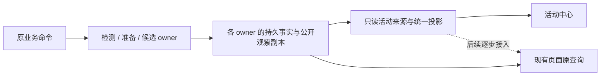

# 异步活动中心 Spec

状态：2026-11-06 经独立文档审核后按用户授权实施，首期代码及只读界面已接入，验证结果见专属验收；不部署，不进入 roadmap 调度。

对应 [Plan](../plans/async-activity-center.plan.md) 与[专属验收规划](../testing/acceptance/async-activity-center.md)。

## 1. 目标与首期范围

建立统一异步活动观察机制，使用户在项目内跨页面查看正在推进、正在等待、需要处理及最近结束的工作。活动具有稳定身份，持续工作可在刷新和重新打开页面后重新发现。业务模块继续决定如何执行以及何时完成，统一层只投影事实。

首期采用“顶部常驻入口＋右侧抽屉”：在项目顶部栏右侧打开活动中心，跨项目内页面查看进度。接入以下三类工作：

| 类别 | 首期具体入口 / 活动单位 | 详情去向 |
| --- | --- | --- |
| 检测 | `environment_start` 对应一次项目运行环境检测；`maintenance_check` 对应一次用户显式主分支检查 | 原项目运行环境页 / 原项目维护区域 |
| 测试准备 | `maintenance_generate_all`、`maintenance_retry` 对应实际登记的准备批次；批次内展示材料校验与测试安排生成摘要 | 原项目维护区域及相关任务 |
| 任务执行 | `start_task`、`start_candidate` 登记的独立候选，从候选预留开始，包含启动、实施、审查、发布、待答、待合并及结束 | 原执行页，定位候选 |

“原界面先不动”指保留原页面、进度组件、业务操作、请求语义与查询入口；允许在应用壳增加入口和定位所需的路由参数。不在本期把原页面迁到新投影。首期展示当前项目，项目切换后切换观察范围；不承诺跨项目汇总。

后台定时主分支观察、普通页面查询、轮询、目录探测不逐次登记。测试准备内部的主分支检查作为准备阶段展示，不另建顶层活动。Roadmap、配置保存、部署等暂不接入；后续用户需要追踪的异步工作默认按本契约接入，并在变更验收中验证。

## 2. 当前代码依据与必要补齐

| 现状 | 源码依据 | 对本方案的约束 |
| --- | --- | --- |
| 请求回执与候选启动已有浏览器 journal 和恢复展示 | `web/src/app/operations.tsx`、`web/src/app/use-original-requests.ts`、`web/src/app/use-candidate-starts.ts`、`web/src/shared/api/journal.ts` | 复用原请求及原对账路径；不能把 `applied` 普遍解释为工作成功 |
| 环境检测持久保存 Record/Round，独立后台观察；`Start` 在活动落库前执行材料准备 | `internal/environmentadaptation/service.go`、`internal/environmentadaptation/model/model.go`、`internal/app/environment_adaptation.go`、`internal/storage/sqlite/environments.go` | 正式活动由 Record.ID 标识；提交期间只能展示尚未确认的请求，不能伪造 Run 已启动 |
| 显式主分支检查先保存 CommandRecord，再调用 `m.check`；与后台检查共用检查机制 | `internal/app/maintenance_routes.go`、`internal/app/project_maintenance.go`、`internal/projectmaintenance/model/records.go` | 只从显式命令发现活动；CommandRecord 的最终成功在此动作中代表本次检查完成，不能借用全局 Observation 的后来成功覆盖原命令未知 |
| 准备 worker 独立于任务 actor，先登记批次，再准备和观察生成 | `internal/app/maintenance_generation.go`、`internal/app/maintenance_worker.go` | 观察不得调用 `processPreparation`、`refreshMaterials`、`requestPreparation` 或模型生成 |
| 当前批次存于项目 settings 的一个 JSON 字段，后续批次会覆盖；失败批次不一定有 CompletedAt | `internal/projectmaintenance/model/generation_batch.go`、`internal/storage/sqlite/materials.go` | 最近结束列表不能靠浏览器缓存或原登记回执重建；须由准备 owner 补齐按批次 ID 保存的事实及终结摘要 |
| 候选保存 caller 参与关系和公开 Runner 投影；TaskDelivery 独立 | `internal/runnerstate/candidate.go`、`internal/taskrunner/projection.go`、`internal/product/query/pages.go`、`web/src/features/runs/state.ts` | 候选 ID 与 Runner Run ID 分开；同 Task 的并行候选分别展示，不能以原生轮次结束直接宣布任务交付 |
| 测试进度来自已核验的 progress-file；布尔 false 代表未完成 | `internal/testmanagement/progress.go`、[运行时进度契约](../../docs/integration/runtime-progress.md) | 只复用已保存的测试进度，不另拉 Runner、不把 false 当作失败、不据此修改执行终态 |

上述文件说明当前基础，不代表活动中心已实现。通用异常、原请求、恢复和资源所有权遵循 [Runner 调用生命周期](../../docs/product-design/runner-lifecycle.md)；本期没有新增执行恢复规则。

## 3. 所有权与解耦边界



1. 执行、输入、重试、恢复、资格、DAG、交付和停止结算继续由原 owner 决定。统一层没有这些写端口，也不持有 Runner 客户端、原生进程或执行租约。
2. “登记”首先指来源接入和从业务持久记录发现活动，不新增必须与业务双写的通用活动状态表，不设任意前端 `setStatus` / 百分比上报 API。来源在应用组装时显式注册，发现和转换是只读能力。
3. 已登记工作在抽屉关闭、路由卸载、浏览器关闭及没有任何活动查询时仍按原节奏推进。打开、刷新和重新查询活动不触发 Git fetch、生成、Runner inspect/observe/progress-file、原请求对账、提交、停止或恢复；原业务后台观察继续负责外部取证。
4. 观察故障只影响观察视图，不写业务失败，不释放资源，不结算 Task，不修改原业务超时或预算。关闭抽屉仅解除 UI 订阅，不取消原命令的 HTTP 请求或实际工作。
5. 元数据随原 owner 的提交保存，失败走其既有存储错误处理；不得因活动 UI、缓存或聚合器不可用增加执行准入。必要的批次事实补齐属于准备 owner 自身记录，不能由观察聚合器在读请求中补写。
6. 来源之间没有互相推进关系；一个来源故障不阻止其他来源返回。统一响应不宣称各来源是同一次执行现场原子快照。

## 4. 活动契约与身份

统一契约使用 Activity 概念，与 Task/DAG、Runner Operation、会话 ActivityEvent 区分。首期纯值契约至少包含：

| 字段组 | 语义 |
| --- | --- |
| `activity_id`、`kind`、`source` | 不透明稳定 ID；kind 为 detection / test_preparation / task_execution，source 区分环境检测、主分支检查、准备批次、候选 |
| `project_id`、`source_id`、`source_revision` | 原业务身份及适用版本；无版本的来源不能伪造业务 revision |
| `request_ids`、业务引用 | 关联原请求、Task、批次、候选、Runner Run；一个工作可以关联多个请求 |
| `title`、`state`、`phase`、`summary` | 用户可读标题、统一状态、来源阶段及摘要；阶段可为空，不补不存在的细节 |
| `needs_attention`、`wait_reason`、`diagnostic` | 是否需要用户处理、等待原因及诊断；允许运行中同时有非阻塞异步问题 |
| `progress` | 可空，声明计量名称、单位、分母及已知计数；不要求所有工作都有百分比 |
| 时间与观察信息 | 正式活动的 `created_at`、可空 `business_finished_at`、可空 `finished_at`、可空 `source_observed_at`；另有观察状态、诊断和响应采样时间；临时项没有原时间时可为空 |
| `details_ref`、来源结果与结算摘要 | 类型化内部定位引用；区分已知业务结果、关联工作的运行/未知情况、资源结算及活动结束，保留候选结果与 Task 交付的不同含义 |

正式 ID 由项目身份、来源名称、原业务 ID 确定，编码无歧义；不含服务 instance_id、列表位置或当前 Runner Run ID。更换 SteerLine 实例不改已有活动 ID，HTTP 响应和浏览器缓存仍绑定当前项目/实例，防止旧响应污染新现场。

同一原请求重查不产生新活动。准备中的重复点击若复用当前批次，关联到同一活动；真正重试并登记新批次/候选/检测才产生新 ID。原工作在相同候选内被合法恢复时保持原活动身份，允许依据新事实重新进入运行态，不强行规定展示终态永不改变。

### 提交到正式记录之间

临时项严格限定当前 `home_id / project_id / instance_id`。浏览器只读合并已有 journal 与 `candidateStarts.items`：journal 中尚无正式活动的请求显示“正在提交 / 结果待核实”；尚未进入 journal、正在等待首次启动确认的本地候选显示“等待首次启动确认”，已有本地未提交失败显示“未提交”。本地临时身份使用原 LocalStart.id，journal 使用原 request_id，在同一观察 scope 内按相同原 ID 合并，明确 `provisional=true`；不能新建信封、提前提交或为显示另写 journal。

正式候选的 c.ID 与该原启动 ID、正式来源的 request_ids 是精确替换依据：本地项 → journal → 正式记录只能显示一次，不能按同 Task、同方案或时间相近猜测关联。旧实例未匹配的 journal 请求仅保留在原操作回执历史中，不重新生成当前提交占位或进入当前计数/提醒；旧实例请求若精确关联到现存正式活动，仍可按该活动的持久事实展示，活动 ID 不因实例变化而改变。

`rejected` 且确认未建立业务活动时可结束请求占位，显示“未启动”；`applied` 但暂未找到正式记录时显示“等待工作信息”，不能填成功。显式主分支检查例外按其本次命令终态形成正式活动。停止、回答等附属命令不另建顶层活动。

正式活动不在当前列表页或筛选中时，也不能因此重建占位。统一查询提供有界的原请求关联只读查找，返回正式 ID 和最小状态，独立于列表分页；每批最多 100 个 request_id，可分批读取。查找失败保留关联待核实，不证明“尚未登记”。常驻提示将服务端正式活动计数与尚未关联的提交提示分开标注，不把两者直接相加为已确认工作总量。

只有已写入 journal 的临时项具有其原有刷新恢复能力；尚未发送的本地候选随原 hook 生命周期存在，刷新/实例切换后不承诺恢复，不能为补显示而重新创建工作。不声称其他浏览器/CLI 在尚未登记源记录时也可发现临时项。正式记录一旦提交，必须能脱离发起浏览器发现；环境材料读取期间的跨客户端发现不通过重构原启动流程解决，属于本期明确边界。

## 5. 状态、进度与观察质量

### 统一状态

`state` 使用 queued / running / waiting / succeeded / failed / cancelled；未知原状态映射为 waiting 并说明“状态待核实”，保留诊断，不能默认成功。状态由每次读取的来源事实纯转换，不维护另一套可独立推进的状态机。

| 来源事实 | 统一含义 |
| --- | --- |
| 环境 running、stopping、unverified | 分别展示检测推进、停止收尾、等待核实；使用原提交/轮次/结果及 Settled 判断，不凭状态名推测资源已结束 |
| 环境 ready / failed / cancelled 且 Settled | succeeded / failed / cancelled；以前检测成功与当前环境资格失效分开，资格失效不回写历史活动失败 |
| 显式 maintenance_check 的持久命令 | pending 为运行或等待核实；本次 applied / rejected 形成成功 / 失败或未启动结果；不能用之后后台扫描的 CheckedAt 或 LastSuccess 替代本次回执 |
| 准备 queued / preparing / generating | 排队 / 读取校验材料 / 测试安排生成；生成 generated 仍需材料 owner 校验为 ready，不能直接视为准备成功 |
| 准备 completed / failed | 表示原 owner 已确认的批次业务结果；仍有本批次关联生成运行或结算未知时显示 waiting 并保留业务结果，满足下述结束条件后才显示成功/失败终态；不以“请求已处理”作为成功 |
| 候选提交未知、待答、阻断或要求显式恢复 | waiting，说明具体原因；阻塞问题需处理，非阻塞问题可保持 running 且 needs_attention=true |
| 候选 pr_ready、await_merge | waiting，显示待合并；原生轮次成功、测试全部 true 或 PR 创建都不直接等于 Task 交付 |
| 候选最终结果及参与关系 | 使用原 TaskDelivery、participation、公开 workflow 终态确定候选结果，标明“已交付 / 候选结束 / 未选中 / 已撤回”等原因；不能把同 Task 的其他候选也显示为交付成功 |

业务结果与停止/资源结算分别保留。终态结果已知但原 owner 仍有未核实副作用或停止义务时，活动显示 waiting / 收尾待核实并保留已知结果，不能因 stop 已接受而显示已取消。已明确结束但资源由原契约允许保留时，可结束活动并注明资源保留；活动结束不承诺工作区被删除。

准备批次尤其不能只看 batch.Status：当前 `failPreparation` 可能在已提交的子 Generation 仍运行时记录 failed。批次 owner 须持久保留本次实际登记的 GenerationID、Inputs 和任务关联，包括部分提交后失败的路径；新批次替换当前引用不丢失旧关联。原 GenerationService 的后台观察继续按原规则处理这些既有生成，统一来源只读关联事实，不能重跑历史批次准备或自动停止子工作。

批次业务结束时保存该次业务结果、`business_finished_at` 及当时计数快照；子生成后来的运行/结算摘要独立展示，不用后来成功把原失败快照洗成成功。只要原关联中仍有运行、未知提交或 `Generation.Settled()` 未成立的工作，活动不进入最近结束，显示“准备失败 · 关联生成仍在运行”或“结果已知 · 收尾待核实”。原 owner 确认的合法结果更正按新事实投影，保留前次结果依据，不由统一层推断。

原批次业务结果已终结，且全部原关联生成已按原 owner 规则结算后，活动才可转为相应终态；零关联时只需已确认的批次业务终结。活动 `finished_at` 从业务终结及所有关联结算的已有时间取较晚者，缺任一必需时间时留空并注明未记录，不能用查询时间填补。非当前历史批次也按这些引用只读汇总，故可在后续结算后自然退出进行中，不需要活动 GET 补写或新增恢复调度。

失败或未知原因不能仅凭错误字符串推断；实现时为现存枚举和组合补齐映射表与反例，新增来源状态必须更新适配及验证。统一层不更改已有动作允许条件。

`needs_attention` 独立于主状态，先按原 owner 的当前相关性筛选，再判断当前待回答、需人工恢复/处理的阻断或失败。排队、正常生成、普通待合并或仅观察暂时中断不自动等于需处理。采用以下可取证口径，不建设“已处理”写服务：

| 来源 | 当前提醒的相关性与退出依据 |
| --- | --- |
| 环境检测 | 当前环境键的 Current.ActivityID 精确引用的检测失败/阻断可提醒；新活动成为当前引用后，旧已结算失败只作为历史结果保留。当前资格失效不是改写旧活动结果的证据 |
| 显式主分支检查 | 当前项目最新已持久登记的显式 maintenance_check 的失败可提醒；顺序由原命令创建时间与稳定 ID 确定。后来登记的检查使旧已确认失败退出当前提醒，但不证明旧检查成功；后台 Observation 不参与替代判定 |
| 测试准备 | 当前批次的有效失败/阻断可提醒；非当前批次仍须检查其失败项是否被当前 Material 以完全相同的 TaskID / Inputs / GenerationID 引用，仍有效的失败项继续提醒。仅重试一部分不清除其他仍被引用的失败；不同输入或新生成的显式引用替换只说明旧项已成为历史，不表述为旧尝试成功。批次整体错误且无逐项关联时，仅当前批次引用确定当前提醒 |
| 候选 | 先遵循现有 currentCandidate 的业务边界：非 active、stop_requested、Task 已交付/关闭/丢弃或已是交付赢家时，不把历史 pending question/业务失败作为当前待答/恢复提醒；其他候选也不能凭同 Task 的后续成功宣称原问题已答。有效候选的阻塞与非阻塞问题仍按原问题状态判断 |

上述当前相关性不消除任何原活动的未核实副作用、身份冲突或停止义务；这些事实仍使活动保持 waiting，原 owner 明确要求人工核实时独立进入需处理。读取当前引用/问题/结算证据失败时，将相关提醒标为待核实并保留上次有效值，不能将缺证据当作已解决。历史失败本身始终保留在结果与最近结束中，不因退出当前提醒被改写；来源没有确切关系时不推断“后续尝试解决了旧失败”。

### 进度

- 检测、主分支检查及候选主流程优先展示真实阶段和持续时间，无可靠分母时不显示百分比、不按耗时估算。
- 准备批次复用原 owner 的计量单位及去重口径；当前 `batchItems` 对相同 Plan/输入可去重，不能把单位默认命名为全部 Task 数量。准备阶段分母未确定时显示阶段；同一份摘要的总数与分类数须一致。
- 准备业务结束后保存该批次的业务结果与当时计数快照，后续新批次或材料更新不改写它；关联生成的后续运行/结算另列摘要，不混入原业务成功计数。部分失败保留成功/失败/阻断计数，整体结果按原 owner 决定；合法零工作批次显示“无需新增准备”，不产生 0/0 百分比。
- 候选内可附带已有 `ProgressView` 的“测试已通过 x/y，未完成 z”摘要；false 不表示失败，重跑允许计数下降。没有文件、断连或格式异常保留最后有效值并标诊断，不影响候选终态。

### 观察质量

观察状态独立为 current / stale / unavailable / unverified。响应 `sampled_at` 只证明本次读到存储；不能拿当前时间或 HTTP 200 冒充 Runner 最近成功观察时间，业务 revision 长期不变也不等于失联。

来源需提供最近成功观察时间、适用观察周期/超时及已知观察错误。缺少可靠新鲜度证据时用 unverified；成功读取不变 revision 可更新观察时间，失败不能更新成功时间。环境、候选、测试生成复用各自后台观察并由 owner 保存必要观察元数据；主分支检查使用本次命令事实。派生进度的独立故障单独标识，不必使已确认的主流程整体失效。终结且没有待核实义务的历史记录标为已结束，不因不再轮询而持续报过期。

断网或单来源读取失败时，客户端保留上次有效记录和时间，叠加故障标记；首次无数据显示“尚未取得进度”。来源失败不能返回一个“成功的空列表”让其活动消失。来源当前完整读取确认某记录不在当前查询集合时，才移除该集合中的旧项；分页未返回不构成删除证明。

## 6. 查询、展示与恢复

### 6.1 查询与数据范围

- 新增项目只读 `/activities` 产品查询，沿现有 applicationhttp → httpapi → 应用只读适配 / product query → storage read ports 链路，HTTP/浏览器代理共享白名单同步更新。路径相对既有项目 API 前缀，不新增服务或 Runner 契约。
- 返回活动列表、分类计数、分页信息及各来源观察/完整性报告。筛选支持进行中（queued/running/waiting）、需处理（needs_attention）、最近结束（终态）；需处理与其他筛选可以重叠，计数不是可相加的互斥桶。
- 列表默认每页 50、最大 200；最近结束取当前项目最近 50 项，活动事实由 owner 保留，本期不增加清理任务。进行中与需处理支持继续翻页，无隐藏固定上限；稳定数据集完整翻页不漏项、不重复。同时间以稳定 ID 打破排序平局，空时间不补造。来源读取有界、避免逐项外部查询及无限历史扫描。
- 计数基于完整查询集合，读不全时显式标“部分结果 / 数量待核实”，不得拿已加载一页冒充全部。游标绑定项目、筛选与排序；换实例废弃客户端旧请求和游标并重新读取，活动本身 ID 保持不变。
- 轮询复用 TanStack Query 与可见性机制；抽屉展开且可见时约 2 秒刷新，收起时常驻摘要约 10 秒刷新，页面隐藏暂停，恢复可见立即读取。共享同范围请求，允许有界退避，只重试只读查询；无任何 UI 观察时业务仍推进。后续推送仅作为刷新通知，不成为业务权威。
- 正式记录从业务存储重建；准备批次须改为按 ID 保留，现有 current 查询语义继续由当前批次引用提供。浏览器只保存筛选/展开等偏好和原有 journal；不持久化另一套运行状态。服务重启不创建替代执行，未知主分支检查保留未知，不重放 Git 操作求终态。

### 6.2 顶部入口与抽屉布局

| 区域 | 首期设计要求 |
| --- | --- |
| 顶部入口 | 接入 `web/src/app/app-shell.tsx` 现有 `topbar-actions`，与连接状态并列，不替换连接状态或原导航。按钮有活动图标及“活动”文字；已确认数量可显示“活动 · 3 项进行中”，另以“需处理 1”标记提醒。没有活动仍保留入口。窄屏可缩短可见文案，完整名称及数量保留在可访问名称中 |
| 入口范围 | 只在已选项目的应用壳展示，首期代表“当前项目所有已接入活动”。项目内路由切换时位置稳定；无项目的选择页及全局设置页不显示一个含义不明的跨项目计数 |
| 抽屉位置 | 从视口右侧展开，桌面目标宽度约 440px、随视口约束，纵向使用顶部栏下方至视口底部的可用高度，顶部入口保持可操作。覆盖当前页面右侧，不挤压或重排原业务布局；桌面无阻断式遮罩，可同时查看和操作未覆盖的原页面 |
| 抽屉头部 | 标题“活动中心 · <当前项目名称>”，始终可见的关闭按钮；独立显示来源连接/完整性提示。标题不能省略项目上下文，完整项目名可通过换行或可访问名称取得 |
| 筛选栏 | “进行中”“需处理”“最近结束”，附对应已确认数量或明确的未知/部分结果标记。首次打开默认“进行中”；需处理标记醒目但不闪烁，不能只依赖颜色 |
| 列表区 | 独立纵向滚动，底部按需显示“加载更多”和已加载范围。进行中/需处理按创建时间从早到晚，最近结束按结束时间从近到远，时间相同以稳定 ID 排序；空结束时间排在已知结束时间之后，并明确时间未记录 |
| 窄屏 | 视口宽度不大于 640px 时使用同一抽屉的全宽覆盖形态与背景遮罩，背景暂停交互；不新增另一套活动页面。320px 宽及 200% 缩放下主要信息和关闭/筛选/详情入口均可达，不产生整页横向滚动 |

抽屉条目按以下信息层次显示，文案示例只说明布局，不约束业务必须提供该阶段或分母：

```text
活动中心 · SteerLine                         ×
进行中 3     需处理 1     最近结束

检测开发环境
检测中 · 已持续 42 秒
最后确认于 14:32                       查看详情

准备测试安排
已就绪 4/6 · 其余正在生成               查看详情

任务 #101 · 候选 2
等待回答 · 需要确认接口行为             去处理
```

- 第一行是业务标题和必要的对象标识；同 Task 的候选必须可区分。来源类别作为次级信息，不把请求 ID、Runner 协议状态或技术字段名当作主要标题。
- 第二层直接展示状态/阶段、真实计数或持续时间。等待原因与需处理原因在列表内可读，不能要求先打开详情才能知道为什么停留。
- 第三层显示最后确认时间或结束时间及详情入口。失败、连接中断、信息过期使用文字加图标区分；当前无法确认时标注“上次已知状态”，不能持续转圈冒充实时推进。耗时优先使用来源时间，缺时间时不补造。
- 长诊断可折叠，摘要保留；详情缺失时显示具体原因，不生成猜测链接。来源失败的提示放在抽屉可见区域，并保留上次有效卡片；首次加载、空集合与加载失败分别展示“正在读取活动”“暂无进行中的活动 / 暂无需要处理的活动 / 暂无最近结束的活动”“尚未取得进度”。
- 正式进行中数、需处理数与待确认提交数分别表达；数量待核实时显示“数量待核实”或“上次确认”，不能显示确定的 0。最近结束没有新活动时也保留可切换入口。

### 6.3 打开、更新与详情跳转

1. 点击顶部“活动”按钮打开/收起抽屉，按钮通过 `aria-expanded` 表达状态。关闭按钮和抽屉内的 Escape 可关闭；桌面点击未覆盖的原页面保留抽屉，窄屏点击背景遮罩关闭。打开/关闭只改变显示与观察订阅。原页面弹窗及导航保护仍有相应层级和输入优先级，抽屉不截获其 Escape，也不拦截桌面原页面的键盘操作。
2. 抽屉开启后，同一项目内通过原导航切换页面保持抽屉和筛选；切换项目时清空旧项目显示与游标，已打开的抽屉切换到新项目并重新读取，不能短暂显示旧项目标题或活动。同项目实例变化也保留打开状态和筛选，但立即废弃旧实例数据、游标及未发送本地项，重新读取正式活动。打开状态由不随 Workspace 的 home/project/instance key 重挂载的应用级 UI owner 保存，业务查询仍绑定项目实例。离开项目作用域或更换 home 时关闭；返回项目默认关闭，但可恢复该 home/项目上次筛选偏好。
3. 新活动、成功、失败或需处理变化仅更新入口提示和列表，不自动展开抽屉、不强制跳筛选、不抢焦点或滚动位置；不因每轮轮询弹 toast。活动结束不自动关闭抽屉。筛选切换回到该筛选列表顶部，普通刷新/加载更多保持已有可见条目位置。
4. “查看详情”或“去处理”只导航到原页面并关闭抽屉，定位相应检测、任务或候选；“去处理”不直接回答、重试或恢复。首期不增加停止、取消、重试、回答、恢复或“标记已处理”按钮，原业务入口保持原授权/准入规则。
5. 对无法在原页定位的历史准备批次，在抽屉内展开该批次只读结果摘要，保留筛选与列表位置；若再进入原项目维护区域，明确标注原页展示当前批次，不把历史结果指向另一批次。精确定位不存在或不可用时保留解释与可用的相关入口。
6. 返回原页面的定位行为只能滚动/聚焦目标或显示原详情，不自动触发业务动作。已有导航离开保护照常生效；导航被取消时保留抽屉与焦点，不先隐藏结果。关闭抽屉后再次点击顶部入口，恢复当前项目筛选，默认不自动重新打开先前展开的历史摘要。

### 6.4 键盘与可访问性

- 顶部入口和关闭按钮可用 Tab、Enter/Space 操作，图标有可访问名称，计数与状态均有文本。桌面抽屉使用命名的非模态区域，打开时聚焦标题或首个合适控件，不困住键盘焦点，允许进入未覆盖的原页面。
- 窄屏抽屉以带标题的模态对话框表达，开启期间限制焦点在抽屉内并使背景不可交互，锁定背景滚动；关闭后恢复原页面滚动。布局断点变化时同步切换语义并保留当前筛选、数据及有效焦点。
- 通过关闭按钮或 Escape 关闭后焦点回到顶部入口；若关闭时用户已在桌面原页面操作，不因数据更新把焦点拉回。详情导航成功后焦点移交目标页面/对象，不再回顶部活动按钮。
- 筛选具备可辨识的选中状态与键盘切换行为；“加载更多”状态可读。`aria-live` 仅适度播报首次完成、需处理变化及观察故障，不逐秒播报耗时或每次轮询的相同内容；遵循减少动态效果偏好。

## 7. 非目标与后续演进

本期不实现统一调度器、通用任务队列、事件溯源、消息中间件、强制活动树、全流程百分比、自动重试恢复、跨项目活动汇总、任意插件上传状态或旧版本兼容。不修改提示词、Runner 文件通道、真实测试通过条件、Task/DAG 或交付规则。搜索、完整历史页面及跨项目活动总览留待活动规模需要时另行规划，本期不增加无目标的“查看全部”入口。

后续逐个把原页面进度改为该统一契约的局部投影；来源适配和计量语义由来源 owner 维护，展示组件只消费纯值。新来源应说明身份、发现方式、终结条件、观察故障、详情入口和验收，不在应用壳按业务类型持续堆叠执行逻辑。

若准备历史/观察元数据需要调整持久格式，实施时按当前 schema 重新固定新格式，拒绝旧开发格式；不新增旧版读取、迁移、双写或回退。此文不授权重置既有运行现场。

## 8. 通过条件

| 验收项 | 必须成立的结果 |
| --- | --- |
| AAC-A01 | 三类工作、四种来源从真实持久事实发现；原请求精确关联，同批次重复请求与并行候选的身份、占位替换和隔离正确 |
| AAC-A02 | 所有现存状态组合及未知状态有明确投影；请求成功、工作成功、TaskDelivery 和资源结算不混淆；进度计量、零项和重跑正确 |
| AAC-A03 | 活动查询零外部取证/业务写入；没有 UI、关闭抽屉和查询失败均不改变实际执行、输入、重试、期限或停止规则 |
| AAC-A04 | 刷新与同构建服务重启可重建活动；准备新批次不覆盖旧结果；未知请求不重发，旧实例迟到响应不污染新范围 |
| AAC-A05 | 单来源故障、观察过期、进度异常和断连保留最后有效信息；空列表、分页、完整性和分类计数语义准确 |
| AAC-A06 | 顶部常驻入口＋右侧抽屉符合第 6.2–6.4 节：零活动/未知计数、桌面/窄屏、跨路由/切项目、更新不打扰、定位/导航保护及键盘/焦点行为正确；原页面/原请求行为与业务准入保持原语义 |
| AAC-A07 | 受控跨模块流程实际覆盖三类工作及恢复/故障；既有 L1/L2 与受影响 owner、Web/HTTP/存储回归通过 |
| AAC-M01 | 人工体验核对并行工作、等待原因及需处理提示是否易理解；单列后置，不替代自动行为验收 |

具体方法、执行安排与证据只登记于[专属验收规划](../testing/acceptance/async-activity-center.md)。本文件没有已通过实现或验收声明。

## 9. 观察资源与粗筛契约收紧（2026-11-06）

本节收紧首期观察能力，不改变原执行流程、业务超时或原界面。

- 写入 store 持有独立观察连接池，使用 SQLite `mode=ro` 与每连接 `query_only=1`，最多 2 个连接、空闲不保留句柄；观察不借用业务唯一连接。观察池创建/读取失败只返回来源故障，不能回退到业务连接或增加执行准入；池随原 store 一起关闭。既有独立只读 inspector 已是只读资源，可使用自身连接。仍共享本地文件、WAL 和 CPU，不承诺操作系统级或物理存储隔离。
- 四来源独立并行采样，每来源总预算 1 秒，包含连接等待、SQL、事实解码和投影阶段的取消检查，同一来源摘要/列表/关联共享该预算，不逐次重新计时。外层请求提前取消时所有观察查询退出；单来源超时只标该来源不可用/计数未知，其他已取得事实照常返回。读端口必须响应 context，不使用脱离请求且无人回收的后台查询，不改变业务 owner 的预算或流程。
- `GET /activities?mode=links&request_ids=...` 是专用关联读取；每批最多 100 个 ID、逐来源仅一次关联 SELECT，不读取摘要/列表、不携带分类计数、items 或游标。禁止与 filter/cursor/limit 混用。默认列表模式保留可选的同次关联读取；抽屉的独立关联 query 使用专用模式，因此新 journal 请求和额外批次不重复计算完整摘要。没有新增业务对账或请求提交。
- `MatchesAsyncActivity` 为最终筛选语义权威。SQL 筛选只可保守删减：对于全来源事实投影后匹配 ongoing/attention/recent 的每条记录，相应 SQL 粗筛必须返回它。未知/缺失字段不得被 SQL NULL 语义静默排除；SQL 允许多取，但最终列表仍由纯投影确认。
- 新状态、来源或 SQL 谓词变更必须运行真实 SQLite 组合契约：无业务筛选的完整事实 → 最终投影参考集合 → 粗筛超集断言 → 有界分页最终集合/计数对比。覆盖四来源、nil Runner 投影、未知枚举/缺失字段、参与/停止、未知和已接受未终结操作、待答/恢复、批次业务失败与子生成结算；最近结束仍最多 50 项，不把保守多取解释为匹配。

新增验收 AAC-A08（只读资源/来源预算/关联成本）和 AAC-A09（粗筛超集/最终分页一致性），详细方法与实际结果见专属验收。提交 PR 前完成固定 L1/L2、受影响 storage/http/Web 专项、活动受控 E2E 和独立子代理审核；暂不部署。

独立审核补充：环境 owner 在原 Record 上分别保存最近成功观察与 `observation_diagnostic`。成功→观察失败→恢复时，活动分别为 current/unavailable/current，失败不刷新成功时间或改变业务状态；成功只清除由上次观察产生的诊断，其他业务/首次提交事实保留。该元数据沿原 owner 的事实保存，不由查询补写，也不通过错误字符串分类观察结果。
