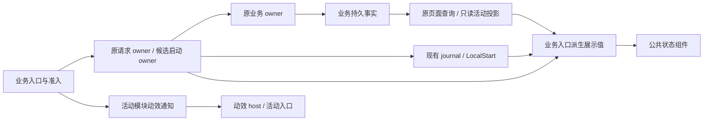

# 异步操作统一反馈与活动中心衔接 Spec

状态：2026-11-09，用户在设计审计修订后授权当前聊天实施；首批入口已接入，实际验证与未验边界见专属记录。不部署、不进入 roadmap 调度、不分配 Task ID。配套 [Plan](../plans/async-operation-feedback.plan.md)、[测试选择](../plans/async-operation-feedback.tests.json)及[专属验收](../testing/acceptance/async-operation-feedback.md)。

## 1. 目标与现状依据

用户点击异步操作后，立即看到明确反馈和相关操作被锁定；请求提交与后台工作之间有连续的界面状态，用户知道后续到活动中心查看。活动模块提供公共展示与动效，提交防重和状态交接沿现有请求/业务 owner 实现，执行、资格及最终结果保持原归属。

当前源码以本工作区 `eed86e1355b14d07521c85483c511bd2e625f585` 为调查基线：

| 现状 | 依据与本次要解决的问题 |
| --- | --- |
| Roadmap 页面通过 `busy` 与业务记录禁用操作，提交后依次刷新列表、详情 | `web/src/features/roadmaps/roadmaps.tsx`：缺少点击当下的动作专属状态，请求结束到新业务事实显示之间没有统一衔接 |
| 解析正式记录在来源、已有任务、执行方案及材料核验后保存 | `internal/roadmap/generation.go`：提交期可能尚无正式活动，不能提前显示“解析运行中” |
| 活动中心已有请求占位、候选本地项、请求关联及 Roadmap 来源 | `web/src/features/activities/model.ts`、`activities.tsx`、`internal/product/query/async_activities.go`：复用四个现有来源 environment_detection、baseline_check、task_candidate、roadmap，不新增活动数据库 |
| 活动抽屉打开/收起分别约 2/10 秒读取；命令失效规则未覆盖活动查询 | `web/src/shared/api/queries.ts`：显式提交后应定向刷新活动及原页面，不能只等下一次周期 |
| 环境、候选、项目维护分别维护提交反馈 | `project-environment.tsx`、`use-candidate-starts.ts`、`project-maintenance.tsx`：统一展示组件和动效，提交交接与资格继续归现有 owner |

本设计补充[异步活动中心 Spec](async-activity-center.spec.md)的发起交互，对首批入口允许按本文改变原页反馈；活动中心的只读所有权、事实身份、观察故障、抽屉行为仍沿用原契约。原文中的测试准备来源属于历史范围，当前已删除，本次不恢复。异常、未知副作用与恢复遵循 [Runner 调用生命周期](../../docs/product-design/runner-lifecycle.md)，本次没有新的执行恢复规则。

## 2. 首批操作及交付范围

| 操作族 | 首批动作 | 反馈与活动归属 |
| --- | --- | --- |
| Roadmap 内容生成 | `roadmap_parse`、`roadmap_generate_documents`，含重新解析与文档生成重试入口 | 点击即显示提交；播放进入活动中心动画；按原请求关联实际新建的解析/文档记录 |
| Roadmap 发布与入图 | `roadmap_publish`、`roadmap_admit`、`roadmap_resume` | 播放同类动画；按现有请求关联更新原 Roadmap 活动，不按每次命令新建顶层活动 |
| Roadmap 其余流程操作 | `roadmap_prepare_static`、`roadmap_confirm`、`roadmap_edit_documents`、`roadmap_observe`、`roadmap_stop` | 共用即时反馈和局部阻塞；原地显示结果。查询/停止指向原记录，不播放新增活动动画；静态初始化不新增活动 |
| 环境检测发起 | `environment_start` | 点击即显示“正在提交检测…”；按环境身份防重；动画与原环境活动衔接 |
| 手动候选发起 | `start_task`、`start_candidate`，从任务页确认启动及新增并行候选 | 使用现有 LocalStart/原请求身份；动画与候选详情导航可同时发生，候选协调仍由原 hook 管理 |
| 显式检查更新 | `maintenance_check` | 即时反馈与动画，关联本次显式检查活动；短时间完成也可追踪到本次结果 |

“Roadmap 全流程”指上表列出的现有操作入口，不改变任务确认、文档审阅、发布合并和入图的授权语义。`roadmap_stop` 仍按内容请求原规则处理，与退出任务候选参与分别表达。

本期不接入环境停止/失效、候选停止、回答问题、解决 PR 冲突、派发开关、本地更新 `maintenance_update`、配置保存或探测；这些入口保留既有功能，可后续复用本公共能力。自动派发、后台观察、轮询、普通刷新和恢复发现不产生发起动画。没有新的测试准备/生成入口、调度器、通用持久任务表、统一进度百分比或旧版本兼容路径。

## 3. 统一反馈状态与交接

### 3.1 三种信息各有权威

1. **交互反馈**：只说明本次点击正在提交、等待信息或需要核实，由原请求/业务 owner 的在途记录、journal、LocalStart 和业务查询派生；活动反馈模块不另存这些阶段。
2. **原请求回执**：继续使用现有不可变信封、journal、首次提交和原请求核实；保留 submitted / accepted / applied / rejected / outcome_unknown。首批业务入口须消费足够的原回执信息，不能靠 `send(): boolean` 判断未知或业务完成；纯展示组件只接收派生文案、忙碌状态及禁用原因，不要求理解 Receipt 协议。
3. **业务进度**：由原业务查询和活动只读投影提供。请求 applied 不普遍代表后台工作完成，动画结束也不代表受理或成功。

### 3.2 点击到结果的显示契约

| 阶段或事实 | 原页面与活动入口 | 阻塞与后继 |
| --- | --- | --- |
| 用户激活一个合格操作 | 原请求 owner 在第一个异步等待前记录当前在途信封，业务入口据此防重；候选继续使用原 LocalStart。按钮改为“正在提交解析…/检测…/检查更新…”等 | 立即锁定本次意图及冲突操作；不提前写 journal、不在反馈 Provider 登记另一份提交状态、不新增业务活动 |
| 等待首次发送/请求仍在途 | 清楚显示“等待首次启动确认”或“正在提交”，原在途信封/LocalStart 与 journal 占位按精确身份合并 | 不能从不存在正式活动推断未提交；不因等待超时自动重发 |
| 请求已确认受理，业务信息尚未刷新 | 显示“已受理，正在读取工作信息”；有记录身份时提供原页详情入口 | 由原业务入口依据该回执与业务查询维持必要的推进限制；不能短暂回到可重复提交的旧状态，也不等待活动列表/关联成功才解锁 |
| 取得同一工作的最新业务事实 | 按真实事实显示排队、运行、待审阅、需处理或结束；原页提供“查看活动” | 由业务准入接管；进行中的解析可禁重新解析，但原规则允许的查询/停止仍可操作 |
| 明确拒绝或确认未发送 | 停止提交反馈，显示具体原因；确认未发送时清理原在途项 | 去掉本次提交 guard，重新按当前业务资格决定能否重试；不显示工作已启动 |
| outcome_unknown、发送后丢回执、尚不能证明未发送 | 显示“提交结果待核实 · 查看原请求”，保留原请求身份；不以错误样式宣称业务失败 | 结束提交转圈，但同一冲突意图保持待核实限制；仅沿既有核实/显式恢复入口继续 |
| 请求有结果，但刷新/活动观察失败 | 保留已知回执及最后业务事实，显示“界面状态待更新”或观察诊断 | 业务查询失败时只限制依赖该事实的操作；仅活动查询/关联失败不得阻塞业务。已具备原准入依据的查询、停止等仍按原能力可用 |

状态交接必须覆盖请求返回到列表/详情更新的间隙。结束在途显示前，原请求 owner 须把已取得的原回执交给现有 mutation/journal 查询缓存；业务入口用这份回执与精确对应的业务事实衔接，不能只等待下一轮 journal 轮询，也不新存一份回执。缓存读取失败时保留已取得回执及诊断，不能把它退回“未提交”。提交反馈不等待模型运行或资源结算；HTTP 仍在途时显示“正在提交”，长时间未确认补等待说明及原请求入口，不新增业务超时。进入“待核实”后不用持续转圈冒充正在执行。

活动占位只读合并原请求 owner 的在途信封、journal、LocalStart 与正式活动，同一原请求 ID/LocalStart.id 只显示一次；不在反馈 Provider 另建占位表。正式活动不在当前筛选或分页内时，使用现有 request-links 关联；不按任务、方案、路径或时间相近猜测。发布/入图/继续通过原命令与记录的持久关联合并到原活动，不复制一份 UI 业务活动。

动作在动画完成前已经结束时直接显示实际结果，不强制停留最低时长。显式检查更新可依据其本次持久命令终态显示完成；其他动作不得借此把 applied 通用化为完成。

## 4. 阻塞范围与并行规则

“阻塞”统一指禁用冲突的写操作及必要输入，并在相关区域显示原因；首批操作不使用全页遮罩，不锁主导航、活动入口、原文、历史和无冲突对象。当前抽屉的窄屏模态语义保持原契约，不能用抽屉模态代替提交阻塞。

范围至少绑定 `home / project / instance`。原请求 owner 仅暴露原在途信封的只读选择器；各业务入口基于这些事实及原业务查询判断冲突。活动反馈层不仲裁、不提供 acquire/release 或通用 conflict-key 注册表，不建立新的锁服务：

| 对象 | 提交期锁定范围 | 取得业务事实后的规则 |
| --- | --- | --- |
| Roadmap 草稿流程 | Roadmap owner 以 source 身份关联不同 record/子记录，禁止重复推进和互相覆盖的编辑。静态初始化按项目限制重复发起，准备状态仍由原查询提供 | 查询原操作不与推进锁共用一把锁；停止只遵循原能力与自身在途防重。未知提交不能把可用的核实/停止入口一并锁住；其他草稿及只读查看不受影响 |
| 环境检测 | 以 environment_key 及项目实例为范围；同一环境的不同 profile 别名不能绕过防重 | 对应环境的开始/停止/资格仍由原环境事实判断；不锁其他环境或项目 |
| 首次任务启动 | 每次确认意图同步防重，继续沿原候选 hook 的首次 claim 排序与任务资格检查 | 不增加第二套 task claim 队列；同任务后续候选遵循现有协调流程 |
| 新增并行候选 | 同一确认意图只发送一次；再次明确确认的独立候选有各自原身份 | 不能用 task_id 或 action+target 一把锁封死合法并行候选；同/不同任务的独立候选可继续登记 |
| 检查更新 | 同一项目的显式检查入口；与原维护 owner 已规定冲突的更新入口按原规则互斥 | 不扩张为项目全部操作锁；后台定时检查不驱动 UI 提交锁 |

原业务禁用原因优先于公共提交原因，界面能区分“未就绪/来源变化/历史只读”“正在提交”“原请求待核实”“等待业务状态更新”。首批入口不再因无关命令的全局 `busy` 而禁用，也不能因撤掉 `busy` 丢失原快照版本、资格及未知请求保护。

相关区域可用 `aria-busy` 和就近状态说明表达，不能整片设置 inert 而连只读内容、查询入口一起封住。防重须对鼠标双击、Enter/Space 连续激活、同页重复入口及 React 渲染前的重复调用成立；候选确认面板仅防止同一次确认被重复激活，重新明确确认仍可创建独立候选。服务端原有版本/幂等和浏览器原请求锁继续是执行保护。

## 5. 进入活动中心的动画与可访问性

- 仅用户实际确认发起且被 UI 接受的动作播放一次。取消确认、资格不足、渲染重放、journal 轮询、原请求对账和恢复读取不播放。Roadmap 的重新解析/重新生成是新显式意图，可以各播放一次。
- 激活后可立即出现简短标签，从按钮的快照位置移向顶部活动入口，目标时长 300–450ms；入口轻微高亮一次。文案使用“正在提交”，不写“已启动/成功”。明确未发送/拒绝且动画仍在播放时可直接结束动画，保留原位错误说明。
- 动画层不接收指针、不抢焦点、不滚动页面，不遮挡操作内容；不挂在会因原页导航卸载的按钮内部。目标坐标只用于展示，不决定请求发送或阻塞解除；路由切换、滚动/窗口变化导致坐标失效时可结束飞行动画，保留静态反馈。
- 活动入口不可见、抽屉已展开、页面隐藏或窄屏空间不足时，采用入口高亮/就近文字等静态反馈，不为寻找目标强制滚动。遵循 `prefers-reduced-motion: reduce`，关闭位移动画。320px 宽及 200% 等效布局中无新增横向滚动、交互遮挡或焦点丢失。
- 不自动展开抽屉、不跳筛选、不改变滚动位置。“查看活动”只打开现有抽屉并保留用户筛选，本期不增加跨分页搜索、定向加载或新的一套活动定位状态。需要查看本次结果时复用原页面详情/原请求入口；快速结束仍可在“最近结束”查看。
- 多个独立发起各保留文字反馈；动效 host 最多显示一个短期动画，重叠发起可只响应入口高亮，不设置动画队列、不保留已播意图历史。每个入口只在原操作接受本次激活时调用一次动效；不通过监听 journal 或业务状态变化触发。视觉节点对辅助技术隐藏，状态由就近 `role=status`/适度 `aria-live` 播报一次。
- 本地提交只影响“提交待确认”提示，不直接给服务端进行中计数加一；正式数量、需处理数量和未知观察仍使用原计数契约。

## 6. 活动中心模块内的解耦边界

公共能力放在 `web/src/features/activities` 的独立 feedback 子模块，只包含纯展示组件和一个动效 host；具体文件数量不预设。应用层挂载的 Provider 如有必要，仅提供视觉通知与活动入口引用，在同一项目路由导航间存在；它不管理提交生命周期。原请求 owner 已在 Workspace 中存活，候选原 hook 已管理 LocalStart，无需另建长期反馈会话。

| 所有者 | 负责 | 不得承担 |
| --- | --- | --- |
| feedback 公共层 | 消费展示 props 的状态组件、最多一个短期动效、活动入口引用；纯展示文案可复用 | 调用提交回调、保存回执/提交阶段、仲裁冲突、信封/journal 写入、业务资格、自动重试/恢复/停止 |
| 各业务入口/原业务 hook | 原准入原因、对象关联、在途/回执/最新业务事实的展示派生与交接；直接调用原提交路径；显式通知动效 | 复制动画实现、在反馈 Provider 保存同一业务状态，或任意改活动状态 |
| 原请求与候选 owner | 当前在途信封、不可变请求、journal、原请求核实、首次 claim 协调、未发送/未知判断 | 依赖 DOM、动画、抽屉打开状态才能提交或继续执行；另建通用冲突调度器 |
| 查询与活动中心 | 只读发现、精确关联、定向刷新、计数/筛选/详情展示 | 为显示活动而补做提交、取证 Runner、恢复或取消业务 |

依赖方向为业务入口调用原 submit/start，并将展示 props/视觉通知交给 feedback；feedback 不得调用 execute/run/submit 回调，即使回调由调用者注入也不例外。动效缺席/失败不影响原提交。新 feedback 子模块不导入业务页面、Workspace、Api、journal 或候选 hook；现有 Activities 组件仍可沿原路径只读消费 Workspace。查询、请求和业务事实不经过动效 Provider 转运。

动效内存只保存当前一次动画的范围、短标题和几何快照，动画完成/降级或范围切换后清除，无计数、阶段、回执、重试、队列或请求正文。原请求 owner 优先复用已有 mutation 的信封/回执记录，发送阶段的只读选择不另存另一份阶段；若同步防重需辅助 ref，只能位于该原 owner 或确认面板，不能复制回执和业务状态。未知信息仍从 journal/LocalStart/业务查询读取。禁止第二份提交注册表或额外本地持久化；刷新不重放动画。

## 7. 刷新、生命周期与故障隔离

1. 显式提交、回执变化和既有原请求核实取得新结果时，定向失效同 home/项目/实例的活动列表、关联与该业务页面查询；页面隐藏时标记失效，恢复可见后读取，避免新增后台轮询器。不要依赖原页串行多次 refetch 才让入口变化。
2. 活动查询键和 Roadmap 等现有非统一排列的查询键应由各查询 owner 提供匹配/失效帮助函数，不能假定全部都是同一数组下标。新请求关联刷新不得丢失已加载分页、当前筛选和已知活动。
3. 同项目路由卸载只移除原页订阅，不取消原命令或清除原请求；发送与活动发现由现有 Workspace 请求 owner、LocalStart 和 journal 继续承接，不能依赖卸载页面的 finally 或动效结束做关键交接。不改变 Api 原有项目/实例生命周期的取消行为。范围切换清除动效，现有请求/查询 scope 拒绝迟到结果。
4. 未知请求的防重复限制由原 journal/业务事实支撑，不能仅靠已卸载页面的内存锁。活动关联/查询失败既不释放也不建立业务限制；业务已确认可操作时，不得因活动中心不可用而禁用。业务刷新失败时保留就近刷新/核实入口。
5. 动画 API、坐标、活动查询、反馈渲染故障不作为业务准入条件；装饰失败降为静态反馈，不能使原提交不发生、增加调用次数或改变结果。活动抽屉关闭、浏览器关闭后原工作照常推进。
6. 没有后端持久化、Runner 契约、提示词正文/接线/资产变更。若实现发现必须修改这些边界，先更新本 Spec/Plan、测试选择及验收；不以 UI 便利为理由扩张执行职责。

## 8. 通过条件

具体操作、自动/人工方法、实时结果及证据登记于[专属验收规划](../testing/acceptance/async-operation-feedback.md)。

| ID | 必须成立的成果 |
| --- | --- |
| AOF-A01 | 第 2 节动作表的全部入口有即时、对象明确的反馈；第一个异步等待前防重，旧状态不在请求返回/刷新间隙重新放行 |
| AOF-A02 | 原请求各状态、确认未发送、发送后未知、快速完成与刷新失败准确表达；accepted/applied/动画结束不冒充业务完成 |
| AOF-A03 | 阻塞范围符合第 4 节；同草稿多入口、同环境别名防重；独立环境/草稿和合法并行候选不因全局 busy 被阻断 |
| AOF-A04 | 用户意图动画最多一次；路线、目标降级、快速结果、并发、减少动态效果及键盘/窄屏语义符合第 5 节；动画不参与执行时序 |
| AOF-A05 | 原在途信封、journal/LocalStart 与正式活动只读精确合并，发布/入图/继续关联原活动；反馈 Provider 无提交表，其他筛选/分页无重复，计数不伪造 |
| AOF-A06 | 提交与原请求结果变化主动定向刷新，原页/活动连续交接，保留分页/筛选；跨路由、刷新及范围切换不丢原请求、不污染新范围 |
| AOF-A07 | 公共反馈层不调用提交回调、不仲裁冲突、不保存回执；动画与活动观察失败不阻止原提交/已具资格的业务操作，不增加执行调用，原版本/幂等/资格保护保持 |
| AOF-A08 | 首批全部动作由组件/契约测试覆盖，真实浏览器验证动效和四类发起接线；Roadmap 受控提交后的拒绝/未知分支与模拟成功反馈明确区分。生产构建及必要回归通过；不为 UI 验收新增完整生成/发布模拟引擎 |
| AOF-M01 | 后置人工确认动画能表达“已交给后台”，局部锁定、等待说明和详情入口清楚；不替代任何自动失败或未实施项 |
