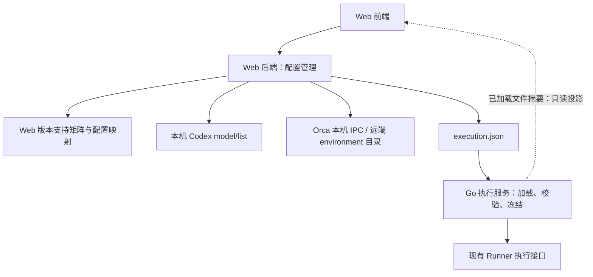

# Web 执行配置管理与能力探测 Spec

日期：2026-10-21。状态：已实现配置管理、本机 Orca 及统一 Orca 目录边界；实际验证范围见专属验收。配套 [Plan](../plans/web-execution-config.plan.md) 与[专属验收](../testing/acceptance/web-execution-config.md)。普通开发，无 roadmap Task ID，不修改 execution-map。

## 1. 目标、现状与范围

用户在 Web 中根据当前产品支持范围和目标运行环境的能力，创建、编辑、复制、删除、设为默认并保存执行配置。每项配置包含名称、运行机、执行链路、Agent、模型和 thinking effort，并完整保留现有 execution/workflow 的其他合法参数。

实施前代码基线为 `00eb8c6f89d4fe66bb4da840025094ce711d0422`。当时 `web/src/features/settings/settings.tsx` 只展示已加载预设；`web/server` 主要承担浏览器认证和应用 API 转发。实施前全局配置由 `internal/app/runner_config.go` 定义，格式为 3，保存在 `<STEERLINE_HOME>/execution.json`；应用启动时读取整份快照，文件改变后拒绝新候选，不热加载。

已实现范围是本机 Codex app-server 与远端 Orca/Codex。本次增加 Windows/amd64 的本机 Orca：运行机仍为本机，链路选择 Orca + Agent，按已有 Runner 契约提供 Codex、Pi（`pi`）、DeepSeek Harness（`dsh`）的明确参数映射。原“本机 Orca 已放弃/不恢复”的范围限制由本次修订取代。其他 Agent 仍只能展示未支持原因；Orca 注册或返回目录不能自动扩展产品支持矩阵。Pi/DSH 的本机能力不推导为远端支持，远端可生成范围仍为 Codex。

不包含模型 provider 的 API key/OAuth、base URL 或账号配置管理，也不扫描/复制 Pi 等 Agent 的凭据配置。用户在目标 Orca 所启动的 Agent 中完成配置或登录。Orca 的连接认证仅用于访问既有目标，不是模型 provider 凭据管理。

不包含 Runner 构建选择/升级、远端机器配对/解绑、任意 SSH 主机、远端 Codex 直连、自动登录、真实模型试运行、配置热加载或浏览器控制整体重启。本机 Orca 增量不扩展至其他 OS，不代替部署 helper，也不改 Runner/Orca 的业务执行、权限、停止或恢复协议。权限和执行环境的主动验证继续使用既有环境检查入口。

## 2. 所有权与依赖方向

| 所有者 | 本次职责 | 不承担的职责 |
| --- | --- | --- |
| Web 前端 | 全局管理页、联动选择、草稿、能力/缓存/错误展示、保存及生效状态 | 本机进程、原生 RPC、凭据文件、配置文件直接写入 |
| Web 后端 | 产品支持矩阵；调用固定 Runner 公开目录；配置生成、验证、读取与原子保存 | Task/Candidate/Run 状态、执行授权、业务数据库、代理业务轮次 |
| Go 执行服务 | 加载并独立校验配置、冻结候选参数、消费配置、投影已加载文件摘要 | 能力探测、探测缓存、配置 CRUD、依赖 Web 在线或探测记录 |
| SteerRunner | 按现有公开配置契约执行和管理原生生命周期 | 原生目录接口归[边界收口 Spec](runner-boundary-consolidation.spec.md)，执行沿现有 Runner |

Web 后端新增的原生对接仅支持目录查询，不能复用 Runner 私有实现、导入任务应用/执行服务实现包，或经 Go 执行服务转发能力请求。允许少量 Orca 协议对接重复；若共享类型或基础传输，只共享无业务状态的部分，不建立同时管理探测和执行的大适配器。

此处是对现有“Web 仅转发产品 API”职责的明确增量：Web 后端可管理唯一的 `execution.json` 和目录查询资源，不能因此获得项目文件、任务库、Runner state-dir 或其他宿主文件的通用读写权限。共享配置类型与纯校验可抽为无进程/存储副作用的公共包；执行服务不得反向依赖 `web/`。

本机 Orca 同样由 Web 后端直接连接 Orca 本机 IPC 查询。named pipe 客户端属于 `web/server/discovery`，不能导入、复制执行行为或调用 Runner 的本机连接实现；只可自行实现现有线协议及复用无业务状态的基础库。现有 `orca-terminal + target.local` 是执行配置，不是新增 Go 探测端口。Go 只做已有消费校验、冻结与提交，Runner 不新增接口。

**停止条件**：实施中若发现必须新增 Runner 探测接口、让 Go 执行服务探测/保存配置/转发目录、导入 Runner 私有包或读取其状态库、由 Web 启动受管 helper/业务代理来获取目录，立即停止相关增量并向用户说明具体缺口，不能自行放宽边界。缺本机 IPC、Agent 目录或部署材料应分别显示 unavailable/unsupported 或部署前置，不能伪装成边界已打通。若现有接口无法在上述范围满足已定验收，同样停止并报告，不以弱化验收或静默回退完成。

## 3. 三类数据及选择规则

| 数据 | 权威和用途 | 生命周期 |
| --- | --- | --- |
| 产品支持矩阵 | Web 发布的链路、Agent 参数映射、支持的 Runner 配置契约 | 随 Web 版本发布，不由 Orca 列表动态扩容 |
| 环境能力目录 | 指定环境的 Agent、模型、effort、默认项及来源 | Web 拥有的辅助查询结果；可过期、可删除 |
| 执行配置 | 用户明确选择的 execution + workflow 及 ID/name/default | 唯一保存于 execution.json；执行服务独立消费 |

生成器的可选范围为“Web 产品支持范围 ∩ 环境返回能力 ∩ 所选 Runner 公开配置契约”。使用现有公开 schema 验证字段及组合，前端根据结构化目录与配置 DTO 编辑草稿，Web 后端负责最终支持矩阵和 schema 校验，不在前端或执行服务复制 Runner schema。

Web 后端通过所选 EXE 既有的离线 `version` 与 `capabilities --offline --json` 读取公开、自包含 schema，核对文件 SHA、version/resource digest 及 Web 支持的配置契约；不传 state-dir，不连接或启动常驻 Runner。普通 `capabilities` 可能需要 resident 服务，不能作为此处的替代入口。离线契约查询只提供配置格式/组合，不探测机器、Agent、模型或账号；不需要 Runner 新增接口。缺少该已发布离线能力或配置契约不受支持时，展示原因并阻止生成/保存，不猜测兼容或更换构建。公开 schema 的获取/校验安排见 Plan U1；它不是模型目录。

本次新增组合及映射如下；workflow 的实际 ID/version、Agent/权限/effort 组合仍须通过固定构建发布的完整 `run_configuration` schema，不能只看 adapter 名称。

| 运行机 / 链路 | 可生成 Agent | target / adapter | 模型参数与工作流限制 |
| --- | --- | --- | --- |
| 本机 / Codex 直连 | Codex | `local / codex-app-server` | 保留已有 settings 映射 |
| 本机 / Orca + Agent | Codex、Pi、DSH | `local / orca-terminal`，不带 environment | `settings.agent` + `agent_launch.model/reasoning_effort`；普通开发按 schema，审计流程仅在 schema 明确允许的本机 Codex 组合开放 |
| 远端 / Orca + Agent | Codex | `orca_environment / orca-terminal` | 保持已有远端映射，不接受本机 runtime/helper 字段 |

本机 Orca 的 `transport` 沿用受信 Orca CLI 设置；`agent_launch` 使用对应已适配 Agent 的原生默认 executable 或已有同 Agent 配置，不能复用 Codex 的默认程序启动 Pi/DSH。各 Agent 的 effort 范围来自其公开 schema 分支与原生目录的交集，不再统一套用 Codex 的枚举；无目录时可显式手动填写 schema 合法值，并标明未验证。

本机受管执行所需的 `agent_launch.runtime_executable/runtime_sha256` 是**部署输入**，不由能力目录探测产生。新配置必须从现有受信本机 Orca profile 继承发布 helper 的绝对路径与 SHA；缺少时显示“缺少本机 Orca 受管运行组件”，禁止生成/保存该组合。部署/唯一调试生成器负责在启动前写入该模板 profile 及材料来源，Web 不下载、编译、启动 helper，不提供任意路径/命令注册，不把 SteerLine 的 `debug-helper.exe` 当成 Runner helper。本机/远端切换时清理不适用字段，不能把本机路径或 SHA 带入远端。程序身份与权限的实际执行核验仍归 Runner。

上述材料门槛针对新增本机 Orca 或改变其执行参数；既有 profile 的未改动 execution/workflow 可按合法 JSON 保留，不因目录离线或 helper 文件暂不可用而删除原值、阻止其他链路编辑或强制展开默认值。仅更名/改默认项不冒充环境就绪；实际使用时仍由执行服务及 Runner 独立裁决，未知状态不能显示为已验证。

helper缺失不阻止纯目录查询：页面仍可选择本机Orca并查看其目录/部署诊断，只限制生成可保存的新增执行配置；不因此自动写模板或启动运行组件。

目录查询在 Web 后端按 home、固定 Runner pin、配置快照和显式目标合并在途请求，总并发最多二。每次新请求重新调用固定 Runner EXE，不将留存的旧目录作为五分钟内的新鲜事实复用。最多保留 128 个上下文的上次结果，失败时明确过期；配置变化丢弃旧响应及其数组。原生来源/时间与接收时间分别展示，账号/工作区未核实时保持 context_unverified。凭据及配对上下文只在 Runner 内部处理。

缓存键和状态不进入 execution.json，不进入 Task/Candidate/Run。删除缓存、关闭 Web、离线使用手写合法配置均不改变执行资格。执行服务按实际配置及现场独立检查；不能要求提供 probe ID 或模型必须属于某次 Web 缓存。

## 4. Runner 公开目录与 Web 请求协调

本节由[职责边界收口 Spec](runner-boundary-consolidation.spec.md)的 S1/S2 取代原 Web 原生协议实现。Web 从已有 profile 或明确目标构造有限查询，核对固定 Runner EXE 的离线 native_catalog/schema、版本、SHA256 和 resource_digest，再通过 native-catalog 读取目录。响应须属于原目标及同一构建，严格区分完整空目录、进行中目录、错误和未知。

Runner 复用本机 IPC/远端配对能力处理 Orca status、注册 Agent 和模型目录，本机 Codex 只启动所属元数据 app-server 的 initialize/model/list。Web 不再读取 Orca 元数据/配对文件或执行原生 RPC。查询无需项目、接入材料或 Runner 常驻服务，未映射 Agent 的注册事实可以显示，生成配置仍受产品支持组合和公开 schema 约束。

选择、配置、pin 改变时丢弃晚到结果；最后订阅取消、Web 关闭及超时排空所属 CLI 和元数据资源。版本/离线声明及目录读取共用三十秒预算，清理额外五秒，原生累计和最终 JSON 各不超过 1 MiB。原生失败不会改投另一机器、Agent 或直连链路。历史原生专项的通过只对应其原构建，迁移后验证见[专属记录](../testing/acceptance/runner-boundary-consolidation.md)。

## 5. 管理界面与编辑行为

全局路由为 `/settings/execution-configs`，项目目录为空或项目失败时仍可进入；项目执行设置页链接到同一管理页。管理页不依赖选中项目，也不要求项目 ready；沿用现有浏览器会话及 home 作用域，不扩大 Web 远程访问范围。

页面原型已于 2026-10-21 经用户确认，采用本次会话的 `execution-config-manager.html` 布局与交互；生产页面使用真实目录与 HTTP 配置保存，不保留示例数据或原型状态持久化。桌面采用左侧配置列表、右侧编辑器，窄屏依次排列。列表显示名称、默认标识、运行机、链路/Agent、模型/effort；提供新建、编辑、复制、删除、设为默认。复制生成新 ID；既有 ID 不因名称改变而变化。至少保留一个配置，删除默认项须在同次保存中选择替代项。历史执行不随目录删除而消失。

主要编辑顺序为“名称 → 运行机 → 执行链路 → Agent → Provider（Pi）→ 模型 → Thinking effort”。Pi的Provider选项只从Orca返回目录投影，选择Provider会清空不匹配的模型与effort；其他Agent不显示该筛选。页面提供目标Orca/Agent配置凭据的说明，不提供key、base URL或登录配置表单。本机新增“Codex 直连 / Orca + Agent”链路选择；远端链路仍固定 Orca。本机 Orca 展示 Codex/Pi/DSH 的产品映射与各自目录状态；本机 Codex 不展示无意义的 Agent 单选。运行机与链路是独立字段，不能把本机 Orca伪装为远端机器。当前未支持 Agent 可读但不可生成。权限模式、workflow、审计模型/effort 和其余现有合法设置放在更多设置；审计模型同样按所选链路目录和完整 workflow schema 校验。切换链路/Agent 时同步处理不再合法的审计流程、审计参数与 effort，不能隐藏保留导致保存后才发现旧组合冲突。首版不提供任意 shell 命令输入或新增可执行程序注册；已有 executable/args/认证引用/提示词覆盖可查看，编辑其他字段时原样保留，不丢失、不复制凭据正文。

新建时可将返回的默认模型/effort预填为明确选项，并允许修改；不把预填值冒充 Runner 最终解析值。刷新目录不自动改已保存配置。切换模型时若旧 effort 不再支持，清空并要求选择；不支持 effort 时显示“不适用”并省略该字段，不把默认、空串与 none 混同。

切换机器/链路/Agent后，必须重新核对下游选择；只有新上下文确认同一原始值有效时才可保留，否则清空并解释原因。目录显示名与原始 model ID 分开，按原始值保存。

离线/探测失败不删除已保存值，不静默改投；既有未知模型标记“当前目录未确认”。已保存合法配置允许在目录不可用时保留或明确编辑其原始模型/effort 值，仍须通过产品映射与 schema 校验；不能通过手填绕过不支持的链路/Agent，不能标记成已探测。新建/修改模型使用未确认原始值时提供显式“手动填写，未验证”入口，不是自动回退。浏览器表单校验不替代服务端校验。

保存只表示文件保存成功；“目录已获取”“文件已保存”“服务已加载”“项目可执行”“环境检查通过”使用不同文案。环境检查继续从既有入口执行，不由保存动作启动。

## 6. Web API、生成与保存

新增 Web 自有命名空间 `/api/web/execution-config`，由 Web 后端本地处理，不能转发到 `/v2/application` 或增加执行服务的管理路由。

| 方法与相对路径 | 行为 |
| --- | --- |
| `GET /` | 读固定 home 的保存配置、saved_digest、支持策略/契约标识、只读部署 pin、写入是否允许及原因 |
| `GET /status` | 只读磁盘配置摘要，不运行离线元数据或原生探测；供项目页提示待重启 |
| `POST /discover` | 按结构化查询目标读取 environments/agents/models；返回上下文、状态、来源、时间和有界结果，不接受任意 RPC 方法/命令字符串 |
| `POST /validate` | 从编辑值生成候选配置并返回规范保存正文/字段错误；无文件、服务或业务副作用 |
| `PUT /` | 携带 `If-Match` 提交整个目录的编辑结果；服务端重新生成/验证后原子保存，返回新摘要及待生效提示 |

路径实际为不带尾斜杠的基础路径及其子路径。复用精确 loopback/Host、同源 cookie、Origin 和 CSRF；所有 POST/PUT 都核验 CSRF，不能通过只读外观绕过原生进程启动授权。请求与结果上限 1 MiB，错误不回显认证正文。目标程序仅来自服务端支持策略或当前已保存配置；不接受通用文件路径、原生 RPC 透传、任意 argv/env 或目标 URL，浏览器不取得配对凭据。

本机增量沿用同一命名空间：`GET` 增加结构化运行机/链路/Agent 支持组合、各分支 effort/workflow 约束及本机 helper 部署材料是否齐备；不能向浏览器返回认证正文。`POST /discover` 的 models/agents 请求显式提供 `host`、`adapter` 和适用的 `agent/environment`，后端核对目录路由与Agent标识后选择本机 Codex、本机 Orca IPC 或远端 Orca；Orca查询不受执行映射过滤；environments 仍只查询登记机器。前后端及测试同步更新，不保留缺 adapter 的歧义分支，不新增 `host=local_orca` 或配置格式4；已保存配置仍用既有 adapter/target 区分。

读取/写入只针对固定 home 的 `execution.json`；部署字段 `version` 和 `runner` 不可由本页改变。已有符合公开 schema 的未编辑设置按 JSON 值保留，不进行默认展开；不接受重复键、未知字段、非法组合或超限配置。ID、名称、非空目录、唯一 ID、默认项存在等规则沿当前格式。生成与保存共用一套 Web 后端实现，PUT 不信任先前 validate 结果或浏览器提交的探测结论。

`saved_digest` 为原文件字节的 SHA-256，独立于 profile 参数摘要和项目 ConfigDigest。Web 写请求串行，在替换前重新读取并核对 If-Match；缺条件返回 428，已变化返回 412，保留用户草稿并要求重新读取/合并，不能覆盖其他标签页的更新。成功发布前再次发现已变化也拒绝。保存正文确定性排版；与当前 JSON 值完全相同的提交不重写文件、不制造待重启。成功响应丢失后先 GET 比较保存值，不以旧 If-Match 自动重试覆盖。

同目录临时文件写入、同步、原子替换并核验发布结果，复用私有文件及路径保护；不修改 home 的 ACL，不接受软链接/reparse point 等越界目标。发布前失败保留旧文件，发布结果未核实时明确提示重新读取，不谎报已回滚。不提供备份副本、第二配置数据库或旧格式迁移。并发人工工具编辑应遵循同一写入协调约定；不承诺原子替换能对不协作的外部任意写入提供跨进程 CAS。

已启动的冻结调试包只读，本页展示原因；不能借 Web 保存绕过“换方案生成新包”规则。分级测试自有隔离夹具不视作安装或冻结调试包。文件缺失/损坏可展示诊断，不自动覆盖；首版不提供首次部署修复向导。

## 7. 保存与生效

第一版固定为“保存后显式重启 SteerLine 生效”，不热加载。保存不自动重启、停止任务、提交运行或更新 Runner pin。

现有应用目录 `GET /v2/application/projects` 增加只读 `loaded_execution_digest`：由宿主初始化固定的原全局文件字节计算，读取失败时缺省并带原诊断；不能在查询时重新读取磁盘冒充已加载。它仅表示宿主读入的文件，不保证每个项目或 Runner 可执行。该最小投影是执行服务消费配置的可观测性，不是管理或探测接口。

Web 比较同 home/当前宿主实例的 loaded_execution_digest 与 saved_digest：相同显示“服务已加载”；不同显示“已保存，待重启”；服务断连、旧实例或摘要缺失显示“生效状态未知”，不能默认已生效。保存后重新获取当前磁盘与宿主投影，不用浏览器本地标记替代跨 Web 重启状态。

文件变化后当前宿主仍按既有配置一致性门槛拒绝新候选；Web 新启动入口显示需重启，CLI 等其他消费者同样不能绕过。旧 Run 的观察、原请求对账和停止沿原持久绑定；其他业务输入继续受原授权/实例/配置门槛约束，不保证换配置后任意输入仍可受理。用户使用现有正式 restart 或 stop/start 流程生效；刷新页面、重启 Web、重启 Runner 本身均不构成应用配置重载。

重启后新候选使用新目录，既有候选的 ID/name、完整提交、参数摘要、Run/input_digest 等仍取其冻结记录。关闭 Web 或删除探测缓存后，新加载的合法配置仍可由执行服务/CLI 使用；不为此增加 probe ID、目录命中或查询成功门禁。服务/构建换代和 stop/reply/resume 的行为统一链接[既有协作规则](runner-collaboration.spec.md#4-冻结摘要与配置变化)及[当前生命周期规则](../../docs/product-design/runner-lifecycle.md)，不复制另一套恢复状态机。本文不改变 W/E/V 节点、异常、重试及恢复矩阵。

## 8. 最小验收与交付

全部步骤、结果和实际版本只登记于[专属验收](../testing/acceptance/web-execution-config.md)。下表定义要求，不表示已通过。

| ID | 自动通过条件 |
| --- | --- |
| WEC-A01 | Web 拥有探测/管理，执行服务无探测/CRUD依赖，Runner 无新增接口；认证与路径边界保持 |
| WEC-A02 | 产品矩阵、目录和 schema 交集正确，原始值/默认项/高级字段及手动未验证值正确生成，不扩展未映射组合；本机新增范围另按 A10–A14 验证 |
| WEC-A03 | Codex 目录分页完整、版本/上下文正确；超时/取消/异常清理精确 owned 资源，零 thread/turn/模型输入 |
| WEC-A04 | Orca 远端协商、Agent/目录、获取中/来源/不可达及缓存作用域正确；零终端/会话/输入创建 |
| WEC-A05 | 全局页面 CRUD、默认项、字段联动、晚到结果、离线/缓存/未知值及生效状态可正确操作与展示 |
| WEC-A06 | 全文件条件保存、冲突、无改动、权限与失败窗口正确；冻结调试包拒写，部署 pin 不可改 |
| WEC-A07 | 当前实例投影原加载摘要，保存不热加载/自动重启；新候选被原门槛阻断，旧绑定不被新目录覆盖 |
| WEC-A08 | 隔离跨进程闭环完成编辑保存、正式停启、新目录消费；关闭 Web/清空目录缓存后 CLI 仍可提交合法配置，原执行记录保持 |
| WEC-A09 | 新隔离调试包中正式 Web 查询路径取得真实本机 Codex 与已配对远端 Orca 目录，保存来源/版本/清理证据；不执行模型任务 |
| WEC-A10 | 本机 Orca IPC 认证、协商、目录、runtime变化/取消/预算及缓存隔离正确，方法白名单零业务调用；原依赖守卫保持 |
| WEC-A11 | Codex/Pi/DSH 本机映射、分支 schema/effort/workflow、helper继承/缺失阻断及远端禁止helper字段正确；目录缺失不伪造能力 |
| WEC-A12 | 本机链路可切换，Agent/模型/effort/审计字段正确联动，三通路迟到响应隔离，草稿与原生默认值保留 |
| WEC-A13 | 扩展原受控配置L3，保存本机 Orca 后正式重启，关闭Web后CLI提交使用原样adapter/target/agent/model/effort/helper，旧候选不变 |
| WEC-A14 | 新生成调试包经正式Web路径取得真实本机Orca目录及来源，并核验Web owned连接清理；不运行helper或模型，不改变共享Orca资源 |
| WEC-A15 | 本机/远端同一Orca目录协议、响应投影与错误规则；远端可查询注册Pi，目录不带产品支持字段、不补注册项、不扩展远端执行映射，凭据不透出 |
| WEC-A16 | Pi Provider筛选与完整原始模型标识保存正确，无provider凭据管理；切换后字段重置，未映射的远端Agent显示已发现但不可生成配置 |

WEC-M01 为后置人工体验：中文名称、列表/编辑器、窄屏键盘操作、失败文案和待重启提示；参与窗口及非阻塞范围见专属验收。功能未完成前，不以探索调用、编译或文档生成代替以上结果。

新增 WEC-M02 为本机 Orca 后置人工体验：本机双链路、三Agent目录状态、手动值/helper缺失提示及字段联动；具体现场和窗口见专属验收。原人工现场仍是原版本冻结包，不自动更新，也不作为新增能力已实现/已验收的证据。

## 本机 helper 部署材料

Web 和 Go 执行服务均不构建、安装或启动 helper 以探测能力。部署维护者可以采用 Runner 发布文档 `SteerlineFlow/testing.md` 明确支持的 `go build -o <安装路径>/steerrunner-agent.exe ./cmd/steerrunner-agent`：必须取所选 EXE build 元数据记录的干净发布提交，隔离提取该提交，不使用较新的工作树 HEAD；记录源码归档摘要、固定提交、构建命令、Go版本、Runner及helper SHA256作为部署材料。它是发布材料准备，不是 Web/执行服务运行时的能力。

唯一调试生成器在启动前校验显式提供的 helper 文件与 SHA，复制到新包 bin 并将该不可变路径写入本机模板；可通过 `-OrcaRuntimePublication` 一并校验并保存上述发布来源记录。缺失或身份不匹配即生成失败，不能借用安装环境或 SteerLine 的 debug-helper。页面仍不允许更改程序路径及摘要，目录成功不作为 helper 或模型执行资格证明。
