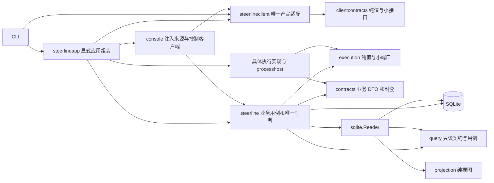
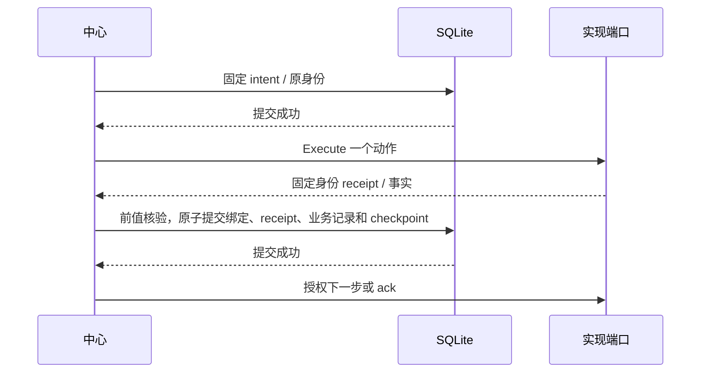

# 当前代码架构与源码索引

核对日期：2026-10-04。集成基线为 #69 PR194 的实际合并 `e81fadaf59d0411af1594be7c5cd6a832c71c29f`，本页同步 #71 客户端交付；下方全 OS 源码统计保留 #68 快照，迁移文件链接指向当前所有者。前版 PR179 的架构快照可从 Git 历史查看；当前文档只链接现存源码。具体删除与验证见 [#68 交付记录](../validation/core-decoupling-07-cleanup/README.md)，#63–#67 历史断言/失败/原生证据仍在各自记录，不重写历史结果。

## 系统与业务权威

CLI 和 TUI 通过配置、查询及控制入口访问本机服务；`run` 承载同一 Service actor。SQLite 是唯一持久业务权威。任务创建、领取、废弃、依赖和交付由中心用例校验身份、前值、版本和幂等键并提交；外部 worker、日志、UI 和应用组装都不拥有业务写入权。文件控制请求/回执仍是当前协议，HTTP/SSE 与规划主 agent 尚未由本系列交付。

图中箭头表达源码依赖或明确标注的数据库访问。运行时中心通过注入端口调用实现。直属主包生产/测试源码和文件名无平台关键字，直接及传递依赖无具体实现、app 或 integration；实现不导入主包。`coreboundary` 检查所有 OS/tag 的源码图及 Windows/Linux 生产依赖，不按目录名排除生成源码。

## 当前模块职责

| 所有者 | 简短职责与源码入口 |
| --- | --- |
| `internal/steerline` | Task/Workflow/Execution/Decision/Operation/TaskDelivery 用例、通用协调、提交和恢复。显式 [execution_directory.go](../../internal/steerline/execution_directory.go)、[worker_lifecycle.go](../../internal/steerline/worker_lifecycle.go)、[service_commit.go](../../internal/steerline/service_commit.go)；#69 已通过 [persistence/ports.go](../../internal/steerline/persistence/ports.go) 收窄生产写消费者，唯一 SQL 执行器仍在直属存储文件，整体归包留 #70。 |
| `execution` | 通用身份、闭集操作、事实/问题/回执、策略/需求、不可变有界封套及小端口；只依赖标准库。[lifecycle.go](../../internal/steerline/execution/lifecycle.go)、[implementation_data.go](../../internal/steerline/execution/implementation_data.go)。 |
| `contracts` | 业务持久/展示 DTO、会话来源及宿主端口；使用既有 execution/task/taskview 纯值，不解释原生载荷。[records.go](../../internal/steerline/contracts/records.go)、[conversation.go](../../internal/steerline/contracts/conversation.go)、[environment.go](../../internal/steerline/contracts/environment.go)。 |
| `codexworker` / `codexapp` | 前者拥有原生 codec、配置/命令/权限、生命周期、history/source/mapper；后者拥有 WebSocket/JSON-RPC 和原生问题传输。不给实现 Store 或可写 Service。 |
| `orcaworker` | 原生配置/绑定/资源/terminal/Dispatch/message、宿主准备和输出、观察及原操作对账。[lifecycle_resources.go](../../internal/steerline/orcaworker/lifecycle_resources.go)、[lifecycle_observation.go](../../internal/steerline/orcaworker/lifecycle_observation.go)。 |
| `orca_remote_worker` | 原远端协议、身份、消息、观察、结算与对账；新执行仍按权限准入拒绝，远端取消 unsupported。协议 mock 不证明权限认证。 |
| `steerlineapp` | 唯一内置目录、严格实现配置、默认值、具体工厂与产品构造。[directory.go](../../internal/steerlineapp/directory.go)、[config.go](../../internal/steerlineapp/config.go)、[app.go](../../internal/steerlineapp/app.go)；不承担状态转换，无 init/全局可变注册。 |
| `processhost` | OS 进程、身份、句柄及文件操作，由 app 构造，经小端口注入中心/实现；关闭观察不等于杀进程。 |
| `steerlineintegration` / `testprotocol` | 外层真实应用端口、原生配置和协议 mock 的跨层断言；不导出任意中心写接口。testprotocol 是测试进程 fixture，不是产品依赖。 |
| `task` / `taskgraph` / `taskview` / `workerflow` | 任务资格/DAG/展示及单 worker 纯规则，保留唯一实现。 |
| `projection` | 从同一持久快照复制并构建 Runtime/Run，按当前 Step 和 AttemptNumber 选择候选；workerflow 路径另核对非空 CurrentAttemptID，不匹配时拒绝投影，无 I/O。 |
| `query` / `sqlite` | 分消费者只读契约及同事务 Reader；中心仍保留开库/薄接线，写事务未搬迁。 |
| `workspace` / `publication` | 固定 Git 工作区及发布/PR provider 操作和事实；中心决定资格、受理与唯一交付。 |
| `clientcontracts` / `steerlineclient` | 纯产品 DTO/小接口与唯一客户端；配置/资源工厂由 app 注入，读取复用 query/projection，变更调用原 CommandService/control。 |
| `console` | TUI 输入/导航/视图；当前仍消费中心产品 DTO/query/control，客户端 I/O 已归唯一 adapter；仅配置/视图和薄映射留 #72。 |
| `coreboundary` / `testboundary` / `testfeedback` | 执行隔离守卫、E2E 测试依赖守卫及 Go JSON 报告；产品不依赖测试 fixture 或 runner。 |

## 固定配置、提交与恢复

项目策略与全局方案分开；发布责任保持 `worker` / `host_service` 或项目显式委托 `execution_profile`。应用每次构造独立不可变目录，配置受理、Claim、冻结、恢复和查询使用同一目录。固定 profile v5 / `builtin-execution-v2`、PolicyResources v3、SQLite schema 11、runtime/checkpoint schema 16、conversation event v2 保持。封套固定 key、版本、用途、所属身份、摘要及 64 KiB 上限，载荷深复制并只由实现 codec 解码。旧开发格式明确拒绝，不迁移、双写、重建或回退。

中心先提交原 intent 再执行一个动作，原 receipt 与绑定提交后才授权下一步；thread 绑定提交后才发送首轮、资源回执后才派发、消息消费事实提交后才 ack。异步结果核对原 Operation/request digest、target、Execution/Attempt/代次和输入绑定；提交失败恢复私有候选，不发布成功视图。heartbeat 只写服务元数据。

未知 start/reply/send/ack 保持原请求并只读对账，不重派或换会话。准备 nonce/deadline、准备与业务用途、工具/收据、DeferredDecision/Feedback 和人工恢复门槛仍由中心拥有。重启不自动解除人工门槛；当前配置不能重写原 profile/session/process/incarnation/workspace。TaskDelivery 按真实 provider 的原 PR/repository/head/base/merge 事实唯一提交，清理失败不撤销交付。

源码：[service_commit.go](../../internal/steerline/service_commit.go)、[worker_attachment_store.go](../../internal/steerline/worker_attachment_store.go)、[worker_lifecycle_async.go](../../internal/steerline/worker_lifecycle_async.go)、[worker_lifecycle_recovery.go](../../internal/steerline/worker_lifecycle_recovery.go)、[state_preflight.go](../../internal/steerline/state_preflight.go)、[native_delivery_command.go](../../internal/steerline/native_delivery_command.go)。

## 产品客户端（#71）

产品纯契约由 [clientcontracts/client.go](../../internal/steerline/clientcontracts/client.go) 和 [observations.go](../../internal/steerline/clientcontracts/observations.go) 拥有，复用 contracts/execution/task/taskview；不依赖中心、存储、平台或应用组装。CLI 产品入口消费这些小接口，唯一 [steerlineclient](../../internal/steerlineclient/client.go) 接受外部纯资源工厂；[steerlineapp/client.go](../../internal/steerlineapp/client.go) 绑定配置/身份，构造原 QueryService、ConversationQueryService、CommandService 与文件 control 端口。没有第二条 SQL、投影、分页或业务提交实现。

客户端按读取/命令范围关闭资源，Close 不停止服务或 worker。变更前固定 request/command ID，超时后查原 ID；control 同 ID 同内容返回原请求，异内容拒绝，不重新发布或换实例。`answer -request-id` 查询原命令；accepted 保持中心受理含义，不声明 worker 已执行。离线查询只打开已存在、当前格式且归属匹配的 native reader，不建库、迁移或准备工作区。

`console/source.go` 暂存桥只负责 DTO/调用映射；日志 I/O、候选输入检查、项目查询和控制已归客户端。配置视图、导航/渲染及中心别名仍待 #72 迁移；#72 删除这些薄桥并直接消费注入的产品小接口。实施/断言映射见 [#71 验证记录](../validation/core-decoupling-10-client/README.md)。本页下方的全 OS 源码统计保持 #68 快照，#71 新模块以上述实际源码为准。

## 会话和客户端读取

中心按预算轮转来源，使用实现提供的 source/mapper 端口；mapper 从已提交事件重建，失败候选 mapper/cursor 丢弃。来源归属 Project/Workflow/Execution/Attempt 必须匹配中心请求。会话事件、正文版本和 source cursor 用独立原子事务，不混入 heartbeat；正文/raw 不累计进实现封套。

公开 Runtime/Run 从已提交记录深复制构建，与私有工作 Run 分开。sqlite.Reader 在同一读事务采样任务、Ready、选中任务、记录和 checkpoint；query 复用 projection/task 规则。连接身份失败仍可展示可用只读数据，控制和领取各自重检。领域事件正文有页预算，cursor 只推进到实际返回事件；缺来源终态/final 时不能由界面推断完成。

源码：[conversation_service.go](../../internal/steerline/conversation_service.go)、[conversation_store.go](../../internal/steerline/conversation_store.go)、[project_view.go](../../internal/steerline/project_view.go)、[query/project.go](../../internal/steerline/query/project.go)、[console/source.go](../../internal/steerline/console/source.go)。

## 验证映射与后续任务

| 约束 / 原断言 | 当前所有者与入口 |
| --- | --- |
| 配置/封套版本、身份、摘要、深复制及拒绝 | execution/三个实现 codec、app 固定 profile；quick rules + owner cases；[#63 Plan 交付映射](../spec/core-decoupling-02-bindings.plan.md) |
| intent/receipt/ack、未知结果、原身份与唯一交付 | 中心中性事务测试 + 外层公开生命周期；[#64 映射](../validation/core-decoupling-03-lifecycle/README.md)、CD67 AdditionalImplementation |
| 来源 mapper/cursor 同事务、host 人工门槛、旧 conversation 拒绝 | 中心 CD65、query/sqlite、实现 history/host；[#65 映射](../validation/core-decoupling-04-conversation/README.md) |
| 唯一应用构造、产品配置、原 fixed profile 恢复 | app / integration；[#66 映射](../validation/core-decoupling-05-composition/README.md) |
| 全标签源码/依赖、负向 fixture、第三实现及支持/remote 原路径 | `TestCD67CoreBoundary` / `TestCD67AdditionalImplementation`，quick 固定选择，逐包 parent/subtest JSON run/pass；[#67 映射](../validation/core-decoupling-06-boundary/test-mapping.json) |
| #68 删除依据、保留入口及受影响代表 | [候选清单](../validation/core-decoupling-07-cleanup/candidate-inventory.json)、[验证记录](../validation/core-decoupling-07-cleanup/README.md)；没有删除/迁移断言，quick 引用仍有效 |

`go run ./cmd/test-feedback -quick` 已包含 15 包的规则/实现/app/CD67 守卫，不另加重复守卫。按 [测试计划](../spec/core-decoupling-07-cleanup.plan.md) 运行必要定向和一次 quick，明确临时 STEERLINE_HOME，仅隔离 Git/SQLite/协议 mock。原生支持和 opt-in live 证据保留，本次未启用。远端权限缺证拒绝不变。

#67/#68/#69 已实际合并；本页同步 #71 实施交付并集成 #69 的写端口。#70 搬唯一 SQL 实现；#71 接公共产品 DTO/adapter/CLI，#72 迁 TUI。共享 contracts/组装/quick 顺序集成。没有新平台、remote 权限、兼容层或插件系统。

## 全 OS / 构建标签源码索引

以下统计涵盖 cmd/internal 全部生产 `.go`（仅排除 `_test.go`），包括不同 OS/tag；是源码 import 图，不是运行时调用图或支持范围。完整路径、SHA-256、构建条件和 imports 见 [机器索引](../validation/core-decoupling-07-cleanup/source-index.json)。

共 **26 个包目录、293 个生产 Go 文件、61 条项目内 import 边**。

| 包目录 | 文件数 | 直接项目内依赖 |
| --- | ---: | --- |
| `cmd/orca-probe` | 1 | 无 |
| `cmd/steerline` | 1 | `internal/steerline`、`internal/steerlineapp` |
| `cmd/test-feedback` | 5 | `internal/testfeedback`、`internal/testprocess` |
| `internal/coreboundary` | 1 | 无 |
| `internal/steerline` | 99 | `internal/steerline/contracts`、`internal/steerline/execution`、`internal/steerline/projection`、`internal/steerline/publication`、`internal/steerline/query`、`internal/steerline/sqlite`、`internal/steerline/task`、`internal/steerline/taskview`、`internal/steerline/workerflow`、`internal/steerline/workspace` |
| `internal/steerline/codexapp` | 4 | 无 |
| `internal/steerline/codexworker` | 30 | `internal/steerline/codexapp`、`internal/steerline/contracts`、`internal/steerline/execution`、`internal/steerline/workspace` |
| `internal/steerline/console` | 18 | `internal/steerline`、`internal/steerline/execution` |
| `internal/steerline/contracts` | 13 | `internal/steerline/execution`、`internal/steerline/task`、`internal/steerline/taskview` |
| `internal/steerline/execution` | 15 | 无 |
| `internal/steerline/orca_remote_worker` | 14 | `internal/steerline/codexworker`、`internal/steerline/execution`、`internal/steerline/orcaworker` |
| `internal/steerline/orcaworker` | 29 | `internal/steerline/codexworker`、`internal/steerline/contracts`、`internal/steerline/execution`、`internal/steerline/workspace` |
| `internal/steerline/processhost` | 4 | `internal/steerline/execution` |
| `internal/steerline/projection` | 3 | `internal/steerline/contracts`、`internal/steerline/execution`、`internal/steerline/workerflow` |
| `internal/steerline/publication` | 7 | `internal/steerline/contracts`、`internal/steerline/execution` |
| `internal/steerline/query` | 6 | `internal/steerline/contracts`、`internal/steerline/execution`、`internal/steerline/task`、`internal/steerline/taskview` |
| `internal/steerline/sqlite` | 7 | `internal/steerline/contracts`、`internal/steerline/execution`、`internal/steerline/projection`、`internal/steerline/query`、`internal/steerline/task` |
| `internal/steerline/task` | 10 | `internal/steerline/taskgraph` |
| `internal/steerline/taskgraph` | 1 | 无 |
| `internal/steerline/taskview` | 3 | `internal/steerline/task`、`internal/steerline/taskgraph` |
| `internal/steerline/testprotocol` | 4 | 无 |
| `internal/steerline/workerflow` | 3 | `internal/steerline/execution`、`internal/steerline/task` |
| `internal/steerline/workspace` | 6 | `internal/steerline/execution` |
| `internal/steerlineapp` | 5 | `internal/steerline`、`internal/steerline/codexworker`、`internal/steerline/console`、`internal/steerline/contracts`、`internal/steerline/execution`、`internal/steerline/orca_remote_worker`、`internal/steerline/orcaworker`、`internal/steerline/processhost`、`internal/steerline/publication`、`internal/steerline/workspace` |
| `internal/testfeedback` | 1 | 无 |
| `internal/testprocess` | 3 | 无 |

### 全量源码路径

#### cmd/orca-probe

- [main.go](../../cmd/orca-probe/main.go)

#### cmd/steerline

- [main.go](../../cmd/steerline/main.go)

#### cmd/test-feedback

- [e2e.go](../../cmd/test-feedback/e2e.go)
- [main.go](../../cmd/test-feedback/main.go)
- [process_unix.go](../../cmd/test-feedback/process_unix.go)
- [process_windows.go](../../cmd/test-feedback/process_windows.go)
- [scoped.go](../../cmd/test-feedback/scoped.go)

#### internal/coreboundary

- [check.go](../../internal/coreboundary/check.go)

#### internal/steerline

- [activity.go](../../internal/steerline/activity.go)
- [command.go](../../internal/steerline/command.go)
- [command_processor.go](../../internal/steerline/command_processor.go)
- [config.go](../../internal/steerline/config.go)
- [control_client.go](../../internal/steerline/control_client.go)
- [control_protocol.go](../../internal/steerline/control_protocol.go)
- [control_service.go](../../internal/steerline/control_service.go)
- [conversation.go](../../internal/steerline/conversation.go)
- [conversation_position.go](../../internal/steerline/conversation_position.go)
- [conversation_query.go](../../internal/steerline/conversation_query.go)
- [conversation_replay.go](../../internal/steerline/conversation_replay.go)
- [conversation_service.go](../../internal/steerline/conversation_service.go)
- [conversation_sources.go](../../internal/steerline/conversation_sources.go)
- [conversation_store.go](../../internal/steerline/conversation_store.go)
- [decision.go](../../internal/steerline/decision.go)
- [domain.go](../../internal/steerline/domain.go)
- [execution_backend.go](../../internal/steerline/execution_backend.go)
- [execution_directory.go](../../internal/steerline/execution_directory.go)
- [execution_helpers.go](../../internal/steerline/execution_helpers.go)
- [execution_profiles.go](../../internal/steerline/execution_profiles.go)
- [execution_requirements.go](../../internal/steerline/execution_requirements.go)
- [execution_snapshot.go](../../internal/steerline/execution_snapshot.go)
- [execution_store.go](../../internal/steerline/execution_store.go)
- [implementation_bindings.go](../../internal/steerline/implementation_bindings.go)
- [journal_platform_linux.go](../../internal/steerline/journal_platform_linux.go)
- [journal_platform_other.go](../../internal/steerline/journal_platform_other.go)
- [journal_platform_windows.go](../../internal/steerline/journal_platform_windows.go)
- [journal_reader.go](../../internal/steerline/journal_reader.go)
- [launchers.go](../../internal/steerline/launchers.go)
- [model.go](../../internal/steerline/model.go)
- [sqlite_native_authority.go](../../internal/steerline/sqlite_native_authority.go)
- [native_batch_command.go](../../internal/steerline/native_batch_command.go)
- [native_claim_command.go](../../internal/steerline/native_claim_command.go)
- [native_cleanup.go](../../internal/steerline/native_cleanup.go)
- [native_cleanup_stop.go](../../internal/steerline/native_cleanup_stop.go)
- [native_contract_files.go](../../internal/steerline/native_contract_files.go)
- [native_delivery_command.go](../../internal/steerline/native_delivery_command.go)
- [native_discard_command.go](../../internal/steerline/native_discard_command.go)
- [native_dispatch_command.go](../../internal/steerline/native_dispatch_command.go)
- [native_graph_export.go](../../internal/steerline/native_graph_export.go)
- [sqlite_task_graph.go](../../internal/steerline/sqlite_task_graph.go)
- [native_graph_types.go](../../internal/steerline/native_graph_types.go)
- [native_project_open.go](../../internal/steerline/native_project_open.go)
- [native_readiness_query.go](../../internal/steerline/native_readiness_query.go)
- [native_repository_target.go](../../internal/steerline/native_repository_target.go)
- [native_service.go](../../internal/steerline/native_service.go)
- [native_state_preflight.go](../../internal/steerline/native_state_preflight.go)
- [native_task_page.go](../../internal/steerline/native_task_page.go)
- [native_task_predecessors.go](../../internal/steerline/native_task_predecessors.go)
- [observation.go](../../internal/steerline/observation.go)
- [operation.go](../../internal/steerline/operation.go)
- [platform_linux.go](../../internal/steerline/platform_linux.go)
- [platform_windows.go](../../internal/steerline/platform_windows.go)
- [pr.go](../../internal/steerline/pr.go)
- [profile_data.go](../../internal/steerline/profile_data.go)
- [project_view.go](../../internal/steerline/project_view.go)
- [publication_snapshot.go](../../internal/steerline/publication_snapshot.go)
- [query_command.go](../../internal/steerline/query_command.go)
- [recovery.go](../../internal/steerline/recovery.go)
- [render.go](../../internal/steerline/render.go)
- [runtime_view.go](../../internal/steerline/runtime_view.go)
- [service.go](../../internal/steerline/service.go)
- [service_client.go](../../internal/steerline/service_client.go)
- [service_commit.go](../../internal/steerline/service_commit.go)
- [service_execution_profiles.go](../../internal/steerline/service_execution_profiles.go)
- [service_workers.go](../../internal/steerline/service_workers.go)
- [sqlite_store.go](../../internal/steerline/sqlite_store.go)
- [sqlite_store_checkpoint.go](../../internal/steerline/sqlite_store_checkpoint.go)
- [sqlite_store_read.go](../../internal/steerline/sqlite_store_read.go)
- [sqlite_store_schema.go](../../internal/steerline/sqlite_store_schema.go)
- [sqlite_store_write.go](../../internal/steerline/sqlite_store_write.go)
- [sqlite_store_write_commands.go](../../internal/steerline/sqlite_store_write_commands.go)
- [sqlite_store_write_execution.go](../../internal/steerline/sqlite_store_write_execution.go)
- [sqlite_store_write_native.go](../../internal/steerline/sqlite_store_write_native.go)
- [state_preflight.go](../../internal/steerline/state_preflight.go)
- [state_revision.go](../../internal/steerline/state_revision.go)
- [store.go](../../internal/steerline/store.go)
- [worker_attachment_store.go](../../internal/steerline/worker_attachment_store.go)
- [sqlite_worker_commit.go](../../internal/steerline/sqlite_worker_commit.go)
- [worker_completion.go](../../internal/steerline/worker_completion.go)
- [worker_environment.go](../../internal/steerline/worker_environment.go)
- [worker_environment_host.go](../../internal/steerline/worker_environment_host.go)
- [worker_events.go](../../internal/steerline/worker_events.go)
- [worker_evidence.go](../../internal/steerline/worker_evidence.go)
- [worker_execution.go](../../internal/steerline/worker_execution.go)
- [worker_feedback.go](../../internal/steerline/worker_feedback.go)
- [worker_lifecycle.go](../../internal/steerline/worker_lifecycle.go)
- [worker_lifecycle_async.go](../../internal/steerline/worker_lifecycle_async.go)
- [worker_lifecycle_feedback.go](../../internal/steerline/worker_lifecycle_feedback.go)
- [worker_lifecycle_recovery.go](../../internal/steerline/worker_lifecycle_recovery.go)
- [worker_pr.go](../../internal/steerline/worker_pr.go)
- [worker_process.go](../../internal/steerline/worker_process.go)
- [worker_publish_local.go](../../internal/steerline/worker_publish_local.go)
- [worker_recovery.go](../../internal/steerline/worker_recovery.go)
- [worker_resume.go](../../internal/steerline/worker_resume.go)
- [worker_start.go](../../internal/steerline/worker_start.go)
- [worker_state.go](../../internal/steerline/worker_state.go)
- [worker_types.go](../../internal/steerline/worker_types.go)
- [workspace_config.go](../../internal/steerline/workspace_config.go)

#### internal/steerline/codexapp

- [ask.go](../../internal/steerline/codexapp/ask.go)
- [client.go](../../internal/steerline/codexapp/client.go)
- [doc.go](../../internal/steerline/codexapp/doc.go)
- [transport.go](../../internal/steerline/codexapp/transport.go)

#### internal/steerline/codexworker

- [activity.go](../../internal/steerline/codexworker/activity.go)
- [ask.go](../../internal/steerline/codexworker/ask.go)
- [ask_journal.go](../../internal/steerline/codexworker/ask_journal.go)
- [backend.go](../../internal/steerline/codexworker/backend.go)
- [capability.go](../../internal/steerline/codexworker/capability.go)
- [command.go](../../internal/steerline/codexworker/command.go)
- [config.go](../../internal/steerline/codexworker/config.go)
- [connection.go](../../internal/steerline/codexworker/connection.go)
- [conversation.go](../../internal/steerline/codexworker/conversation.go)
- [conversation_adapter.go](../../internal/steerline/codexworker/conversation_adapter.go)
- [doc.go](../../internal/steerline/codexworker/doc.go)
- [event_fact.go](../../internal/steerline/codexworker/event_fact.go)
- [executable.go](../../internal/steerline/codexworker/executable.go)
- [execution_binding.go](../../internal/steerline/codexworker/execution_binding.go)
- [history.go](../../internal/steerline/codexworker/history.go)
- [history_binding.go](../../internal/steerline/codexworker/history_binding.go)
- [intent.go](../../internal/steerline/codexworker/intent.go)
- [journal.go](../../internal/steerline/codexworker/journal.go)
- [launch.go](../../internal/steerline/codexworker/launch.go)
- [lifecycle.go](../../internal/steerline/codexworker/lifecycle.go)
- [native_params.go](../../internal/steerline/codexworker/native_params.go)
- [observe.go](../../internal/steerline/codexworker/observe.go)
- [outcome.go](../../internal/steerline/codexworker/outcome.go)
- [params.go](../../internal/steerline/codexworker/params.go)
- [permissions.go](../../internal/steerline/codexworker/permissions.go)
- [policy.go](../../internal/steerline/codexworker/policy.go)
- [policy_resources.go](../../internal/steerline/codexworker/policy_resources.go)
- [profile_config.go](../../internal/steerline/codexworker/profile_config.go)
- [recovery.go](../../internal/steerline/codexworker/recovery.go)
- [session_launcher.go](../../internal/steerline/codexworker/session_launcher.go)

#### internal/steerline/console

- [activity.go](../../internal/steerlineclient/activity.go)
- [conversation.go](../../internal/steerline/console/conversation.go)
- [conversation_anchor.go](../../internal/steerline/console/conversation_anchor.go)
- [execution_profile.go](../../internal/steerline/console/execution_profile.go)
- [model.go](../../internal/steerline/console/model.go)
- [model_control.go](../../internal/steerline/console/model_control.go)
- [model_keys.go](../../internal/steerline/console/model_keys.go)
- [model_navigation.go](../../internal/steerline/console/model_navigation.go)
- [model_update_actions.go](../../internal/steerline/console/model_update_actions.go)
- [model_update_conversation.go](../../internal/steerline/console/model_update_conversation.go)
- [model_update_project.go](../../internal/steerline/console/model_update_project.go)
- [preferences.go](../../internal/steerline/console/preferences.go)
- [profile_choice.go](../../internal/steerline/console/profile_choice.go)
- [source.go](../../internal/steerline/console/source.go)
- [view.go](../../internal/steerline/console/view.go)
- [view_conversation.go](../../internal/steerline/console/view_conversation.go)
- [view_tasks.go](../../internal/steerline/console/view_tasks.go)
- [view_text.go](../../internal/steerline/console/view_text.go)

#### internal/steerline/contracts

- [activity.go](../../internal/steerline/contracts/activity.go)
- [conversation.go](../../internal/steerline/contracts/conversation.go)
- [conversation_query.go](../../internal/steerline/contracts/conversation_query.go)
- [decision_content.go](../../internal/steerline/contracts/decision_content.go)
- [environment.go](../../internal/steerline/contracts/environment.go)
- [execution.go](../../internal/steerline/contracts/execution.go)
- [json.go](../../internal/steerline/contracts/json.go)
- [pr.go](../../internal/steerline/contracts/pr.go)
- [publication.go](../../internal/steerline/contracts/publication.go)
- [query.go](../../internal/steerline/contracts/query.go)
- [records.go](../../internal/steerline/contracts/records.go)
- [runtime.go](../../internal/steerline/contracts/runtime.go)
- [snapshot.go](../../internal/steerline/contracts/snapshot.go)

#### internal/steerline/execution

- [backend.go](../../internal/steerline/execution/backend.go)
- [capability.go](../../internal/steerline/execution/capability.go)
- [errors.go](../../internal/steerline/execution/errors.go)
- [event.go](../../internal/steerline/execution/event.go)
- [host.go](../../internal/steerline/execution/host.go)
- [implementation_config_input.go](../../internal/steerline/execution/implementation_config_input.go)
- [implementation_data.go](../../internal/steerline/execution/implementation_data.go)
- [lifecycle.go](../../internal/steerline/execution/lifecycle.go)
- [operation.go](../../internal/steerline/execution/operation.go)
- [policy.go](../../internal/steerline/execution/policy.go)
- [publication.go](../../internal/steerline/execution/publication.go)
- [question_route.go](../../internal/steerline/execution/question_route.go)
- [requirements.go](../../internal/steerline/execution/requirements.go)
- [session.go](../../internal/steerline/execution/session.go)
- [workspace.go](../../internal/steerline/execution/workspace.go)

#### internal/steerline/orca_remote_worker

- [backend.go](../../internal/steerline/orca_remote_worker/backend.go)
- [config.go](../../internal/steerline/orca_remote_worker/config.go)
- [intent.go](../../internal/steerline/orca_remote_worker/intent.go)
- [lifecycle.go](../../internal/steerline/orca_remote_worker/lifecycle.go)
- [messaging.go](../../internal/steerline/orca_remote_worker/messaging.go)
- [observation.go](../../internal/steerline/orca_remote_worker/observation.go)
- [policy.go](../../internal/steerline/orca_remote_worker/policy.go)
- [preflight.go](../../internal/steerline/orca_remote_worker/preflight.go)
- [profile_config.go](../../internal/steerline/orca_remote_worker/profile_config.go)
- [run.go](../../internal/steerline/orca_remote_worker/run.go)
- [start.go](../../internal/steerline/orca_remote_worker/start.go)
- [types.go](../../internal/steerline/orca_remote_worker/types.go)
- [version.go](../../internal/steerline/orca_remote_worker/version.go)
- [worker.go](../../internal/steerline/orca_remote_worker/worker.go)

#### internal/steerline/orcaworker

- [backend.go](../../internal/steerline/orcaworker/backend.go)
- [binding.go](../../internal/steerline/orcaworker/binding.go)
- [client.go](../../internal/steerline/orcaworker/client.go)
- [command.go](../../internal/steerline/orcaworker/command.go)
- [config.go](../../internal/steerline/orcaworker/config.go)
- [dispatch_submit.go](../../internal/steerline/orcaworker/dispatch_submit.go)
- [environment.go](../../internal/steerline/orcaworker/environment.go)
- [event.go](../../internal/steerline/orcaworker/event.go)
- [events.go](../../internal/steerline/orcaworker/events.go)
- [execution_state.go](../../internal/steerline/orcaworker/execution_state.go)
- [host.go](../../internal/steerline/orcaworker/host.go)
- [intent.go](../../internal/steerline/orcaworker/intent.go)
- [inventory.go](../../internal/steerline/orcaworker/inventory.go)
- [lifecycle.go](../../internal/steerline/orcaworker/lifecycle.go)
- [lifecycle_observation.go](../../internal/steerline/orcaworker/lifecycle_observation.go)
- [lifecycle_resources.go](../../internal/steerline/orcaworker/lifecycle_resources.go)
- [lifecycle_turns.go](../../internal/steerline/orcaworker/lifecycle_turns.go)
- [message.go](../../internal/steerline/orcaworker/message.go)
- [message_identity.go](../../internal/steerline/orcaworker/message_identity.go)
- [mutation.go](../../internal/steerline/orcaworker/mutation.go)
- [orchestration.go](../../internal/steerline/orcaworker/orchestration.go)
- [output.go](../../internal/steerline/orcaworker/output.go)
- [profile_config.go](../../internal/steerline/orcaworker/profile_config.go)
- [readiness.go](../../internal/steerline/orcaworker/readiness.go)
- [relay.go](../../internal/steerline/orcaworker/relay.go)
- [saved_receipt.go](../../internal/steerline/orcaworker/saved_receipt.go)
- [terminal.go](../../internal/steerline/orcaworker/terminal.go)
- [terminal_protocol.go](../../internal/steerline/orcaworker/terminal_protocol.go)
- [workspace.go](../../internal/steerline/orcaworker/workspace.go)

#### internal/steerline/processhost

- [host.go](../../internal/steerline/processhost/host.go)
- [process_other.go](../../internal/steerline/processhost/process_other.go)
- [process_unix.go](../../internal/steerline/processhost/process_unix.go)
- [process_windows.go](../../internal/steerline/processhost/process_windows.go)

#### internal/steerline/projection

- [run.go](../../internal/steerline/projection/run.go)
- [runtime.go](../../internal/steerline/projection/runtime.go)
- [selectors.go](../../internal/steerline/projection/selectors.go)

#### internal/steerline/publication

- [command.go](../../internal/steerline/publication/command.go)
- [gitea.go](../../internal/steerline/publication/gitea.go)
- [policy.go](../../internal/steerline/publication/policy.go)
- [pr.go](../../internal/steerline/publication/pr.go)
- [provider.go](../../internal/steerline/publication/provider.go)
- [publish.go](../../internal/steerline/publication/publish.go)
- [request.go](../../internal/steerline/publication/request.go)

#### internal/steerline/query

- [conversation.go](../../internal/steerline/query/conversation.go)
- [conversation_ports.go](../../internal/steerline/query/conversation_ports.go)
- [events.go](../../internal/steerline/query/events.go)
- [ports.go](../../internal/steerline/query/ports.go)
- [project.go](../../internal/steerline/query/project.go)
- [tasks.go](../../internal/steerline/query/tasks.go)

#### internal/steerline/sqlite

- [checkpoint.go](../../internal/steerline/sqlite/checkpoint.go)
- [conversation.go](../../internal/steerline/sqlite/conversation.go)
- [graph.go](../../internal/steerline/sqlite/graph.go)
- [project.go](../../internal/steerline/sqlite/project.go)
- [reader.go](../../internal/steerline/sqlite/reader.go)
- [records.go](../../internal/steerline/sqlite/records.go)
- [tasks.go](../../internal/steerline/sqlite/tasks.go)

#### internal/steerline/task

- [batch.go](../../internal/steerline/task/batch.go)
- [command_plan.go](../../internal/steerline/task/command_plan.go)
- [contract.go](../../internal/steerline/task/contract.go)
- [delivery.go](../../internal/steerline/task/delivery.go)
- [delivery_gate.go](../../internal/steerline/task/delivery_gate.go)
- [model.go](../../internal/steerline/task/model.go)
- [predecessors.go](../../internal/steerline/task/predecessors.go)
- [readiness.go](../../internal/steerline/task/readiness.go)
- [receipts.go](../../internal/steerline/task/receipts.go)
- [status.go](../../internal/steerline/task/status.go)

#### internal/steerline/taskgraph

- [taskgraph.go](../../internal/steerline/taskgraph/taskgraph.go)

#### internal/steerline/taskview

- [model.go](../../internal/steerline/taskview/model.go)
- [page.go](../../internal/steerline/taskview/page.go)
- [project.go](../../internal/steerline/taskview/project.go)

#### internal/steerline/testprotocol

- [appserver.go](../../internal/steerline/testprotocol/appserver.go)
- [native_orca.go](../../internal/steerline/testprotocol/native_orca.go)
- [supervised.go](../../internal/steerline/testprotocol/supervised.go)
- [terminal.go](../../internal/steerline/testprotocol/terminal.go)

#### internal/steerline/workerflow

- [prompt.go](../../internal/steerline/workerflow/prompt.go)
- [recovery.go](../../internal/steerline/workerflow/recovery.go)
- [state.go](../../internal/steerline/workerflow/state.go)

#### internal/steerline/workspace

- [cleanup.go](../../internal/steerline/workspace/cleanup.go)
- [git.go](../../internal/steerline/workspace/git.go)
- [inspect.go](../../internal/steerline/workspace/inspect.go)
- [lifecycle.go](../../internal/steerline/workspace/lifecycle.go)
- [prepare.go](../../internal/steerline/workspace/prepare.go)
- [resources.go](../../internal/steerline/workspace/resources.go)

#### internal/steerlineapp

- [app.go](../../internal/steerlineapp/app.go)
- [capability.go](../../internal/steerlineapp/capability.go)
- [config.go](../../internal/steerlineapp/config.go)
- [console.go](../../internal/steerlineapp/console.go)
- [directory.go](../../internal/steerlineapp/directory.go)

#### internal/testfeedback

- [summary.go](../../internal/testfeedback/summary.go)

#### internal/testprocess

- [process.go](../../internal/testprocess/process.go)
- [process_unix.go](../../internal/testprocess/process_unix.go)
- [process_windows.go](../../internal/testprocess/process_windows.go)
