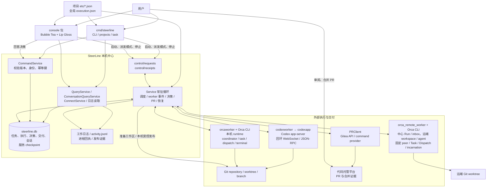
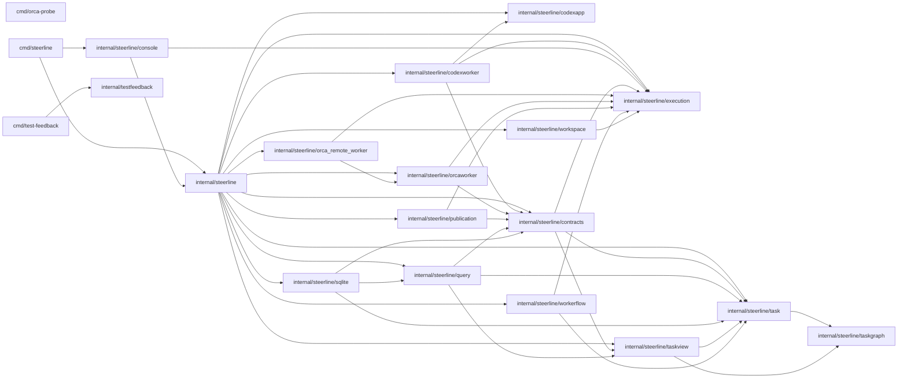
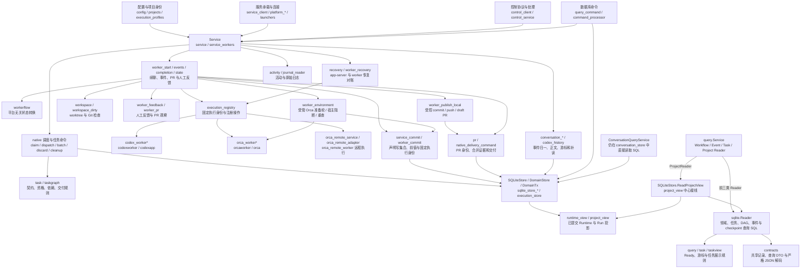
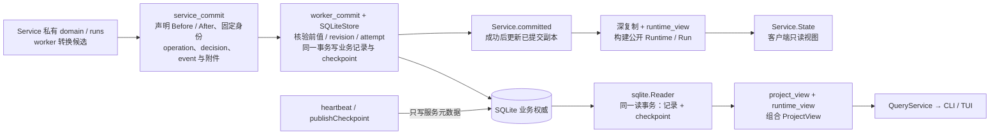
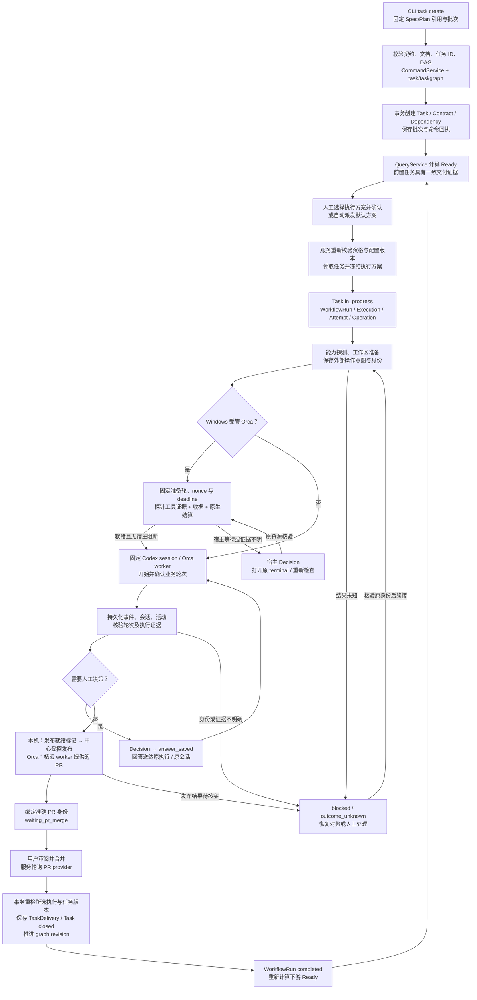
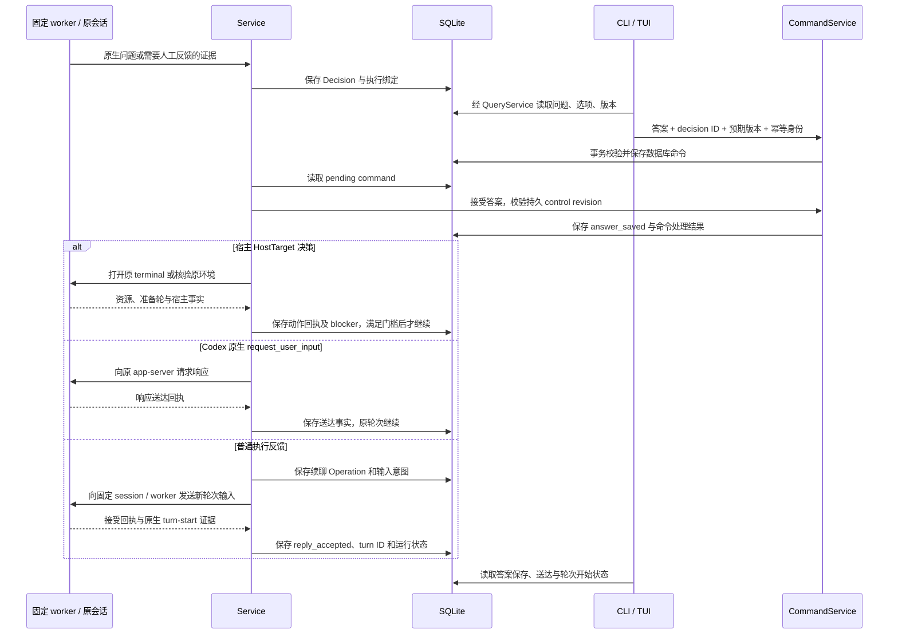
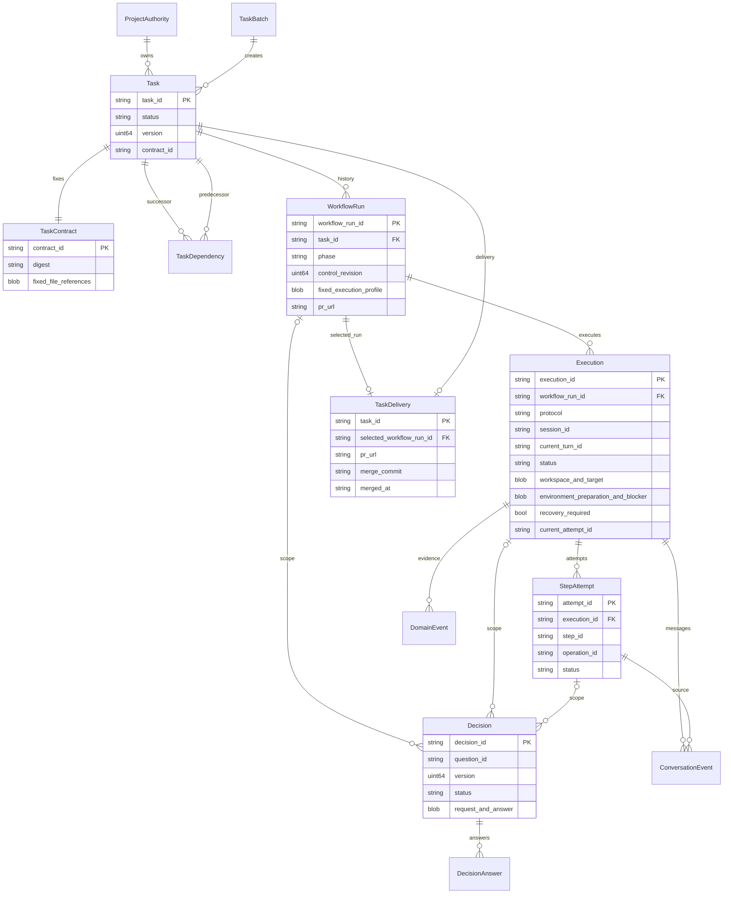

# SteerLine 当前代码架构图

快照日期：2026-10-01。源码基线：`7350e84`（PR #174 已合入主干），叠加本轮执行隔离清理。本文起源于 [PR #153](https://github.com/erranliu/SteerLine/pull/153)，已包含 #54–#61 的公共契约、工作区、发布、适配器、权限和需求注册实现；已合入与原生验收完成分别记录，见[执行隔离总纲](../roadmap/execution-isolation.md)。

本文描述当前检出的代码：系统边界、实际 Go 包依赖、核心包内部职责、任务执行、人工决策、数据模型、日志与恢复。图中的职责分组不代表已拆成独立包或服务。箭头含义在各图前说明；未来方案与当前可启动路径分开列出，第 10 节给出后续解耦与复用建议。

## 1. 系统与进程总览

实线表示当前调用或数据通路。CLI 和控制台可以是不同进程；`run` 在独立服务进程中运行。查询经 Go 读取 SQLite，当前客户端控制协议主要使用文件请求/回执和数据库命令，而不是第二阶段计划中的 HTTP/SSE。

**业务权威**是 SQLite 中的持久记录。服务负责运行中的业务推进；CLI 的任务创建、废弃、追加前置等命令也能通过 `CommandService` 写库，但须取得仓库身份锁。客户端提交命令不等于执行成功，agent 输出和日志不等于任务交付。

**生命周期**：Windows 通过可见的 `service-window.bat` 承载服务；控制台退出不会停止服务。服务重启先对账保存的身份、命令和外部状态，再允许新派发。当前代码有 Windows/Linux 平台实现，代码存在不表示各平台均完成原生验收。

源码入口：[main.go](../../cmd/steerline/main.go)、[Service](../../internal/steerline/service.go)、[console/source.go](../../internal/steerline/console/source.go)、[control_protocol.go](../../internal/steerline/control_protocol.go)、[native_project_open.go](../../internal/steerline/native_project_open.go)。

## 2. 实际 Go 包依赖

箭头仅表示非测试 `.go` 源文件中的项目内 `import`，不代表运行时调用。所有 `internal/steerline/` 子包在图中用短名表示。

| 包 | 当前职责 | 非测试 Go 文件 |
| --- | --- | ---: |
| `cmd/steerline` | 产品命令入口、服务启动、控制台和任务命令路由 | 1 |
| `internal/steerline` | 服务编排、业务持久化、平台适配接线、查询和控制 | 114 |
| `console` | TUI 状态、导航、任务列表、活动/会话/正文、执行方案和决策编辑；渲染与锚点按职责分文件 | 18 |
| `contracts` | 共享持久记录、运行视图、执行配置与查询 DTO，严格 JSON 解码 | 12 |
| `query` | 按消费者分开的只读接口、事件/任务分页、DAG 与 Ready 查询规则 | 4 |
| `sqlite` | 领域、事件、命令、任务、DAG、checkpoint 与组合快照的 SQLite 只读适配 | 6 |
| `task` | 任务契约、批次、状态、依赖资格、交付和命令规则 | 10 |
| `taskgraph` | DAG 校验、遍历、前后置关系和图算法 | 1 |
| `taskview` | 任务展示、分页和投影规则 | 3 |
| `workerflow` | 单个可续聊 worker 的纯状态规则、恢复和提示构造 | 3 |
| `execution` | 公共执行身份、输入/回答、事实、回执、能力、工作区与错误；无业务写库权 | 10 |
| `codexapp` | Codex app-server 参数、客户端、原生问题与 WebSocket 协议 | 4 |
| `codexworker` | app-server 启动、连接、能力探测、轮次观察、journal 与回答 | 25 |
| `orcaworker` | Orca task/dispatch、terminal、消息、relay、输出与工作区协议、环境就绪证据 | 22 |
| `orca_remote_worker` | 远端预检、启动/复用、观察、mailbox、工作区和清理协议 | 12 |
| `workspace` | Git worktree 准备、核验、资源解析和清理 | 5 |
| `publication` | 发布请求、Git 发布、PR provider 查询与责任匹配 | 7 |
| `cmd/orca-probe` | 只读能力探测与脱敏证据采集 | 1 |
| `cmd/test-feedback` | 最小/定向/全量测试调度、日志与反馈报告 | 4 |
| `internal/testfeedback` | Go test JSON 结果汇总 | 1 |

合计 **18 个包目录、220 个非测试 Go 文件**。统计覆盖 `cmd/` 与 `internal/`；不含 `_test.go`、测试数据、脚本和文档。核心包仍集中承载多项职责，不能将上述逻辑边界理解为微服务或已经完成的全面拆包。

## 3. 核心包内部职责与接线

图中多数节点仍是 `steerline` 包内的逻辑职责；`execution`、`contracts`、`query`、`sqlite` 与 `orca_remote_worker` 已是独立包。实线表示主要协作关系，不是完整函数调用图。

| 职责 | 主要源码 | 关键边界 |
| --- | --- | --- |
| 配置与固定执行方案 | `config.go`、`execution_profiles.go`、`service_execution_profiles.go`、`projects.go` | 项目身份、PR 和 DAG 属于项目；每次领取冻结 worker 执行方案和摘要 |
| 服务调度与事件循环 | `service.go`、`service_workers.go`、`native_service.go` | worker 观察器按 workflow run ID 管理；启动、回答和恢复不依赖一个共享的“当前 worker” |
| 控制与命令 | `control_*.go`、`query_command.go`、`command_processor.go` | 控制文件绑定服务实例；数据库命令有版本和幂等身份 |
| 任务管理 | `native_batch_command.go`、`native_claim_command.go`、`native_dispatch_command.go`、`native_task_predecessors.go`、`native_discard_command.go` | 验证固定契约、DAG 与版本；废弃后的外部清理单独对账 |
| 图与候选读取 | `query/tasks.go`、`sqlite/graph.go`、`sqlite/tasks.go`、`native_graph_snapshot.go`、`native_task_page.go` | 规则与 SQL 已拆包，父包保留接线及导出；展示 Ready 缓存不是领取许可 |
| 单 worker 生命周期 | `worker_start.go`、`worker_events.go`、`worker_completion.go`、`worker_state.go`、`worker_execution.go`、`worker_resume.go` | Session、Turn、Execution、Attempt 和 Operation 必须对应持久身份 |
| 本机 Codex | `codex_worker*.go`、`codex_history_port.go`、`codexworker/`、`codexapp/` | 实际 worker 经回环 WebSocket 连接 app-server；不是第二阶段规划会话的 stdio 方案 |
| Orca | `orca_worker*.go`、`orca_remote*.go`、`orca.go`、`orcaworker/`、`orca_remote_worker/` | coordinator、runtime、task、dispatch、terminal 与消息回执分别核验 |
| 环境就绪与宿主阻断 | `worker_environment.go`、`orcaworker/readiness.go`、`orcaworker/environment.go`、`contracts/environment.go` | Windows 受管 Orca 准备轮与业务轮分离；探针收据、工具调用证据与原生结算共同放行业务 |
| 工作区与发布 | `workspace*.go`、`worker_publish_local.go`、`codex_git_sandbox.go` | 本机 worker 发出发布就绪标记后，中心校验并办理发布 |
| PR 与交付 | `pr.go`、`native_delivery_command.go`、`task/delivery*.go` | 合并事实先外部查询，再事务内重检并写交付与 closed 状态 |
| 决策与干预 | `decision.go`、`worker_feedback.go`、`service_commit.go`、`operation.go` | 保存答案、送达回执、原会话新轮次开始是不同事实 |
| 日志与会话 | `activity.go`、`journal_*.go`、`conversation*.go`、`codex_conversation.go` | 原始日志、归一事件、正文版本与最终回复分别处理 |
| 查询与数据契约 | `query/`、`contracts/`、`project_view.go` | 查询按四类只读能力接线，不依赖中心、SQLite 具体类型或写事务；数据 JSON 字段保持不变 |
| 持久化与投影 | `sqlite/`、`sqlite_store*.go`、`service_commit.go`、`worker_commit.go`、`execution_store.go`、`runtime_view.go` | 领域查询 SQL 在 sqlite 包，会话 SQL 仍在中心；中心拥有连接、schema 初始化、原子写入和 Runtime 业务投影 |
| 恢复与平台 | `recovery.go`、`worker_recovery.go`、`platform_*.go`、`spawner.go` | 对账原身份；不因超时、观察断线或重启直接创建替代执行 |

当前生产代码另已删除无生产消费者的旧 Orca shell 轮次、prompt/pull/journal、游标 reader 和 helper；有价值的远端身份/结算/回复测试直接验证独立包。通用 `Worker` 类型位于 `worker_types.go`。当前生产代码已移除旧步骤校验 `remoteprotocol`、Execution 的候选/验证/审查修订与修复轮数字段，以及 Attempt 的旧前置结果、结果 ID 和 legacy 标记。`CurrentStep` / `StepID` 仍固定为 `worker`，WorkflowRun 继续表示本次任务执行。原生事件解码位于 `codexworker/event_fact.go` 与 `orcaworker/event.go`；父包的 `worker_evidence.go`、`codex_worker_evidence.go`、`orca_worker_evidence.go` 仅负责固定记录和有类型事实的适配。中心恢复、启动、事件、结算、PR、反馈分别落在相应 `worker_*.go`，写入仍只经显式事务。

### 3.1 已提交视图与原子写入

箭头表示数据流。下列写集合、事务执行器与投影目前都在中心包，`sqlite.Reader` 只承担读取。工作副本不能作为已提交视图发布；数据库命令与 worker 转换共用数据库，但有各自的事务入口。

`workerCommit` 附件包含执行绑定和底层操作回执；恢复时退休旧 Attempt、创建新 Attempt 与切换 Execution 当前代次也在同一事务内。提交失败后恢复私有候选，不能发布成功状态或消费成功回执。会话记录及其 source cursor 使用独立的 `CommitConversation` 事务，不能误解为所有日志和正文都与 worker 写集合一起提交。

源码：[service_commit.go](../../internal/steerline/service_commit.go)、[worker_commit.go](../../internal/steerline/worker_commit.go)、[worker_attachment_store.go](../../internal/steerline/worker_attachment_store.go)、[project_view.go](../../internal/steerline/project_view.go)、[conversation_store.go](../../internal/steerline/conversation_store.go)。

## 4. 任务从创建到交付

这是业务流程图。每次“已请求”“已接受”“已确认”均需对应持久记录或外部证据。当前 worker 可以多轮续聊，不应将历史的 prepare/implement/verify/review 分阶段方案当作生产必经流水线。

人工派发允许多个不同 Ready 任务并行，每个任务冻结独立执行方案与 worker 身份；同一任务不能重复领取。自动模式一次保持一个活动执行，切换自动模式不会停止已经人工启动的任务。领取、进程开始、轮次结束、PR 合并、任务交付不是同一层状态。

源码：[native_service.go](../../internal/steerline/native_service.go)、[worker_start.go](../../internal/steerline/worker_start.go)、[workerflow/state.go](../../internal/steerline/workerflow/state.go)、[worker_publish_local.go](../../internal/steerline/worker_publish_local.go)、[native_delivery_command.go](../../internal/steerline/native_delivery_command.go)。

### 4.1 环境就绪与停服恢复的边界

Windows 受管 Orca 在领取事务中保存 `Execution.Environment`：固定执行方案摘要、准备轮 ID、nonce 和跨重启的截止时间；资源准备后再固定实际 runtime / terminal / incarnation / worktree 和启动命令。业务输入须同时满足 readiness 已核验、没有宿主 blocker、无需人工恢复。准备轮不计作业务轮，不能用模型的“环境可用”回复代替工具调用证据、原子探针收据与原生成功结算。

宿主阻断使用中心接收的 `HostTarget` 决策；打开 terminal 不等于放行，重查也不能覆盖观察期间出现的新故障。原生问题、普通反馈可以被暂存，保留自己的发送身份与回执。已经绑定 PR 的执行不会因为迟到的 terminal 诊断被退回业务阶段。

停服恢复另有人工门槛：服务重启可以对账原进程与原操作，恢复发起新业务输入须取得当前服务实例下的新决策；旧实例已保存的答案不自动重发。本机原进程及后代确认停止、原 worktree 核验且没有未知操作后，用户可继续原 Codex session 或明确选择新 session；新 Attempt 与旧 Attempt 的退休一并提交。Orca 保留原 runtime / terminal / dispatch 进行核验。

源码：[native_claim_command.go](../../internal/steerline/native_claim_command.go)、[worker_environment.go](../../internal/steerline/worker_environment.go)、[contracts/environment.go](../../internal/steerline/contracts/environment.go)、[orcaworker/readiness.go](../../internal/steerline/orcaworker/readiness.go)、[worker_recovery.go](../../internal/steerline/worker_recovery.go)。

## 5. 人工决策与原会话续聊

这是时序图。原生问题响应与普通反馈续聊分别处理；“答案被保存”不能展示为“agent 已应用”。

配置、session、run、execution、turn 身份不匹配时拒绝发送；结果未知时保留原命令和操作身份等待对账。心跳和日志更新不会改变 WorkflowRun 的持久控制版本。

源码：[query_command.go](../../internal/steerline/query_command.go)、[command_processor.go](../../internal/steerline/command_processor.go)、[worker_execution.go](../../internal/steerline/worker_execution.go)、[codex_worker_reply.go](../../internal/steerline/codex_worker_reply.go)。

## 6. 核心数据模型

图表示主要领域关系，省略所有关系共有的 `project_identity`。部分关系保存在 payload 中，并不全部是 SQL 外键；完整表定义见 `sqlite_store_schema.go`。一个任务可有历史 workflow，但数据库约束同一任务只有一个非终态 workflow，同一 workflow 只有一个活动 execution。

| 存储类别 | 当前表 | 用途 |
| --- | --- | --- |
| 版本与项目权威 | `schema_migrations`、`database_state`、`project_task_authorities` | schema、数据库身份与版本、项目绑定、派发模式、图版本 |
| 任务与 DAG | `tasks`、`task_contracts`、`task_batches`、`task_dependencies`、`task_deliveries` | 固定契约、不可随意修改的依赖、任务创建批次和合并交付证据 |
| 执行 | `workflow_runs`、`executions`、`step_attempts` | workflow、外部执行绑定、workspace、session/turn 和 attempt |
| 命令、操作与决策 | `commands`、`operations`、`decisions`、`decision_answers` | 命令幂等、外部副作用意图、决策版本与回答回执 |
| 底层执行记录 | `execution_bindings`、`execution_operations` | 后端执行绑定与操作记录 |
| 领域事件 | `events` | 业务事实与可分页读取的证据 |
| 会话 | `conversation_events`、`conversation_bodies`、`conversation_current_messages`、`conversation_raw` | 归一事件、完整正文版本、当前消息和原始来源 |
| 会话读取位置与能力 | `conversation_source_cursors`、`conversation_capability_reports` | 恢复读取游标、来源能力及版本证据 |
| 服务 checkpoint | `projection` | 服务实例、心跳、未完成控制操作、阻塞信息与认领前预留；不持久化第二套 Runtime/Run 业务权威 |

当前 SQLite schema 为 **8**（`sqlite.SchemaVersion`），Runtime / 服务 checkpoint schema 为 **10**（`contracts.WorkerFlowRuntimeSchema`）。环境准备、阻断及恢复身份保存在 Execution payload，底层表仍按固定项目和执行身份绑定。数据库使用 WAL、外键、busy timeout 和事务；旧格式直接拒绝，不增加迁移、双写或回退路径。

源码：[domain.go](../../internal/steerline/domain.go)、[task/model.go](../../internal/steerline/task/model.go)、[sqlite_store_schema.go](../../internal/steerline/sqlite_store_schema.go)、[runtime_view.go](../../internal/steerline/runtime_view.go)。

## 7. 输出、会话与恢复读取

箭头表示采集和读取通路。会话补读与业务 worker 事件处理并存；日志只能提供相应来源确认的事实。

Service 将私有领域工作副本、已提交快照和私有工作 Run 分开；公开 Runtime/Run 由已提交记录深复制构建，不复用工作 Run 的指针。worker 转换通过 `service_commit.go` / `worker_commit.go` 声明记录前值、操作和事件；业务记录与 checkpoint 在同一事务提交。执行绑定与停止意图/回执也作为明确的附属写集合在该事务中提交。`publishCheckpoint` 与 heartbeat 只写服务快照，不扫描业务字段。手动本地恢复在一笔提交中退休旧 Attempt、创建新 Attempt 并切换 Execution 当前代次。

读取视图在同一事务中组合业务记录和 checkpoint。会话事件及来源游标持久化后可以补读，正文按身份与版本定位；来源没有明确 turn 终态或 final 时，界面显示未识别或能力原因。重启恢复还需核验进程身份、app-server generation、固定工作区、Orca dispatch 和未完成 Operation，不能只从日志推测是否完成。

`QueryService.ReadProjectView` 在一笔 SQLite 读事务内组合任务页、完整 Ready 候选、选中任务（含页外选择）、领域记录和服务 checkpoint，复用现有任务、DAG 与 Runtime 投影规则。TUI 直接消费组合结果，不再分别读取列表与 Ready 后重试版本匹配；服务连接依据同一 Runtime 样本执行独立的进程与配置核验，并按核验时刻重新计算心跳新鲜度，保留原数据库采样时间。分区读取错误或连接身份核验失败仍可保留可用的只读数据，控制和领取继续自行校验。领域事件分页每批最多读取 32 条；SQL 先读取有界元数据，只物化本页剩余字节预算内的正文，超出预算的预读事件和条数探测只返回正文引用。每页保留 1 MiB 正文上限、超大正文引用和按最后实际返回事件推进的游标。

## 8. 工具、依赖与尚未交付的边界

| 项目 | 当前定位 |
| --- | --- |
| Go 1.24.2 | `go.mod` 声明的 Go 版本 |
| Bubble Tea / Lip Gloss / ANSI / runewidth | 当前终端控制台与文本渲染依赖 |
| `modernc.org/sqlite` | 当前 SQLite 驱动 |
| `golang.org/x/sys` | 平台进程和系统能力 |
| `build.ps1` / `build.bat` | Windows 本地构建 `cmd/steerline` 到 `bin/steerline.exe` |
| `internal/steerline/launcher/` | 内嵌 console/service-window 启动入口与说明 |
| `scripts/steerline-pr-provider.py` | 调用 `gh`，提供准确 GitHub PR 查询与关闭事实；属于 command provider 适配 |
| `scripts/roadmap_task_id.py` | 通过 Git ref 占用与校验 roadmap task ID；不是当前运行调度器 |
| `examples/` | 项目配置、全局执行方案、任务批次与控制协议示例 |
| `docs/spec/`、`docs/roadmap/`、`docs/validation/` | 执行契约、规划依赖与验收证据；不是运行时服务模块 |
| `docs/phase-2/prototype/index.html` | 五页交互原型，演示数据与按钮没有接真实服务 |
| WinUI 3、规划主 agent、规划 worktree、受控文档发布、HTTP/JSON/SSE | 第二阶段 Spec/方案，当前 `cmd/`、`internal/` 中没有对应产品实现 |
| stable/dev 固定版本选择与发布 | 当前只有本地构建、安装相关代码；固定版本运行交付仍为 Spec |
| `orca_supervised` | 协议已通过 orca_remote_worker 接入；固定两端身份与版本。#59 权限落实证据缺失，当前新领取拒绝，不能计作完整 Service 成功验收；远端取消仍不支持 |
| Pi 输出归一代码 | `activity.go` 中存在归一器，不代表当前本机 worker-flow 支持 Pi 执行 |
| `workspace` / `publication` 包及 `codexworker` / `orcaworker` 的扩展 | #55–#61 的目标归属；公共 execution 契约已合入，前两个包尚不存在，上层执行实现仍待迁移 |

当前依赖边界：`contracts` 不导入中心或平台适配；`query.Service` 分别持有 `WorkflowReader`、`EventReader`、`TaskReader`、`ProjectReader`，查询代码不导入 `database/sql` 或 `*SQLiteStore`。`sqlite.Reader` 实现前三类只读能力并返回组合快照的原始记录；中心的项目读取接线完成已提交 Runtime 投影后满足 `ProjectReader`。父包保留类型别名和构造接线，命令和 worker 原子写入仍由现有中心事务入口负责。DAG 独立读取与事务内读取共用一个 SQL 加载器；严格 cursor 解码、JSON 字段、schema 版本、PR 交付和恢复身份未改变。项目 `-quick` 入口已加入 contracts、query、sqlite 的最小用例。

## 9. 快照验证与维护

本轮基于 `7350e84` 核对执行隔离清理，源码索引覆盖 `cmd/` 与 `internal/` 的 263 个非测试 Go 文件及 20 个实际包目录。包数量和文件索引按当前文件系统重新生成；删除的 `execution_recovery.go` 不再列入。定向测试、最小入口、依赖与链接检查见[清理记录](../validation/execution-isolation-cleanup/README.md)。未运行全量测试或重新进行真实 agent、双机及权限认证。

已有实现验证入口与证据：环境就绪见[验收记录](../validation/worker-environment-readiness/README.md)，停服恢复见[验证记录](../validation/worker-service-recovery/README.md)，执行隔离规划与现有就绪行为的对齐见[主干同步记录](../validation/execution-isolation-main-sync/README.md)。查询拆包与组合快照的现有测试分别位于 `query/`、`sqlite/`、`project_view_test.go`、`query_event_batch_test.go`；worker 写边界测试位于 `worker_commit_boundary_test.go`、`runtime_view_test.go`。后续重构复用这些定向用例及项目最小入口。

包依赖图只展示非测试源码中的项目内 import，覆盖各平台源码；系统与流程图对照当前生产路径。`contracts` 仍依赖 `task` / `taskview` / `execution`，并非完全无依赖的类型包；`sqlite.Reader` 仍调用 `query` 的 Ready 与 cursor 规则；`ConversationQueryService` 尚未纳入独立 Reader。这些是当前边界，不能用目标分层替代。

维护时优先核对入口、包 import、可启动执行模式、schema、checkpoint、控制协议、外部通信和交付事务。新增生产源码后同步全量文件索引；生产支持范围变化时同步图 1、图 4 和第 8 节。

## 10. 后续重构建议：解耦与代码复用

当前拆包已建立 `task` / `taskgraph` / `taskview` 纯规则、`workerflow` 状态规则和 `query` / `sqlite` 只读边界。剩余耦合主要集中在中心：114 个生产 Go 文件；`Service` 同时持有私有工作副本、已提交副本、数据库、PR client、worker 观察器、会话 mapper 和控制状态。下面按收益与前置排序；10.1 的执行配置隔离已合入，但原生验收仍有明确缺口，10.5 的纯渲染拆分已完成，其余重构建议尚未实现，不改变已绑定的任务 Spec。

### 10.1 执行配置隔离与验收边界

项目持有 execution 的纯权限/发布/需求值；全局 Profile 选择目标、agent、model/effort 与原生选项。`execution_registry.go` 以 backend/agent/协议注册固定操作，目标另行绑定；业务准备、启动、事件、结算、等待/反馈、恢复和清理使用注册回调及类型化事实。`workerflow` 保留纯状态规则和提示词，原 `mode.go` 与业务 ByMode 路由已删除。PendingIdentity 由三种对应适配器解释，不把命令意图当作原生 turn。

中心仍唯一拥有 WorkflowRun/Execution/Decision/Operation 和 TaskDelivery 写事务；注册回调只接通原协调函数。原生 thread/terminal/Dispatch、版本、权限编译和证据解释归 codexworker/orcaworker/orca_remote_worker，Git/PR 归 workspace/publication。恢复以 v4 原组合快照和独立资源绑定为依据，当前配置只影响新执行；当前需求缺失新增阻断事实，不重写领取证据。详细所有者、删除项、依赖检查和远程验收限制见 [#61 验收记录](../validation/execution-isolation-08-resolution/README.md)。

本轮把 Orca inbox、结算、原 Dispatch 核验、回复/重查和确认/重查绑定到 `orca_execution_operations.go` 的注册操作；本机结果转发及其清理使用注册回调。中心协调文件继续持有事务、恢复门槛与 TaskDelivery，不属于待删除旧实现。无人调用的旧恢复、journal 观察和包装函数已删除；仅由验收消费的辅助入口移入测试文件，详情见[清理记录](../validation/execution-isolation-cleanup/README.md)。配置校验、固定身份映射与平台专属准备仍保留具体实现知识，尚未达到所有中心文件完全无平台知识的目标。

contracts → execution，execution 不依赖项目包；query 使用四类只读端口，sqlite 采样同事务原始 ProjectRecords，中心 NewQueryService/projectReadRecords 水合 ProjectView。没有新增 SQL、写端口或混合版本展示。

源码：[orca_execution_operations.go](../../internal/steerline/orca_execution_operations.go)、[execution_registry.go](../../internal/steerline/execution_registry.go)、[execution_requirements.go](../../internal/steerline/execution_requirements.go)、[requirements.go](../../internal/steerline/execution/requirements.go)、[worker_execution.go](../../internal/steerline/worker_execution.go)。

### 10.2 收窄写入接口，再迁移 SQLite 写实现

`CommandService.Store`、`Service.domainStore` 仍是 `*SQLiteStore`；`DomainStore` 将查询、连接关闭和事务写入合在一起，`DomainTx` 暴露任务、执行、决策、图版本等二十余项操作。worker 的声明写集合已是可复用边界，优先从这个真实消费者抽出小型提交接口，而不是复制一个通用 Repository。

将命令提交/接受答案、worker 转换、任务领取/交付分别定义为应用侧必要能力；将写集合与原子结果归到不依赖 SQL 或适配器的契约，SQL 前值核验和写入移到 `sqlite`。中心保留候选计算及成功后更新已提交视图。迁移时让任务、决策、操作、绑定附件与 checkpoint 继续使用原来的原子事务，不能为了分包拆成多次提交；连接的打开与关闭由组装入口负责。

这样 CLI 与服务复用同一命令/交付规则，恢复与正常 worker 转换复用同一事务执行器，并可用小型失败注入验证提交边界。

最小验证：复用声明写集合、过期前值回滚、checkpoint 失败回滚和副作用前意图持久化用例；确认调用者不再依赖 SQL 具体类型。

源码：[sqlite_store.go](../../internal/steerline/sqlite_store.go)、[query_command.go](../../internal/steerline/query_command.go)、[service_commit.go](../../internal/steerline/service_commit.go)、[worker_commit.go](../../internal/steerline/worker_commit.go)。

### 10.3 提取纯 Runtime 投影，补全组合查询边界

`sqlite.Reader` 实现 Workflow / Event / Task 三类 Reader；ProjectReader 目前由中心的 `SQLiteStore.ReadProjectView` 完成。原因是 `runtime_view.go` 的投影仍调用中心的执行视图与决策函数。`contracts` 又同时包含持久记录、配置、视图和查询 DTO，继续向其中加入行为容易重新形成集中依赖。

建议建立只依赖记录及纯规则的投影包，统一 `DomainSnapshot + ServiceCheckpoint → Runtime / Run`；将决策视图、执行状态映射等必要纯转换一并迁移，禁止 I/O、后台探测或 Service 指针。`project_view` 和服务公开状态使用同一投影器，工作副本与公开视图继续各自拥有对象。先完成实际消费者迁移，再考虑按执行记录/客户端视图区分 contracts，避免只移动类型而保留反向依赖。

组合读取仍在同一数据库读事务内获取原始任务、Ready、领域记录和 checkpoint；投影接在完整快照之后。Ready 与任务游标继续只有一份规则，`sqlite` 当前对 `query` 的规则调用无需仅为层次外观再复制。

最小验证：复用跨写入事务的固定读快照、页外选择、缺少 checkpoint、Runtime 无写回及指针隔离用例。

源码：[runtime_view.go](../../internal/steerline/runtime_view.go)、[project_view.go](../../internal/steerline/project_view.go)、[sqlite/project.go](../../internal/steerline/sqlite/project.go)、[contracts/runtime.go](../../internal/steerline/contracts/runtime.go)。

### 10.4 将会话查询接入现有只读模式

`conversation_store.go` 同时包含会话写事务、游标、查询服务、正文分页、raw 读取、恢复游标和能力记录；`ConversationQueryService` 直接通过 `q.Store.db` 执行 SQL。这是查询拆包后最明确的剩余边界，可作为范围较小的独立重构先行。

参考现有 `query.EventReader`：会话事件、正文/raw、能力读取按消费者需要提供小型 Reader，查询规则放到 query 或会话查询包，SQL 放到 sqlite；mapper 的事件归一与补读协调保持独立。复用严格 cursor 解码、身份检查和正文预算的已有模式；领域事件与会话的筛选、完整性和 final 语义分别保留，只共享语义相同的基础函数。

保留 `CommitConversation` 将事件、正文版本和 source cursor 一并提交的事务。CLI、TUI 及未来桌面界面可复用同一只读会话 API，不需要复制 SQL。

最小验证：复用会话游标续读、完整正文/UTF-8 边界和重启 mapper / source cursor 用例，确认查询服务不直接依赖 SQL。

源码：[conversation_store.go](../../internal/steerline/conversation_store.go)、[conversation_service.go](../../internal/steerline/conversation_service.go)、[conversation_replay.go](../../internal/steerline/conversation_replay.go)、[query/ports.go](../../internal/steerline/query/ports.go)。

### 10.5 最后收口客户端接线与展示复用

本轮已将任务列表与共享状态展示移到 `view_tasks.go`，会话分组、事件和正文渲染移到 `view_conversation.go`，稳定身份 token 与滚动锚点移到 `conversation_anchor.go`，终端文本清理、宽度和滚动函数移到 `view_text.go`。`view.go` 从 1808 行缩至 1073 行，保留主布局、任务详情、活动、决策和对话框接线；函数签名、调用关系和渲染语义保持原样。

`console` 已有 QuerySource、ControlClient、DecisionCommandClient 接口；`source.go` 仍负责配置解析、开库、连接探测、快照缓存和命令提交，`model.go` 仍有 1411 行。后续可在明确共享文件归属后继续拆分模型职责，再将实际存储与服务客户端组装移到入口，以现有接口注入 console。

可共享的是任务摘要、执行状态、阻塞原因、决策可回复资格与固定方案展示等产品视图和规则，CLI 与 TUI 使用同一结果；Bubble Tea 消息、快捷键和 Lip Gloss 样式留在 console。快照采样时间、连接核验时刻和显示缓存仍分开，缓存 Ready 不能变成启动授权。当前不必为了尚未落地的桌面界面提前创建完整 UI 框架。

最小验证：复用项目切换、选择保留、方案选择、决策提交和过期快照测试；同包渲染拆文件不额外新增镜像实现的测试。

源码：[console/source.go](../../internal/steerline/console/source.go)、[console/model.go](../../internal/steerline/console/model.go)、[console/view.go](../../internal/steerline/console/view.go)、[service_client.go](../../internal/steerline/service_client.go)。

建议推进顺序：执行隔离按现有 #54–#61 的依赖推进；会话读取拆包可在不修改共同执行契约的范围内先行；写入接口与纯投影安排独立小步，最后收口 UI 接线。每步迁移完整职责、更新调用并删除原实现，保留唯一业务权威、原子性和当前格式内恢复，不新增旧版兼容或双实现。

### 10.6 与执行适配器迁移并行的范围

基于 `78c1872`：#54 公共 execution 契约已合入，#55 工作区与 #56 发布可以按各自 Spec 并行；#57 Codex 硬前置仍为 #55、#56，#58 Orca 硬前置仍为 #57。这些是执行隔离系列自身的顺序，不能以新的并行重构绕过。

| 重构 | 并行判断 | 范围与交接 |
| --- | --- | --- |
| 会话只读查询拆包 | **首选，可与 #55–#58 并行** | 只迁移 ReadConversation / ReadMessageBody / ReadRaw 及所需只读契约、游标和 SQL；保留会话写事务、source checkpoint、mapper、原生来源解析与执行回执。共享 DTO 提取及 console/source 的会话调用由单方集中修改，调用形式交接一次 |
| 控制台局部渲染与交互拆文件 | **本轮已完成任务列表和会话渲染拆分** | 新增四个同包文件，复用原函数；配置、执行方案选择与提交资格保持原接线。活动/决策等后续拆分继续避开 #59–#61 的共享配置文件 |
| 纯 Runtime / Run 投影归包 | **有条件，暂列后续** | 先固定刷新执行视图、决策展示和状态映射的输入/输出及唯一所有者；适配器分支不得同步修改 runtime_view、contracts/runtime、decision 的这些函数。不能与配置快照 #59–#61 同时修改同一展示契约 |
| SQLite 写实现及提交接口迁移 | **当前不建议并行** | worker_commit、service_commit、worker_attachment_store 和恢复接线也是适配器整合点。搬迁会扩大事务及身份核验的合入冲突，宜在执行桥接稳定后实施 |

推荐组合是两条工作线：执行隔离按 #55/#56 → #57 → #58 推进，另一条先完成会话只读查询拆包。只读线不修改 `execution/`、`codexworker/`、`orcaworker/`、`orca_remote_worker/`，也不搬迁 `codex_conversation.go` / `codex_history_port.go` 的原生读取；后者属于 #57 的迁移范围。

只读线可以在 contracts 的独立文件承接现有后端无关会话数据类型，在 query 中建立必要 Reader，在 sqlite 中实现读取。`conversation.go` 仅允许相关类型与纯校验的归属整理；mapper、写记录格式、来源选择规则和正文完整性保持现有语义，不能借拆包重新解释执行事件。`conversation_store.go` 保留写入与 checkpoint，读方法的唯一实现移出；不维护双查询路径。

并行验收限于会话去重与 Unicode 分页、正文/raw 损坏拒绝、旧 Attempt 隔离及现有 console 会话消费，再做依赖检查和少量中心接线回归。共享文件改动集中集成，后合入方更新主干并验证接线；不需要为只读搬迁重复真实 Codex / Orca 启动或全量测试。

## 附录：全部非测试 Go 源文件索引

当前 263 个生产源码文件，按实际目录列出；测试辅助文件不计入。

### cmd/orca-probe

| 源文件 |
| --- |
| [main.go](../../cmd/orca-probe/main.go) |

### cmd/steerline

| 源文件 |
| --- |
| [main.go](../../cmd/steerline/main.go) |

### cmd/test-feedback

| 源文件 |
| --- |
| [main.go](../../cmd/test-feedback/main.go) |
| [process_unix.go](../../cmd/test-feedback/process_unix.go) |
| [process_windows.go](../../cmd/test-feedback/process_windows.go) |
| [scoped.go](../../cmd/test-feedback/scoped.go) |

### internal/steerline

| 源文件 |
| --- |
| [activity.go](../../internal/steerline/activity.go) |
| [codex_conversation.go](../../internal/steerline/codex_conversation.go) |
| [codex_feedback_hooks.go](../../internal/steerline/codex_feedback_hooks.go) |
| [codex_git_sandbox.go](../../internal/steerline/codex_git_sandbox.go) |
| [codex_history_port.go](../../internal/steerline/codex_history_port.go) |
| [codex_worker.go](../../internal/steerline/codex_worker.go) |
| [codex_worker_evidence.go](../../internal/steerline/codex_worker_evidence.go) |
| [codex_worker_recovery.go](../../internal/steerline/codex_worker_recovery.go) |
| [codex_worker_reply.go](../../internal/steerline/codex_worker_reply.go) |
| [command.go](../../internal/steerline/command.go) |
| [command_processor.go](../../internal/steerline/command_processor.go) |
| [config.go](../../internal/steerline/config.go) |
| [control_client.go](../../internal/steerline/control_client.go) |
| [control_protocol.go](../../internal/steerline/control_protocol.go) |
| [control_service.go](../../internal/steerline/control_service.go) |
| [conversation.go](../../internal/steerline/conversation.go) |
| [conversation_position.go](../../internal/steerline/conversation_position.go) |
| [conversation_replay.go](../../internal/steerline/conversation_replay.go) |
| [conversation_service.go](../../internal/steerline/conversation_service.go) |
| [conversation_store.go](../../internal/steerline/conversation_store.go) |
| [decision.go](../../internal/steerline/decision.go) |
| [domain.go](../../internal/steerline/domain.go) |
| [execution_backend.go](../../internal/steerline/execution_backend.go) |
| [execution_capability.go](../../internal/steerline/execution_capability.go) |
| [execution_helpers.go](../../internal/steerline/execution_helpers.go) |
| [execution_profiles.go](../../internal/steerline/execution_profiles.go) |
| [execution_registry.go](../../internal/steerline/execution_registry.go) |
| [execution_requirements.go](../../internal/steerline/execution_requirements.go) |
| [execution_snapshot.go](../../internal/steerline/execution_snapshot.go) |
| [execution_store.go](../../internal/steerline/execution_store.go) |
| [journal_platform_linux.go](../../internal/steerline/journal_platform_linux.go) |
| [journal_platform_other.go](../../internal/steerline/journal_platform_other.go) |
| [journal_platform_windows.go](../../internal/steerline/journal_platform_windows.go) |
| [journal_reader.go](../../internal/steerline/journal_reader.go) |
| [launchers.go](../../internal/steerline/launchers.go) |
| [model.go](../../internal/steerline/model.go) |
| [native_authority.go](../../internal/steerline/native_authority.go) |
| [native_batch_command.go](../../internal/steerline/native_batch_command.go) |
| [native_claim_command.go](../../internal/steerline/native_claim_command.go) |
| [native_cleanup.go](../../internal/steerline/native_cleanup.go) |
| [native_cleanup_stop.go](../../internal/steerline/native_cleanup_stop.go) |
| [native_contract_files.go](../../internal/steerline/native_contract_files.go) |
| [native_delivery_command.go](../../internal/steerline/native_delivery_command.go) |
| [native_discard_command.go](../../internal/steerline/native_discard_command.go) |
| [native_dispatch_command.go](../../internal/steerline/native_dispatch_command.go) |
| [native_graph_export.go](../../internal/steerline/native_graph_export.go) |
| [native_graph_snapshot.go](../../internal/steerline/native_graph_snapshot.go) |
| [native_graph_types.go](../../internal/steerline/native_graph_types.go) |
| [native_project_open.go](../../internal/steerline/native_project_open.go) |
| [native_readiness.go](../../internal/steerline/native_readiness.go) |
| [native_readiness_query.go](../../internal/steerline/native_readiness_query.go) |
| [native_repository_target.go](../../internal/steerline/native_repository_target.go) |
| [native_service.go](../../internal/steerline/native_service.go) |
| [native_state_preflight.go](../../internal/steerline/native_state_preflight.go) |
| [native_task_page.go](../../internal/steerline/native_task_page.go) |
| [native_task_predecessors.go](../../internal/steerline/native_task_predecessors.go) |
| [observation.go](../../internal/steerline/observation.go) |
| [operation.go](../../internal/steerline/operation.go) |
| [orca.go](../../internal/steerline/orca.go) |
| [orca_execution_operations.go](../../internal/steerline/orca_execution_operations.go) |
| [orca_feedback_hooks.go](../../internal/steerline/orca_feedback_hooks.go) |
| [orca_remote_adapter.go](../../internal/steerline/orca_remote_adapter.go) |
| [orca_remote_service.go](../../internal/steerline/orca_remote_service.go) |
| [orca_worker_dispatch.go](../../internal/steerline/orca_worker_dispatch.go) |
| [orca_worker_evidence.go](../../internal/steerline/orca_worker_evidence.go) |
| [orca_worker_observation.go](../../internal/steerline/orca_worker_observation.go) |
| [orca_worker_prepare.go](../../internal/steerline/orca_worker_prepare.go) |
| [orca_worker_relay.go](../../internal/steerline/orca_worker_relay.go) |
| [orca_worker_terminal.go](../../internal/steerline/orca_worker_terminal.go) |
| [orca_worker_workspace.go](../../internal/steerline/orca_worker_workspace.go) |
| [platform_linux.go](../../internal/steerline/platform_linux.go) |
| [platform_windows.go](../../internal/steerline/platform_windows.go) |
| [pr.go](../../internal/steerline/pr.go) |
| [project_view.go](../../internal/steerline/project_view.go) |
| [projects.go](../../internal/steerline/projects.go) |
| [publication_snapshot.go](../../internal/steerline/publication_snapshot.go) |
| [query_command.go](../../internal/steerline/query_command.go) |
| [recovery.go](../../internal/steerline/recovery.go) |
| [render.go](../../internal/steerline/render.go) |
| [runtime_view.go](../../internal/steerline/runtime_view.go) |
| [service.go](../../internal/steerline/service.go) |
| [service_client.go](../../internal/steerline/service_client.go) |
| [service_commit.go](../../internal/steerline/service_commit.go) |
| [service_execution_profiles.go](../../internal/steerline/service_execution_profiles.go) |
| [service_workers.go](../../internal/steerline/service_workers.go) |
| [spawner.go](../../internal/steerline/spawner.go) |
| [sqlite_store.go](../../internal/steerline/sqlite_store.go) |
| [sqlite_store_checkpoint.go](../../internal/steerline/sqlite_store_checkpoint.go) |
| [sqlite_store_read.go](../../internal/steerline/sqlite_store_read.go) |
| [sqlite_store_schema.go](../../internal/steerline/sqlite_store_schema.go) |
| [sqlite_store_write.go](../../internal/steerline/sqlite_store_write.go) |
| [sqlite_store_write_commands.go](../../internal/steerline/sqlite_store_write_commands.go) |
| [sqlite_store_write_execution.go](../../internal/steerline/sqlite_store_write_execution.go) |
| [sqlite_store_write_native.go](../../internal/steerline/sqlite_store_write_native.go) |
| [state_preflight.go](../../internal/steerline/state_preflight.go) |
| [state_revision.go](../../internal/steerline/state_revision.go) |
| [store.go](../../internal/steerline/store.go) |
| [worker_attachment_store.go](../../internal/steerline/worker_attachment_store.go) |
| [worker_commit.go](../../internal/steerline/worker_commit.go) |
| [worker_completion.go](../../internal/steerline/worker_completion.go) |
| [worker_environment.go](../../internal/steerline/worker_environment.go) |
| [worker_events.go](../../internal/steerline/worker_events.go) |
| [worker_evidence.go](../../internal/steerline/worker_evidence.go) |
| [worker_execution.go](../../internal/steerline/worker_execution.go) |
| [worker_feedback.go](../../internal/steerline/worker_feedback.go) |
| [worker_pr.go](../../internal/steerline/worker_pr.go) |
| [worker_process.go](../../internal/steerline/worker_process.go) |
| [worker_publish_local.go](../../internal/steerline/worker_publish_local.go) |
| [worker_recovery.go](../../internal/steerline/worker_recovery.go) |
| [worker_resume.go](../../internal/steerline/worker_resume.go) |
| [worker_start.go](../../internal/steerline/worker_start.go) |
| [worker_state.go](../../internal/steerline/worker_state.go) |
| [worker_types.go](../../internal/steerline/worker_types.go) |
| [workspace_config.go](../../internal/steerline/workspace_config.go) |

### internal/steerline/codexapp

| 源文件 |
| --- |
| [ask.go](../../internal/steerline/codexapp/ask.go) |
| [client.go](../../internal/steerline/codexapp/client.go) |
| [doc.go](../../internal/steerline/codexapp/doc.go) |
| [transport.go](../../internal/steerline/codexapp/transport.go) |

### internal/steerline/codexworker

| 源文件 |
| --- |
| [activity.go](../../internal/steerline/codexworker/activity.go) |
| [ask.go](../../internal/steerline/codexworker/ask.go) |
| [ask_journal.go](../../internal/steerline/codexworker/ask_journal.go) |
| [backend.go](../../internal/steerline/codexworker/backend.go) |
| [capability.go](../../internal/steerline/codexworker/capability.go) |
| [command.go](../../internal/steerline/codexworker/command.go) |
| [config.go](../../internal/steerline/codexworker/config.go) |
| [connection.go](../../internal/steerline/codexworker/connection.go) |
| [conversation.go](../../internal/steerline/codexworker/conversation.go) |
| [doc.go](../../internal/steerline/codexworker/doc.go) |
| [event_fact.go](../../internal/steerline/codexworker/event_fact.go) |
| [executable.go](../../internal/steerline/codexworker/executable.go) |
| [history.go](../../internal/steerline/codexworker/history.go) |
| [history_binding.go](../../internal/steerline/codexworker/history_binding.go) |
| [intent.go](../../internal/steerline/codexworker/intent.go) |
| [journal.go](../../internal/steerline/codexworker/journal.go) |
| [launch.go](../../internal/steerline/codexworker/launch.go) |
| [native_params.go](../../internal/steerline/codexworker/native_params.go) |
| [observe.go](../../internal/steerline/codexworker/observe.go) |
| [outcome.go](../../internal/steerline/codexworker/outcome.go) |
| [params.go](../../internal/steerline/codexworker/params.go) |
| [permissions.go](../../internal/steerline/codexworker/permissions.go) |
| [policy.go](../../internal/steerline/codexworker/policy.go) |
| [recovery.go](../../internal/steerline/codexworker/recovery.go) |
| [session_launcher.go](../../internal/steerline/codexworker/session_launcher.go) |

### internal/steerline/console

| 源文件 |
| --- |
| [activity_source.go](../../internal/steerline/console/activity_source.go) |
| [conversation.go](../../internal/steerline/console/conversation.go) |
| [conversation_anchor.go](../../internal/steerline/console/conversation_anchor.go) |
| [execution_profile.go](../../internal/steerline/console/execution_profile.go) |
| [model.go](../../internal/steerline/console/model.go) |
| [model_control.go](../../internal/steerline/console/model_control.go) |
| [model_keys.go](../../internal/steerline/console/model_keys.go) |
| [model_navigation.go](../../internal/steerline/console/model_navigation.go) |
| [model_update_actions.go](../../internal/steerline/console/model_update_actions.go) |
| [model_update_conversation.go](../../internal/steerline/console/model_update_conversation.go) |
| [model_update_project.go](../../internal/steerline/console/model_update_project.go) |
| [preferences.go](../../internal/steerline/console/preferences.go) |
| [profile_choice.go](../../internal/steerline/console/profile_choice.go) |
| [source.go](../../internal/steerline/console/source.go) |
| [view.go](../../internal/steerline/console/view.go) |
| [view_conversation.go](../../internal/steerline/console/view_conversation.go) |
| [view_tasks.go](../../internal/steerline/console/view_tasks.go) |
| [view_text.go](../../internal/steerline/console/view_text.go) |

### internal/steerline/contracts

| 源文件 |
| --- |
| [activity.go](../../internal/steerline/contracts/activity.go) |
| [conversation.go](../../internal/steerline/contracts/conversation.go) |
| [decision_content.go](../../internal/steerline/contracts/decision_content.go) |
| [environment.go](../../internal/steerline/contracts/environment.go) |
| [execution.go](../../internal/steerline/contracts/execution.go) |
| [json.go](../../internal/steerline/contracts/json.go) |
| [pr.go](../../internal/steerline/contracts/pr.go) |
| [publication.go](../../internal/steerline/contracts/publication.go) |
| [query.go](../../internal/steerline/contracts/query.go) |
| [records.go](../../internal/steerline/contracts/records.go) |
| [runtime.go](../../internal/steerline/contracts/runtime.go) |
| [snapshot.go](../../internal/steerline/contracts/snapshot.go) |

### internal/steerline/execution

| 源文件 |
| --- |
| [backend.go](../../internal/steerline/execution/backend.go) |
| [capability.go](../../internal/steerline/execution/capability.go) |
| [errors.go](../../internal/steerline/execution/errors.go) |
| [event.go](../../internal/steerline/execution/event.go) |
| [operation.go](../../internal/steerline/execution/operation.go) |
| [policy.go](../../internal/steerline/execution/policy.go) |
| [publication.go](../../internal/steerline/execution/publication.go) |
| [requirements.go](../../internal/steerline/execution/requirements.go) |
| [session.go](../../internal/steerline/execution/session.go) |
| [workspace.go](../../internal/steerline/execution/workspace.go) |

### internal/steerline/orca_remote_worker

| 源文件 |
| --- |
| [backend.go](../../internal/steerline/orca_remote_worker/backend.go) |
| [config.go](../../internal/steerline/orca_remote_worker/config.go) |
| [intent.go](../../internal/steerline/orca_remote_worker/intent.go) |
| [messaging.go](../../internal/steerline/orca_remote_worker/messaging.go) |
| [observation.go](../../internal/steerline/orca_remote_worker/observation.go) |
| [policy.go](../../internal/steerline/orca_remote_worker/policy.go) |
| [preflight.go](../../internal/steerline/orca_remote_worker/preflight.go) |
| [run.go](../../internal/steerline/orca_remote_worker/run.go) |
| [start.go](../../internal/steerline/orca_remote_worker/start.go) |
| [types.go](../../internal/steerline/orca_remote_worker/types.go) |
| [version.go](../../internal/steerline/orca_remote_worker/version.go) |
| [worker.go](../../internal/steerline/orca_remote_worker/worker.go) |

### internal/steerline/orcaworker

| 源文件 |
| --- |
| [backend.go](../../internal/steerline/orcaworker/backend.go) |
| [binding.go](../../internal/steerline/orcaworker/binding.go) |
| [client.go](../../internal/steerline/orcaworker/client.go) |
| [command.go](../../internal/steerline/orcaworker/command.go) |
| [config.go](../../internal/steerline/orcaworker/config.go) |
| [dispatch_submit.go](../../internal/steerline/orcaworker/dispatch_submit.go) |
| [environment.go](../../internal/steerline/orcaworker/environment.go) |
| [event.go](../../internal/steerline/orcaworker/event.go) |
| [events.go](../../internal/steerline/orcaworker/events.go) |
| [intent.go](../../internal/steerline/orcaworker/intent.go) |
| [inventory.go](../../internal/steerline/orcaworker/inventory.go) |
| [message.go](../../internal/steerline/orcaworker/message.go) |
| [message_identity.go](../../internal/steerline/orcaworker/message_identity.go) |
| [mutation.go](../../internal/steerline/orcaworker/mutation.go) |
| [orchestration.go](../../internal/steerline/orcaworker/orchestration.go) |
| [output.go](../../internal/steerline/orcaworker/output.go) |
| [readiness.go](../../internal/steerline/orcaworker/readiness.go) |
| [relay.go](../../internal/steerline/orcaworker/relay.go) |
| [saved_receipt.go](../../internal/steerline/orcaworker/saved_receipt.go) |
| [terminal.go](../../internal/steerline/orcaworker/terminal.go) |
| [terminal_protocol.go](../../internal/steerline/orcaworker/terminal_protocol.go) |
| [workspace.go](../../internal/steerline/orcaworker/workspace.go) |

### internal/steerline/publication

| 源文件 |
| --- |
| [command.go](../../internal/steerline/publication/command.go) |
| [gitea.go](../../internal/steerline/publication/gitea.go) |
| [policy.go](../../internal/steerline/publication/policy.go) |
| [pr.go](../../internal/steerline/publication/pr.go) |
| [provider.go](../../internal/steerline/publication/provider.go) |
| [publish.go](../../internal/steerline/publication/publish.go) |
| [request.go](../../internal/steerline/publication/request.go) |

### internal/steerline/query

| 源文件 |
| --- |
| [events.go](../../internal/steerline/query/events.go) |
| [ports.go](../../internal/steerline/query/ports.go) |
| [project.go](../../internal/steerline/query/project.go) |
| [tasks.go](../../internal/steerline/query/tasks.go) |

### internal/steerline/sqlite

| 源文件 |
| --- |
| [checkpoint.go](../../internal/steerline/sqlite/checkpoint.go) |
| [graph.go](../../internal/steerline/sqlite/graph.go) |
| [project.go](../../internal/steerline/sqlite/project.go) |
| [reader.go](../../internal/steerline/sqlite/reader.go) |
| [records.go](../../internal/steerline/sqlite/records.go) |
| [tasks.go](../../internal/steerline/sqlite/tasks.go) |

### internal/steerline/task

| 源文件 |
| --- |
| [batch.go](../../internal/steerline/task/batch.go) |
| [command_plan.go](../../internal/steerline/task/command_plan.go) |
| [contract.go](../../internal/steerline/task/contract.go) |
| [delivery.go](../../internal/steerline/task/delivery.go) |
| [delivery_gate.go](../../internal/steerline/task/delivery_gate.go) |
| [model.go](../../internal/steerline/task/model.go) |
| [predecessors.go](../../internal/steerline/task/predecessors.go) |
| [readiness.go](../../internal/steerline/task/readiness.go) |
| [receipts.go](../../internal/steerline/task/receipts.go) |
| [status.go](../../internal/steerline/task/status.go) |

### internal/steerline/taskgraph

| 源文件 |
| --- |
| [taskgraph.go](../../internal/steerline/taskgraph/taskgraph.go) |

### internal/steerline/taskview

| 源文件 |
| --- |
| [model.go](../../internal/steerline/taskview/model.go) |
| [page.go](../../internal/steerline/taskview/page.go) |
| [project.go](../../internal/steerline/taskview/project.go) |

### internal/steerline/workerflow

| 源文件 |
| --- |
| [prompt.go](../../internal/steerline/workerflow/prompt.go) |
| [recovery.go](../../internal/steerline/workerflow/recovery.go) |
| [state.go](../../internal/steerline/workerflow/state.go) |

### internal/steerline/workspace

| 源文件 |
| --- |
| [cleanup.go](../../internal/steerline/workspace/cleanup.go) |
| [git.go](../../internal/steerline/workspace/git.go) |
| [inspect.go](../../internal/steerline/workspace/inspect.go) |
| [prepare.go](../../internal/steerline/workspace/prepare.go) |
| [resources.go](../../internal/steerline/workspace/resources.go) |

### internal/testfeedback

| 源文件 |
| --- |
| [summary.go](../../internal/testfeedback/summary.go) |
