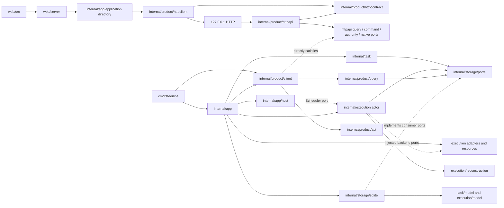
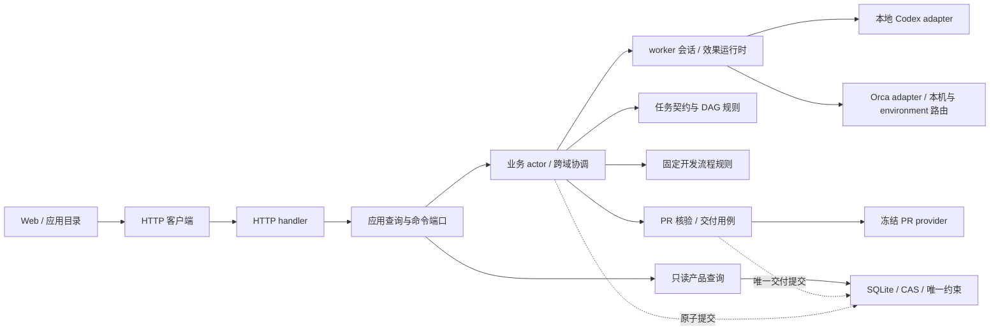

# 当前代码架构与源码索引

> 2026-10-15：TUI 已移除，Web 为唯一交互前端；后台 CLI、项目/应用/Web 独立服务和原生会话能力保留。范围与实际验证见[TUI 退役](../acceptance/tui-retirement.md)，已有 Web 行为见[项目切换](../acceptance/web-project-switch.md)。

核对基点：2026-10-15，`317714e6`＋本次 TUI 退役；本文描述该源码树，不将历史原生样本当作当前版本全量验收。第一阶段目标包含本地 Codex、本机 Orca 与远端执行路径交付；Orca 历史交付范围见[单终端验收](../acceptance/orca-terminal-transport.md)，当前完成补查询的规则、原生短回合及未重跑 PR 范围见[补查询验收](../acceptance/orca-completion-query.md)。远端执行目标与远程 HTTP 客户端是不同能力。

## 系统边界

整体职责与生命周期原则见[架构总览](../architecture.md)，本页维护实际代码与端口归属。

Worker 各节点的异常分类、重试预算和恢复边界统一维护于[Worker 流程异常处理与重试](../product-design/worker-lifecycle.md)，该文档同时索引当前实现与待补能力；本页不复制处理矩阵。

用于拆分 roadmap 任务时，先按[并行开发指南](parallel-development.md)核对功能、契约、共享语义/接线和测试资源；本页的包划分不直接构成并行许可。

Web 通过独立 Web 服务、应用目录与基础 HTTP 客户端访问各项目服务。`internal/app` 保留 CLI/服务的 adapter、SQLite 和端口组装；`internal/app/host` 承载服务进程、文件控制协议、锁与心跳，通过注入端口调用 execution actor。任务和执行状态仍由唯一 actor 决定，产品查询投影同一数据库快照。

The host does not open SQL, import backend adapters, or apply task/execution transitions. Its application admission, process facts, scheduling, command transport and activity presentation are injected. It reads the committed service/runtime sample through the configured reader; process liveness is observed separately from the SQLite snapshot.

## Module owners

Web 由 `cmd/steerline-web` 独立运行，`web/src` 负责当前项目页面与持久原信封/草稿，`web/server` 负责浏览器认证、静态嵌入及受限应用 API 转接。`steerline serve-app` 在 `internal/app/application_service.go` 组合应用目录和 `applicationhttp`，只通过原 `httpclient` 连接各项目；项目服务不再托管 Web。`projectconnection` 是应用服务使用的只读配置与 Git 身份解析器，`localservice` 维护独立 home/实例/进程发现和租约，应用协议为 `steerline-application/v1`。`build.ps1 -Web` 分别生成业务与 Web exe，只有后者嵌入页面；普通业务构建不依赖 Node。操作见 [Web README](../../web/README.md)，验证见[项目切换验收](../acceptance/web-project-switch.md)。

| Owner | Responsibility |
| --- | --- |
| `internal/app` | Config loading, profile and adapter construction, SQLite binding, command/client composition and close ownership. Builtin catalog composition stays in `directory.go`; local Codex and Orca terminal registrations/codecs and implementation helpers live in their respective owner files. |
| `internal/app/host` | Service process hosting, startup identity, locks, file control requests/receipts, heartbeat, exact instance/revision routing and shutdown observation. `internal/execution/scheduler` contains the timer loop over the injected actor interface. |
| `internal/task` | Fixed task contract validation, selection and task-owned claim/result/discard declarations through narrow ports. |
| `internal/task/model` | Task values, fixed contract, DAG, eligibility and normalized delivery facts. |
| `internal/execution` | Unique actor, dispatch, worker sessions, decisions, recovery, delivery and cleanup. Host calls the actor through `execution.HostPort` and scheduling callbacks; adapters do not mutate domain state. |
| `internal/execution/model`, `internal/execution/backend` and `internal/execution/conversation` | Execution records and rules; backend-neutral adapter values and implementation evidence; conversation source and mapper ports with their discovery/history requests. |
| `internal/execution/reconstruction` | Pure reconstruction of `Runtime` and `RunView` from a committed checkpoint and the sampled task/execution records. It performs no I/O. |
| `internal/execution/adapters` | Codex app-server, Orca single-terminal local/environment implementation, and their public protocol codecs. Orca target routing shares code; remote delivery has a finite real sample after native CLI upgrade and directory trust preparation; automatic continuation of the initially rejected task remains unverified. |
| `internal/execution/workspace`, `publication`, `process` | Git workspace, provider/PR operations, managed worker processes and file resource facts. The app injects process facts into the host. |
| `internal/product/api` | Serializable product pages, user commands, request targets and receipts. It contains no Runtime, Config, SQL record, or Go handle. |
| `internal/product/client` | The injected internal product client for CLI/service consumers. At app composition it directly satisfies the HTTP server's query, command, authority and native-viewer ports; the HTTP package does not depend on the concrete client. `TaskGraphExportReceipt` is a product value and graph file publication is a client operation. |
| `internal/product/query` | Read-only projections and composition of product pages from storage ports. No SQL or business writer. |
| `internal/product/httpapi` | Loopback HTTP discovery/authentication and DTO/action transport over narrow query, command, authority and native-viewer ports. `command_registry.go` owns immutable envelope registration and authority reconciliation; `request_records.go` owns the private record format and atomic file access. The package does not open SQL or own business transitions. |
| `internal/product/activityrender` | Pure activity formatter shared by service output; consumes product API values and retains its original rendering tests. |
| `internal/product/httpclient`, `httpcontract`, `httpfs` | HTTP consumer, serializable wire values, restricted discovery/credential files and shared process identity checks. No business-file fallback; browser original requests belong to Web IndexedDB. |
| `internal/storage/ports` and `internal/storage/sqlite` | Consumer-owned narrow read/commit declarations; one SQLite implementation owns schema, SQL, WAL, CAS and transactions. |
| `internal/testkit` and `tests/integration`, `tests/e2e` | Test-only boundary guards, Go test feedback, process ownership and protocol fixtures; real application composition tests; registered controlled/native E2E scenarios. Product production imports are forbidden. |

The former `internal/steerline` host/facade, `internal/steerlineapp`, `internal/steerline/contracts` and `internal/steerlineintegration` packages have no production or test import path. Tests moved to their owner or to `tests/integration`; no forwarding aliases remain.

Within app, [`directory.go`](../../internal/app/directory.go) explicitly combines two registration/codec pairs and binds one independent catalog. [`directory_local.go`](../../internal/app/directory_local.go) owns local Codex configuration, preflight/claim, policy resources and `localExecutionBackend`; [`directory_orca_terminal.go`](../../internal/app/directory_orca_terminal.go) owns the single Orca terminal implementation with local/environment routing. Both targets use one agent terminal, short inputs and cursor-based compact replies; supervised is deleted. Backend-local changes normally stay in the owner file; catalog-wide identity/policy changes still require coordination.

Worker execution is composed as Workflow → ReliableExecution → adapter: `workflow` owns business prompts, source and successor rules; `reliable` owns preparation applicability, original-operation reconciliation, identity/turn facts, deadlines and recovery qualification. The execution root maps durable records and composes one WorkerCommit; it does not inject Service rules into either package. Adapters declare applicability and native facts, with no backend-name branches in reliable. The retired local workspace fallback is deleted. Scope and evidence are maintained in the [three-layer acceptance](../acceptance/worker-three-layer.md).

## Current package inventory

The package inventory follows the current Go tree. Web/application consumers use the base HTTP client; the retired TUI and its request journal are absent. E2E scenarios retain their e2e build tag; the test runner enumerates the current owners.

| Owner / purpose | Current packages |
| --- | --- |
| Product commands and runner | `cmd/orca-probe`, `cmd/steerline`, `cmd/test-feedback` |
| Composition and host | `internal/app`, `internal/app/host` |
| Task | `internal/task`, `internal/task/model` |
| Execution actor and pure values | `internal/execution`, `internal/execution/agentlaunch`, `internal/execution/backend`, `internal/execution/conversation`, `internal/execution/hostport`, `internal/execution/model`, `internal/execution/reconstruction`, `internal/execution/scheduler`, `internal/execution/workflow`, `internal/execution/reliable` |
| Execution effects and native reply evidence | `internal/execution/adapters/codex`, `internal/execution/adapters/orcatransport`, `internal/execution/adapters/protocol/codexapp`, `internal/execution/adapters/protocol/orca`, `internal/execution/process`, `internal/execution/publication`, `internal/execution/workspace` |
| Filesystem guards | `internal/pathguard` |
| Product contracts and reads | `internal/product/api`, `internal/product/client`, `internal/product/query`, `internal/product/query/taskgraph`, `internal/product/httpapi`, `internal/product/httpclient`, `internal/product/httpcontract`, `internal/product/httpfs` |
| Storage | `internal/storage/ports`, `internal/storage/sqlite` |
| Test support | `internal/testkit/boundary`, `internal/testkit/boundary/e2e`, `internal/testkit/feedback`, `internal/testkit/fixtures`, `internal/testkit/process`, `internal/testkit/protocol` |
| Integration and E2E helpers | `tests/integration`, `tests/e2e/cmd/sandbox-setup`, `tests/e2e/internal/controlled`, `tests/e2e/internal/driver`, `tests/e2e/internal/evidence`, `tests/e2e/internal/native`, `tests/e2e/internal/testenv` |

The tagged scenario owners are `tests/e2e/smoke`, `tests/e2e/live`, and `tests/e2e/suites/{candidates,delivery,recovery,runtime,nativeworkspace}`. Source presence does not imply current runner registration: IDs, levels, environments and exact top-level tests remain owned by [`tests/e2e/suites.json`](../../tests/e2e/suites.json) and the [E2E guide](../../tests/e2e/README.md). Integration tests own real app composition; they may not import `tests/e2e/internal`.

## Public boundaries and entry points

| Public boundary | Main declarations / production entry |
| --- | --- |
| Task input, graph, qualification and result values | `internal/task/model`; `task.Service.Ready` reaches `model.ReadyTasks` and its `StableTaskOrder` rule; `task.Commands` receives only task-specific ports. |
| Execution records and neutral adapter values | `internal/execution/model` and `internal/execution/backend`; the unique `execution.Service` / `execution.CommandService` own dispatch, recovery, delivery and cleanup. |
| Host calls into execution | `execution.HostPort` and scheduler callbacks in `internal/execution`; `internal/app/host` uses injected ports and does not implement domain transitions. |
| Serializable product surface | `internal/product/api`; `internal/product/client` is the one injected Go client; `internal/product/query` projects read-only storage values. |
| Local native client transport | `internal/product/httpapi` adapts its consumer ports to `steerline-client/v1`; `internal/app` directly supplies the product client as the port implementation and starts the endpoint within the existing locked service lifetime. |
| Atomic persistence declarations | `internal/storage/ports`; `internal/storage/sqlite` is the sole SQL/schema/transaction implementation. |
| Composition inputs | `internal/app.Config`, `LoadConfig`, `NewService` and the app wiring files bind the concrete adapters, ports and SQLite owner. |
| Main executable | `cmd/steerline/main.go` routes `serve-app`/`stop-app`, `run`/`start-service`, task and product commands. |
| Test feedback executable | `cmd/test-feedback` selects L1, Full, scoped Go tests and registered controlled/live E2E scenarios; only its feedback/process imports are allowed outside tests. |
| Diagnostic executable | `cmd/orca-probe` emits capability evidence and does not create product tasks, workers or messages. |

Historical migration ledgers and source inventories are available from the [fixed Git snapshot](../acceptance/archive/completed/history.md#历史取证). Current ownership is defined by the source tables on this page and the boundary guards, not inventories at a prior commit.

## Build, install and launch sources

The repository-root [`build.ps1`](../../build.ps1) builds `./cmd/steerline` to `bin/steerline.exe` on Windows; `-Web` also builds the assets and independent `bin/steerline-web.exe`. [`build.bat`](../../build.bat) always passes `-Web`, so double-clicking it builds both executables and requires Go, Node.js and npm; `--no-pause` skips its final keypress. A plain `build.ps1` still builds only the business executable without Node.js. They build only and do not install or switch a running service. `steerline install` copies the running executable through `internal/app.InstallSelf` to the configured application home. `steerline launchers` calls `internal/app/host.InstallLaunchers`, which writes the embedded application/Web launchers, `service-window.bat` and launcher README into that home. The service process enters through `cmd/steerline` and `internal/app/host`; there is no separate legacy root host package. Installation/debug path isolation was delivered by #83; phase-one combined/24-hour/same-build recovery acceptance remains pending. Full stable/dev version management is outside the current roadmap.

## Platform-specific source owners

These files are selected by Go OS/build constraints and remain in their actual owners; the source scanner covers inactive OS/tag files too.

| Concern | Current files |
| --- | --- |
| Service host | `internal/app/host/platform_windows.go`, `internal/app/host/platform_linux.go` and matching platform tests |
| Execution journal and process facts | `internal/execution/journal_platform_{windows,linux,other}.go`; `internal/execution/process/facts_{windows,linux,other}.go`; `service_facts_{windows,linux,other}.go` |
| Process replacement and ownership | `internal/execution/process/replace_{windows,unix}.go`; `internal/testkit/process/process_{windows,unix}.go`; `cmd/test-feedback/process_{windows,unix}.go` |
| Test protocol lock and controlled state replacement | `internal/testkit/protocol/native_lock_{windows,other}.go`; `tests/e2e/internal/controlled/state_replace_{windows,other}.go` |
| E2E platform helpers | `tests/e2e/cmd/sandbox-setup/elevation_{windows,other}.go`; `tests/e2e/internal/native/{sandbox,candidate_fault}_{windows,other}.go` |

`TestCD67CoreBoundary` retains all-tag source negatives and direct/transitive Windows/Linux production closure checks. These checks prove dependency structure for both target OSes; a Windows run does not claim Linux runtime behavior.

## Persistent state and recovery

SQLite remains the only persistent business authority. Claim, task result, unique delivery, discard, command receipt and their checkpoint changes still validate original identity and versions in their existing transaction boundaries. External Git or provider facts remain independent observations; no cross-system atomicity is inferred.

The local HTTP transport keeps its discovery, current-user credential and immutable request envelopes under the existing `run_dir/local-api/` tree. These transport records arbitrate HTTP request IDs and report recovery status; task/execution transitions and command receipts remain in the existing host inbox or SQLite command authority.

Execution recovery reads the service checkpoint together with task authority/graph and execution records using the existing storage read ports. `execution/reconstruction` rebuilds the read-only Runtime from that sample; persisted control-operation receipts use execution-owned checkpoint values and convert to product DTOs at the host transport. `ApplicationProjectSnapshot` still composes product project values and execution facts in one SQLite read transaction; the Go client classifies heartbeat/process freshness from the sampled Runtime rather than combining separately sampled versions. E2E `SnapshotContext` also reconstructs from that same `ApplicationProjectSnapshot` database sample.

Complete final reply writes and their native-history checkpoints still commit atomically; raw/process transcripts and the separate JSONL conversation replay are retired. Query pages expose `product/api` DTOs; raw source cursors, implementation attributes and persisted event values remain execution-owned. Host heartbeat writes service metadata only. Stopping the service does not imply that an external worker exited.

The current persisted-format source table is maintained in the [data model](../product-design/data-model.md#当前格式来源). Unsupported or retired formats are rejected without migration, old-format reads, dual writes or rollback paths.

## Verification and source locations

The boundary tests scan all OS/build-tag source files and the Windows/Linux production dependency graphs. `test-feedback -level=L1` remains the fixed quick/rule/owner selection; E2E level and scenario selection remains explicit in [`tests/e2e/README.md`](../../tests/e2e/README.md). Full, L2 and live L3 are not default requirements.

Test-only support has one owner under [`internal/testkit`](../../internal/testkit): [`boundary`](../../internal/testkit/boundary/check.go) scans production ownership and architecture closures; [`boundary/e2e`](../../internal/testkit/boundary/e2e/boundary_test.go) checks test-tool consumers and E2E/import boundaries; [`feedback`](../../internal/testkit/feedback/summary.go) parses Go test events; [`process`](../../internal/testkit/process/process.go) owns test subprocess trees; and [`protocol`](../../internal/testkit/protocol) contains protocol fixtures. `cmd/test-feedback` is the only non-test source allowed to import `feedback` and `process`; the existing E2E setup/driver/native helpers may import `process`. No product source may import testkit or `tests`. Real app and cross-module tests stay in [`tests/integration`](../../tests/integration); they cannot import `tests/e2e/internal`.

## Key source entry points

| Flow | Source |
| --- | --- |
| CLI composition and installation | [`cmd/steerline/main.go`](../../cmd/steerline/main.go), [`internal/app/config.go`](../../internal/app/config.go), [`internal/app/execution_service_wiring.go`](../../internal/app/execution_service_wiring.go), [`internal/app/host/launchers.go`](../../internal/app/host/launchers.go), [`build.ps1`](../../build.ps1) |
| Host loop and control | [`internal/app/host/service_client.go`](../../internal/app/host/service_client.go), [`internal/app/host/control_protocol.go`](../../internal/app/host/control_protocol.go), [`internal/execution/scheduler/loop.go`](../../internal/execution/scheduler/loop.go) |
| Execution actor and ports | [`internal/execution/service_construction.go`](../../internal/execution/service_construction.go), [`internal/execution/host_ports.go`](../../internal/execution/host_ports.go), [`internal/execution/service_commit.go`](../../internal/execution/service_commit.go) |
| Runtime reconstruction | [`internal/execution/reconstruction/runtime.go`](../../internal/execution/reconstruction/runtime.go), [`internal/execution/reconstruction/run.go`](../../internal/execution/reconstruction/run.go) |
| Product reads and client | [`internal/product/query/project_page.go`](../../internal/product/query/project_page.go), [`internal/product/client/client.go`](../../internal/product/client/client.go) |
| Web and HTTP transport | [`web/server`](../../web/server), [`internal/product/httpclient`](../../internal/product/httpclient), [`internal/product/httpcontract`](../../internal/product/httpcontract), [`internal/product/httpfs`](../../internal/product/httpfs), [`internal/product/httpapi`](../../internal/product/httpapi), [protocol contract](../product-design/local-client-protocol.md), [`internal/app/execution_service_wiring.go`](../../internal/app/execution_service_wiring.go) |
| Storage ports and SQLite | [`internal/storage/ports`](../../internal/storage/ports), [`internal/storage/sqlite`](../../internal/storage/sqlite) |
| Test feedback and process support | [`internal/testkit/feedback`](../../internal/testkit/feedback), [`internal/testkit/process`](../../internal/testkit/process), [`internal/testkit/protocol`](../../internal/testkit/protocol) |
| Boundary guards and integration tests | [`internal/testkit/boundary`](../../internal/testkit/boundary), [`internal/testkit/boundary/e2e`](../../internal/testkit/boundary/e2e), [`tests/integration`](../../tests/integration) |

## Development flow ownership

`internal/execution/workflow` owns the single `development/v3` business prompts, source/format rules, successor decisions and strict JSON decoding. `reliable` normalizes execution evidence and owns technical qualification/reconciliation/recovery; `staged_flow.go` maps durable records and commits results, transitions and next-input intentions atomically. `model/staged_flow.go` retains persistent wire values and step IDs. The flow no longer stores separate artifact snapshots. Adapters normalize native evidence without selecting the next business step. Codex consumes verified app-server final_answer items. Orca uses one original terminal, exact input acceptance/start receipts, a pre-send main-agent baseline and original runtime/terminal/incarnation/pane/provider identity. Native subscription and independent `worktree.ps` queries verify a new completion and complete ordinary `lastAssistantMessage`; working observation is optional. There is no Task/Dispatch/coordinator, output-material relay, base64 result marker, screen completion heuristic or agent-private history scan. Missing/truncated/conflicting provenance blocks advancement. Current completion supports Codex main-agent evidence only; native outcome may remain unknown independently of the accepted reply and business outcome. Both adapters expose workspace facts without promising strong read-only isolation; Orca's comparison is revision-scoped. Product pages and the TUI consume persisted workflow projections. See [Orca boundary](orca-native-worker.md) and [completion rules](../spec/orca-completion-query.spec.md).

## HTTP 接入后的解耦评估与建议

以下为 `5a24abec` 的代码评估。2026-10-14，经范围审计与用户授权，五项各自建立Spec/Plan；#92已通过PR #311交付，#93已通过PR #312交付，#94/#95/#96因Worker三层重构影响继续留[草稿](../roadmap/drafts/roadmap.md)。下述保留原基线的收益评估及已交付HTTP边界说明，旧流程/runtime owner及集成建议不用于当前开工；三层未合入前不声明其为当前代码。

建议保持同一个 Go 服务，在进程内形成以下职责关系。实线表示调用/事实消费，虚线表示共享的原子提交边界；业务 actor 是唯一状态变更仲裁者。

### 已有边界与剩余耦合

| 边界 | 当前程度 | 仍共享的职责 |
| --- | --- | --- |
| Web / 应用目录 ↔ HTTP ↔ 项目服务 | 浏览器认证与原信封保存在 Web；应用目录只读解析并转接公共 HTTP | 共享实例/进程身份核验保留；TUI Console、journal 和 observer 已退役 |
| HTTP handler ↔ Go 应用 | Server 通过查询、命令、authority 与原生查看消费端口调用现有应用；不打开 SQL，不推进业务状态 | `command_registry.go` 统一普通命令和原生查看的登记/对账及跨动作仲裁；`request_records.go` 单独持有私有记录格式、大小边界和原子读写。app 将现有 product client 直接接入这些端口 |
| 任务管理 ↔ 执行 | task 只依赖 task/model；execution 通过 TaskWorkPort/TaskResultPort 调用任务规则，不导入 task 实现 | claim/result/discard/delivery 跨域协调仍在 execution.CommandService；CommandStore 集合较宽，不能将它全部注入每个用途 |
| 流程 ↔ worker 运行时 | adapter 不解析业务 JSON、不选择下一业务步骤 | staged_flow、worker 生命周期、反馈、恢复、会话采集及提交都是 Service 方法，共享 domain/runs/worker/effect 状态；主要是文件归属，尚无包级隔离 |
| 本地 Codex ↔ Orca | 两个 adapter 和协议 codec 已分开，核心不导入实现 | 核心仍用聚合 LifecyclePort；部分通用分离启动逻辑仍叫 applyAppServerSessionReceipt/applyAppServerTurnReceipt，需要按真实通用职责建立边界；两端证据和停止能力仍不同 |
| 存储 ↔ 查询 | SQL 与只读产品查询分包，业务提交已有 CAS/唯一约束 | SQLite 仍引用 query 的少量值/分页辅助，httpapi 也引用 query 的页大小常量；这是可清理的反向知识依赖，并非当前绕过业务权威 |

### 重构收益评估

已确认批次#92/#93中，#92/#93均已独立复审、验证并真实合并。#94/#96与三层workflow/reliable及actor接线重叠，#95的最终交付抽取仍有剩余收益但当前桥接需重审，见[冲突核对](../roadmap/drafts/roadmap.md#与worker三层重构的冲突核对)。以下保留原设计理由，不作为五项实施次序。

1. **本次已分离固定流程规则。** [workflow](../../internal/execution/workflow/route.go) 已接收窄业务值和已核验的执行事实，返回显式后继声明；不接收 Service、RunView 可写指针、SQL 或 backend 句柄。严格结果解析归 [workflow/result.go](../../internal/execution/workflow/result.go)，原生 I/O 由 adapter 执行，技术规则由 reliable 决定，结果/转移/下一输入由 actor 一次提交。#94 的重叠调查和后续范围需在启动前与此成果核对，不据此自动改变 roadmap 任务状态。
2. **高收益：收拢 worker 运行时资源所有权。** 首轮 [#96](../spec/worker-runtime-ownership.spec.md)只收拢观察器、原句柄、在途外部调用、取消/关闭和固定结果交接，复用已有后台机制。只接受已持久化 Operation 与冻结资源值，返回原身份事实/回执；不携带可写 RunView/apply闭包。业务 actor 保留步骤、Decision、恢复资格、提交与确认门槛，具体adapter保留证据/停服能力，本机/environment Orca仍共用实现。完整业务恢复拆分不混入首轮。
3. **高收益：抽出任务最终交付。** [native_delivery_command.go](../../internal/execution/native_delivery_command.go) 当前组合冻结 provider、真实 PR 查询、执行门槛、任务结果和提交。[#95](../spec/task-delivery-usecase.spec.md)仅提取最终交付用例，接收固定候选/任务、带provider身份的PR事实、任务结果声明和提交端口；claim/discard的进一步收窄留后续。沿用 [ResultCommit](../../internal/storage/ports/task_result.go) 的原子提交，不拆唯一TaskDelivery/closed/WorkflowRun/图修订。流程/PR绑定仍由actor负责，未知发布但合法真实合并的原交付路径保持。
4. **已交付：分离 HTTP 协议与命令登记/对账。** 任务 [#92](../spec/http-command-boundary.spec.md) 经PR #311将 Server 改为消费查询、命令、authority 和原生查看端口，app 直接提供现有 product client；登记 owner 接收固定信封与 OS 调用身份，不接收 Server、Request、ResponseWriter、具体 Client 或数据库连接。普通业务命令与原生窗口副作用共用记录 owner 和跨动作仲裁，保留各自重试规则；HTTP 层保留认证、路由、JSON 上限和状态码映射。不把 transport receipt 变成领域权威，也不把 unknown 当成重放许可。具体行为与验收结果见[专属验收](../acceptance/http-command-boundary.md)。
5. **历史交付：客户端原请求与本机观察。** [#93](../spec/http-client-request-lifecycle.spec.md) 的 TUI Console/journal/observer 已随本次退役删除；基础 Client/Open 和应用/Web 所需进程身份核验保留，浏览器原信封由现有 Web IndexedDB 维护。原交付事实不改写。

上述顺序优先减少共享 Service 的修改范围。HTTP 端口和客户端拆分可独立准备；交付抽取与 worker 抽取都涉及共享模型/接线时应分次落地。每次抽取都应以“消费者无需修改无关 owner，且测试无需完整 Service/真后端”验收，单纯移动文件或接口方法原样转发不算完成解耦。

### 其他值得收窄的功能

- **会话/final 采集与 worker 控制：** 已有 ConversationSourcePort 和存储端口；进一步让采集只持有固定来源、读取游标与提交声明。body/历史读取无需启动/停止/恢复能力，保持 final 与 checkpoint 原子提交及原身份归属。
- **宿主环境动作与业务反馈：** 原生查看、open_terminal、recheck_environment 属于宿主能力；Decision 答案及新业务 turn 属于流程。复用现有类型化目标，独立消费端口，避免新增宿主入口牵动 staged_flow。
- **存储与产品投影的公共值：** 将 query 中被 SQLite/httpapi 共用的常量、历史/分页纯值移至真正的契约或消费端口 owner；保持同快照查询，逐步消除 SQLite 对 query 的引用，避免新建万能 common 包。

保持一个 Go 服务、一个业务写入仲裁与一个 SQLite 即可实现上述模块解耦；模块边界不要求独立进程、数据库或服务部署。当前只有一个固定开发流程，不预设插件系统、通用 DSL 或跨版本兼容层。
