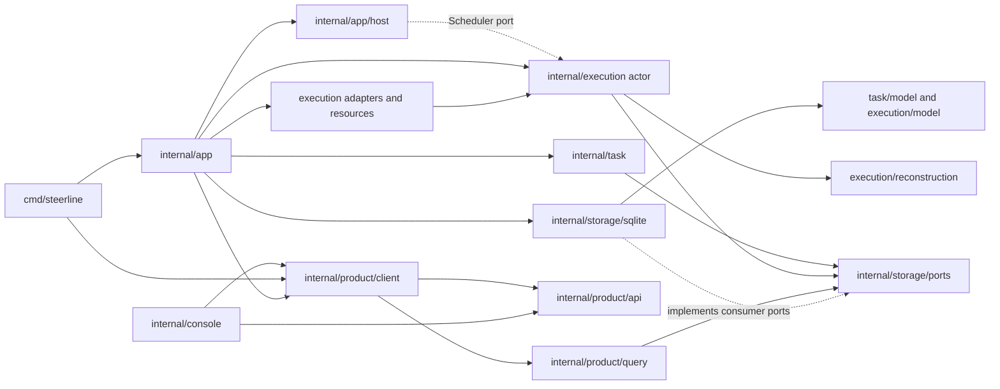

# 当前代码架构与源码索引

核对日期：2026-10-06。本文描述当前候选源码树。第一阶段的运行与验收只包含本地 Codex 和本机 Orca；保留的远端实现不代表一期接受远端权限或远端真机流程。

## 系统边界

整体职责与生命周期原则见[架构总览](../architecture.md)，本页维护实际代码与端口归属。

用于拆分 roadmap 任务时，先按[并行开发指南](parallel-development.md)核对功能、契约、共享语义/接线和测试资源；本页的包划分不直接构成并行许可。

CLI 和 TUI 使用同一个产品客户端。`internal/app` 读取配置并组装具体 adapter、SQLite 和各消费者端口；`internal/app/host` 承载服务进程、文件控制协议、启动/退出观察、锁与心跳，并通过注入端口调用 execution actor。任务和执行状态仍由唯一业务 actor 决定，再由 SQLite 专用提交接口校验身份、前值和版本。产品查询只把同一数据库快照投影为 `product/api` 页面。

The host does not open SQL, import backend adapters, or apply task/execution transitions. Its application admission, process facts, scheduling, command transport and activity presentation are injected. It reads the committed service/runtime sample through the configured reader; process liveness is observed separately from the SQLite snapshot.

## Module owners

| Owner | Responsibility |
| --- | --- |
| `internal/app` | Config loading, profile and adapter construction, SQLite binding, command/client composition and close ownership. |
| `internal/app/host` | Service process hosting, startup identity, locks, file control requests/receipts, heartbeat, exact instance/revision routing and shutdown observation. `internal/execution/scheduler` contains the timer loop over the injected actor interface. |
| `internal/task` | Fixed task contract validation, selection and task-owned claim/result/discard declarations through narrow ports. |
| `internal/task/model` | Task values, fixed contract, DAG, eligibility and normalized delivery facts. |
| `internal/execution` | Unique actor, dispatch, worker sessions, decisions, recovery, delivery and cleanup. Host calls the actor through `execution.HostPort` and scheduling callbacks; adapters do not mutate domain state. |
| `internal/execution/model`, `internal/execution/backend` and `internal/execution/conversation` | Execution records and rules; backend-neutral adapter values and implementation evidence; conversation source and mapper ports with their discovery/history requests. |
| `internal/execution/reconstruction` | Pure reconstruction of `Runtime` and `RunView` from a committed checkpoint and the sampled task/execution records. It performs no I/O. |
| `internal/execution/adapters` | Codex, local Orca, retained remote protocol implementation and shared Codex codec. Remote protocol retention does not authorize remote execution. |
| `internal/execution/workspace`, `publication`, `process` | Git workspace, provider/PR operations, managed worker processes and file resource facts. The app injects process facts into the host. |
| `internal/product/api` | Serializable product pages, user commands, request targets and receipts. It contains no Runtime, Config, SQL record, or Go handle. |
| `internal/product/client` | The single injected product client for CLI/TUI consumers. `TaskGraphExportReceipt` is a product value and graph file publication is a client operation. |
| `internal/product/query` | Read-only projections and composition of product pages from storage ports. No SQL or business writer. |
| `internal/console` | TUI navigation and view state; consumes only product API values and injected client interfaces. |
| `internal/storage/ports` and `internal/storage/sqlite` | Consumer-owned narrow read/commit declarations; one SQLite implementation owns schema, SQL, WAL, CAS and transactions. |
| `internal/testkit` and `tests/integration`, `tests/e2e` | Test-only boundary guards, Go test feedback, process ownership and protocol fixtures; real application composition tests; registered controlled/native E2E scenarios. Product production imports are forbidden. |

The former `internal/steerline` host/facade, `internal/steerlineapp`, `internal/steerline/contracts` and `internal/steerlineintegration` packages have no production or test import path. Tests moved to their owner or to `tests/integration`; no forwarding aliases remain.

## Current package inventory

At the #82 source commit, Windows `go list ./...` enumerates 42 packages. This includes the `docs/validation` helper package; it is not a product dependency. E2E scenario files use the `e2e` build tag, so their packages are listed separately from the default Go inventory below. No package remains under the retired `internal/steerline`, `internal/steerlineapp`, or `internal/steerlineintegration` roots.

| Owner / purpose | Current packages |
| --- | --- |
| Product commands and runner | `cmd/orca-probe`, `cmd/steerline`, `cmd/test-feedback` |
| Validation helper | `docs/validation` |
| Composition and host | `internal/app`, `internal/app/host` |
| Console | `internal/console`, `internal/console/activityrender` |
| Task | `internal/task`, `internal/task/model` |
| Execution actor and pure values | `internal/execution`, `internal/execution/backend`, `internal/execution/conversation`, `internal/execution/hostport`, `internal/execution/model`, `internal/execution/reconstruction`, `internal/execution/scheduler` |
| Execution effects | `internal/execution/adapters/codex`, `internal/execution/adapters/orca`, `internal/execution/adapters/orcaremote`, `internal/execution/adapters/protocol/codexapp`, `internal/execution/process`, `internal/execution/publication`, `internal/execution/workspace` |
| Product contracts and reads | `internal/product/api`, `internal/product/client`, `internal/product/query`, `internal/product/query/taskgraph` |
| Storage | `internal/storage/ports`, `internal/storage/sqlite` |
| Test support | `internal/testkit/boundary`, `internal/testkit/boundary/e2e`, `internal/testkit/feedback`, `internal/testkit/process`, `internal/testkit/protocol` |
| Integration and E2E helpers | `tests/integration`, `tests/e2e/cmd/sandbox-setup`, `tests/e2e/internal/controlled`, `tests/e2e/internal/driver`, `tests/e2e/internal/evidence`, `tests/e2e/internal/native`, `tests/e2e/internal/testenv` |

The tagged scenario owners are `tests/e2e/smoke`, `tests/e2e/live`, and `tests/e2e/suites/{candidates,delivery,recovery}`. IDs, levels, environments and exact top-level tests remain owned by [`tests/e2e/suites.json`](../../tests/e2e/suites.json) and the [E2E guide](../../tests/e2e/README.md). Integration tests own real app composition; they may not import `tests/e2e/internal`.

## Public boundaries and entry points

| Public boundary | Main declarations / production entry |
| --- | --- |
| Task input, graph, qualification and result values | `internal/task/model`; `task.Service.Ready` reaches `model.ReadyTasks` and its `StableTaskOrder` rule; `task.Commands` receives only task-specific ports. |
| Execution records and neutral adapter values | `internal/execution/model` and `internal/execution/backend`; the unique `execution.Service` / `execution.CommandService` own dispatch, recovery, delivery and cleanup. |
| Host calls into execution | `execution.HostPort` and scheduler callbacks in `internal/execution`; `internal/app/host` uses injected ports and does not implement domain transitions. |
| Serializable product surface | `internal/product/api`; `internal/product/client` is the one injected Go client; `internal/product/query` projects read-only storage values. |
| Atomic persistence declarations | `internal/storage/ports`; `internal/storage/sqlite` is the sole SQL/schema/transaction implementation. |
| Composition inputs | `internal/app.Config`, `LoadConfig`, `NewService` and the app wiring files bind the concrete adapters, ports and SQLite owner. |
| Main executable | `cmd/steerline/main.go` routes `console`, `run`/`start-service`, task and product commands. |
| Test feedback executable | `cmd/test-feedback` selects L1, Full, scoped Go tests and registered controlled/live E2E scenarios; only its feedback/process imports are allowed outside tests. |
| Diagnostic executable | `cmd/orca-probe` emits capability evidence and does not create product tasks, workers or messages. |

Historical migration ledgers and source inventories are available from the [fixed Git snapshot](../acceptance/archive/completed/history.md#历史取证). Current ownership is defined by the source tables on this page and the boundary guards, not inventories at a prior commit.

## Build, install and launch sources

The repository-root [`build.ps1`](../../build.ps1) builds `./cmd/steerline` to `bin/steerline.exe` on Windows; [`build.bat`](../../build.bat) is its double-click wrapper. They build only and do not install or switch a running service. `steerline install` copies the running executable through `internal/app.InstallSelf` to the configured application home. `steerline launchers` calls `internal/app/host.InstallLaunchers`, which writes the embedded `console.bat`, `service-window.bat` and launcher README into that home. The service process enters through `cmd/steerline` and `internal/app/host`; there is no separate legacy root host package. Installation/debug path isolation is the current planned increment; full stable/dev version management is outside the current roadmap.

## Platform-specific source owners

These files are selected by Go OS/build constraints and remain in their actual owners; the source scanner covers inactive OS/tag files too.

| Concern | Current files |
| --- | --- |
| Service host | `internal/app/host/platform_windows.go`, `internal/app/host/platform_linux.go` and matching platform tests |
| Console preference file semantics | `internal/console/preferences_windows.go`, `internal/console/preferences_unix.go` |
| Execution journal and process facts | `internal/execution/journal_platform_{windows,linux,other}.go`; `internal/execution/process/facts_{windows,linux,other}.go`; `service_facts_{windows,linux,other}.go` |
| Process replacement and ownership | `internal/execution/process/replace_{windows,unix}.go`; `internal/testkit/process/process_{windows,unix}.go`; `cmd/test-feedback/process_{windows,unix}.go` |
| Test protocol lock and controlled state replacement | `internal/testkit/protocol/native_lock_{windows,other}.go`; `tests/e2e/internal/controlled/state_replace_{windows,other}.go` |
| E2E platform helpers | `tests/e2e/cmd/sandbox-setup/elevation_{windows,other}.go`; `tests/e2e/internal/native/{sandbox,candidate_fault}_{windows,other}.go` |

`TestCD67CoreBoundary` retains all-tag source negatives and direct/transitive Windows/Linux production closure checks. These checks prove dependency structure for both target OSes; a Windows run does not claim Linux runtime behavior.

## Persistent state and recovery

SQLite remains the only persistent business authority. Claim, task result, unique delivery, discard, command receipt and their checkpoint changes still validate original identity and versions in their existing transaction boundaries. External Git or provider facts remain independent observations; no cross-system atomicity is inferred.

Execution recovery reads the service checkpoint together with task authority/graph and execution records using the existing storage read ports. `execution/reconstruction` rebuilds the read-only Runtime from that sample; persisted control-operation receipts use execution-owned checkpoint values and convert to product DTOs at the host transport. `ApplicationProjectSnapshot` still composes product project values and execution facts in one SQLite read transaction; the Go client classifies heartbeat/process freshness from the sampled Runtime rather than combining separately sampled versions. E2E `SnapshotContext` also reconstructs from that same `ApplicationProjectSnapshot` database sample.

Complete final reply writes and their native-history checkpoints still commit atomically; raw/process transcripts and the separate JSONL conversation replay are retired. Query pages expose `product/api` DTOs; raw source cursors, implementation attributes and persisted event values remain execution-owned. Host heartbeat writes service metadata only. Stopping the service does not imply that an external worker exited.

The current persisted-format source table is maintained in the [data model](../product-design/data-model.md#当前格式来源). Unsupported or retired formats are rejected without migration, old-format reads, dual writes or rollback paths.

## Verification and source locations

The boundary tests scan all OS/build-tag source files and the Windows/Linux production dependency graphs. `test-feedback -level=L1` remains the fixed quick/rule/owner selection; E2E level and scenario selection remains explicit in [`tests/e2e/README.md`](../../tests/e2e/README.md). Full, L2 and live L3 are not default requirements.

Test-only support has one owner under [`internal/testkit`](../../internal/testkit): [`boundary`](../../internal/testkit/boundary/check.go) scans production ownership and architecture closures; [`boundary/e2e`](../../internal/testkit/boundary/e2e/boundary_test.go) checks test-tool consumers and E2E/import boundaries; [`feedback`](../../internal/testkit/feedback/summary.go) parses Go test events; [`process`](../../internal/testkit/process/process.go) owns test subprocess trees; and [`protocol`](../../internal/testkit/protocol) contains protocol fixtures. `cmd/test-feedback` is the only non-test source allowed to import `feedback` and `process`; the existing E2E setup/driver/native helpers may import `process`. No product source may import testkit or `tests`. Real app and cross-module tests stay in [`tests/integration`](../../tests/integration); they cannot import `tests/e2e/internal`.

## Key source entry points

| Flow | Source |
| --- | --- |
| CLI composition and installation | [`cmd/steerline/main.go`](../../cmd/steerline/main.go), [`internal/app/config.go`](../../internal/app/config.go), [`internal/app/execution_service_wiring.go`](../../internal/app/execution_service_wiring.go), [`internal/app/host/launchers.go`](../../internal/app/host/launchers.go), [`build.ps1`](../../build.ps1) |
| Host loop and control | [`internal/app/host/service_client.go`](../../internal/app/host/service_client.go), [`internal/app/host/control_protocol.go`](../../internal/app/host/control_protocol.go), [`internal/execution/scheduler/loop.go`](../../internal/execution/scheduler/loop.go) |
| Execution actor and ports | [`internal/execution/service_construction.go`](../../internal/execution/service_construction.go), [`internal/execution/host_ports.go`](../../internal/execution/host_ports.go), [`internal/execution/service_commit.go`](../../internal/execution/service_commit.go) |
| Runtime reconstruction | [`internal/execution/reconstruction/runtime.go`](../../internal/execution/reconstruction/runtime.go), [`internal/execution/reconstruction/run.go`](../../internal/execution/reconstruction/run.go) |
| Product reads and client | [`internal/product/query/project_page.go`](../../internal/product/query/project_page.go), [`internal/product/client/client.go`](../../internal/product/client/client.go), [`internal/console/interfaces.go`](../../internal/console/interfaces.go) |
| Storage ports and SQLite | [`internal/storage/ports`](../../internal/storage/ports), [`internal/storage/sqlite`](../../internal/storage/sqlite) |
| Test feedback and process support | [`internal/testkit/feedback`](../../internal/testkit/feedback), [`internal/testkit/process`](../../internal/testkit/process), [`internal/testkit/protocol`](../../internal/testkit/protocol) |
| Boundary guards and integration tests | [`internal/testkit/boundary`](../../internal/testkit/boundary), [`internal/testkit/boundary/e2e`](../../internal/testkit/boundary/e2e), [`tests/integration`](../../tests/integration) |

## Development flow ownership

`internal/execution/staged_flow.go` owns the single development flow, frozen stage input/source bindings, artifact checks and atomic result/transition/next-input commitment; `staged_result.go` owns strict business JSON decoding. `model/staged_flow.go` contains values and step IDs. The native adapters normalize final provenance and keep transport purpose business/readiness; they do not choose business steps. Codex consumes verified app-server final_answer items; local Orca uses its exact file/offset transcript source pinned during readiness to verify the original root session, Task header, final_answer and task_complete. Later Dispatches may lack a fresh worker-read provider-session hook. Only the exact original root transcript pinned during readiness is reused; root session/workspace, current injected Task and native completion are reverified. No home/session scan or replacement binding is used. Missing/conflicting provenance blocks advancement and preserves its diagnostic. Both currently retain frozen native report permissions and expose the fact-comparison guarantee, without promising strong read-only isolation. Product pages and the TUI consume the same persisted workflow snapshot.
