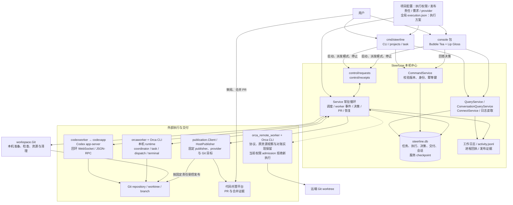
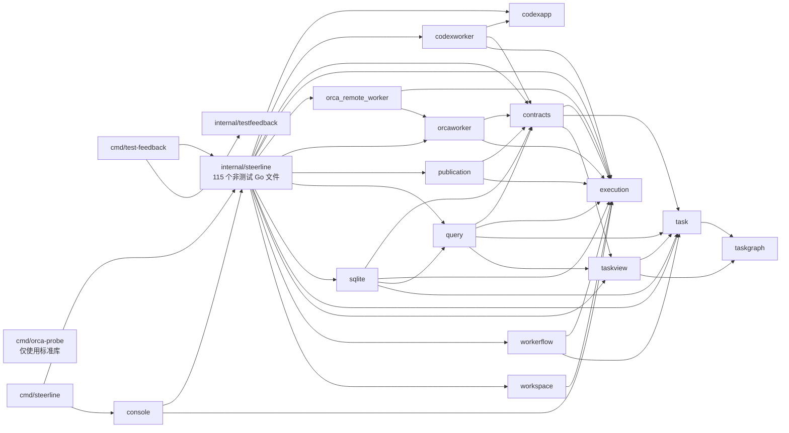
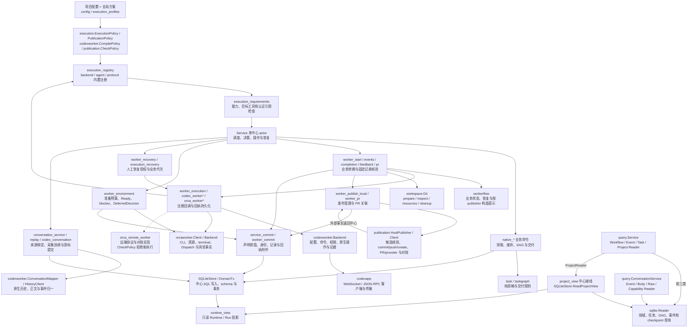
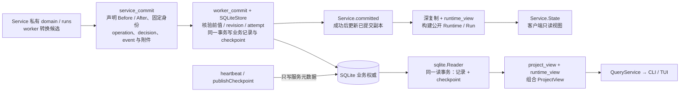
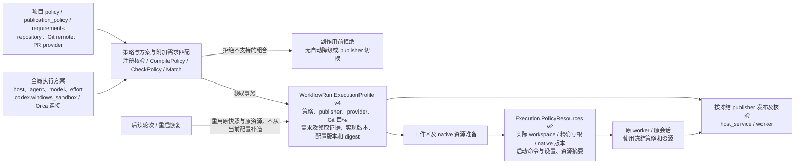
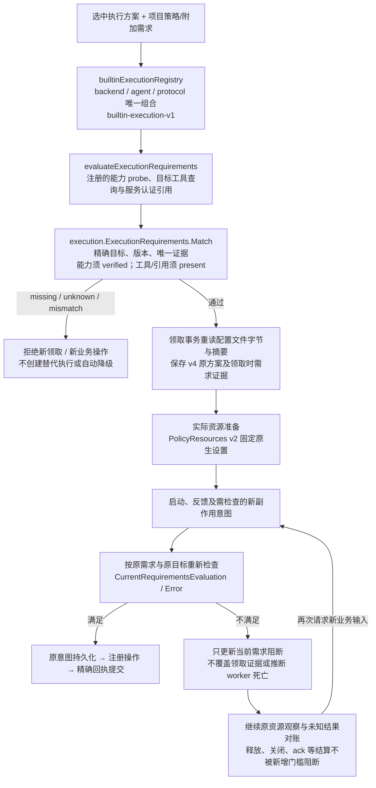
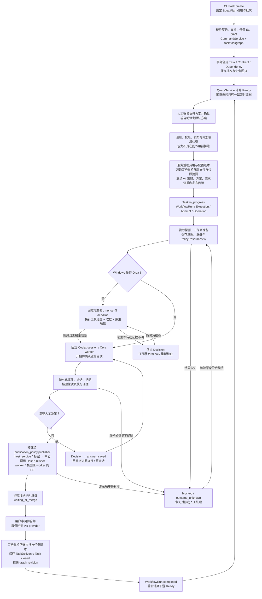
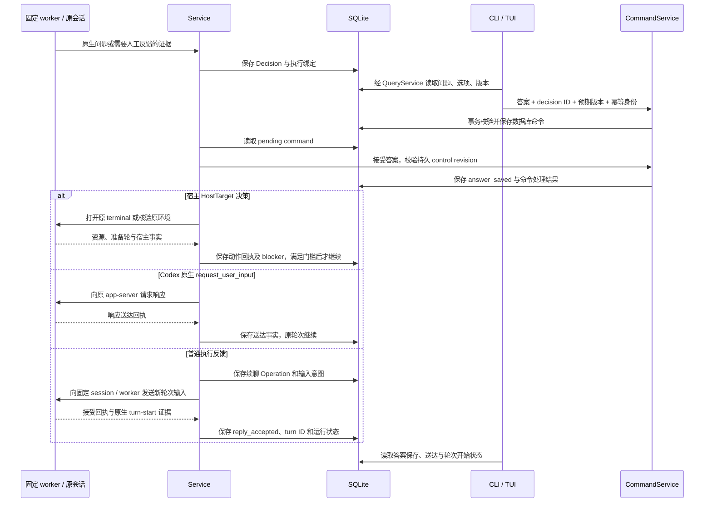
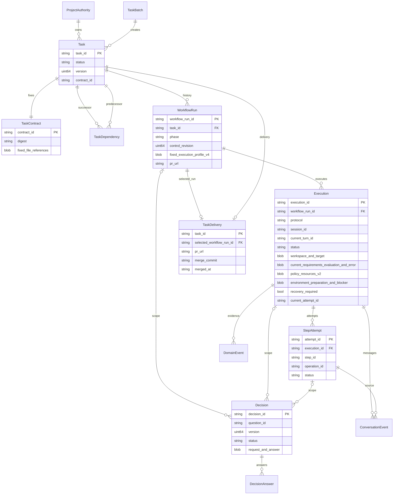
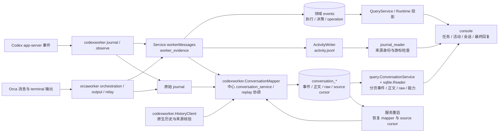

# SteerLine 当前代码架构图

快照日期：2026-10-01。源码基线：`7350e842bf1c33d50add3050e7bdfc8faa81c162`（已 rebase 并核对远端 `origin/main`）。本文起源于 [PR #153](https://github.com/erranliu/SteerLine/pull/153)，包含 PR #166 控制台渲染拆分与 #54–#61 执行隔离系列；最新 PR #174 已交付执行需求检查、内置注册与 v4 固定执行快照，叠加本轮会话只读查询拆包。

本文描述当前检出的代码：系统边界、实际 Go 包依赖、核心包内部职责、任务执行、人工决策、数据模型、日志与恢复。图中的职责分组不代表已拆成独立包或服务。箭头含义在各图前说明；未来方案与当前可启动路径分开列出，第 10 节给出后续解耦与复用建议。

## 1. 系统与进程总览

实线表示当前调用或数据通路，虚线表示实现保留但当前新执行入口不可用的远程通路。CLI 和控制台可以是不同进程；`run` 在独立服务进程中运行。查询经 Go 读取 SQLite，当前客户端控制协议主要使用文件请求/回执和数据库命令，而不是第二阶段计划中的 HTTP/SSE。

**业务权威**是 SQLite 中的持久记录。服务负责运行中的业务推进；CLI 的任务创建、废弃、追加前置等命令也能通过 `CommandService` 写库，但须取得仓库身份锁。客户端提交命令不等于执行成功，agent 输出和日志不等于任务交付。

**生命周期**：Windows 通过可见的 `service-window.bat` 承载服务；控制台退出不会停止服务。服务重启先对账保存的身份、命令和外部状态，再允许新派发。当前代码有 Windows/Linux 平台实现，但可启动的权限组合以第 3.2 节为准，不能从平台文件存在推断生产支持。

源码入口：[main.go](../../cmd/steerline/main.go)、[Service](../../internal/steerline/service.go)、[console/source.go](../../internal/steerline/console/source.go)、[control_protocol.go](../../internal/steerline/control_protocol.go)、[native_project_open.go](../../internal/steerline/native_project_open.go)。

## 2. 实际 Go 包依赖

箭头仅表示非测试 `.go` 源文件中的项目内 `import`，覆盖所有平台源码，不代表运行时调用。包名均对应真实目录。

| 包 | 当前职责 | 非测试 Go 文件 |
| --- | --- | ---: |
| `cmd/orca-probe` | 只读 Orca 能力探测与脱敏证据采集 | 1 |
| `cmd/steerline` | 产品命令入口、服务启动、控制台和任务命令路由 | 1 |
| `cmd/test-feedback` | 最小/定向/全量测试调度、日志与反馈报告 | 4 |
| `internal/steerline` | 配置与实现组装、调度、业务事务、持久化、查询及平台进程接线 | 115 |
| `codexapp` | app-server WebSocket/JSON-RPC、原生问题与传输；参数与权限决定已移出 | 4 |
| `codexworker` | Codex 配置/命令/权限编译、启动/连接/观察/回答/恢复、活动/会话与原生历史解析 | 25 |
| `console` | TUI 状态、导航、任务列表、会话/正文、方案和决策；渲染与锚点按职责分文件 | 18 |
| `contracts` | 共享任务/执行记录、视图、活动/会话、决策内容及发布冻结 DTO、严格 JSON 解码 | 13 |
| `execution` | 公共身份、输入/回答、事实、回执、能力、工作区、错误、项目权限/发布责任与需求匹配纯值 | 10 |
| `orca_remote_worker` | 远端预检、启动/复用、观察、mailbox、工作区和清理协议；当前策略入口拒绝新执行 | 12 |
| `orcaworker` | Orca CLI/资源/终端/派发/消息/观察/对账、shell 包装、就绪与宿主事实 | 22 |
| `publication` | Git 发布、候选核验与对账、PR/provider、发布责任支持与非秘密目标校验 | 7 |
| `query` | 按消费者分开的只读接口、领域/会话事件、正文/raw/能力读取、任务分页、DAG 与 Ready 查询规则 | 6 |
| `sqlite` | 领域/会话/能力/命令/任务/DAG/checkpoint 与组合快照的 SQLite 只读适配 | 7 |
| `task` | 任务契约、批次、状态、依赖资格、交付和命令规则 | 10 |
| `taskgraph` | DAG 校验、遍历、前后置关系和图算法 | 1 |
| `taskview` | 任务展示、分页和投影规则 | 3 |
| `workerflow` | 单 worker 的纯业务状态、恢复规则与按发布责任构造固定任务指令 | 3 |
| `workspace` | 本机 Git/worktree 准备、身份检查、精确资源解析与清理；不写业务状态 | 5 |
| `internal/testfeedback` | Go test JSON 结果汇总 | 1 |

合计 **20 个包目录、268 个非测试 Go 文件、45 条项目内 import 边**。统计覆盖 `cmd/` 与 `internal/`；不含 `_test.go`、测试数据、脚本和文档。适配器、工作区与发布实现已经归包，中心通过内置注册集中接线，并保留业务权威与事务。

## 3. 中心、独立实现与当前接线

图中 Service、业务转换、事务和配置组装仍在中心包；execution、workspace、publication 与各 worker 适配器是独立包。实线表示调用或数据流，虚线表示当前新执行入口被拒绝的远程路径。

| 所有者 | 主要源码 | 已落实的边界 |
| --- | --- | --- |
| 公共执行值与小接口 | `execution/` | 不依赖中心、具体平台或 SQL；权限、发布责任与附加需求是项目纯值 |
| 配置、冻结与实现组装 | `config.go`、`execution_profiles.go`、`execution_snapshot.go`、`publication_snapshot.go`、`execution_registry.go`、`execution_requirements.go` | 内置注册集中接线；领取冻结策略、方案与需求证据，准备后固定实际资源 |
| 业务推进与原子提交 | `service.go`、`worker_*.go`、`native_*.go`、`service_commit.go`、`worker_commit.go` | 适配器不能写 Task、Decision、Operation 或 TaskDelivery；意图、回执和业务转换由中心提交 |
| 本机 Git/worktree | `workspace/`、中心 `workspace_config.go` / `workspace.go` | 本机准备、检查、Git 实际目录和清理已归包；中心构造固定意图与工具端口 |
| Git 发布与 PR/provider | `publication/`、`worker_publish_local.go`、`worker_pr.go`、`native_delivery_command.go` | 外部发布与对账归 publication；真实合并、版本重检及唯一 TaskDelivery 仍在中心 |
| Codex 平台实现 | `codexworker/`、`codexapp/`、中心 `codex_worker*.go` / `codex_history_port.go` | 统一 Codex 参数生产者；原生启动、回答、恢复、活动/会话/历史解析归 codexworker，中心注入受管进程端口 |
| 本机 Orca 平台实现 | `orcaworker/`、中心 `orca_worker*.go` / `orca.go` | 原生 CLI、JSON、资源和结算核验归适配器；Codex 命令由中心从唯一生产者传入，Orca 只包装 shell |
| 远程 Orca 平台实现 | `orca_remote_worker/`、`orca_remote_adapter.go`、`orca_remote_service.go` | 独立协议与原资源对账保留；当前缺少策略落实回执，虽已注册，新执行在权限 admission 拒绝 |
| 环境就绪与宿主处理 | `worker_environment.go`、`contracts/environment.go`、`orcaworker/readiness.go` / `environment.go` | 准备轮、Ready、blocker、重查及反馈暂存归中心；工具证据、收据与宿主事实归适配器 |
| 共享会话与决策数据 | `contracts/conversation.go`、`contracts/activity.go`、`contracts/decision_content.go` | 数据类型已归 contracts，原生解释与中心持久化分开 |
| 查询、投影与存储 | `query/`、`sqlite/`、`project_view.go`、`runtime_view.go`、`conversation_store.go` | 领域和产品会话只读 SQL 已归 sqlite；会话写入/checkpoint 恢复与 Runtime 投影仍由中心拥有 |
| 控制台渲染 | `console/view_tasks.go`、`view_conversation.go`、`conversation_anchor.go`、`view_text.go` | 列表、正文、锚点和文本处理已同包拆文件；配置、提交资格和产品状态保留原入口 |

中心保留内置注册、Config/执行配置解析、平台进程承载与原生证据到业务记录的转换，不能将已完成适配器迁移理解为中心已无实现接线。尤其 `execution_backend.go` 仍含通用执行记录/输出与本机观察桥，`codex_conversation.go` 仍负责历史绑定与持久化协调。共享公共定义没有业务写入权。

### 3.1 已提交视图与原子写入

箭头表示数据流。下列写集合、事务执行器与投影目前都在中心包，`sqlite.Reader` 只承担读取。工作副本不能作为已提交视图发布；数据库命令与 worker 转换共用数据库，但有各自的事务入口。

`workerCommit` 附件包含执行绑定和底层操作回执；恢复时退休旧 Attempt、创建新 Attempt 与切换 Execution 当前代次也在同一事务内。提交失败后恢复私有候选，不能发布成功状态或消费成功回执。会话记录及其 source cursor 使用独立的 `CommitConversation` 事务，不能误解为所有日志和正文都与 worker 写集合一起提交。

源码：[service_commit.go](../../internal/steerline/service_commit.go)、[worker_commit.go](../../internal/steerline/worker_commit.go)、[worker_attachment_store.go](../../internal/steerline/worker_attachment_store.go)、[project_view.go](../../internal/steerline/project_view.go)、[conversation_store.go](../../internal/steerline/conversation_store.go)。

### 3.2 项目策略、执行方案与两阶段冻结

箭头表示配置和证据的生成通路。项目定义权限及发布责任，全局 execution.json 只选择执行位置、agent、model、effort 与实现选项。策略不会因换 Profile 隐式改变。

当前可验证的权限映射限定在 Codex 适配器：Windows local / Orca 的 workspace 写、精确 Git metadata 写、network=allow、escalation=deny；另有 Windows local 的 read-only + network=deny 分支。其他组合明确拒绝。原生映射固定 `codex-cli 0.159.2`，使用 approval=never、明确写根并排除隐式临时根；network=deny 同时禁止 hosted live web search。local 受限模式缺省 elevated；local workspace-write 的 unelevated 分散写根仍拒绝，Orca 必须显式选择 Windows 实现。版本/help 能力检查不等于实际 worker 工具权限证明。

发布责任覆盖 commit、push 与建 PR 一整组动作。当前 host_service 支持 local Codex + GitHub command provider；worker 支持 Orca + 有 query 能力的 provider，远程配置还须通过独立权限 admission。provider 有 query 不表示可 create，能力不足不改变 publisher。完整非秘密目标随 v4 快照冻结，包括 provider、Git 工具、remote 名与实际 URL、base branch 和认证引用；认证值不进快照。恢复、PR 查询与交付按原配置构造 client，不共享当前服务的可变 PR 配置。

源码：[execution/policy.go](../../internal/steerline/execution/policy.go)、[execution/publication.go](../../internal/steerline/execution/publication.go)、[execution_profiles.go](../../internal/steerline/execution_profiles.go)、[execution_snapshot.go](../../internal/steerline/execution_snapshot.go)、[publication_snapshot.go](../../internal/steerline/publication_snapshot.go)、[codexworker/policy.go](../../internal/steerline/codexworker/policy.go)、[publication/policy.go](../../internal/steerline/publication/policy.go)。

### 3.3 内置注册、附加执行需求与当前阻断

这是解析和执行门槛图。注册表位于中心组装层，回调仍由同一个业务 writer 执行；不是动态插件协议，也没有将 Service 或业务事务移入 execution 公共包。

当前注册三条 Codex 路由：local / local_codex_app_server_v1、Orca / orca_terminal_v2、远程 Orca / orca_supervised。实现 key 与实际 target 分开核验，重复 key、重复 host/agent 路由或缺少必要操作在组装时拒绝；未注册组合明确报 unsupported。原 workerflow/mode.go、SelectMode 和 ByMode 路由已移除，启动、事件、轮次、等待/反馈、恢复、清理经注册接线，PendingIdentity 分别由对应适配器解释。远程路由已注册不代表可启动，原 CheckPolicy 权限门槛仍会拒绝新执行。

execution_requirements 只增加必要条件，不授予权限。能力要求使用精确 backend/protocol/target/agent 及平台/agent 版本匹配的已认证报告；版本 probe 不能制造 verified 能力。当前工具 ID 只有 git、go、python，支持存在或精确版本要求；local 在固定环境中只读查询，Go 使用 GOTOOLCHAIN=local 防止版本查询触发下载。本机 Orca 仅能证明固定宿主 Git，terminal 的 Go/Python 返回 unknown；远程工具查询也返回 unknown，不能用服务 PATH 假定目标工具存在。

当前认证要求仅支持 pr.token_env、site=service，检查原 provider 指定的环境变量是否非空，证据只记录引用与 present/missing/unknown；不证明远端登录或 provider 请求一定成功。权限、发布责任、现有 worker preflight 和 readiness 仍独立成立，空附加需求不会跳过它们。

v4 快照固定 ExecutionRequirements、领取时 RequirementsEvaluation 及摘要、ImplementationVersion，后续使用原需求/目标而不是新配置。Execution 的 CurrentRequirementsEvaluation / Error 表示当前检查及阻断；需求不满足只阻止新输入和相应新副作用，不重写领取证据、原绑定或原生存活事实。已经发出的操作保持原身份只读对账，资源结算和消息 ack 不被新的业务需求门槛卡住。控制台从同一次 ProjectView/Domain 快照展示领取时证据和当前阻断。

源码：[execution_registry.go](../../internal/steerline/execution_registry.go)、[execution_requirements.go](../../internal/steerline/execution_requirements.go)、[execution/requirements.go](../../internal/steerline/execution/requirements.go)、[worker_execution.go](../../internal/steerline/worker_execution.go)、[service_commit.go](../../internal/steerline/service_commit.go)、[console/execution_profile.go](../../internal/steerline/console/execution_profile.go)。

## 4. 任务从创建到交付

这是业务流程图。每次“已请求”“已接受”“已确认”均需对应持久记录或外部证据。当前 worker 可以多轮续聊，不应将历史的 prepare/implement/verify/review 分阶段方案当作生产必经流水线。

人工派发允许多个不同 Ready 任务并行，每个任务冻结独立执行方案与 worker 身份；同一任务不能重复领取。自动模式一次保持一个活动执行，切换自动模式不会停止已经人工启动的任务。领取、进程开始、轮次结束、PR 合并、任务交付不是同一层状态。

源码：[native_service.go](../../internal/steerline/native_service.go)、[worker_start.go](../../internal/steerline/worker_start.go)、[workerflow/state.go](../../internal/steerline/workerflow/state.go)、[worker_publish_local.go](../../internal/steerline/worker_publish_local.go)、[native_delivery_command.go](../../internal/steerline/native_delivery_command.go)。

### 4.1 环境就绪与停服恢复的边界

Windows 受管 Orca 在领取事务中保存 `Execution.Environment`：固定执行方案摘要、准备轮 ID、nonce 和跨重启的截止时间；资源准备后再固定实际 runtime / terminal / incarnation / worktree 和启动命令。业务输入须同时满足 readiness 已核验、没有宿主 blocker、无需人工恢复。准备轮不计作业务轮，不能用模型的“环境可用”回复代替工具调用证据、原子探针收据与原生成功结算。

宿主阻断使用中心接收的 `HostTarget` 决策；打开 terminal 不等于放行，重查也不能覆盖观察期间出现的新故障。原生问题、普通反馈可以被暂存，保留自己的发送身份与回执。已经绑定 PR 的执行不会因为迟到的 terminal 诊断被退回业务阶段。

停服恢复另有人工门槛：服务重启可以对账原进程与原操作，恢复发起新业务输入须取得当前服务实例下的新决策；旧实例已保存的答案不自动重发。本机原进程及后代确认停止、原 worktree 核验且没有未知操作后，用户可继续原 Codex session 或明确选择新 session；新 Attempt 与旧 Attempt 的退休一并提交。Orca 保留原 runtime / terminal / dispatch 进行核验。

源码：[native_claim_command.go](../../internal/steerline/native_claim_command.go)、[worker_environment.go](../../internal/steerline/worker_environment.go)、[contracts/environment.go](../../internal/steerline/contracts/environment.go)、[orcaworker/readiness.go](../../internal/steerline/orcaworker/readiness.go)、[worker_recovery.go](../../internal/steerline/worker_recovery.go)。

## 5. 人工决策与原会话续聊

这是时序图。原生问题响应与普通反馈续聊分别处理；“答案被保存”不能展示为“agent 已应用”。

配置、session、run、execution、turn 身份不匹配时拒绝发送；结果未知时保留原命令和操作身份等待对账。心跳和日志更新不会改变 WorkflowRun 的持久控制版本。

源码：[query_command.go](../../internal/steerline/query_command.go)、[command_processor.go](../../internal/steerline/command_processor.go)、[worker_execution.go](../../internal/steerline/worker_execution.go)、[codex_worker_reply.go](../../internal/steerline/codex_worker_reply.go)。

## 6. 核心数据模型

图表示主要领域关系，省略所有关系共有的 `project_identity`。部分关系保存在 payload 中，并不全部是 SQL 外键；完整表定义见 `sqlite_store_schema.go`。一个任务可有历史 workflow，但数据库约束同一任务只有一个非终态 workflow，同一 workflow 只有一个活动 execution。

| 存储类别 | 当前表 | 用途 |
| --- | --- | --- |
| 版本与项目权威 | `schema_migrations`、`database_state`、`project_task_authorities` | schema、数据库身份与版本、项目绑定、派发模式、图版本 |
| 任务与 DAG | `tasks`、`task_contracts`、`task_batches`、`task_dependencies`、`task_deliveries` | 固定契约、不可随意修改的依赖、任务创建批次和合并交付证据 |
| 执行 | `workflow_runs`、`executions`、`step_attempts` | workflow、外部执行绑定、workspace、session/turn 和 attempt |
| 命令、操作与决策 | `commands`、`operations`、`decisions`、`decision_answers` | 命令幂等、外部副作用意图、决策版本与回答回执 |
| 底层执行记录 | `execution_bindings`、`execution_operations` | 后端执行绑定与操作记录 |
| 领域事件 | `events` | 业务事实与可分页读取的证据 |
| 会话 | `conversation_events`、`conversation_bodies`、`conversation_current_messages`、`conversation_raw` | 归一事件、完整正文版本、当前消息和原始来源 |
| 会话读取位置与能力 | `conversation_source_cursors`、`conversation_capability_reports` | 恢复读取游标、来源能力及版本证据 |
| 服务 checkpoint | `projection` | 服务实例、心跳、未完成控制操作、阻塞信息与认领前预留；不持久化第二套 Runtime/Run 业务权威 |

当前 SQLite schema 为 **8**（`sqlite.SchemaVersion`），Runtime / 服务 checkpoint schema 为 **11**（`contracts.WorkerFlowRuntimeSchema`）。v4 执行方案、权限和发布目标保存在 WorkflowRun payload，PolicyResources v2、环境准备、阻断及恢复身份保存在 Execution payload，底层表仍按固定项目和执行身份绑定。数据库使用 WAL、外键、busy timeout 和事务；旧格式直接拒绝，不增加迁移、双写或回退路径。

源码：[domain.go](../../internal/steerline/domain.go)、[task/model.go](../../internal/steerline/task/model.go)、[sqlite_store_schema.go](../../internal/steerline/sqlite_store_schema.go)、[runtime_view.go](../../internal/steerline/runtime_view.go)。

## 7. 输出、会话与恢复读取

箭头表示采集和读取通路。会话补读与业务 worker 事件处理并存；日志只能提供相应来源确认的事实。

Service 将私有领域工作副本、已提交快照和私有工作 Run 分开；公开 Runtime/Run 由已提交记录深复制构建，不复用工作 Run 的指针。worker 转换通过 `service_commit.go` / `worker_commit.go` 声明记录前值、操作和事件；业务记录与 checkpoint 在同一事务提交。执行绑定与停止意图/回执也作为明确的附属写集合在该事务中提交。`publishCheckpoint` 与 heartbeat 只写服务快照，不扫描业务字段。手动本地恢复在一笔提交中退休旧 Attempt、创建新 Attempt 并切换 Execution 当前代次。

读取视图在同一事务中组合业务记录和 checkpoint。会话事件及来源游标持久化后可以补读，正文按身份与版本定位；来源没有明确 turn 终态或 final 时，界面显示未识别或能力原因。重启恢复还需核验进程身份、app-server generation、固定工作区、Orca dispatch 和未完成 Operation，不能只从日志推测是否完成。

`QueryService.ReadProjectView` 在一笔 SQLite 读事务内组合任务页、完整 Ready 候选、选中任务（含页外选择）、领域记录和服务 checkpoint，复用现有任务、DAG 与 Runtime 投影规则。TUI 直接消费组合结果，不再分别读取列表与 Ready 后重试版本匹配；服务连接依据同一 Runtime 样本执行独立的进程与配置核验，并按核验时刻重新计算心跳新鲜度，保留原数据库采样时间。分区读取错误或连接身份核验失败仍可保留可用的只读数据，控制和领取继续自行校验。领域事件分页每批最多读取 32 条；SQL 先读取有界元数据，只物化本页剩余字节预算内的正文，超出预算的预读事件和条数探测只返回正文引用。每页保留 1 MiB 正文上限、超大正文引用和按最后实际返回事件推进的游标。

## 8. 工具、依赖与尚未交付的边界

| 项目 | 当前定位 |
| --- | --- |
| Go 1.24.2 | `go.mod` 声明的 Go 版本 |
| Bubble Tea / Lip Gloss / ANSI / runewidth | 当前终端控制台与文本渲染依赖 |
| `modernc.org/sqlite` | 当前 SQLite 驱动 |
| `golang.org/x/sys` | 平台进程和系统能力 |
| `build.ps1` / `build.bat` | Windows 本地构建 `cmd/steerline` 到 `bin/steerline.exe` |
| `internal/steerline/launcher/` | 内嵌 console/service-window 启动入口与说明 |
| `scripts/steerline-pr-provider.py` | 调用 `gh`，提供准确 GitHub PR 查询与关闭事实；属于 command provider 适配 |
| `scripts/roadmap_task_id.py` | 通过 Git ref 占用与校验 roadmap task ID；不是当前运行调度器 |
| `examples/` | 项目配置、全局执行方案、任务批次与控制协议示例 |
| `docs/spec/`、`docs/roadmap/`、`docs/validation/` | 执行契约、规划依赖与验收证据；不是运行时服务模块 |
| `docs/phase-2/prototype/index.html` | 五页交互原型，演示数据与按钮没有接真实服务 |
| WinUI 3、规划主 agent、规划 worktree、受控文档发布、HTTP/JSON/SSE | 第二阶段 Spec/方案，当前 `cmd/`、`internal/` 中没有对应产品实现 |
| stable/dev 固定版本选择与发布 | 当前只有本地构建、安装相关代码；固定版本运行交付仍为 Spec |
| `orca_supervised` | 远程 worker 协议及业务桥接已实现；当前 CheckPolicy 缺少权限落实回执，配置/方案选择和领取均拒绝新执行，远端取消仍不支持 |
| Pi 输出归一代码 | `activity.go` 中存在归一器，不代表当前本机 worker-flow 支持 Pi 执行 |
| `execution` / `workspace` / `publication`、平台适配器、项目策略与需求/注册 | #54–#61 均已落地；注册表是内置中心组装，目标能力/权限 admission 独立核验 |

当前依赖边界：execution 的策略、需求与 Match 只依赖标准库，workspace 只依赖 execution；publication 使用 contracts / execution，workerflow 只使用 task / execution。Codex、Orca 与远程适配器不导入中心或 SQL；中心提供受管进程、命令执行和事务接线。contracts 使用 execution / task / taskview，包含已归包的会话、活动和发布记录；它不是无依赖的纯类型包。Codex app-server 原生参数、可执行文件与 Windows 权限解释已移到 codexworker，codexapp 保留传输与原生问题客户端。

query.Service 持有 WorkflowReader、EventReader、TaskReader、ProjectReader；前三类由 sqlite.Reader 实现，组合 ProjectReader 仍由中心完成 Runtime 投影。产品会话查询由 query.ConversationService 使用四类小 Reader，sqlite.Reader 实现事件、正文、raw 和能力读取；中心 NewConversationQueryService 只负责连接与 Reader 接线。写事务、checkpoint 恢复和 Runtime 投影尚未整体归包。存在类型别名或工厂桥接不代表另一条实现路径。

## 9. 快照验证与维护

本轮基于 `7350e84` 完成会话只读查询拆包，并保留先前 rebase 后的完整架构更新。核对 268 个生产 Go 文件、20 个真实包目录、45 条项目内 import、schema 与关键路径。10 张 Mermaid 图语法、全量源码索引、真实依赖边与相对链接及 `git diff --check` 通过。

验证：项目 -quick 最小入口通过（执行 20.8 秒）；contracts/query/sqlite 包测试、8 个定向会话/历史用例、控制台会话/正文/折叠/滚动专项及受影响包 go vet 通过。query 层不导入 database/sql 或 sqlite，7 个保留的写入/checkpoint/mapper 函数体与基线完全一致。未运行项目全量测试或平台认证，未做完整视觉渲染验收。

控制台包整体测试中的 TestEnterOnlyOpensDetailAndStartKeepsOneRequestID、TestStartIsNotPublishedWhenRequestIdentityCannotBePersisted、TestControlRequestIDFromErrorRemainsQueryOnly 失败；使用 Go overlay 编译未修改主干代码复现相同失败（publication_policy 缺失及后续 nil 指针），本轮没有扩大范围修改执行方案测试 fixture。受影响会话专项不受该基线问题影响。

维护时同步核对配置与策略来源、可启动组合、adapter 与中心的写入边界、两阶段冻结版本、schema、checkpoint、控制协议、外部身份和交付事务。新增生产源码更新全量索引，生产支持范围变化同步图 1、图 4 与第 8 节。

## 10. 后续重构建议与已完成项

本轮源码核对确认 #54–#61 已合入，不能继续将工作区、发布或平台适配迁移列为未实施建议。中心有 115 个生产 Go 文件，剩余集中职责是配置组装、业务状态、事务、部分查询/投影和会话持久化；已归包的实现继续通过固定输入及回执与中心协作。

### 10.1 已完成的执行隔离与控制台拆分

| 范围 | 当前实现 | 主干交付 |
| --- | --- | --- |
| #54 公共执行契约 | execution 身份、事实、操作、资源和小接口 | PR #164 |
| #55 本机工作区 | workspace Git、准备/核验、精确资源与清理 | PR #169 |
| #56 发布及 PR | publication 的 HostPublisher、Client 与 query/create/close 边界 | PR #168 |
| #57 Codex 适配器 | codexworker 配置、统一命令、权限、原生操作、历史与事件 | PR #170 |
| #58 Orca 适配器 | orcaworker / orca_remote_worker 的 CLI、协议与资源对账 | PR #171 |
| #59 项目执行权限 | execution.ExecutionPolicy、CompilePolicy、两阶段冻结与原生设置证据 | PR #172 |
| #60 项目发布责任 | PublicationPolicy、固定 publisher/provider/Git 目标与认证引用 | PR #173 |
| 控制台渲染拆分 | view_tasks、view_conversation、conversation_anchor、view_text 同包分工 | PR #166 |
| #61 执行需求和配置注册 | ExecutionRequirements、内置注册、v4 快照与当前需求阻断 | PR #174 |

执行隔离系列已收口；后续重构复用已有策略、需求、内置注册和事务，不重建 backend、readiness 或 publication 引擎。注册回调仍接通原中心协调函数，不拥有第二套业务状态。类型所有者、删除项与原始验证证据见 [#61 验收记录](../validation/execution-isolation-08-resolution/README.md)；该历史验收不是本次重新运行。远端能否 admission 放行取决于具体权限落实证据，不能以完成注册代替能力认证。

### 10.2 会话只读查询：本轮已落地

后端无关查询 DTO、游标筛选与分页返回类型在 contracts/conversation_query.go；query.ConversationService 分别消费 ConversationEventReader、ConversationBodyReader、ConversationRawReader、ConversationCapabilityReader，无 SQLite 具体类型、连接所有权或写接口。事件字节预算、cursor、正文摘要/版本/UTF-8 与 raw 完整性保持原规则，SQL 和默认/显式来源选择归 sqlite/conversation.go。

中心 conversation_query.go 仅保留公开类型别名、cursor 入口和 Reader 组装；控制台与已有采集测试改用构造入口。conversation_store.go 的 7 个写入/checkpoint/mapper 恢复函数保持原实现，CommitConversation 仍原子提交事件、正文版本及 source cursor。没有改 schema、JSON/cursor 格式、原生采集或 worker 状态机，也没有增加第二条查询路径。

最小入口已自动覆盖 query/sqlite 新测试；只读 SQLite 用例验证四类读取、项目/来源隔离与 canonical/raw 选择，独立 Reader 用例覆盖无数据库分页、cursor 和正文/raw 规则。下一优先方向转为纯 Runtime 投影及真实消费者写入接口。

### 10.3 纯 Runtime 投影与写入接口：各自独立迁移

组合 ProjectReader 仍由 project_view.go 接上 runtime_view.go。建议提取依赖记录和纯规则的投影器，服务公开视图与组合查询共用 `DomainSnapshot + ServiceCheckpoint → Runtime / Run`，保持工作副本与公开对象的指针隔离及同一读快照，避免搬包时引入 I/O 或当前配置回填。

CommandService 与 Service 仍依赖具体 SQLiteStore，DomainTx 的任务、决策、操作和 graph 接口较宽。可先按命令提交/接受答案、worker 转换、领取/交付的真实消费者收窄接口，再迁移 SQL 写实现。沿用 workerCommit 的前值和固定身份，业务记录、执行绑定、操作回执与 checkpoint 仍由原事务提交；不为分包增加第二个提交入口或拆开原子写集合。

### 10.4 控制台后续接线与并行边界

任务列表、会话正文、身份 token/锚点和文本处理的同包拆分已经完成。后续可继续拆分 model 和主 view 的活动、决策等局部职责；配置选择、源读取及提交资格应复用已落地的注册与冻结接线，不提前复制一套 UI 框架或状态规则。

会话只读查询已完成；后续纯投影与控制台模型的局部整理可在约定共享文件归属后并行，配置或注册接线的变更继续集中处理。纯投影须先约定 runtime_view、contracts/runtime 及展示函数的唯一修改者；写事务搬迁与配置或注册接线修改仍宜独立串行集成。

每项实现迁移完整职责、接通真实消费者并删除原实现。最小验收使用既有受影响用例、依赖检查及必要中心接线，不新增旧版兼容、自动回退或全量故障矩阵。本节只更新建议和状态，不创建新任务或改变已有任务契约。

## 附录：全部非测试 Go 源文件索引

下列索引覆盖 `cmd/` 与 `internal/` 中全部非测试 `.go` 文件，按真实包目录分组。

### cmd/orca-probe

| 源文件 |
| --- |
| [main.go](../../cmd/orca-probe/main.go) |

### cmd/steerline

| 源文件 |
| --- |
| [main.go](../../cmd/steerline/main.go) |

### cmd/test-feedback

| 源文件 |
| --- |
| [main.go](../../cmd/test-feedback/main.go) |
| [process_unix.go](../../cmd/test-feedback/process_unix.go) |
| [process_windows.go](../../cmd/test-feedback/process_windows.go) |
| [scoped.go](../../cmd/test-feedback/scoped.go) |

### internal/steerline

| 源文件 |
| --- |
| [activity.go](../../internal/steerline/activity.go) |
| [codex_conversation.go](../../internal/steerline/codex_conversation.go) |
| [codex_feedback_hooks.go](../../internal/steerline/codex_feedback_hooks.go) |
| [codex_git_sandbox.go](../../internal/steerline/codex_git_sandbox.go) |
| [codex_history_port.go](../../internal/steerline/codex_history_port.go) |
| [codex_worker.go](../../internal/steerline/codex_worker.go) |
| [codex_worker_evidence.go](../../internal/steerline/codex_worker_evidence.go) |
| [codex_worker_recovery.go](../../internal/steerline/codex_worker_recovery.go) |
| [codex_worker_reply.go](../../internal/steerline/codex_worker_reply.go) |
| [command.go](../../internal/steerline/command.go) |
| [command_processor.go](../../internal/steerline/command_processor.go) |
| [config.go](../../internal/steerline/config.go) |
| [control_client.go](../../internal/steerline/control_client.go) |
| [control_protocol.go](../../internal/steerline/control_protocol.go) |
| [control_service.go](../../internal/steerline/control_service.go) |
| [conversation.go](../../internal/steerline/conversation.go) |
| [conversation_position.go](../../internal/steerline/conversation_position.go) |
| [conversation_query.go](../../internal/steerline/conversation_query.go) |
| [conversation_replay.go](../../internal/steerline/conversation_replay.go) |
| [conversation_service.go](../../internal/steerline/conversation_service.go) |
| [conversation_store.go](../../internal/steerline/conversation_store.go) |
| [decision.go](../../internal/steerline/decision.go) |
| [domain.go](../../internal/steerline/domain.go) |
| [execution_backend.go](../../internal/steerline/execution_backend.go) |
| [execution_capability.go](../../internal/steerline/execution_capability.go) |
| [execution_helpers.go](../../internal/steerline/execution_helpers.go) |
| [execution_profiles.go](../../internal/steerline/execution_profiles.go) |
| [execution_recovery.go](../../internal/steerline/execution_recovery.go) |
| [execution_registry.go](../../internal/steerline/execution_registry.go) |
| [execution_requirements.go](../../internal/steerline/execution_requirements.go) |
| [execution_snapshot.go](../../internal/steerline/execution_snapshot.go) |
| [execution_store.go](../../internal/steerline/execution_store.go) |
| [journal_platform_linux.go](../../internal/steerline/journal_platform_linux.go) |
| [journal_platform_other.go](../../internal/steerline/journal_platform_other.go) |
| [journal_platform_windows.go](../../internal/steerline/journal_platform_windows.go) |
| [journal_reader.go](../../internal/steerline/journal_reader.go) |
| [launchers.go](../../internal/steerline/launchers.go) |
| [model.go](../../internal/steerline/model.go) |
| [native_authority.go](../../internal/steerline/native_authority.go) |
| [native_batch_command.go](../../internal/steerline/native_batch_command.go) |
| [native_claim_command.go](../../internal/steerline/native_claim_command.go) |
| [native_cleanup.go](../../internal/steerline/native_cleanup.go) |
| [native_cleanup_stop.go](../../internal/steerline/native_cleanup_stop.go) |
| [native_contract_files.go](../../internal/steerline/native_contract_files.go) |
| [native_delivery_command.go](../../internal/steerline/native_delivery_command.go) |
| [native_discard_command.go](../../internal/steerline/native_discard_command.go) |
| [native_dispatch_command.go](../../internal/steerline/native_dispatch_command.go) |
| [native_graph_export.go](../../internal/steerline/native_graph_export.go) |
| [native_graph_snapshot.go](../../internal/steerline/native_graph_snapshot.go) |
| [native_graph_types.go](../../internal/steerline/native_graph_types.go) |
| [native_project_open.go](../../internal/steerline/native_project_open.go) |
| [native_readiness.go](../../internal/steerline/native_readiness.go) |
| [native_readiness_query.go](../../internal/steerline/native_readiness_query.go) |
| [native_repository_target.go](../../internal/steerline/native_repository_target.go) |
| [native_service.go](../../internal/steerline/native_service.go) |
| [native_state_preflight.go](../../internal/steerline/native_state_preflight.go) |
| [native_task_page.go](../../internal/steerline/native_task_page.go) |
| [native_task_predecessors.go](../../internal/steerline/native_task_predecessors.go) |
| [observation.go](../../internal/steerline/observation.go) |
| [operation.go](../../internal/steerline/operation.go) |
| [orca.go](../../internal/steerline/orca.go) |
| [orca_feedback_hooks.go](../../internal/steerline/orca_feedback_hooks.go) |
| [orca_remote_adapter.go](../../internal/steerline/orca_remote_adapter.go) |
| [orca_remote_service.go](../../internal/steerline/orca_remote_service.go) |
| [orca_worker_dispatch.go](../../internal/steerline/orca_worker_dispatch.go) |
| [orca_worker_evidence.go](../../internal/steerline/orca_worker_evidence.go) |
| [orca_worker_observation.go](../../internal/steerline/orca_worker_observation.go) |
| [orca_worker_prepare.go](../../internal/steerline/orca_worker_prepare.go) |
| [orca_worker_relay.go](../../internal/steerline/orca_worker_relay.go) |
| [orca_worker_terminal.go](../../internal/steerline/orca_worker_terminal.go) |
| [orca_worker_workspace.go](../../internal/steerline/orca_worker_workspace.go) |
| [platform_linux.go](../../internal/steerline/platform_linux.go) |
| [platform_windows.go](../../internal/steerline/platform_windows.go) |
| [pr.go](../../internal/steerline/pr.go) |
| [project_view.go](../../internal/steerline/project_view.go) |
| [projects.go](../../internal/steerline/projects.go) |
| [publication_snapshot.go](../../internal/steerline/publication_snapshot.go) |
| [query_command.go](../../internal/steerline/query_command.go) |
| [recovery.go](../../internal/steerline/recovery.go) |
| [render.go](../../internal/steerline/render.go) |
| [runtime_view.go](../../internal/steerline/runtime_view.go) |
| [service.go](../../internal/steerline/service.go) |
| [service_client.go](../../internal/steerline/service_client.go) |
| [service_commit.go](../../internal/steerline/service_commit.go) |
| [service_execution_profiles.go](../../internal/steerline/service_execution_profiles.go) |
| [service_workers.go](../../internal/steerline/service_workers.go) |
| [spawner.go](../../internal/steerline/spawner.go) |
| [sqlite_store.go](../../internal/steerline/sqlite_store.go) |
| [sqlite_store_checkpoint.go](../../internal/steerline/sqlite_store_checkpoint.go) |
| [sqlite_store_read.go](../../internal/steerline/sqlite_store_read.go) |
| [sqlite_store_schema.go](../../internal/steerline/sqlite_store_schema.go) |
| [sqlite_store_write.go](../../internal/steerline/sqlite_store_write.go) |
| [sqlite_store_write_commands.go](../../internal/steerline/sqlite_store_write_commands.go) |
| [sqlite_store_write_execution.go](../../internal/steerline/sqlite_store_write_execution.go) |
| [sqlite_store_write_native.go](../../internal/steerline/sqlite_store_write_native.go) |
| [state_preflight.go](../../internal/steerline/state_preflight.go) |
| [state_revision.go](../../internal/steerline/state_revision.go) |
| [store.go](../../internal/steerline/store.go) |
| [worker_attachment_store.go](../../internal/steerline/worker_attachment_store.go) |
| [worker_commit.go](../../internal/steerline/worker_commit.go) |
| [worker_completion.go](../../internal/steerline/worker_completion.go) |
| [worker_environment.go](../../internal/steerline/worker_environment.go) |
| [worker_events.go](../../internal/steerline/worker_events.go) |
| [worker_evidence.go](../../internal/steerline/worker_evidence.go) |
| [worker_execution.go](../../internal/steerline/worker_execution.go) |
| [worker_feedback.go](../../internal/steerline/worker_feedback.go) |
| [worker_pr.go](../../internal/steerline/worker_pr.go) |
| [worker_process.go](../../internal/steerline/worker_process.go) |
| [worker_publish_local.go](../../internal/steerline/worker_publish_local.go) |
| [worker_recovery.go](../../internal/steerline/worker_recovery.go) |
| [worker_resume.go](../../internal/steerline/worker_resume.go) |
| [worker_start.go](../../internal/steerline/worker_start.go) |
| [worker_state.go](../../internal/steerline/worker_state.go) |
| [worker_types.go](../../internal/steerline/worker_types.go) |
| [workspace_config.go](../../internal/steerline/workspace_config.go) |

### internal/steerline/codexapp

| 源文件 |
| --- |
| [ask.go](../../internal/steerline/codexapp/ask.go) |
| [client.go](../../internal/steerline/codexapp/client.go) |
| [doc.go](../../internal/steerline/codexapp/doc.go) |
| [transport.go](../../internal/steerline/codexapp/transport.go) |

### internal/steerline/codexworker

| 源文件 |
| --- |
| [activity.go](../../internal/steerline/codexworker/activity.go) |
| [ask.go](../../internal/steerline/codexworker/ask.go) |
| [ask_journal.go](../../internal/steerline/codexworker/ask_journal.go) |
| [backend.go](../../internal/steerline/codexworker/backend.go) |
| [capability.go](../../internal/steerline/codexworker/capability.go) |
| [command.go](../../internal/steerline/codexworker/command.go) |
| [config.go](../../internal/steerline/codexworker/config.go) |
| [connection.go](../../internal/steerline/codexworker/connection.go) |
| [conversation.go](../../internal/steerline/codexworker/conversation.go) |
| [doc.go](../../internal/steerline/codexworker/doc.go) |
| [event_fact.go](../../internal/steerline/codexworker/event_fact.go) |
| [executable.go](../../internal/steerline/codexworker/executable.go) |
| [history.go](../../internal/steerline/codexworker/history.go) |
| [history_binding.go](../../internal/steerline/codexworker/history_binding.go) |
| [intent.go](../../internal/steerline/codexworker/intent.go) |
| [journal.go](../../internal/steerline/codexworker/journal.go) |
| [launch.go](../../internal/steerline/codexworker/launch.go) |
| [native_params.go](../../internal/steerline/codexworker/native_params.go) |
| [observe.go](../../internal/steerline/codexworker/observe.go) |
| [outcome.go](../../internal/steerline/codexworker/outcome.go) |
| [params.go](../../internal/steerline/codexworker/params.go) |
| [permissions.go](../../internal/steerline/codexworker/permissions.go) |
| [policy.go](../../internal/steerline/codexworker/policy.go) |
| [recovery.go](../../internal/steerline/codexworker/recovery.go) |
| [session_launcher.go](../../internal/steerline/codexworker/session_launcher.go) |

### internal/steerline/console

| 源文件 |
| --- |
| [activity_source.go](../../internal/steerline/console/activity_source.go) |
| [conversation.go](../../internal/steerline/console/conversation.go) |
| [conversation_anchor.go](../../internal/steerline/console/conversation_anchor.go) |
| [execution_profile.go](../../internal/steerline/console/execution_profile.go) |
| [model.go](../../internal/steerline/console/model.go) |
| [model_control.go](../../internal/steerline/console/model_control.go) |
| [model_keys.go](../../internal/steerline/console/model_keys.go) |
| [model_navigation.go](../../internal/steerline/console/model_navigation.go) |
| [model_update_actions.go](../../internal/steerline/console/model_update_actions.go) |
| [model_update_conversation.go](../../internal/steerline/console/model_update_conversation.go) |
| [model_update_project.go](../../internal/steerline/console/model_update_project.go) |
| [preferences.go](../../internal/steerline/console/preferences.go) |
| [profile_choice.go](../../internal/steerline/console/profile_choice.go) |
| [source.go](../../internal/steerline/console/source.go) |
| [view.go](../../internal/steerline/console/view.go) |
| [view_conversation.go](../../internal/steerline/console/view_conversation.go) |
| [view_tasks.go](../../internal/steerline/console/view_tasks.go) |
| [view_text.go](../../internal/steerline/console/view_text.go) |

### internal/steerline/contracts

| 源文件 |
| --- |
| [activity.go](../../internal/steerline/contracts/activity.go) |
| [conversation.go](../../internal/steerline/contracts/conversation.go) |
| [conversation_query.go](../../internal/steerline/contracts/conversation_query.go) |
| [decision_content.go](../../internal/steerline/contracts/decision_content.go) |
| [environment.go](../../internal/steerline/contracts/environment.go) |
| [execution.go](../../internal/steerline/contracts/execution.go) |
| [json.go](../../internal/steerline/contracts/json.go) |
| [pr.go](../../internal/steerline/contracts/pr.go) |
| [publication.go](../../internal/steerline/contracts/publication.go) |
| [query.go](../../internal/steerline/contracts/query.go) |
| [records.go](../../internal/steerline/contracts/records.go) |
| [runtime.go](../../internal/steerline/contracts/runtime.go) |
| [snapshot.go](../../internal/steerline/contracts/snapshot.go) |

### internal/steerline/execution

| 源文件 |
| --- |
| [backend.go](../../internal/steerline/execution/backend.go) |
| [capability.go](../../internal/steerline/execution/capability.go) |
| [errors.go](../../internal/steerline/execution/errors.go) |
| [event.go](../../internal/steerline/execution/event.go) |
| [operation.go](../../internal/steerline/execution/operation.go) |
| [policy.go](../../internal/steerline/execution/policy.go) |
| [publication.go](../../internal/steerline/execution/publication.go) |
| [requirements.go](../../internal/steerline/execution/requirements.go) |
| [session.go](../../internal/steerline/execution/session.go) |
| [workspace.go](../../internal/steerline/execution/workspace.go) |

### internal/steerline/orca_remote_worker

| 源文件 |
| --- |
| [backend.go](../../internal/steerline/orca_remote_worker/backend.go) |
| [config.go](../../internal/steerline/orca_remote_worker/config.go) |
| [intent.go](../../internal/steerline/orca_remote_worker/intent.go) |
| [messaging.go](../../internal/steerline/orca_remote_worker/messaging.go) |
| [observation.go](../../internal/steerline/orca_remote_worker/observation.go) |
| [policy.go](../../internal/steerline/orca_remote_worker/policy.go) |
| [preflight.go](../../internal/steerline/orca_remote_worker/preflight.go) |
| [run.go](../../internal/steerline/orca_remote_worker/run.go) |
| [start.go](../../internal/steerline/orca_remote_worker/start.go) |
| [types.go](../../internal/steerline/orca_remote_worker/types.go) |
| [version.go](../../internal/steerline/orca_remote_worker/version.go) |
| [worker.go](../../internal/steerline/orca_remote_worker/worker.go) |

### internal/steerline/orcaworker

| 源文件 |
| --- |
| [backend.go](../../internal/steerline/orcaworker/backend.go) |
| [binding.go](../../internal/steerline/orcaworker/binding.go) |
| [client.go](../../internal/steerline/orcaworker/client.go) |
| [command.go](../../internal/steerline/orcaworker/command.go) |
| [config.go](../../internal/steerline/orcaworker/config.go) |
| [dispatch_submit.go](../../internal/steerline/orcaworker/dispatch_submit.go) |
| [environment.go](../../internal/steerline/orcaworker/environment.go) |
| [event.go](../../internal/steerline/orcaworker/event.go) |
| [events.go](../../internal/steerline/orcaworker/events.go) |
| [intent.go](../../internal/steerline/orcaworker/intent.go) |
| [inventory.go](../../internal/steerline/orcaworker/inventory.go) |
| [message.go](../../internal/steerline/orcaworker/message.go) |
| [message_identity.go](../../internal/steerline/orcaworker/message_identity.go) |
| [mutation.go](../../internal/steerline/orcaworker/mutation.go) |
| [orchestration.go](../../internal/steerline/orcaworker/orchestration.go) |
| [output.go](../../internal/steerline/orcaworker/output.go) |
| [readiness.go](../../internal/steerline/orcaworker/readiness.go) |
| [relay.go](../../internal/steerline/orcaworker/relay.go) |
| [saved_receipt.go](../../internal/steerline/orcaworker/saved_receipt.go) |
| [terminal.go](../../internal/steerline/orcaworker/terminal.go) |
| [terminal_protocol.go](../../internal/steerline/orcaworker/terminal_protocol.go) |
| [workspace.go](../../internal/steerline/orcaworker/workspace.go) |

### internal/steerline/publication

| 源文件 |
| --- |
| [command.go](../../internal/steerline/publication/command.go) |
| [gitea.go](../../internal/steerline/publication/gitea.go) |
| [policy.go](../../internal/steerline/publication/policy.go) |
| [pr.go](../../internal/steerline/publication/pr.go) |
| [provider.go](../../internal/steerline/publication/provider.go) |
| [publish.go](../../internal/steerline/publication/publish.go) |
| [request.go](../../internal/steerline/publication/request.go) |

### internal/steerline/query

| 源文件 |
| --- |
| [conversation.go](../../internal/steerline/query/conversation.go) |
| [conversation_ports.go](../../internal/steerline/query/conversation_ports.go) |
| [events.go](../../internal/steerline/query/events.go) |
| [ports.go](../../internal/steerline/query/ports.go) |
| [project.go](../../internal/steerline/query/project.go) |
| [tasks.go](../../internal/steerline/query/tasks.go) |

### internal/steerline/sqlite

| 源文件 |
| --- |
| [checkpoint.go](../../internal/steerline/sqlite/checkpoint.go) |
| [conversation.go](../../internal/steerline/sqlite/conversation.go) |
| [graph.go](../../internal/steerline/sqlite/graph.go) |
| [project.go](../../internal/steerline/sqlite/project.go) |
| [reader.go](../../internal/steerline/sqlite/reader.go) |
| [records.go](../../internal/steerline/sqlite/records.go) |
| [tasks.go](../../internal/steerline/sqlite/tasks.go) |

### internal/steerline/task

| 源文件 |
| --- |
| [batch.go](../../internal/steerline/task/batch.go) |
| [command_plan.go](../../internal/steerline/task/command_plan.go) |
| [contract.go](../../internal/steerline/task/contract.go) |
| [delivery.go](../../internal/steerline/task/delivery.go) |
| [delivery_gate.go](../../internal/steerline/task/delivery_gate.go) |
| [model.go](../../internal/steerline/task/model.go) |
| [predecessors.go](../../internal/steerline/task/predecessors.go) |
| [readiness.go](../../internal/steerline/task/readiness.go) |
| [receipts.go](../../internal/steerline/task/receipts.go) |
| [status.go](../../internal/steerline/task/status.go) |

### internal/steerline/taskgraph

| 源文件 |
| --- |
| [taskgraph.go](../../internal/steerline/taskgraph/taskgraph.go) |

### internal/steerline/taskview

| 源文件 |
| --- |
| [model.go](../../internal/steerline/taskview/model.go) |
| [page.go](../../internal/steerline/taskview/page.go) |
| [project.go](../../internal/steerline/taskview/project.go) |

### internal/steerline/workerflow

| 源文件 |
| --- |
| [prompt.go](../../internal/steerline/workerflow/prompt.go) |
| [recovery.go](../../internal/steerline/workerflow/recovery.go) |
| [state.go](../../internal/steerline/workerflow/state.go) |

### internal/steerline/workspace

| 源文件 |
| --- |
| [cleanup.go](../../internal/steerline/workspace/cleanup.go) |
| [git.go](../../internal/steerline/workspace/git.go) |
| [inspect.go](../../internal/steerline/workspace/inspect.go) |
| [prepare.go](../../internal/steerline/workspace/prepare.go) |
| [resources.go](../../internal/steerline/workspace/resources.go) |

### internal/testfeedback

| 源文件 |
| --- |
| [summary.go](../../internal/testfeedback/summary.go) |
