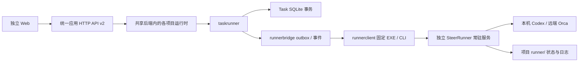

# 当前代码架构

执行已迁到独立 [SteerRunner](https://github.com/erranliu/SteerRunner)。SteerLine 保留 Task/DAG、候选参与关系与唯一 TaskDelivery；通过固定 EXE 的 steerrunner-cli/v1 协作，不导入 Runner Go 包、原生 codec、IPC 或数据库。当前真机验收范围仅本机 Codex；两个 Orca 目标验收已取消。Web 为唯一交互前端，TUI 已按[退役决策](../acceptance/tui-retirement.md)移除。

## 模块归属

| Owner | 职责 |
| --- | --- |
| internal/app | 配置、Task 存储与服务组合、CLI client 选择、只读项目目录和应用连接；不构造原生 adapter |
| internal/app/host | 服务身份、进程观察、锁、控制文件、原请求回执与调度；不持有执行状态机 |
| internal/task 与 task/model | 固定契约、DAG、资格、依赖及任务业务值 |
| internal/taskrunner | Task actor、候选共同 base、固定材料、启动/输入校验、交付与后继释放 |
| internal/runnerbridge | 持久 outbox、原 request_id/body、Run/PR/分支绑定、事件游标、停止义务、重启旧输入围栏 |
| internal/runnerclient | 公开 CLI 子进程、严格 JSON/退出码、EXE/实例 SHA、公开 schema 验证；不读取私有实现 |
| internal/runnercontract 与 runnerstate | 公开协议及 caller 参与关系的纯值，不包含 native owner 或 SQL |
| internal/storage/ports 与 sqlite | Task/DAG、候选/outbox/事件副本、唯一交付及 service checkpoint；schema 21，无旧执行写表或迁移 |
| internal/execution/model 与 backend | 尚由产品 UI、进程身份和 Task 声明使用的纯值；无原生执行写权 |
| internal/execution/reconstruction | 服务 checkpoint 与 UI 运行值；真实候选由 taskrunner 从公开 Runner facts 投影，不从旧执行记录重建 |
| internal/execution/workspace 与 publication | 调用方仓库身份解析、固定发布配置校验；无 native worktree 生命周期或 PR 查询实现 |
| internal/execution/process 与 scheduler | SteerLine 自身的进程/文件资源能力与注入 actor 调度；不推进代理 workflow |
| internal/product | 稳定产品 DTO、只读投影、用户控制与 HTTP 协议；页面不能通过读日志或猜原生事实推进执行 |
| tests/e2e/internal | 隔离环境、公开 CLI driver 和外部原生协议夹具；测试不能导入已删除 owner 或 Runner 内部包 |

旧 actor/worker、adapters、workflow、reliable、conversation owner、执行写表、闲置执行事务端口与原生重建函数已物理删除。执行三层、工作区、会话、输入、恢复、原 final 与发布取证均由 Runner 单写；具体删除和验收见[删除审计](../acceptance/steerrunner-deletion-audit.md)。

## 任务交付链

启动先以 Task/图版本校验固定契约和候选共同 base，再在一个事务中领取候选并保存完整 CLI outbox。提交未知时只查原请求；迟到接受仍绑定原 Run，并执行已持久保存的停止义务。公开事件按原身份/游标事务保存，原 final 的正文与 hash 可追溯，日志不作为业务成功事实。

交付前通过 CLI 刷新所选 PR。Task 关闭、唯一 TaskDelivery、后继释放及候选停止义务在同一事务提交；不要求候选先达到 pr_ready，不以兄弟候选未知阻挡正确已合并结果。Runner 的执行完成不自行关闭 Task。

## 应用与 Web

cmd/steerline-web 独立运行，web/src 维护当前项目页面、原信封与草稿。steerline start 作为短协调器启动本 home 的共享后端与 Web；serve 装载冻结配置，在进程内创建独立 ProjectRuntime、Task actor/store/实例及 Runner CLI 客户端，无逐项目 HTTP listener。CLI/Web 经应用 v2 handler 直达原项目端口；每项目 Runner 仍为独立 state-dir 下的常驻服务。Web 重启不替换项目；整体 stop 发布原宿主及各项目关闭/锁/资源事实，不能以共享 PID 退出代替原生停止。统一启动来源见[规格](../spec/unified-startup.spec.md)。

[Runner 接入](../integration/steerrunner.md)记录固定构建及日志归属；[生命周期](../product-design/worker-lifecycle.md)维护统一节点/异常语义；[接入验收](../acceptance/steerrunner-cutover.md)登记实际通过、失败和未验项。原生验收不能由受控 helper、编译或模型报告代替。
