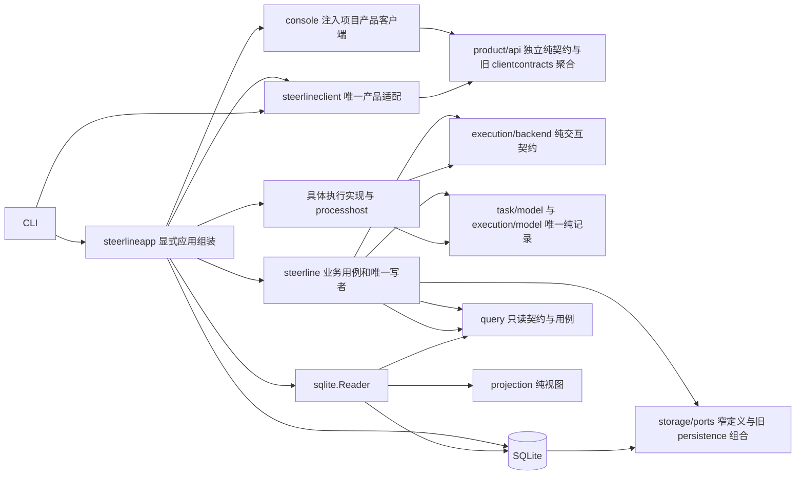
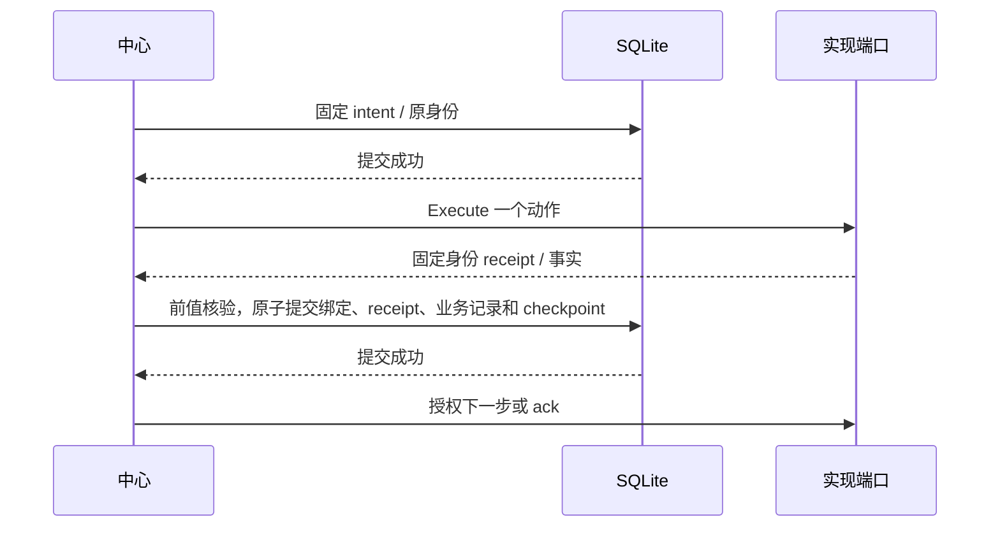

# 当前代码架构与源码索引

一期产品流程和验收仅包含本地 Codex/本机 Orca；本页远端包、接口与协议条目描述存量代码归属，保留迁移/编译/拒绝保护，不表示一期启用远端或必须完成其真机认证。

核对日期：2026-10-05。本页反映已合入 #74/#75/#39 前置的当前工作树与 #76 execution 用例归包实现；[类型归属](../validation/three-line-01-types/README.md)、[#75 任务交付](../validation/three-line-03-task-usecases/README.md)、[#76 execution 归属/验证](../validation/three-line-04-execution-usecases/README.md)记录接口和行为证据。原生能力证据不因搬包而扩大。

## 系统与业务权威

CLI 和 TUI 通过配置、查询及控制入口访问本机服务；`run` 承载同一 Service actor。SQLite 是唯一持久业务权威。任务创建、领取、废弃、依赖和交付由中心用例校验身份、前值、版本和幂等键并提交；外部 worker、日志、UI 和应用组装都不拥有业务写入权。文件控制请求/回执仍是当前协议，HTTP/SSE 与规划主 agent 尚未由本系列交付。

图中箭头表达源码依赖或明确标注的数据库访问。运行时中心通过注入端口调用实现。直属主包生产/测试源码和文件名无平台关键字，直接及传递依赖无具体实现、app 或 integration；实现不导入主包。`coreboundary` 检查所有 OS/tag 的源码图及 Windows/Linux 生产依赖，不按目录名排除生成源码。

## 当前模块职责

| 所有者 | 简短职责与源码入口 |
| --- | --- |
| `internal/steerline` | 宿主循环/启动/锁/控制传输/产品 query；execution actor 已迁出。通用 [host loop](../../internal/steerline/host/loop.go) 调用接口型 Scheduler，保持唯一 host/service 现场接线。SQL/连接/schema/原子事务由唯一 SQLite 模块持有；#73/#74/#75 已交付纯模型和任务/结果小端口。 |
| `internal/execution/backend` | 通用身份、闭集操作、事实/问题/回执、策略/需求、不可变有界封套和实现证据；仅标准库。[lifecycle.go](../../internal/execution/backend/lifecycle.go)、[implementation_data.go](../../internal/execution/backend/implementation_data.go)。 |
| `internal/execution/backend` / `internal/execution/model` / `internal/execution` | backend 持通用 adapter protocol 与封套，model 持冻结 profile/PR/资源及 workerflow 状态。execution 持唯一 actor、候选/会话/Decision/恢复/交付/清理命令、配置、journal cursor 与任务提示构造；TaskWorkPort/TaskResultPort 经 app 注入，production 不导入 task app、query/projection、SQL 或 adapter。 |
| `internal/execution/reconstruction` | 由 task/workflow/execution/attempt/decision/delivery 记录重建内部 Run/Runtime/selectors 的无 I/O 函数；使用 transitional contracts 输出，不构造 product DTO，不依赖 query/SQL/adapter。原 `internal/steerline/projection` 已删。 |
| `internal/task` | 固定工作挑选/排序与任务结果/丢弃声明；app 注入消费方 TaskWorkPort/TaskResultPort，纯输入为 task/model.FixedWork，Reader 只返回任务快照与固定契约。schema 14 的领取/唯一结果/丢弃由 storage/ports 专用声明一次 SQLite 事务组合重检；共享字段/实际拆分见[交接清单](../validation/three-line-02-task-execution-boundary/integration-ownership.md)。 |
| `internal/task/model` | 固定任务/契约、批次/生命周期、DAG 与资格唯一规则；仅标准库。GraphAuthority/DeliveryFact 不含派发、session、PR 明细。 |
| `internal/product/api` | 独立状态标量、用户输入、游标、错误、控制目标和回执；仅标准库，不含 Domain/Runtime/持久记录。 |
| `internal/storage/ports` | RecordWrite 前值声明、Commands 纯读写契约、CommandRecord/DomainEvent、ClaimCommit/ResultCommit/DiscardCommit 和存储错误；只消费纯模型/API/backend。 |
| `contracts` | 尚未迁的宽 Domain/Runtime/内部投影、会话来源/存储组合与宿主记录；每字段唯一后继见[残留清单](../validation/three-line-01-types/residual-ownership.json)。execution 对这些 transitional records 的重建位于自己的纯函数子包。 |
| `codexworker` / `codexapp` | 前者拥有原生 codec、配置/命令/权限、生命周期、history/source/mapper；后者拥有 WebSocket/JSON-RPC 和原生问题传输。不给实现 Store 或可写 Service。 |
| `orcaworker` | 原生配置/绑定/资源/terminal/Dispatch/message、宿主准备和输出、观察及原操作对账。[lifecycle_resources.go](../../internal/steerline/orcaworker/lifecycle_resources.go)、[lifecycle_observation.go](../../internal/steerline/orcaworker/lifecycle_observation.go)。 |
| `orca_remote_worker` | 原远端协议、身份、消息、观察、结算与对账；新执行仍按权限准入拒绝，远端取消 unsupported。协议 mock 不证明权限认证。 |
| `task` | 批次验证/创建、固定文档、追加依赖、工作挑选及规范结果/丢弃声明；只依赖 task/model 和自有任务事务/文档窄端口。[归属与测试](../validation/three-line-03-task-usecases/ownership.md)。 |
| `steerlineapp` | 唯一内置目录、严格实现配置、默认值、具体工厂与产品构造。[directory.go](../../internal/steerlineapp/directory.go)、[config.go](../../internal/steerlineapp/config.go)、[app.go](../../internal/steerlineapp/app.go)；不承担状态转换，无 init/全局可变注册。 |
| `processhost` | OS 进程、身份、句柄及文件操作，由 app 构造，经小端口注入中心/实现；关闭观察不等于杀进程。 |
| `steerlineintegration` / `testprotocol` | 外层真实应用端口、原生配置和协议 mock 的跨层断言；不导出任意中心写接口。testprotocol 是测试进程 fixture，不是产品依赖。 |
| `taskview` | 当前混合只读图投影，依赖 task/execution 纯模型；旧 steerline/task 已删除，任务工作/结果归 task，执行准入/PR事实归 execution/model。TaskGraph 每快照构造一次纯任务事实，任务批次读取绑定与版本来自同一快照；后续产品归包由 #77 负责。 |
| `projection` | 从同一持久快照复制并构建 Runtime/Run，按当前 Step 和 AttemptNumber 选择候选；持续 worker 路径另核对非空 CurrentAttemptID，不匹配时拒绝投影，无 I/O。 |
| `persistence` | #69 的窄声明提交、纯错误及注入连接工厂；消费者只持有自己的端口，不暴露 SQL/任意事务。 |
| `query` / `sqlite` | query 拥有只读应用契约；sqlite 是连接、schema 14、SQL、声明提交及读写事务的唯一实现，复用既有 Reader。应用选择并注入 Factory，中心不依赖 SQL/具体存储。 |
| `workspace` / `publication` | 固定 Git 工作区及 PR 查询/关闭和事实；中心决定资格、受理与唯一交付。 |
| `clientcontracts` / `steerlineclient` | 纯产品 DTO/小接口与唯一客户端；配置/资源工厂由 app 注入，读取复用 query/projection，任务变更调用 task.Commands，执行变更调用 CommandService/control。 |
| `console` | TUI 输入/导航/视图和独立偏好；按项目消费注入的 `clientcontracts.ConsoleClient`。全 OS/tag 生产与测试不依赖中心、具体 SQL、adapter 或 app；内部纯记录和命令回执的消费由 #77 继续收窄。 |
| `activityview` | 唯一纯活动格式化；CLI/中心入口和 console 共用 [render.go](../../internal/steerline/activityview/render.go)，没有产品 I/O。 |
| `coreboundary` / `testboundary` / `testfeedback` | 执行隔离守卫、E2E 测试依赖守卫及 Go JSON 报告；产品不依赖测试 fixture 或 runner。 |

## 固定配置、提交与恢复

项目策略与全局方案分开；发布责任统一为 `worker`，中心只核验交付。应用每次构造独立不可变目录，配置受理、Claim、冻结、恢复和查询使用同一目录。固定 profile v6 / `builtin-execution-v2`、PolicyResources v3、SQLite schema 14、runtime/checkpoint schema 18、conversation event v2 保持。封套固定 key、版本、用途、所属身份、摘要及 64 KiB 上限，载荷深复制并只由实现 codec 解码。旧开发格式明确拒绝，不迁移、双写、重建或回退。

中心先提交原 intent 再执行一个动作，原 receipt 与绑定提交后才授权下一步；thread 绑定提交后才发送首轮、资源回执后才派发、消息消费事实提交后才 ack。异步结果核对原 Operation/request digest、target、Execution/Attempt/代次和输入绑定；提交失败恢复私有候选，不发布成功视图。heartbeat 只写服务元数据。

未知 start/reply/send/ack 保持原请求并只读对账，不重派或换会话。准备 nonce/deadline、准备与业务用途、工具/收据、独立环境 blocker 和人工恢复门槛由中心拥有；阻断时拒绝新输入，不保留自动补投队列。生命周期副作用经同一后台单步结果通道，actor 提交原回执后才允许下一步。重启不自动解除人工门槛；当前配置不能重写原 profile/session/process/incarnation/workspace。TaskDelivery 按真实 provider 的原 PR/repository/head/base/merge 事实唯一提交，清理失败不撤销交付。

执行来源：[service_commit.go](../../internal/execution/service_commit.go)、[worker_attachment_store.go](../../internal/execution/worker_attachment_store.go)、[scheduler.go](../../internal/execution/scheduler.go)、[native_delivery_command.go](../../internal/execution/native_delivery_command.go)；host 启动/loop 与状态预检仍由根宿主拥有。

## 产品客户端（#71）

产品纯契约由 [clientcontracts/client.go](../../internal/steerline/clientcontracts/client.go) 和 [observations.go](../../internal/steerline/clientcontracts/observations.go) 拥有，复用 contracts/execution/task/taskview；不依赖中心、存储、平台或应用组装。CLI 产品入口消费这些小接口，唯一 [steerlineclient](../../internal/steerlineclient/client.go) 接受外部纯资源工厂；[steerlineapp/client.go](../../internal/steerlineapp/client.go) 绑定配置/身份，构造原 QueryService、ConversationQueryService、CommandService 与文件 control 端口。没有第二条 SQL、投影、分页或业务提交实现。

客户端按读取/命令范围关闭资源，Close 不停止服务或 worker。变更前固定 request/command ID，超时后查原 ID；control 同 ID 同内容返回原请求，异内容拒绝，不重新发布或换实例。`answer -request-id` 查询原命令；accepted 保持中心受理含义，不声明 worker 已执行。离线查询只打开已存在、当前格式且归属匹配的 native reader，不建库、迁移或准备工作区。

[steerlineapp/console.go](../../internal/steerlineapp/console.go) 的 `PrepareConsole` 在 UI 外读取配置/身份、构造每项目唯一 #71 adapter 并注入 UI；CLI 与 TUI 使用同一 `openProjectClient` 构造。`console/source.go` 只保留产品纯类型名称，FileQuerySource/FileControlClient、ConfigSource、Config 字段、productRef/withClient/candidateFreshness 映射及全部默认产品 I/O 已删除。方案使用 [presentation.go](../../internal/steerline/clientcontracts/presentation.go) 的非秘密描述、固定摘要和支持原因；候选/自动派发输入检查由产品端口提供，决策展示由同次项目快照的资格原因提供，提交仍由中心重检。

console 保留任务/会话选择、正文版本、Unicode/字节预算、阅读锚点、折叠、原请求及按配置路径/状态目录隔离的偏好。偏好 OS 锁与原子文件写入归 UI；恢复核验通过 [RecoveryQueries](../../internal/steerline/clientcontracts/recovery.go) 调用原中心只读核验，游标编码复用原 query。`Model.Close` 和外层退出清理只释放 UI/client 资源，不提交 stop。依赖守卫在既有 #67/quick 内同时检查 console 全源码、测试、helper 与 Windows/Linux 生产图。实际接线与断言映射见 [#72 验证记录](../validation/core-decoupling-11-tui/README.md)。

中心活动仅随业务提交写入数据库，不维护 activity.jsonl 镜像或文件 seq。操作准备、请求验证、结果归一化和启动回执的共同身份检查由 [lifecycle_receipt.go](../../internal/execution/lifecycle_receipt.go) 复用；每种动作仍决定自己的接收条件和下一步，保留 intent/receipt/附件屏障。

## 会话和客户端读取

中心按预算轮转来源，使用实现提供的 source/mapper 端口；mapper 从已提交事件重建，失败候选 mapper/cursor 丢弃。来源归属 Project/Workflow/Execution/Attempt 必须匹配中心请求。会话事件、正文版本和 source cursor 用独立原子事务，不混入 heartbeat；正文/raw 不累计进实现封套。

公开 Runtime/Run 从已提交记录深复制构建，与私有工作 Run 分开。sqlite.Reader 在同一读事务采样任务、Ready、选中任务、记录和 checkpoint；query 复用 projection/task 规则。连接身份失败仍可展示可用只读数据，控制和领取各自重检。领域事件正文有页预算，cursor 只推进到实际返回事件；缺来源终态/final 时不能由界面推断完成。

源码：[conversation.go](../../internal/execution/conversation.go)、[conversation_replay.go](../../internal/execution/conversation_replay.go)、[conversation_store.go](../../internal/steerline/sqlite/conversation_store.go)、[project_view.go](../../internal/steerline/project_view.go)、[query/project.go](../../internal/steerline/query/project.go)。

## #76 验收与后续任务

执行 actor 与私有状态、配置、命令、conversation journal cursor、执行态重建和相关白盒用例统一归属 `internal/execution`。唯一真实 app 构造注入 TaskWorkPort/TaskResultPort、目录、SQLite connection、ProcessHost 与宿主 transport/diagnostic 小端口。通用 host loop 只认识 scheduler 接口，SQL、adapter 和产品 UI 仍由各自 owner 负责。

依赖守卫 `TestTM04ExecutionBoundary` 检查所有 OS/tag 源码图、Windows/Linux 构建图、product query/projection 直接依赖反例及重建包 adapter 反例。app 外层 MC1/3/5/6/7/8/9、#39 pending-PR、#218 sibling-recovery、TM04 wiring、L1 与 L3 controlled recovery 的实际命中和报告见[#76 验收记录](../validation/three-line-04-execution-usecases/README.md)。没有跑 Full、L2/live 或启用原生接受开关。

#76 合入后 #78 可消费 execution/backend 固定接口；#79 等 #75/#76/#77；#80 等三线服务/目录边界固定；最终测试组合仍归 #82。后继不复制 execution implementation 或恢复旧 forwarding facade。

## 全 OS / 构建标签源码索引

以下索引从当前工作树生成，包含 cmd/internal 所有生产 Go 源码（包括 Windows/Linux 和其他 build tags）；不包含测试文件。逐文件 SHA/import 清单在 [#76 source-index](../validation/three-line-04-execution-usecases/source-index.json)。依赖守卫另扫描测试文件与完整传递图。

| 包 | 生产文件数 | 项目内直接依赖 |
| --- | ---: | --- |
| `cmd/orca-probe` | 1 | 无 |
| `cmd/steerline` | 2 | `internal/execution`, `internal/product/api`, `internal/steerline`, `internal/steerline/clientcontracts`, `internal/steerline/contracts`, `internal/steerline/taskview`, `internal/steerlineapp`, `internal/steerlineclient`, `internal/storage/ports`, `internal/task/model` |
| `cmd/test-feedback` | 6 | `internal/coreboundary`, `internal/execution`, `internal/execution/backend`, `internal/execution/model`, `internal/steerline`, `internal/steerlineapp`, `internal/steerlineintegration`, `internal/storage/ports`, `internal/task`, `internal/task/model`, `internal/testboundary`, `internal/testfeedback`, `internal/testprocess` |
| `internal/coreboundary` | 1 | 无 |
| `internal/execution` | 94 | `internal/execution/backend`, `internal/execution/model`, `internal/execution/reconstruction`, `internal/product/api`, `internal/steerline/activityview`, `internal/steerline/clientcontracts`, `internal/steerline/contracts`, `internal/steerline/persistence`, `internal/steerline/publication`, `internal/steerline/workspace`, `internal/storage/ports`, `internal/task/model` |
| `internal/execution/backend` | 19 | 无 |
| `internal/execution/model` | 21 | `internal/execution/backend` |
| `internal/execution/process` | 3 | `internal/execution/backend` |
| `internal/execution/reconstruction` | 3 | `internal/execution/backend`, `internal/execution/model`, `internal/steerline/contracts`, `internal/task/model` |
| `internal/product/api` | 5 | 无 |
| `internal/steerline` | 42 | `internal/execution`, `internal/execution/backend`, `internal/execution/model`, `internal/execution/process`, `internal/product/api`, `internal/steerline/activityview`, `internal/steerline/clientcontracts`, `internal/steerline/contracts`, `internal/steerline/host`, `internal/steerline/persistence`, `internal/steerline/publication`, `internal/steerline/query`, `internal/steerline/taskview`, `internal/steerline/workspace`, `internal/storage/ports`, `internal/task/model` |
| `internal/steerline/activityview` | 2 | `internal/steerline/contracts` |
| `internal/steerline/clientcontracts` | 5 | `internal/execution/backend`, `internal/execution/model`, `internal/product/api`, `internal/steerline/contracts`, `internal/steerline/taskview`, `internal/storage/ports`, `internal/task/model` |
| `internal/steerline/codexapp` | 4 | 无 |
| `internal/steerline/codexworker` | 29 | `internal/execution/backend`, `internal/execution/model`, `internal/steerline/codexapp`, `internal/steerline/contracts`, `internal/steerline/workspace` |
| `internal/steerline/console` | 23 | `internal/execution/backend`, `internal/execution/model`, `internal/product/api`, `internal/steerline/activityview`, `internal/steerline/clientcontracts`, `internal/steerline/contracts`, `internal/storage/ports` |
| `internal/steerline/contracts` | 10 | `internal/execution/backend`, `internal/execution/model`, `internal/product/api`, `internal/steerline/taskview`, `internal/task/model` |
| `internal/steerline/host` | 2 | `internal/product/api` |
| `internal/steerline/orca_remote_worker` | 14 | `internal/execution/backend`, `internal/steerline/codexworker`, `internal/steerline/orcaworker` |
| `internal/steerline/orcaworker` | 28 | `internal/execution/backend`, `internal/execution/model`, `internal/steerline/codexworker`, `internal/steerline/contracts`, `internal/steerline/workspace` |
| `internal/steerline/persistence` | 2 | `internal/execution/backend`, `internal/execution/model`, `internal/steerline/contracts`, `internal/steerline/query`, `internal/steerline/taskview`, `internal/storage/ports`, `internal/task/model` |
| `internal/steerline/processhost` | 4 | `internal/execution/backend` |
| `internal/steerline/publication` | 6 | `internal/execution/backend`, `internal/execution/model`, `internal/steerline/contracts` |
| `internal/steerline/query` | 6 | `internal/execution/backend`, `internal/execution/model`, `internal/steerline/contracts`, `internal/steerline/taskview`, `internal/storage/ports`, `internal/task/model` |
| `internal/steerline/sqlite` | 35 | `internal/execution/backend`, `internal/execution/model`, `internal/execution/reconstruction`, `internal/steerline/contracts`, `internal/steerline/persistence`, `internal/steerline/query`, `internal/steerline/taskview`, `internal/storage/ports`, `internal/task/model` |
| `internal/steerline/taskview` | 4 | `internal/execution/model`, `internal/task/model` |
| `internal/steerline/testprotocol` | 6 | 无 |
| `internal/steerline/workspace` | 6 | `internal/execution/backend` |
| `internal/steerlineapp` | 14 | `internal/execution`, `internal/execution/backend`, `internal/execution/model`, `internal/product/api`, `internal/steerline`, `internal/steerline/clientcontracts`, `internal/steerline/codexworker`, `internal/steerline/console`, `internal/steerline/contracts`, `internal/steerline/orca_remote_worker`, `internal/steerline/orcaworker`, `internal/steerline/persistence`, `internal/steerline/processhost`, `internal/steerline/publication`, `internal/steerline/query`, `internal/steerline/sqlite`, `internal/steerline/workspace`, `internal/steerlineclient`, `internal/storage/ports`, `internal/task`, `internal/task/model` |
| `internal/steerlineclient` | 1 | `internal/execution/backend`, `internal/product/api`, `internal/steerline/clientcontracts`, `internal/steerline/contracts`, `internal/steerline/query`, `internal/steerline/taskview`, `internal/storage/ports`, `internal/task/model` |
| `internal/storage/ports` | 6 | `internal/execution/model`, `internal/task/model` |
| `internal/task` | 6 | `internal/task/model` |
| `internal/task/model` | 15 | 无 |
| `internal/testfeedback` | 1 | 无 |
| `internal/testprocess` | 3 | 无 |

### 文件

#### cmd/orca-probe

- [main.go](../../cmd/orca-probe/main.go)
#### cmd/steerline

- [main.go](../../cmd/steerline/main.go)
- [task_commands.go](../../cmd/steerline/task_commands.go)
#### cmd/test-feedback

- [e2e.go](../../cmd/test-feedback/e2e.go)
- [main.go](../../cmd/test-feedback/main.go)
- [process_unix.go](../../cmd/test-feedback/process_unix.go)
- [process_windows.go](../../cmd/test-feedback/process_windows.go)
- [scoped.go](../../cmd/test-feedback/scoped.go)
- [task_scope.go](../../cmd/test-feedback/task_scope.go)
#### internal/coreboundary

- [check.go](../../internal/coreboundary/check.go)
#### internal/execution

- [application_config.go](../../internal/execution/application_config.go)
- [application_config_types.go](../../internal/execution/application_config_types.go)
- [candidate_control.go](../../internal/execution/candidate_control.go)
- [candidate_pr.go](../../internal/execution/candidate_pr.go)
- [candidate_resources.go](../../internal/execution/candidate_resources.go)
- [candidate_workers.go](../../internal/execution/candidate_workers.go)
- [command_boundary.go](../../internal/execution/command_boundary.go)
- [command_kinds.go](../../internal/execution/command_kinds.go)
- [command_processor.go](../../internal/execution/command_processor.go)
- [command_submission.go](../../internal/execution/command_submission.go)
- [config_admission.go](../../internal/execution/config_admission.go)
- [control_digest.go](../../internal/execution/control_digest.go)
- [control_service.go](../../internal/execution/control_service.go)
- [control_validation.go](../../internal/execution/control_validation.go)
- [conversation.go](../../internal/execution/conversation.go)
- [conversation_identity.go](../../internal/execution/conversation_identity.go)
- [conversation_position.go](../../internal/execution/conversation_position.go)
- [conversation_replay.go](../../internal/execution/conversation_replay.go)
- [conversation_service.go](../../internal/execution/conversation_service.go)
- [conversation_sources.go](../../internal/execution/conversation_sources.go)
- [decision.go](../../internal/execution/decision.go)
- [execution_backend.go](../../internal/execution/execution_backend.go)
- [execution_command_runner.go](../../internal/execution/execution_command_runner.go)
- [execution_commands.go](../../internal/execution/execution_commands.go)
- [execution_config.go](../../internal/execution/execution_config.go)
- [execution_delivery_poll.go](../../internal/execution/execution_delivery_poll.go)
- [execution_directory.go](../../internal/execution/execution_directory.go)
- [execution_discard_cleanup.go](../../internal/execution/execution_discard_cleanup.go)
- [execution_dispatch.go](../../internal/execution/execution_dispatch.go)
- [execution_errors.go](../../internal/execution/execution_errors.go)
- [execution_helpers.go](../../internal/execution/execution_helpers.go)
- [execution_profiles.go](../../internal/execution/execution_profiles.go)
- [execution_requirements.go](../../internal/execution/execution_requirements.go)
- [execution_snapshot.go](../../internal/execution/execution_snapshot.go)
- [execution_store.go](../../internal/execution/execution_store.go)
- [host_callbacks.go](../../internal/execution/host_callbacks.go)
- [host_ports.go](../../internal/execution/host_ports.go)
- [implementation_bindings.go](../../internal/execution/implementation_bindings.go)
- [journal_cursor.go](../../internal/execution/journal_cursor.go)
- [journal_platform_linux.go](../../internal/execution/journal_platform_linux.go)
- [journal_platform_other.go](../../internal/execution/journal_platform_other.go)
- [journal_platform_windows.go](../../internal/execution/journal_platform_windows.go)
- [journal_reader.go](../../internal/execution/journal_reader.go)
- [json_decode.go](../../internal/execution/json_decode.go)
- [lifecycle_effect.go](../../internal/execution/lifecycle_effect.go)
- [lifecycle_receipt.go](../../internal/execution/lifecycle_receipt.go)
- [native_claim_command.go](../../internal/execution/native_claim_command.go)
- [native_cleanup.go](../../internal/execution/native_cleanup.go)
- [native_cleanup_stop.go](../../internal/execution/native_cleanup_stop.go)
- [native_delivery_command.go](../../internal/execution/native_delivery_command.go)
- [native_discard_command.go](../../internal/execution/native_discard_command.go)
- [native_dispatch_command.go](../../internal/execution/native_dispatch_command.go)
- [native_repository_target.go](../../internal/execution/native_repository_target.go)
- [operation.go](../../internal/execution/operation.go)
- [profile_data.go](../../internal/execution/profile_data.go)
- [prompt.go](../../internal/execution/prompt.go)
- [publication_snapshot.go](../../internal/execution/publication_snapshot.go)
- [read_ports.go](../../internal/execution/read_ports.go)
- [recovery.go](../../internal/execution/recovery.go)
- [runtime_view.go](../../internal/execution/runtime_view.go)
- [scheduler.go](../../internal/execution/scheduler.go)
- [service_activity.go](../../internal/execution/service_activity.go)
- [service_actor.go](../../internal/execution/service_actor.go)
- [service_checkpoint.go](../../internal/execution/service_checkpoint.go)
- [service_commit.go](../../internal/execution/service_commit.go)
- [service_construction.go](../../internal/execution/service_construction.go)
- [service_execution_profiles.go](../../internal/execution/service_execution_profiles.go)
- [service_shutdown.go](../../internal/execution/service_shutdown.go)
- [service_state.go](../../internal/execution/service_state.go)
- [service_task_snapshot.go](../../internal/execution/service_task_snapshot.go)
- [service_workers.go](../../internal/execution/service_workers.go)
- [store.go](../../internal/execution/store.go)
- [stored_execution_validation.go](../../internal/execution/stored_execution_validation.go)
- [utilities.go](../../internal/execution/utilities.go)
- [worker_attachment_store.go](../../internal/execution/worker_attachment_store.go)
- [worker_completion.go](../../internal/execution/worker_completion.go)
- [worker_environment.go](../../internal/execution/worker_environment.go)
- [worker_environment_host.go](../../internal/execution/worker_environment_host.go)
- [worker_events.go](../../internal/execution/worker_events.go)
- [worker_evidence.go](../../internal/execution/worker_evidence.go)
- [worker_execution.go](../../internal/execution/worker_execution.go)
- [worker_feedback.go](../../internal/execution/worker_feedback.go)
- [worker_lifecycle.go](../../internal/execution/worker_lifecycle.go)
- [worker_lifecycle_async.go](../../internal/execution/worker_lifecycle_async.go)
- [worker_lifecycle_feedback.go](../../internal/execution/worker_lifecycle_feedback.go)
- [worker_lifecycle_recovery.go](../../internal/execution/worker_lifecycle_recovery.go)
- [worker_pr.go](../../internal/execution/worker_pr.go)
- [worker_process.go](../../internal/execution/worker_process.go)
- [worker_recovery.go](../../internal/execution/worker_recovery.go)
- [worker_resume.go](../../internal/execution/worker_resume.go)
- [worker_start.go](../../internal/execution/worker_start.go)
- [worker_state.go](../../internal/execution/worker_state.go)
- [worker_types.go](../../internal/execution/worker_types.go)
- [workspace_config.go](../../internal/execution/workspace_config.go)
#### internal/execution/backend

- [backend.go](../../internal/execution/backend/backend.go)
- [capability.go](../../internal/execution/backend/capability.go)
- [environment.go](../../internal/execution/backend/environment.go)
- [errors.go](../../internal/execution/backend/errors.go)
- [event.go](../../internal/execution/backend/event.go)
- [execution.go](../../internal/execution/backend/execution.go)
- [host.go](../../internal/execution/backend/host.go)
- [implementation_config_input.go](../../internal/execution/backend/implementation_config_input.go)
- [implementation_data.go](../../internal/execution/backend/implementation_data.go)
- [json.go](../../internal/execution/backend/json.go)
- [lifecycle.go](../../internal/execution/backend/lifecycle.go)
- [operation.go](../../internal/execution/backend/operation.go)
- [policy.go](../../internal/execution/backend/policy.go)
- [publication.go](../../internal/execution/backend/publication.go)
- [question_route.go](../../internal/execution/backend/question_route.go)
- [record_validation.go](../../internal/execution/backend/record_validation.go)
- [requirements.go](../../internal/execution/backend/requirements.go)
- [session.go](../../internal/execution/backend/session.go)
- [workspace.go](../../internal/execution/backend/workspace.go)
#### internal/execution/model

- [answer_identity.go](../../internal/execution/model/answer_identity.go)
- [candidate_base.go](../../internal/execution/model/candidate_base.go)
- [candidate_set.go](../../internal/execution/model/candidate_set.go)
- [decision_content.go](../../internal/execution/model/decision_content.go)
- [discard_facts.go](../../internal/execution/model/discard_facts.go)
- [environment.go](../../internal/execution/model/environment.go)
- [execution.go](../../internal/execution/model/execution.go)
- [json.go](../../internal/execution/model/json.go)
- [operation_rules.go](../../internal/execution/model/operation_rules.go)
- [pr.go](../../internal/execution/model/pr.go)
- [publication.go](../../internal/execution/model/publication.go)
- [records.go](../../internal/execution/model/records.go)
- [recovery.go](../../internal/execution/model/recovery.go)
- [runtime.go](../../internal/execution/model/runtime.go)
- [state.go](../../internal/execution/model/state.go)
- [task_admission.go](../../internal/execution/model/task_admission.go)
- [task_delivery.go](../../internal/execution/model/task_delivery.go)
- [task_delivery_gate.go](../../internal/execution/model/task_delivery_gate.go)
- [task_delivery_validation.go](../../internal/execution/model/task_delivery_validation.go)
- [task_receipts.go](../../internal/execution/model/task_receipts.go)
- [verified_pr.go](../../internal/execution/model/verified_pr.go)
#### internal/execution/process

- [facts.go](../../internal/execution/process/facts.go)
- [facts_linux.go](../../internal/execution/process/facts_linux.go)
- [facts_windows.go](../../internal/execution/process/facts_windows.go)
#### internal/execution/reconstruction

- [run.go](../../internal/execution/reconstruction/run.go)
- [runtime.go](../../internal/execution/reconstruction/runtime.go)
- [selectors.go](../../internal/execution/reconstruction/selectors.go)
#### internal/product/api

- [client.go](../../internal/product/api/client.go)
- [execution.go](../../internal/product/api/execution.go)
- [observations.go](../../internal/product/api/observations.go)
- [runtime.go](../../internal/product/api/runtime.go)
- [task_predecessors.go](../../internal/product/api/task_predecessors.go)
#### internal/steerline

- [activity.go](../../internal/steerline/activity.go)
- [application_config.go](../../internal/steerline/application_config.go)
- [command_digest.go](../../internal/steerline/command_digest.go)
- [command_kinds.go](../../internal/steerline/command_kinds.go)
- [command_replay.go](../../internal/steerline/command_replay.go)
- [control_client.go](../../internal/steerline/control_client.go)
- [control_files.go](../../internal/steerline/control_files.go)
- [control_protocol.go](../../internal/steerline/control_protocol.go)
- [conversation.go](../../internal/steerline/conversation.go)
- [conversation_query.go](../../internal/steerline/conversation_query.go)
- [decision_client.go](../../internal/steerline/decision_client.go)
- [domain.go](../../internal/steerline/domain.go)
- [domain_snapshot.go](../../internal/steerline/domain_snapshot.go)
- [host_utilities.go](../../internal/steerline/host_utilities.go)
- [json_decode.go](../../internal/steerline/json_decode.go)
- [launchers.go](../../internal/steerline/launchers.go)
- [model.go](../../internal/steerline/model.go)
- [native_graph_export.go](../../internal/steerline/native_graph_export.go)
- [native_graph_types.go](../../internal/steerline/native_graph_types.go)
- [native_project_open.go](../../internal/steerline/native_project_open.go)
- [native_readiness_query.go](../../internal/steerline/native_readiness_query.go)
- [native_state_preflight.go](../../internal/steerline/native_state_preflight.go)
- [native_task_page.go](../../internal/steerline/native_task_page.go)
- [observation.go](../../internal/steerline/observation.go)
- [platform_linux.go](../../internal/steerline/platform_linux.go)
- [platform_windows.go](../../internal/steerline/platform_windows.go)
- [process_projection.go](../../internal/steerline/process_projection.go)
- [project_view.go](../../internal/steerline/project_view.go)
- [query_construction.go](../../internal/steerline/query_construction.go)
- [render.go](../../internal/steerline/render.go)
- [service_client.go](../../internal/steerline/service_client.go)
- [service_console.go](../../internal/steerline/service_console.go)
- [service_host.go](../../internal/steerline/service_host.go)
- [service_loop.go](../../internal/steerline/service_loop.go)
- [service_preflight.go](../../internal/steerline/service_preflight.go)
- [service_prepare.go](../../internal/steerline/service_prepare.go)
- [service_startup_publication.go](../../internal/steerline/service_startup_publication.go)
- [state_preflight.go](../../internal/steerline/state_preflight.go)
- [state_revision.go](../../internal/steerline/state_revision.go)
- [store.go](../../internal/steerline/store.go)
- [task_record_lookup.go](../../internal/steerline/task_record_lookup.go)
- [write_ports.go](../../internal/steerline/write_ports.go)
#### internal/steerline/activityview

- [decision.go](../../internal/steerline/activityview/decision.go)
- [render.go](../../internal/steerline/activityview/render.go)
#### internal/steerline/clientcontracts

- [client.go](../../internal/steerline/clientcontracts/client.go)
- [eligibility.go](../../internal/steerline/clientcontracts/eligibility.go)
- [observations.go](../../internal/steerline/clientcontracts/observations.go)
- [presentation.go](../../internal/steerline/clientcontracts/presentation.go)
- [recovery.go](../../internal/steerline/clientcontracts/recovery.go)
#### internal/steerline/codexapp

- [ask.go](../../internal/steerline/codexapp/ask.go)
- [client.go](../../internal/steerline/codexapp/client.go)
- [doc.go](../../internal/steerline/codexapp/doc.go)
- [transport.go](../../internal/steerline/codexapp/transport.go)
#### internal/steerline/codexworker

- [ask.go](../../internal/steerline/codexworker/ask.go)
- [ask_journal.go](../../internal/steerline/codexworker/ask_journal.go)
- [backend.go](../../internal/steerline/codexworker/backend.go)
- [capability.go](../../internal/steerline/codexworker/capability.go)
- [command.go](../../internal/steerline/codexworker/command.go)
- [config.go](../../internal/steerline/codexworker/config.go)
- [connection.go](../../internal/steerline/codexworker/connection.go)
- [conversation.go](../../internal/steerline/codexworker/conversation.go)
- [conversation_adapter.go](../../internal/steerline/codexworker/conversation_adapter.go)
- [doc.go](../../internal/steerline/codexworker/doc.go)
- [event_fact.go](../../internal/steerline/codexworker/event_fact.go)
- [executable.go](../../internal/steerline/codexworker/executable.go)
- [execution_binding.go](../../internal/steerline/codexworker/execution_binding.go)
- [history.go](../../internal/steerline/codexworker/history.go)
- [history_binding.go](../../internal/steerline/codexworker/history_binding.go)
- [intent.go](../../internal/steerline/codexworker/intent.go)
- [journal.go](../../internal/steerline/codexworker/journal.go)
- [launch.go](../../internal/steerline/codexworker/launch.go)
- [lifecycle.go](../../internal/steerline/codexworker/lifecycle.go)
- [native_params.go](../../internal/steerline/codexworker/native_params.go)
- [observe.go](../../internal/steerline/codexworker/observe.go)
- [outcome.go](../../internal/steerline/codexworker/outcome.go)
- [params.go](../../internal/steerline/codexworker/params.go)
- [permissions.go](../../internal/steerline/codexworker/permissions.go)
- [policy.go](../../internal/steerline/codexworker/policy.go)
- [policy_resources.go](../../internal/steerline/codexworker/policy_resources.go)
- [profile_config.go](../../internal/steerline/codexworker/profile_config.go)
- [recovery.go](../../internal/steerline/codexworker/recovery.go)
- [session_launcher.go](../../internal/steerline/codexworker/session_launcher.go)
#### internal/steerline/console

- [candidates.go](../../internal/steerline/console/candidates.go)
- [conversation.go](../../internal/steerline/console/conversation.go)
- [conversation_anchor.go](../../internal/steerline/console/conversation_anchor.go)
- [execution_profile.go](../../internal/steerline/console/execution_profile.go)
- [interaction.go](../../internal/steerline/console/interaction.go)
- [model.go](../../internal/steerline/console/model.go)
- [model_control.go](../../internal/steerline/console/model_control.go)
- [model_keys.go](../../internal/steerline/console/model_keys.go)
- [model_navigation.go](../../internal/steerline/console/model_navigation.go)
- [model_update_actions.go](../../internal/steerline/console/model_update_actions.go)
- [model_update_conversation.go](../../internal/steerline/console/model_update_conversation.go)
- [model_update_project.go](../../internal/steerline/console/model_update_project.go)
- [preferences.go](../../internal/steerline/console/preferences.go)
- [preferences_io.go](../../internal/steerline/console/preferences_io.go)
- [preferences_unix.go](../../internal/steerline/console/preferences_unix.go)
- [preferences_windows.go](../../internal/steerline/console/preferences_windows.go)
- [presentation.go](../../internal/steerline/console/presentation.go)
- [profile_choice.go](../../internal/steerline/console/profile_choice.go)
- [source.go](../../internal/steerline/console/source.go)
- [view.go](../../internal/steerline/console/view.go)
- [view_conversation.go](../../internal/steerline/console/view_conversation.go)
- [view_tasks.go](../../internal/steerline/console/view_tasks.go)
- [view_text.go](../../internal/steerline/console/view_text.go)
#### internal/steerline/contracts

- [activity.go](../../internal/steerline/contracts/activity.go)
- [conversation.go](../../internal/steerline/contracts/conversation.go)
- [conversation_position.go](../../internal/steerline/contracts/conversation_position.go)
- [conversation_query.go](../../internal/steerline/contracts/conversation_query.go)
- [delivery.go](../../internal/steerline/contracts/delivery.go)
- [execution.go](../../internal/steerline/contracts/execution.go)
- [json.go](../../internal/steerline/contracts/json.go)
- [query.go](../../internal/steerline/contracts/query.go)
- [runtime.go](../../internal/steerline/contracts/runtime.go)
- [snapshot.go](../../internal/steerline/contracts/snapshot.go)
#### internal/steerline/host

- [errors.go](../../internal/steerline/host/errors.go)
- [loop.go](../../internal/steerline/host/loop.go)
#### internal/steerline/orca_remote_worker

- [backend.go](../../internal/steerline/orca_remote_worker/backend.go)
- [config.go](../../internal/steerline/orca_remote_worker/config.go)
- [intent.go](../../internal/steerline/orca_remote_worker/intent.go)
- [lifecycle.go](../../internal/steerline/orca_remote_worker/lifecycle.go)
- [messaging.go](../../internal/steerline/orca_remote_worker/messaging.go)
- [observation.go](../../internal/steerline/orca_remote_worker/observation.go)
- [policy.go](../../internal/steerline/orca_remote_worker/policy.go)
- [preflight.go](../../internal/steerline/orca_remote_worker/preflight.go)
- [profile_config.go](../../internal/steerline/orca_remote_worker/profile_config.go)
- [run.go](../../internal/steerline/orca_remote_worker/run.go)
- [start.go](../../internal/steerline/orca_remote_worker/start.go)
- [types.go](../../internal/steerline/orca_remote_worker/types.go)
- [version.go](../../internal/steerline/orca_remote_worker/version.go)
- [worker.go](../../internal/steerline/orca_remote_worker/worker.go)
#### internal/steerline/orcaworker

- [backend.go](../../internal/steerline/orcaworker/backend.go)
- [binding.go](../../internal/steerline/orcaworker/binding.go)
- [client.go](../../internal/steerline/orcaworker/client.go)
- [command.go](../../internal/steerline/orcaworker/command.go)
- [config.go](../../internal/steerline/orcaworker/config.go)
- [dispatch_submit.go](../../internal/steerline/orcaworker/dispatch_submit.go)
- [environment.go](../../internal/steerline/orcaworker/environment.go)
- [event.go](../../internal/steerline/orcaworker/event.go)
- [events.go](../../internal/steerline/orcaworker/events.go)
- [execution_state.go](../../internal/steerline/orcaworker/execution_state.go)
- [host.go](../../internal/steerline/orcaworker/host.go)
- [intent.go](../../internal/steerline/orcaworker/intent.go)
- [inventory.go](../../internal/steerline/orcaworker/inventory.go)
- [lifecycle.go](../../internal/steerline/orcaworker/lifecycle.go)
- [lifecycle_observation.go](../../internal/steerline/orcaworker/lifecycle_observation.go)
- [lifecycle_resources.go](../../internal/steerline/orcaworker/lifecycle_resources.go)
- [lifecycle_turns.go](../../internal/steerline/orcaworker/lifecycle_turns.go)
- [message.go](../../internal/steerline/orcaworker/message.go)
- [mutation.go](../../internal/steerline/orcaworker/mutation.go)
- [orchestration.go](../../internal/steerline/orcaworker/orchestration.go)
- [output.go](../../internal/steerline/orcaworker/output.go)
- [profile_config.go](../../internal/steerline/orcaworker/profile_config.go)
- [readiness.go](../../internal/steerline/orcaworker/readiness.go)
- [relay.go](../../internal/steerline/orcaworker/relay.go)
- [saved_receipt.go](../../internal/steerline/orcaworker/saved_receipt.go)
- [terminal.go](../../internal/steerline/orcaworker/terminal.go)
- [terminal_protocol.go](../../internal/steerline/orcaworker/terminal_protocol.go)
- [workspace.go](../../internal/steerline/orcaworker/workspace.go)
#### internal/steerline/persistence

- [connections.go](../../internal/steerline/persistence/connections.go)
- [ports.go](../../internal/steerline/persistence/ports.go)
#### internal/steerline/processhost

- [host.go](../../internal/steerline/processhost/host.go)
- [process_other.go](../../internal/steerline/processhost/process_other.go)
- [process_unix.go](../../internal/steerline/processhost/process_unix.go)
- [process_windows.go](../../internal/steerline/processhost/process_windows.go)
#### internal/steerline/publication

- [command.go](../../internal/steerline/publication/command.go)
- [gitea.go](../../internal/steerline/publication/gitea.go)
- [identity.go](../../internal/steerline/publication/identity.go)
- [policy.go](../../internal/steerline/publication/policy.go)
- [pr.go](../../internal/steerline/publication/pr.go)
- [provider.go](../../internal/steerline/publication/provider.go)
#### internal/steerline/query

- [conversation.go](../../internal/steerline/query/conversation.go)
- [conversation_ports.go](../../internal/steerline/query/conversation_ports.go)
- [events.go](../../internal/steerline/query/events.go)
- [ports.go](../../internal/steerline/query/ports.go)
- [project.go](../../internal/steerline/query/project.go)
- [tasks.go](../../internal/steerline/query/tasks.go)
#### internal/steerline/sqlite

- [atomic_replay.go](../../internal/steerline/sqlite/atomic_replay.go)
- [checkpoint.go](../../internal/steerline/sqlite/checkpoint.go)
- [connections.go](../../internal/steerline/sqlite/connections.go)
- [conversation.go](../../internal/steerline/sqlite/conversation.go)
- [conversation_store.go](../../internal/steerline/sqlite/conversation_store.go)
- [graph.go](../../internal/steerline/sqlite/graph.go)
- [helpers.go](../../internal/steerline/sqlite/helpers.go)
- [project.go](../../internal/steerline/sqlite/project.go)
- [project_view.go](../../internal/steerline/sqlite/project_view.go)
- [reader.go](../../internal/steerline/sqlite/reader.go)
- [record_validation.go](../../internal/steerline/sqlite/record_validation.go)
- [records.go](../../internal/steerline/sqlite/records.go)
- [runtime_preflight.go](../../internal/steerline/sqlite/runtime_preflight.go)
- [schema_preflight.go](../../internal/steerline/sqlite/schema_preflight.go)
- [sqlite_native_authority.go](../../internal/steerline/sqlite/sqlite_native_authority.go)
- [sqlite_runtime_snapshot.go](../../internal/steerline/sqlite/sqlite_runtime_snapshot.go)
- [sqlite_store.go](../../internal/steerline/sqlite/sqlite_store.go)
- [sqlite_store_checkpoint.go](../../internal/steerline/sqlite/sqlite_store_checkpoint.go)
- [sqlite_store_read.go](../../internal/steerline/sqlite/sqlite_store_read.go)
- [sqlite_store_schema.go](../../internal/steerline/sqlite/sqlite_store_schema.go)
- [sqlite_store_write.go](../../internal/steerline/sqlite/sqlite_store_write.go)
- [sqlite_store_write_commands.go](../../internal/steerline/sqlite/sqlite_store_write_commands.go)
- [sqlite_store_write_execution.go](../../internal/steerline/sqlite/sqlite_store_write_execution.go)
- [sqlite_store_write_native.go](../../internal/steerline/sqlite/sqlite_store_write_native.go)
- [sqlite_task_graph.go](../../internal/steerline/sqlite/sqlite_task_graph.go)
- [sqlite_task_ports.go](../../internal/steerline/sqlite/sqlite_task_ports.go)
- [sqlite_worker_commit.go](../../internal/steerline/sqlite/sqlite_worker_commit.go)
- [sqlite_write_ports.go](../../internal/steerline/sqlite/sqlite_write_ports.go)
- [state_revision.go](../../internal/steerline/sqlite/state_revision.go)
- [task_claim_commit.go](../../internal/steerline/sqlite/task_claim_commit.go)
- [task_discard_commit.go](../../internal/steerline/sqlite/task_discard_commit.go)
- [task_result_commit.go](../../internal/steerline/sqlite/task_result_commit.go)
- [tasks.go](../../internal/steerline/sqlite/tasks.go)
- [values.go](../../internal/steerline/sqlite/values.go)
- [worker_attachment_store.go](../../internal/steerline/sqlite/worker_attachment_store.go)
#### internal/steerline/taskview

- [model.go](../../internal/steerline/taskview/model.go)
- [page.go](../../internal/steerline/taskview/page.go)
- [project.go](../../internal/steerline/taskview/project.go)
- [snapshot.go](../../internal/steerline/taskview/snapshot.go)
#### internal/steerline/testprotocol

- [appserver.go](../../internal/steerline/testprotocol/appserver.go)
- [native_lock_other.go](../../internal/steerline/testprotocol/native_lock_other.go)
- [native_lock_windows.go](../../internal/steerline/testprotocol/native_lock_windows.go)
- [native_orca.go](../../internal/steerline/testprotocol/native_orca.go)
- [supervised.go](../../internal/steerline/testprotocol/supervised.go)
- [terminal.go](../../internal/steerline/testprotocol/terminal.go)
#### internal/steerline/workspace

- [cleanup.go](../../internal/steerline/workspace/cleanup.go)
- [git.go](../../internal/steerline/workspace/git.go)
- [inspect.go](../../internal/steerline/workspace/inspect.go)
- [lifecycle.go](../../internal/steerline/workspace/lifecycle.go)
- [prepare.go](../../internal/steerline/workspace/prepare.go)
- [resources.go](../../internal/steerline/workspace/resources.go)
#### internal/steerlineapp

- [app.go](../../internal/steerlineapp/app.go)
- [capability.go](../../internal/steerlineapp/capability.go)
- [client.go](../../internal/steerlineapp/client.go)
- [client_command_wiring.go](../../internal/steerlineapp/client_command_wiring.go)
- [client_discard_commands.go](../../internal/steerlineapp/client_discard_commands.go)
- [client_task_commands.go](../../internal/steerlineapp/client_task_commands.go)
- [config.go](../../internal/steerlineapp/config.go)
- [console.go](../../internal/steerlineapp/console.go)
- [directory.go](../../internal/steerlineapp/directory.go)
- [execution_command_wiring.go](../../internal/steerlineapp/execution_command_wiring.go)
- [execution_service_wiring.go](../../internal/steerlineapp/execution_service_wiring.go)
- [task_boundary_wiring.go](../../internal/steerlineapp/task_boundary_wiring.go)
- [task_command_store.go](../../internal/steerlineapp/task_command_store.go)
- [task_documents.go](../../internal/steerlineapp/task_documents.go)
#### internal/steerlineclient

- [client.go](../../internal/steerlineclient/client.go)
#### internal/storage/ports

- [errors.go](../../internal/storage/ports/errors.go)
- [ports.go](../../internal/storage/ports/ports.go)
- [records.go](../../internal/storage/ports/records.go)
- [task_claim.go](../../internal/storage/ports/task_claim.go)
- [task_discard.go](../../internal/storage/ports/task_discard.go)
- [task_result.go](../../internal/storage/ports/task_result.go)
#### internal/task

- [batch.go](../../internal/task/batch.go)
- [commands.go](../../internal/task/commands.go)
- [documents.go](../../internal/task/documents.go)
- [predecessors.go](../../internal/task/predecessors.go)
- [validation.go](../../internal/task/validation.go)
- [work.go](../../internal/task/work.go)
#### internal/task/model

- [batch.go](../../internal/task/model/batch.go)
- [command_plan.go](../../internal/task/model/command_plan.go)
- [contract.go](../../internal/task/model/contract.go)
- [delivery_gate.go](../../internal/task/model/delivery_gate.go)
- [discard_intent.go](../../internal/task/model/discard_intent.go)
- [document_content.go](../../internal/task/model/document_content.go)
- [model.go](../../internal/task/model/model.go)
- [predecessor_command.go](../../internal/task/model/predecessor_command.go)
- [predecessors.go](../../internal/task/model/predecessors.go)
- [readiness.go](../../internal/task/model/readiness.go)
- [result.go](../../internal/task/model/result.go)
- [snapshot.go](../../internal/task/model/snapshot.go)
- [status.go](../../internal/task/model/status.go)
- [taskgraph.go](../../internal/task/model/taskgraph.go)
- [work.go](../../internal/task/model/work.go)
#### internal/testfeedback

- [summary.go](../../internal/testfeedback/summary.go)
#### internal/testprocess

- [process.go](../../internal/testprocess/process.go)
- [process_unix.go](../../internal/testprocess/process_unix.go)
- [process_windows.go](../../internal/testprocess/process_windows.go)
