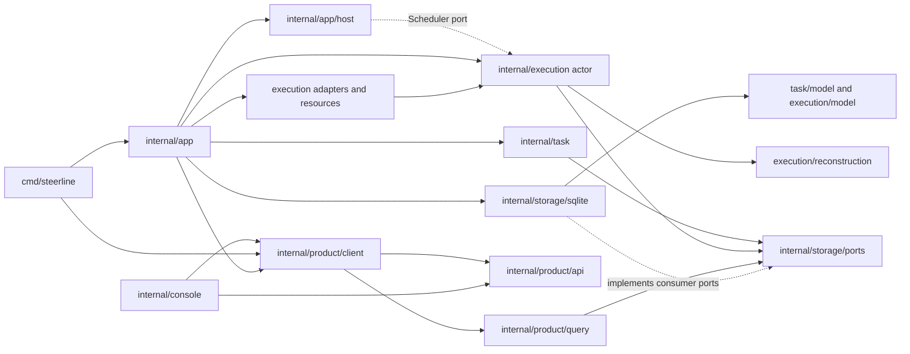

# 当前代码架构与源码索引

核对日期：2026-10-06。本文描述当前候选源码树。第一阶段的运行与验收只包含本地 Codex 和本机 Orca；保留的远端实现不代表一期接受远端权限或远端真机流程。

## 系统边界

CLI 和 TUI 使用同一个产品客户端。`internal/app` 读取配置并组装具体 adapter、SQLite 和各消费者端口；`internal/app/host` 承载服务进程、文件控制协议、启动/退出观察、锁与心跳，并通过注入端口调用 execution actor。任务和执行状态仍由唯一业务 actor 决定，再由 SQLite 专用提交接口校验身份、前值和版本。产品查询只把同一数据库快照投影为 `product/api` 页面。

The host does not open SQL, import backend adapters, or apply task/execution transitions. Its application admission, process facts, scheduling, command transport and activity presentation are injected. It reads the committed service/runtime sample through the configured reader; process liveness is observed separately from the SQLite snapshot.

## Module owners

| Owner | Responsibility |
| --- | --- |
| `internal/app` | Config loading, profile and adapter construction, SQLite binding, command/client composition and close ownership. |
| `internal/app/host` | Service process hosting, startup identity, locks, file control requests/receipts, heartbeat, exact instance/revision routing and shutdown observation. `internal/execution/scheduler` contains the timer loop over the injected actor interface. |
| `internal/task` | Fixed task contract validation, selection and task-owned claim/result/discard declarations through narrow ports. |
| `internal/task/model` | Task values, fixed contract, DAG, eligibility and normalized delivery facts. |
| `internal/execution` | Unique actor, dispatch, worker sessions, decisions, recovery, delivery and cleanup. Host calls the actor through `execution.HostPort` and scheduling callbacks; adapters do not mutate domain state. |
| `internal/execution/model`, `internal/execution/backend` and `internal/execution/conversation` | Execution records and rules; backend-neutral adapter values and implementation evidence; conversation source and mapper ports with their discovery/history requests. |
| `internal/execution/reconstruction` | Pure reconstruction of `Runtime` and `RunView` from a committed checkpoint and the sampled task/execution records. It performs no I/O. |
| `internal/execution/adapters` | Codex, local Orca, retained remote protocol implementation and shared Codex codec. Remote protocol retention does not authorize remote execution. |
| `internal/execution/workspace`, `publication`, `process` | Git workspace, provider/PR operations, managed worker processes and file resource facts. The app injects process facts into the host. |
| `internal/product/api` | Serializable product pages, user commands, request targets and receipts. It contains no Runtime, Config, SQL record, or Go handle. |
| `internal/product/client` | The single injected product client for CLI/TUI consumers. `TaskGraphExportReceipt` is a product value and graph file publication is a client operation. |
| `internal/product/query` | Read-only projections and composition of product pages from storage ports. No SQL or business writer. |
| `internal/console` | TUI navigation and view state; consumes only product API values and injected client interfaces. |
| `internal/storage/ports` and `internal/storage/sqlite` | Consumer-owned narrow read/commit declarations; one SQLite implementation owns schema, SQL, WAL, CAS and transactions. |
| `internal/testkit` and `tests/integration`, `tests/e2e` | Test-only protocol fixtures, real application composition tests, and registered controlled/native E2E scenarios. Production imports are forbidden. |

The former `internal/steerline` host/facade, `internal/steerlineapp`, `internal/steerline/contracts` and `internal/steerlineintegration` packages have no production or test import path. Tests moved to their owner or to `tests/integration`; no forwarding aliases remain.

## Persistent state and recovery

SQLite remains the only persistent business authority. Claim, task result, unique delivery, discard, command receipt and their checkpoint changes still validate original identity and versions in their existing transaction boundaries. External Git or provider facts remain independent observations; no cross-system atomicity is inferred.

Execution recovery reads the service checkpoint together with task authority/graph and execution records using the existing storage read ports. `execution/reconstruction` rebuilds the read-only Runtime from that sample; persisted control-operation receipts use execution-owned checkpoint values and convert to product DTOs at the host transport. `ApplicationProjectSnapshot` still composes product project values and execution facts in one SQLite read transaction; the Go client classifies heartbeat/process freshness from the sampled Runtime rather than combining separately sampled versions. E2E `SnapshotContext` also reconstructs from that same `ApplicationProjectSnapshot` database sample.

Conversation event writes and their source checkpoints still commit atomically. Query pages expose `product/api` DTOs; raw source cursors, implementation attributes and persisted event values remain execution-owned. Host heartbeat writes service metadata only. Stopping the service does not imply that an external worker exited.

The current persisted-format boundary remains strict: profile v6, `builtin-execution-v2`, policy resources v3, SQLite schema 14, checkpoint/runtime schema 18 and conversation event v2. Unsupported or retired formats are rejected without migration, old-format reads, dual writes or rollback paths.

## Verification and source locations

The boundary tests scan all OS/build-tag source files and the Windows/Linux production dependency graphs. `test-feedback -level=L1` remains the fixed quick/rule/owner selection; E2E level and scenario selection remains explicit in [`tests/e2e/README.md`](../../tests/e2e/README.md). Full, L2 and live L3 are not default requirements.

Task #80 ownership, moved test parents/subtests, selected groups and evidence paths are recorded in [`docs/validation/three-line-08-app-host/ownership.md`](../validation/three-line-08-app-host/ownership.md), [`test-mapping.json`](../validation/three-line-08-app-host/test-mapping.json) and [`README.md`](../validation/three-line-08-app-host/README.md).

## Key source entry points

| Flow | Source |
| --- | --- |
| CLI composition | [`cmd/steerline/main.go`](../../cmd/steerline/main.go), [`internal/app/config.go`](../../internal/app/config.go), [`internal/app/execution_service_wiring.go`](../../internal/app/execution_service_wiring.go) |
| Host loop and control | [`internal/app/host/service_client.go`](../../internal/app/host/service_client.go), [`internal/app/host/control_protocol.go`](../../internal/app/host/control_protocol.go), [`internal/execution/scheduler/loop.go`](../../internal/execution/scheduler/loop.go) |
| Execution actor and ports | [`internal/execution/service_construction.go`](../../internal/execution/service_construction.go), [`internal/execution/host_ports.go`](../../internal/execution/host_ports.go), [`internal/execution/service_commit.go`](../../internal/execution/service_commit.go) |
| Runtime reconstruction | [`internal/execution/reconstruction/runtime.go`](../../internal/execution/reconstruction/runtime.go), [`internal/execution/reconstruction/run.go`](../../internal/execution/reconstruction/run.go) |
| Product reads and client | [`internal/product/query/project_page.go`](../../internal/product/query/project_page.go), [`internal/product/client/client.go`](../../internal/product/client/client.go), [`internal/console/interfaces.go`](../../internal/console/interfaces.go) |
| Storage ports and SQLite | [`internal/storage/ports`](../../internal/storage/ports), [`internal/storage/sqlite`](../../internal/storage/sqlite) |
