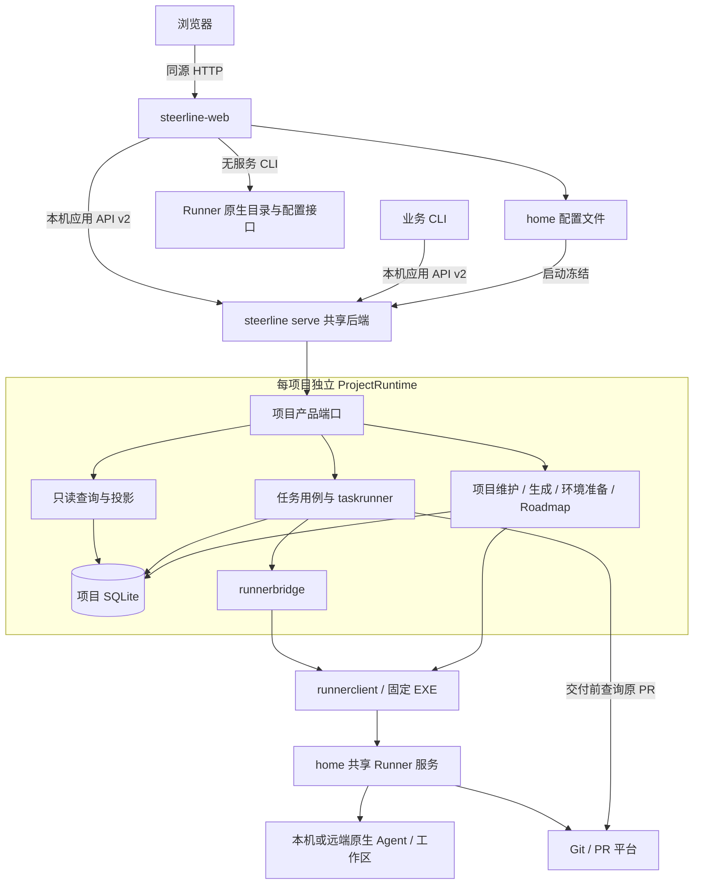
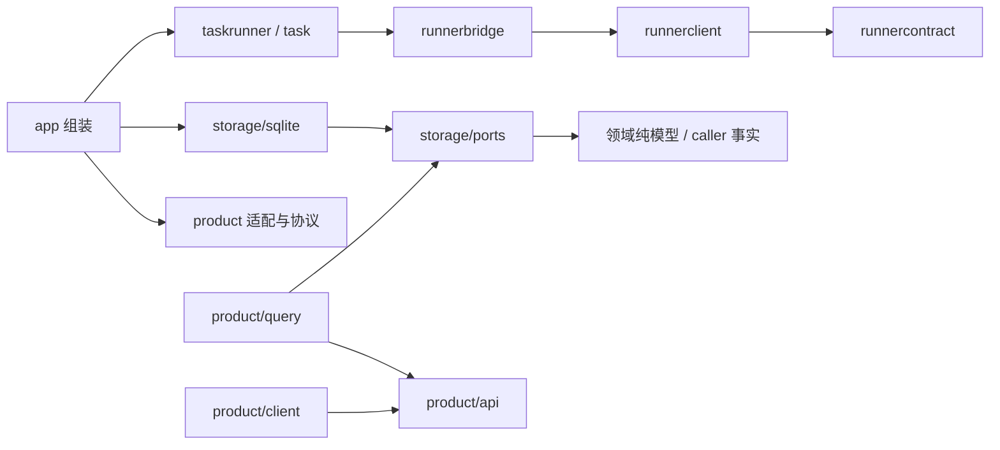

# 当前代码架构

本文维护运行拓扑、源码归属和关键依赖。组件职责见[架构总览](../architecture.md)，领域规则见[产品设计](../product-design/README.md)，当前执行能力见[Runner 接入](../integration/steerrunner.md)。图中的调用与 Go import 分别说明，历史重构和拟议拆分见[历史入口](../../SteerlineFlow/archive/design/architecture-web-history.md)。

## 进程与运行边界

`steerline start` 协调启动共享后端和独立 Web 程序；后端装载各项目运行时，并持有一个 home 级 Runner 服务。各项目没有独立 HTTP listener，应用路由在进程内调用项目产品端口。

项目业务事实保存在 SteerLine SQLite，执行事实保存在 Runner state-dir；调用方只保存公开副本与原绑定。Web 的配置操作与本机元数据查询不依赖项目任务库，原生协议归 Runner。运行配置、短目录及升级规则归接入说明，不在本页维护版本副本。

## 客户端与服务边界

浏览器 → Web 同源 API → 应用 API v2 → 项目 `Read/Command/Task` 端口 → 产品用例。Web 和 CLI 不直接读任务库、checkpoint 或 Runner 私有文件；应用路由也不因列表或连接请求初始化项目状态。项目装载与关库由 `ProjectRuntime` 负责。

Web 拥有浏览器认证、项目选择、草稿、原信封和查询缓存；Go 产品用例拥有业务资格和状态提交。应用与项目 Bearer 留在本机服务侧，浏览器使用绑定 home/Web 实例的会话。离线显示最后观察并禁写，实例变化重新核验；旧请求不自动改投新实例或候选。认证与工程操作归 [Web README](../../web/README.md)，具体路径、回执与补交资格归[本机协议](../product-design/local-client-protocol.md)。

当前采用查询刷新与受控轮询。Roadmap 规划分页已通过本机 Runner 原生多轮会话接入独立 worktree。SSE、远程 Web 访问和持续维护工作台仍属后续范围。[Roadmap 规划 Spec](../../SteerlineFlow/spec/roadmap-planning.spec.md) 重构与维护已接入最小分页和后台行动，独立维护[自身边界](refactoring-maintenance.md)，不改变 Task/DAG 交付。

## 模块与资源归属

| 源码入口 | 当前职责 |
| --- | --- |
| [app](../../internal/app) | 应用目录、配置冻结、项目运行时和产品适配；组装具体 store、Runner 客户端及端口 |
| [app/host](../../internal/app/host) · [hostcontract](../../internal/hostcontract) | 宿主身份、控制、锁、进程观察与关闭；hostcontract 保存 checkpoint 等纯契约值 |
| [task](../../internal/task) · [task/model](../../internal/task/model) | 任务契约、DAG、依赖、资格、交付证据及验证；纯模型归 task/model |
| [taskrunner](../../internal/taskrunner) | 任务 actor、候选资格与冻结、反馈、平台 PR 核验、唯一交付及后继释放 |
| [runnerbridge](../../internal/runnerbridge) | 原请求 outbox、Run/输入/PR 绑定、公开事件和游标、迟到接受及停止义务；统一构造候选停止信封 |
| [runnerclient](../../internal/runnerclient) | 固定 EXE、实例及公开能力校验、CLI 调用、公开结果解码和升级排空核验 |
| [runnercontract](../../internal/runnercontract) · [runnerstate](../../internal/runnerstate) · [runnerbinding](../../internal/runnerbinding) | 公开协议投影、调用方候选事实及纯绑定核验；无资源或执行状态机 |
| [projectmaintenance](../../internal/projectmaintenance) | 远端/本地观察、材料准备及项目就绪；维护自身活动，不持有候选执行状态机 |
| [testmanagement](../../internal/testmanagement) | 测试清单、生成输入与结果、取消及停止责任；共享生成准入由应用宿主协调 |
| [environmentadaptation](../../internal/environmentadaptation) | 普通 Run 执行项目检测并消费封存结果，保存项目×环境资格，不创建任务 DAG |
| [refactoring](../../internal/refactoring) · [只读决策](../../internal/steeragent/maintenance) | 唯一维护行动、预算、轮次与停止/收尾；纯决策只生成提示词，所有项目写入由 Runner 完成；存储和查询只依赖 refactoring/model |
| [roadmap](../../internal/roadmap) · [文档发布组装](../../internal/app/roadmap_publication.go) | 解析、确认及生成记录；文档 Git/provider 发布由 app 组装，正式编号和入图归 task |
| [storage/ports](../../internal/storage/ports) · [storage/sqlite](../../internal/storage/sqlite) | 返回领域事实，原子保存业务记录、候选、停止义务及 checkpoint；不生成产品 DTO |
| [product/api](../../internal/product/api) · [query](../../internal/product/query) · [client](../../internal/product/client) | 产品 DTO、只读投影和注入能力的内部产品客户端；查询层处理公开字段、分页与输出预算 |
| [applicationhttp](../../internal/product/applicationhttp) · [httpapi](../../internal/product/httpapi) | 应用路由、认证和项目协议映射，经产品端口调用；不把传输回执当业务完成 |
| [applicationclient](../../internal/product/applicationclient) · [httpclient](../../internal/product/httpclient) · [httpcontract](../../internal/product/httpcontract) | 本机 HTTP 消费、连接及共享路由/信封契约；不访问任务库 |
| [executionconfig](../../internal/executionconfig) · [Web 配置](../../web/server/executionconfig) · [目录协调](../../web/server/discovery) · [原生查询](../../web/server/nativequery) | 纯配置值与 Web 条件保存；通过固定 Runner 接口处理原生配置、目录和在途合并 |
| [billing](../../internal/billing) · [billingconfig](../../internal/billingconfig) · [用量组装](../../internal/app/runner_usage.go) | 无 IO 的精确计算、home 价表文件唯一读写入口及固定候选用量组合；Runner 只提供用量事实 |
| [execution](../../internal/execution) | 仍被消费的展示/配置值、宿主视图、控制传输和进程端口；包名不表示旧原生 worker 仍存在 |
| [web/server](../../web/server) · [web/src](../../web/src) | 独立 Web 宿主与 React 页面；认证、配置、项目连接、原请求 journal 和渲染 |
| [testkit](../../internal/testkit) · [E2E driver](../../tests/e2e/internal) | 依赖守卫、共享夹具与隔离驱动；不导入 Runner 私有实现 |

`ProjectRuntime` 唯一持有并关闭项目 store、锁、日志和产品端口；actor、factory 和内部客户端借用这些资源。`ApplicationDirectory` / `applicationRunner` 持有 home 共享 Runner，项目不能自行关闭它。全局配置、价表和 Runner 部署记录各由相应 owner 管理，不能当作第二份任务状态。

## 依赖方向与现存耦合

以下仅示意主要依赖方向，具体 import 由源码及[依赖守卫](../../internal/testkit/boundary)核对：

- Web 的业务 HTTP 消费依赖不应到达后端 handler、query、storage 或原生执行实现；配置及计费文件使用各自独立 owner。
- SQLite 与存储端口无产品包生产依赖；查询层从同快照事实生成 DTO。`runnerbridge` 不导入 SQLite 或 task 实现，`runnerbinding` 仅使用公开契约和 caller 事实。
- `product/client` 只依赖产品 API；任务交付/项目权威归 `task/model`，宿主 checkpoint/控制及观察契约归 `hostcontract`。这些值不能经旧包别名重新形成双所有者。
- `taskrunner`、storage 和 query 仍消费 `execution/model` 等展示或配置值；app 也同时包含组装与产品适配。它们是现存耦合，不能因文件已拆分就宣称可独立编译、替换或交付。
- 项目运行时分别注入固定提交材料读取与执行预留。读取返回指定提交下的普通 Git 文件，执行预留由项目维护核实就绪并持有基线锁完成保存。环境准备使用基线预留，任务启动继续按环境目标、项目基线、存储的顺序取得锁。

新增边界按实际消费者收窄；未实施的 app 拆分、调用面调整等建议保留在历史入口，需另行确认。当前任务交付的同一原子事务和项目资源所有权不因拆包改变。

## 命令、查询与事务边界

命令路径为产品端口 → 用例/actor → 原事务保存意图 → 外部请求 → 校验并保存原事实。TaskDelivery、关闭任务、图释放和全部候选停止义务仍在一个写事务中完成；交付前 PR 由调用方直接查询平台。完整链路见[可靠性交付](reliable-delivery-chain.md)，本页不再维护第二张步骤图。

读取路径为同一读事务取得任务、候选、事件及 checkpoint → 事务外纯投影。历史、详情、会话与活动不得分别重读可变事实拼接快照；读取失败不以部分数据返回成功。正文引用、SHA/长度、UTF-8 边界、游标与公开预算继续由现有存储/查询边界核验。

活动读取流保持同一只读事务，查询层逐条投影并计数；超预算记录不推进游标。正常、预算终止、取消或错误路径均须关闭流，关闭失败不返回成功页。具体格式和预算归[数据模型](../product-design/data-model.md)与[执行观察和结果](../product-design/execution-observability.md)。

关闭顺序为拒绝并排空项目 Read/Command/Task → 关闭本地资源并记录锁结果 → 应用结算共享 Runner。关闭 Web、项目本地退出和原生资源停止分别判断；失败不丢原绑定或停止义务。原生恢复及 v8 升级遵守[生命周期](../product-design/runner-lifecycle.md)，不在组装层另建规则。

## 维护范围

随实现更新受影响的图、模块与来源链接；格式版本唯一定位在数据模型，不在本页重复数字。技术栈和开发操作归 Web README；任务安排归 Spec/Plan，审计及验证归[历史证据入口](../../SteerlineFlow/archive/design/architecture-web-history.md)。本页不追加日期增量、已完成任务清单或拟议模块。

## 统一异步观察

`storage/ports.AsyncActivityReader` 提供中性有界事实；SQLite 单条查询获取来源及关联，产品 `query/async_activities.go` 只做状态、相关性与列表投影。App 注入四个静态来源并暴露 `GET /activities`，绕开 actor 的业务执行路径；不调用 Runner 或 Git。业务 owner 负责批次/关联/观察元数据的持久化，读取方没有执行能力。Web 的 App 在 keyed Workspace 外保存抽屉偏好，Workspace 内按 home/project/instance 保存查询；入口通过 slot 交给应用壳。设计与扩展约定见[异步活动中心](../product-design/async-activities.md)，实际验证见[专属验收](../../SteerlineFlow/testing/acceptance/async-activity-center.md)。
