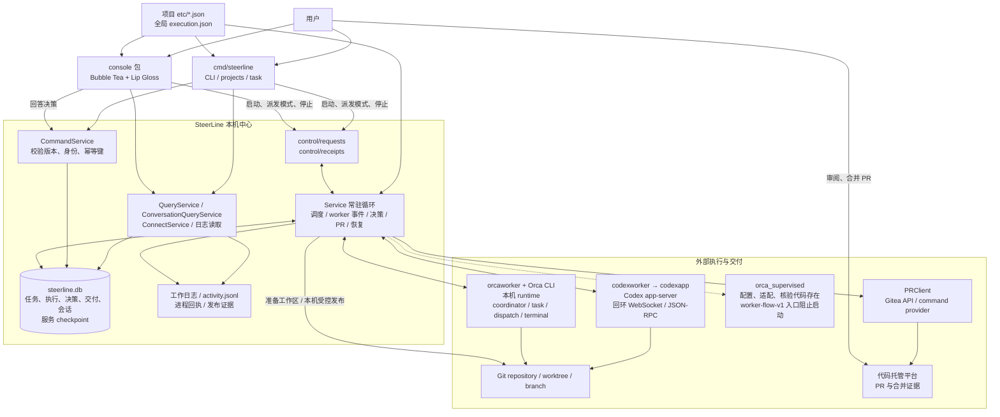
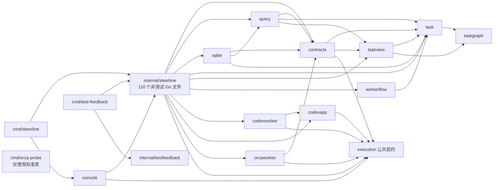
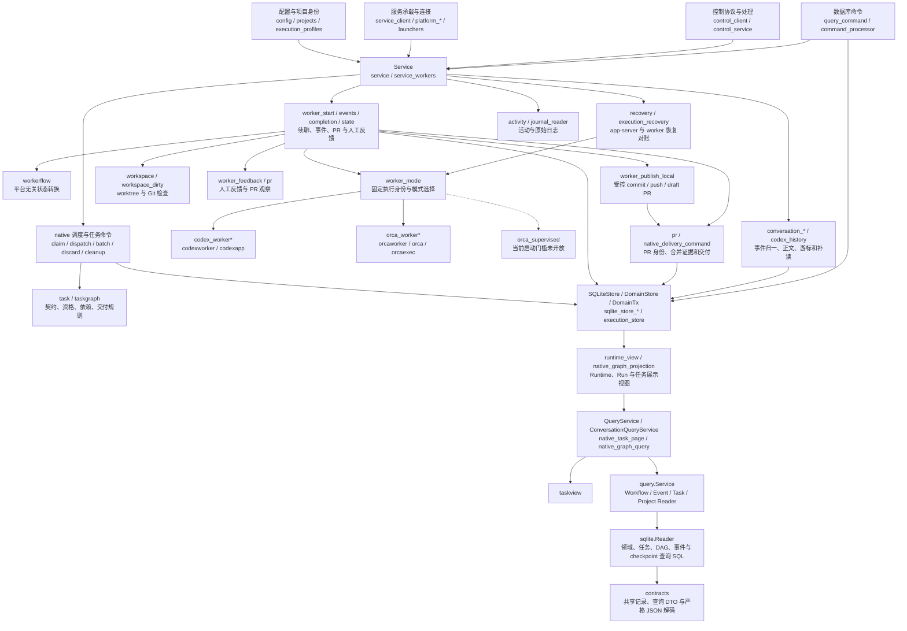
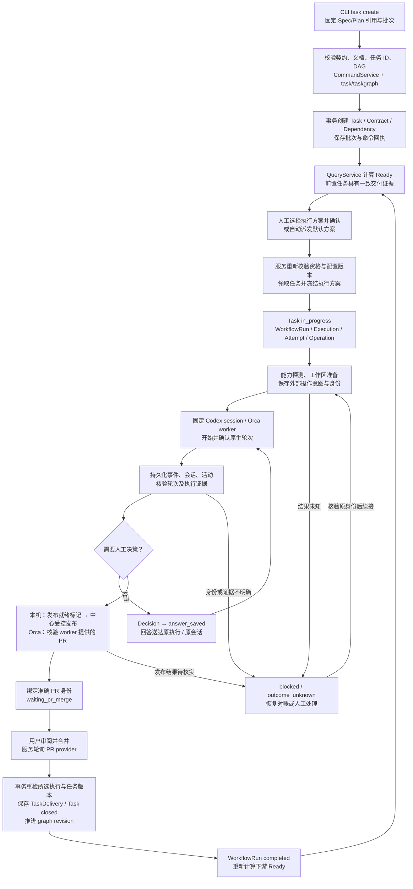
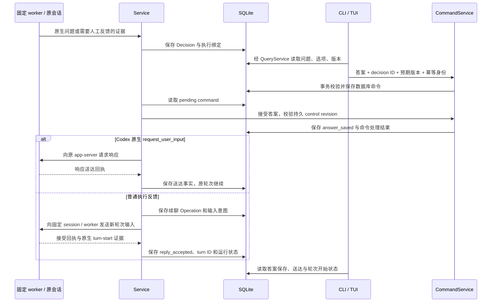
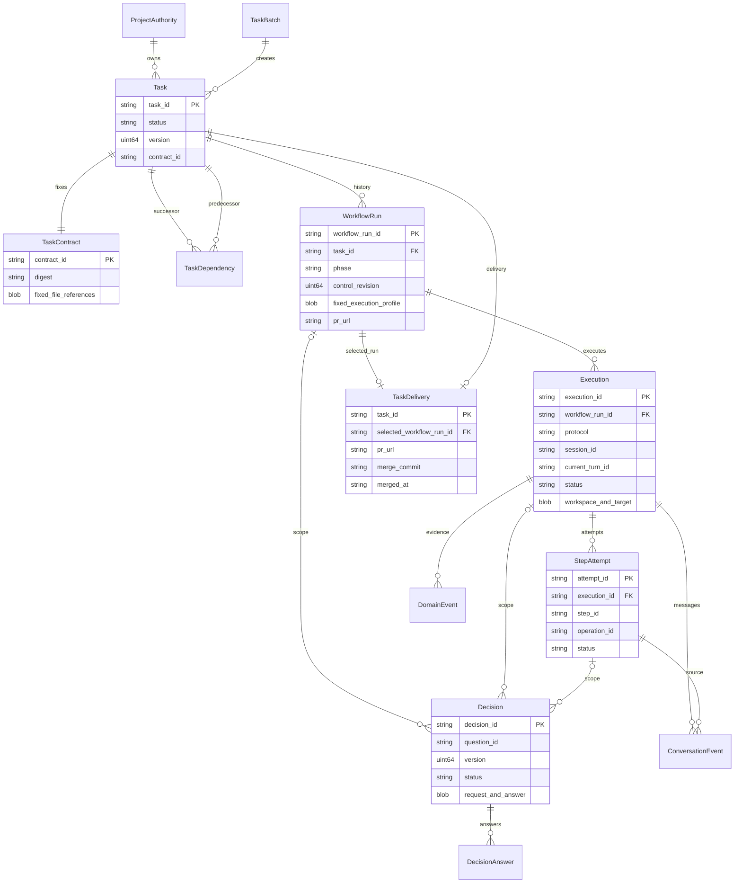
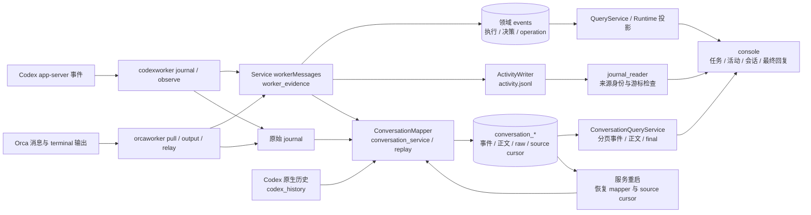

# SteerLine 当前代码架构图

快照日期：2026-09-30。源码基线：`c2c9f95`（含 PR #160 的环境就绪与 PR #161 的隔离规划），叠加查询拆包及审计修复。

本文描述当前检出的代码：系统边界、实际 Go 包依赖、核心包内部职责、任务执行、人工决策、数据模型、日志与恢复。图中的职责分组不代表已拆成独立包或服务。箭头含义在各图前说明；未来方案与当前可启动路径分开列出。

## 1. 系统与进程总览

实线表示当前调用或数据通路，虚线表示存在代码但当前不能启动的执行路径。CLI 和控制台可以是不同进程；`run` 在独立服务进程中运行。查询经 Go 读取 SQLite，当前客户端控制协议主要使用文件请求/回执和数据库命令，而不是第二阶段计划中的 HTTP/SSE。

**业务权威**是 SQLite 中的持久记录。服务负责运行中的业务推进；CLI 的任务创建、废弃、追加前置等命令也能通过 `CommandService` 写库，但须取得仓库身份锁。客户端提交命令不等于执行成功，agent 输出和日志不等于任务交付。

**生命周期**：Windows 通过可见的 `service-window.bat` 承载服务；控制台退出不会停止服务。服务重启先对账保存的身份、命令和外部状态，再允许新派发。当前代码有 Windows/Linux 平台实现，代码存在不表示各平台均完成原生验收。

源码入口：[main.go](../../cmd/steerline/main.go)、[Service](../../internal/steerline/service.go)、[console/source.go](../../internal/steerline/console/source.go)、[control_protocol.go](../../internal/steerline/control_protocol.go)、[native_project_open.go](../../internal/steerline/native_project_open.go)。

## 2. 实际 Go 包依赖

箭头仅表示非测试 `.go` 源文件中的项目内 `import`，不代表运行时调用。所有 `internal/steerline/` 子包在图中用短名表示。

| 包 | 当前职责 | 非测试 Go 文件 |
| --- | --- | ---: |
| `cmd/steerline` | 产品命令入口、服务启动、控制台和任务命令路由 | 1 |
| `internal/steerline` | 服务编排、业务持久化、平台适配接线、查询和控制 | 110 |
| `console` | TUI 状态、导航、任务列表、活动/会话/正文、执行方案和决策编辑 | 14 |
| `contracts` | 共享持久记录、运行视图、执行配置与查询 DTO，严格 JSON 解码 | 7 |
| `query` | 按消费者分开的只读接口、事件/任务分页、DAG 与 Ready 查询规则 | 4 |
| `sqlite` | 领域、事件、命令、任务、DAG、checkpoint 与组合快照的 SQLite 只读适配 | 6 |
| `task` | 任务契约、批次、状态、依赖资格、交付和命令规则 | 10 |
| `taskgraph` | DAG 校验、遍历、前后置关系和图算法 | 1 |
| `taskview` | 任务展示、分页和投影规则 | 3 |
| `workerflow` | 单个可续聊 worker 的纯状态规则、模式选择和提示构造 | 4 |
| `execution` | 公共执行身份、会话输入/回答、事实、回执、能力、工作区与错误；无业务写库权 | 7 |
| `codexapp` | Codex app-server 参数、客户端、原生问题与 WebSocket 协议 | 7 |
| `codexworker` | app-server 启动、连接、能力探测、轮次观察、journal 与回答 | 11 |
| `orcaworker` | Orca task/dispatch、terminal、消息、pull/relay、输出与工作区协议、环境就绪证据 | 19 |
| `cmd/orca-probe` | 只读能力探测与脱敏证据采集 | 1 |
| `cmd/test-feedback` | 最小/定向/全量测试调度、日志与反馈报告 | 4 |
| `internal/testfeedback` | Go test JSON 结果汇总 | 1 |

合计 **17 个包目录、210 个非测试 Go 文件**。统计覆盖 `cmd/` 与 `internal/`；不含 `_test.go`、测试数据、脚本和文档。核心包仍集中承载多项职责，不能将上述逻辑边界理解为微服务或已经完成的全面拆包。

## 3. 核心包内部职责与接线

图中多数节点仍是 `steerline` 包内的逻辑职责；`contracts`、`query` 和 `sqlite` 已是独立包。实线表示主要协作关系，不是完整函数调用图。

| 职责 | 主要源码 | 关键边界 |
| --- | --- | --- |
| 配置与固定执行方案 | `config.go`、`execution_profiles.go`、`service_execution_profiles.go`、`projects.go` | 项目身份、PR 和 DAG 属于项目；每次领取冻结 worker 执行方案和摘要 |
| 服务调度与事件循环 | `service.go`、`service_workers.go`、`native_service.go` | worker 观察器按 workflow run ID 管理；启动、回答和恢复不依赖一个共享的“当前 worker” |
| 控制与命令 | `control_*.go`、`query_command.go`、`command_processor.go` | 控制文件绑定服务实例；数据库命令有版本和幂等身份 |
| 任务管理 | `native_batch_command.go`、`native_claim_command.go`、`native_dispatch_command.go`、`native_task_predecessors.go`、`native_discard_command.go` | 验证固定契约、DAG 与版本；废弃后的外部清理单独对账 |
| 图与候选读取 | `native_graph_*.go`、`native_readiness*.go`、`native_task_page*.go` | 使用事务快照和游标；展示 Ready 缓存不是领取许可 |
| 单 worker 生命周期 | `worker_start.go`、`worker_events.go`、`worker_completion.go`、`worker_state.go`、`worker_mode.go`、`worker_resume.go` | Session、Turn、Execution、Attempt 和 Operation 必须对应持久身份 |
| 本机 Codex | `codex_worker*.go`、`codex_history.go`、`codexworker/`、`codexapp/` | 实际 worker 经回环 WebSocket 连接 app-server；不是第二阶段规划会话的 stdio 方案 |
| Orca | `orca_worker*.go`、`orca.go`、`orcaexec.go`、`orcaworker/` | coordinator、runtime、task、dispatch、terminal 与消息回执分别核验 |
| 工作区与发布 | `workspace*.go`、`worker_publish_local.go`、`codex_git_sandbox.go` | 本机 worker 发出发布就绪标记后，中心校验并办理发布 |
| PR 与交付 | `pr.go`、`native_delivery_command.go`、`task/delivery*.go` | 合并事实先外部查询，再事务内重检并写交付与 closed 状态 |
| 决策与干预 | `decision.go`、`worker_feedback.go`、`service_commit.go`、`operation.go` | 保存答案、送达回执、原会话新轮次开始是不同事实 |
| 日志与会话 | `activity.go`、`journal_*.go`、`conversation*.go`、`codex_conversation.go` | 原始日志、归一事件、正文版本与最终回复分别处理 |
| 查询与数据契约 | `query/`、`contracts/`、`project_view.go` | 查询按四类只读能力接线，不依赖中心、SQLite 具体类型或写事务；数据 JSON 字段保持不变 |
| 持久化与投影 | `sqlite/`、`sqlite_store*.go`、`execution_store.go`、`store.go`、`runtime_view.go` | 只读 SQL 在 sqlite 包；中心拥有连接、schema 初始化、原子写入和 Runtime 业务投影；checkpoint 不保存第二套业务状态 |
| 恢复与平台 | `recovery.go`、`execution_recovery.go`、`platform_*.go`、`spawner.go` | 对账原身份；不因超时、观察断线或重启直接创建替代执行 |

本轮删除旧步骤校验 `remoteprotocol`、Execution 的候选/验证/审查修订与修复轮数字段，以及 Attempt 的旧前置结果、结果 ID 和 legacy 标记。`CurrentStep` / `StepID` 仍固定为 `worker`，WorkflowRun 继续表示本次任务执行。原生事件解码位于 `codexworker/event_fact.go` 与 `orcaworker/event.go`；父包的 `worker_evidence.go`、`codex_worker_evidence.go`、`orca_worker_evidence.go` 仅负责固定记录和有类型事实的适配。中心恢复、启动、事件、结算、PR、反馈分别落在相应 `worker_*.go`，写入仍只经显式事务。

## 4. 任务从创建到交付

这是业务流程图。每次“已请求”“已接受”“已确认”均需对应持久记录或外部证据。当前 worker 可以多轮续聊，不应将历史的 prepare/implement/verify/review 分阶段方案当作生产必经流水线。

人工派发允许多个不同 Ready 任务并行，每个任务冻结独立执行方案与 worker 身份；同一任务不能重复领取。自动模式一次保持一个活动执行，切换自动模式不会停止已经人工启动的任务。领取、进程开始、轮次结束、PR 合并、任务交付不是同一层状态。

源码：[native_service.go](../../internal/steerline/native_service.go)、[worker_start.go](../../internal/steerline/worker_start.go)、[workerflow/state.go](../../internal/steerline/workerflow/state.go)、[worker_publish_local.go](../../internal/steerline/worker_publish_local.go)、[native_delivery_command.go](../../internal/steerline/native_delivery_command.go)。

## 5. 人工决策与原会话续聊

这是时序图。原生问题响应与普通反馈续聊分别处理；“答案被保存”不能展示为“agent 已应用”。

配置、session、run、execution、turn 身份不匹配时拒绝发送；结果未知时保留原命令和操作身份等待对账。心跳和日志更新不会改变 WorkflowRun 的持久控制版本。

源码：[query_command.go](../../internal/steerline/query_command.go)、[command_processor.go](../../internal/steerline/command_processor.go)、[worker_mode.go](../../internal/steerline/worker_mode.go)、[codex_worker_reply.go](../../internal/steerline/codex_worker_reply.go)。

## 6. 核心数据模型

图表示主要领域关系，省略所有关系共有的 `project_identity`。部分关系保存在 payload 中，并不全部是 SQL 外键；完整表定义见 `sqlite_store_schema.go`。一个任务可有历史 workflow，但数据库约束同一任务只有一个非终态 workflow，同一 workflow 只有一个活动 execution。

| 存储类别 | 当前表 | 用途 |
| --- | --- | --- |
| 版本与项目权威 | `schema_migrations`、`database_state`、`project_task_authorities` | schema、数据库身份与版本、项目绑定、派发模式、图版本 |
| 任务与 DAG | `tasks`、`task_contracts`、`task_batches`、`task_dependencies`、`task_deliveries` | 固定契约、不可随意修改的依赖、任务创建批次和合并交付证据 |
| 执行 | `workflow_runs`、`executions`、`step_attempts` | workflow、外部执行绑定、workspace、session/turn 和 attempt |
| 命令、操作与决策 | `commands`、`operations`、`decisions`、`decision_answers` | 命令幂等、外部副作用意图、决策版本与回答回执 |
| 底层执行记录 | `execution_bindings`、`execution_operations` | 后端执行绑定与操作记录 |
| 领域事件 | `events` | 业务事实与可分页读取的证据 |
| 会话 | `conversation_events`、`conversation_bodies`、`conversation_current_messages`、`conversation_raw` | 归一事件、完整正文版本、当前消息和原始来源 |
| 会话读取位置与能力 | `conversation_source_cursors`、`conversation_capability_reports` | 恢复读取游标、来源能力及版本证据 |
| 服务 checkpoint | `projection` | 服务实例、心跳、未完成控制操作、阻塞信息与认领前预留；不持久化第二套 Runtime/Run 业务权威 |

当前 SQLite schema 为 **7**，服务 checkpoint schema 为 **9**。数据库使用 WAL、外键、busy timeout 和事务；旧格式直接拒绝，不增加迁移、双写或回退路径。

源码：[domain.go](../../internal/steerline/domain.go)、[task/model.go](../../internal/steerline/task/model.go)、[sqlite_store_schema.go](../../internal/steerline/sqlite_store_schema.go)、[runtime_view.go](../../internal/steerline/runtime_view.go)。

## 7. 输出、会话与恢复读取

箭头表示采集和读取通路。会话补读与业务 worker 事件处理并存；日志只能提供相应来源确认的事实。

Service 将私有领域工作副本、已提交快照和私有工作 Run 分开；公开 Runtime/Run 由已提交记录深复制构建，不复用工作 Run 的指针。worker 转换通过 `service_commit.go` / `worker_commit.go` 声明记录前值、操作和事件；业务记录与 checkpoint 在同一事务提交。执行绑定与停止意图/回执也作为明确的附属写集合在该事务中提交。`publishCheckpoint` 与 heartbeat 只写服务快照，不扫描业务字段。手动本地恢复在一笔提交中退休旧 Attempt、创建新 Attempt 并切换 Execution 当前代次。

读取视图在同一事务中组合业务记录和 checkpoint。会话事件及来源游标持久化后可以补读，正文按身份与版本定位；来源没有明确 turn 终态或 final 时，界面显示未识别或能力原因。重启恢复还需核验进程身份、app-server generation、固定工作区、Orca dispatch 和未完成 Operation，不能只从日志推测是否完成。

`QueryService.ReadProjectView` 在一笔 SQLite 读事务内组合任务页、完整 Ready 候选、选中任务（含页外选择）、领域记录和服务 checkpoint，复用现有任务、DAG 与 Runtime 投影规则。TUI 直接消费组合结果，不再分别读取列表与 Ready 后重试版本匹配；服务连接依据同一 Runtime 样本执行独立的进程与配置核验，并按核验时刻重新计算心跳新鲜度，保留原数据库采样时间。分区读取错误或连接身份核验失败仍可保留可用的只读数据，控制和领取继续自行校验。领域事件分页每批最多读取 32 条；SQL 先读取有界元数据，只物化本页剩余字节预算内的正文，超出预算的预读事件和条数探测只返回正文引用。每页保留 1 MiB 正文上限、超大正文引用和按最后实际返回事件推进的游标。

## 8. 工具、依赖与尚未交付的边界

| 项目 | 当前定位 |
| --- | --- |
| Go 1.24.2 | `go.mod` 声明的 Go 版本 |
| Bubble Tea / Lip Gloss / ANSI / runewidth | 当前终端控制台与文本渲染依赖 |
| `modernc.org/sqlite` | 当前 SQLite 驱动 |
| `golang.org/x/sys` | 平台进程和系统能力 |
| `build.ps1` / `build.bat` | Windows 本地构建 `cmd/steerline` 到 `bin/steerline.exe` |
| `internal/steerline/launcher/` | 内嵌 console/service-window 启动入口与说明 |
| `scripts/steerline-pr-provider.py` | 调用 `gh`，提供准确 GitHub PR 查询与关闭事实；属于 command provider 适配 |
| `scripts/roadmap_task_id.py` | 通过 Git ref 占用与校验 roadmap task ID；不是当前运行调度器 |
| `examples/` | 项目配置、全局执行方案、任务批次与控制协议示例 |
| `docs/spec/`、`docs/roadmap/`、`docs/validation/` | 执行契约、规划依赖与验收证据；不是运行时服务模块 |
| `docs/phase-2/prototype/index.html` | 五页交互原型，演示数据与按钮没有接真实服务 |
| WinUI 3、规划主 agent、规划 worktree、受控文档发布、HTTP/JSON/SSE | 第二阶段 Spec/方案，当前 `cmd/`、`internal/` 中没有对应产品实现 |
| stable/dev 固定版本选择与发布 | 当前只有本地构建、安装相关代码；固定版本运行交付仍为 Spec |
| `orca_supervised` | 配置和多个适配/核验函数存在；`StaticUnavailableReason` 和 native preflight 阻止当前单 worker 启动 |
| Pi 输出归一代码 | `activity.go` 中存在归一器，不代表当前本机 worker-flow 支持 Pi 执行 |

本轮依赖边界：`contracts` 不导入中心或平台适配；`query.Service` 分别持有 `WorkflowReader`、`EventReader`、`TaskReader`、`ProjectReader`，查询代码不导入 `database/sql` 或 `*SQLiteStore`。`sqlite.Reader` 实现前三类只读能力并返回组合快照的原始记录；中心的项目读取接线完成已提交 Runtime 投影后满足 `ProjectReader`。父包保留类型别名和构造接线，命令和 worker 原子写入仍由现有中心事务入口负责。DAG 独立读取与事务内读取共用一个 SQL 加载器；严格 cursor 解码、JSON 字段、schema 版本、PR 交付和恢复身份未改变。项目 `-quick` 入口已加入 contracts、query、sqlite 的最小用例。

## 9. 快照验证与维护

本次审计补充了 Ready 查询的缺失读能力/项目检查，以及任务查询返回值的项目、任务 ID 和 cursor 数据库身份/版本校验；替换 Reader 不能绕过这些查询规则。整合主干环境就绪后，ProbeIdentity、ProbeReceipt、ToolContext、HostFact 等共享证据 DTO 位于 contracts，Orca 包仅通过类型别名使用，contracts 继续不依赖平台适配。当前 SQLite schema 为 8、Runtime schema 为 10，与主干格式一致。

审计回归、新包用例、收窄后的 `-quick` 入口、环境就绪模拟验证、控制台与 CLI 集成测试、`go vet`、共享 DTO 字段/JSON 标签及依赖边界核对通过。首次定向筛选中的真机就绪验收因未启用专用开关而跳过；最终最小入口只选择模拟用例，未运行全量测试或真机认证。

查询、数据契约与 SQLite 只读适配拆包通过扩展后的 `-quick` 入口及定向验证；contracts、query、sqlite 包测试、控制台与 CLI 集成测试、测试入口覆盖检查和受影响包 `go vet` 通过。独立能力用例只注入任务或事件 Reader，确认查询不要求 SQLite 或无关读写能力；真实 SQLite 用例核对页外选择、正文预算、固定目标、只读数据库版本及原始 checkpoint 与中心投影的分工。架构包依赖、204 个生产源码索引和相对链接已核对。未运行全量测试或真机认证。

包依赖图由非测试源码的项目内 import 提取并人工对照入口。系统、执行与存储图对照当前关键代码和 schema，不依据未来 Spec 推断已交付能力。本轮收尾同步更新当前源码接线与文件索引。整合 PR #157 后，项目 `-quick` 入口（现已覆盖 `workerflow`）及附加的 13 个定向用例通过（执行 98.3 秒），覆盖私有 actor 视图、两轮续聊、问题回复恢复、重启不重发、原子绑定/停止回执和原生事件身份；`codexworker`、`orcaworker` 与测试入口自身的测试、受影响命令编译、`go vet` 和差异检查通过。未运行全量测试或真机认证。

维护时优先核对：入口命令、包 import、可启动执行模式、schema、checkpoint、控制协议、外部进程通信和交付事务。新增生产源码后应同步下面的全量文件索引；生产支持范围有变化时同步图 1、图 4 和第 8 节。

组合查询快照与事件批量分页改动通过项目 `-quick` 入口及相关定向查询、DAG、连接和观察用例，控制台包测试与受影响包 `go vet` 通过。新增用例在固定 WAL 读快照期间提交新任务状态、DAG 和 checkpoint，确认当前视图不混入新版本，下一次刷新才采用新记录；覆盖页外选择、缺少 checkpoint、读取错误、大正文引用、字节边界和游标连续性。审计补充验证样本过期、采样开始后的正常心跳、真正的未来心跳、身份核验失败时保留只读样本，以及多条接近 1 MiB 正文的 SQL 预读预算。200 条小事件的分页读取从 201 次数据库查询降为 8 次；每页最多 1000 条时从 1001 次降为 33 次。未运行全量测试或真机认证。

## 附录：全部非测试 Go 源文件索引

下列索引覆盖 `cmd/` 与 `internal/` 中全部非测试 `.go` 文件，按真实包目录分组。

### cmd/orca-probe

| 源文件 |
| --- |
| [main.go](../../cmd/orca-probe/main.go) |

### cmd/steerline

| 源文件 |
| --- |
| [main.go](../../cmd/steerline/main.go) |

### cmd/test-feedback

| 源文件 |
| --- |
| [main.go](../../cmd/test-feedback/main.go) |
| [process_unix.go](../../cmd/test-feedback/process_unix.go) |
| [process_windows.go](../../cmd/test-feedback/process_windows.go) |
| [scoped.go](../../cmd/test-feedback/scoped.go) |

### internal/steerline

| 源文件 |
| --- |
| [activity.go](../../internal/steerline/activity.go) |
| [codex.go](../../internal/steerline/codex.go) |
| [codex_conversation.go](../../internal/steerline/codex_conversation.go) |
| [codex_git_sandbox.go](../../internal/steerline/codex_git_sandbox.go) |
| [codex_history.go](../../internal/steerline/codex_history.go) |
| [codex_worker.go](../../internal/steerline/codex_worker.go) |
| [codex_worker_evidence.go](../../internal/steerline/codex_worker_evidence.go) |
| [codex_worker_recovery.go](../../internal/steerline/codex_worker_recovery.go) |
| [codex_worker_reply.go](../../internal/steerline/codex_worker_reply.go) |
| [command.go](../../internal/steerline/command.go) |
| [command_processor.go](../../internal/steerline/command_processor.go) |
| [config.go](../../internal/steerline/config.go) |
| [control_client.go](../../internal/steerline/control_client.go) |
| [control_protocol.go](../../internal/steerline/control_protocol.go) |
| [control_service.go](../../internal/steerline/control_service.go) |
| [conversation.go](../../internal/steerline/conversation.go) |
| [conversation_position.go](../../internal/steerline/conversation_position.go) |
| [conversation_replay.go](../../internal/steerline/conversation_replay.go) |
| [conversation_service.go](../../internal/steerline/conversation_service.go) |
| [conversation_store.go](../../internal/steerline/conversation_store.go) |
| [decision.go](../../internal/steerline/decision.go) |
| [domain.go](../../internal/steerline/domain.go) |
| [execution_backend.go](../../internal/steerline/execution_backend.go) |
| [execution_capability.go](../../internal/steerline/execution_capability.go) |
| [execution_helpers.go](../../internal/steerline/execution_helpers.go) |
| [execution_profiles.go](../../internal/steerline/execution_profiles.go) |
| [execution_recovery.go](../../internal/steerline/execution_recovery.go) |
| [execution_store.go](../../internal/steerline/execution_store.go) |
| [journal_platform_linux.go](../../internal/steerline/journal_platform_linux.go) |
| [journal_platform_other.go](../../internal/steerline/journal_platform_other.go) |
| [journal_platform_windows.go](../../internal/steerline/journal_platform_windows.go) |
| [journal_reader.go](../../internal/steerline/journal_reader.go) |
| [launchers.go](../../internal/steerline/launchers.go) |
| [model.go](../../internal/steerline/model.go) |
| [native_authority.go](../../internal/steerline/native_authority.go) |
| [native_batch_command.go](../../internal/steerline/native_batch_command.go) |
| [native_claim_command.go](../../internal/steerline/native_claim_command.go) |
| [native_cleanup.go](../../internal/steerline/native_cleanup.go) |
| [native_cleanup_stop.go](../../internal/steerline/native_cleanup_stop.go) |
| [native_contract_files.go](../../internal/steerline/native_contract_files.go) |
| [native_delivery_command.go](../../internal/steerline/native_delivery_command.go) |
| [native_discard_command.go](../../internal/steerline/native_discard_command.go) |
| [native_dispatch_command.go](../../internal/steerline/native_dispatch_command.go) |
| [native_graph_export.go](../../internal/steerline/native_graph_export.go) |
| [native_graph_snapshot.go](../../internal/steerline/native_graph_snapshot.go) |
| [native_graph_types.go](../../internal/steerline/native_graph_types.go) |
| [native_project_open.go](../../internal/steerline/native_project_open.go) |
| [native_readiness.go](../../internal/steerline/native_readiness.go) |
| [native_readiness_query.go](../../internal/steerline/native_readiness_query.go) |
| [native_repository_target.go](../../internal/steerline/native_repository_target.go) |
| [native_service.go](../../internal/steerline/native_service.go) |
| [native_state_preflight.go](../../internal/steerline/native_state_preflight.go) |
| [native_task_page.go](../../internal/steerline/native_task_page.go) |
| [native_task_predecessors.go](../../internal/steerline/native_task_predecessors.go) |
| [observation.go](../../internal/steerline/observation.go) |
| [operation.go](../../internal/steerline/operation.go) |
| [orca.go](../../internal/steerline/orca.go) |
| [orca_supervised.go](../../internal/steerline/orca_supervised.go) |
| [orca_version.go](../../internal/steerline/orca_version.go) |
| [orca_worker_dispatch.go](../../internal/steerline/orca_worker_dispatch.go) |
| [orca_worker_evidence.go](../../internal/steerline/orca_worker_evidence.go) |
| [orca_worker_observation.go](../../internal/steerline/orca_worker_observation.go) |
| [orca_worker_prepare.go](../../internal/steerline/orca_worker_prepare.go) |
| [orca_worker_relay.go](../../internal/steerline/orca_worker_relay.go) |
| [orca_worker_terminal.go](../../internal/steerline/orca_worker_terminal.go) |
| [orca_worker_workspace.go](../../internal/steerline/orca_worker_workspace.go) |
| [orcaexec.go](../../internal/steerline/orcaexec.go) |
| [platform_linux.go](../../internal/steerline/platform_linux.go) |
| [platform_windows.go](../../internal/steerline/platform_windows.go) |
| [pr.go](../../internal/steerline/pr.go) |
| [project_view.go](../../internal/steerline/project_view.go) |
| [projects.go](../../internal/steerline/projects.go) |
| [query_command.go](../../internal/steerline/query_command.go) |
| [recovery.go](../../internal/steerline/recovery.go) |
| [render.go](../../internal/steerline/render.go) |
| [runtime_view.go](../../internal/steerline/runtime_view.go) |
| [service.go](../../internal/steerline/service.go) |
| [service_client.go](../../internal/steerline/service_client.go) |
| [service_commit.go](../../internal/steerline/service_commit.go) |
| [service_execution_profiles.go](../../internal/steerline/service_execution_profiles.go) |
| [service_workers.go](../../internal/steerline/service_workers.go) |
| [spawner.go](../../internal/steerline/spawner.go) |
| [sqlite_store.go](../../internal/steerline/sqlite_store.go) |
| [sqlite_store_checkpoint.go](../../internal/steerline/sqlite_store_checkpoint.go) |
| [sqlite_store_read.go](../../internal/steerline/sqlite_store_read.go) |
| [sqlite_store_schema.go](../../internal/steerline/sqlite_store_schema.go) |
| [sqlite_store_write.go](../../internal/steerline/sqlite_store_write.go) |
| [sqlite_store_write_commands.go](../../internal/steerline/sqlite_store_write_commands.go) |
| [sqlite_store_write_execution.go](../../internal/steerline/sqlite_store_write_execution.go) |
| [sqlite_store_write_native.go](../../internal/steerline/sqlite_store_write_native.go) |
| [state_preflight.go](../../internal/steerline/state_preflight.go) |
| [state_revision.go](../../internal/steerline/state_revision.go) |
| [store.go](../../internal/steerline/store.go) |
| [worker_attachment_store.go](../../internal/steerline/worker_attachment_store.go) |
| [worker_commit.go](../../internal/steerline/worker_commit.go) |
| [worker_completion.go](../../internal/steerline/worker_completion.go) |
| [worker_environment.go](../../internal/steerline/worker_environment.go) |
| [worker_events.go](../../internal/steerline/worker_events.go) |
| [worker_evidence.go](../../internal/steerline/worker_evidence.go) |
| [worker_feedback.go](../../internal/steerline/worker_feedback.go) |
| [worker_mode.go](../../internal/steerline/worker_mode.go) |
| [worker_pr.go](../../internal/steerline/worker_pr.go) |
| [worker_process.go](../../internal/steerline/worker_process.go) |
| [worker_publish_local.go](../../internal/steerline/worker_publish_local.go) |
| [worker_recovery.go](../../internal/steerline/worker_recovery.go) |
| [worker_resume.go](../../internal/steerline/worker_resume.go) |
| [worker_start.go](../../internal/steerline/worker_start.go) |
| [worker_state.go](../../internal/steerline/worker_state.go) |
| [workspace.go](../../internal/steerline/workspace.go) |
| [workspace_dirty.go](../../internal/steerline/workspace_dirty.go) |

### internal/steerline/codexapp

| 源文件 |
| --- |
| [ask.go](../../internal/steerline/codexapp/ask.go) |
| [client.go](../../internal/steerline/codexapp/client.go) |
| [doc.go](../../internal/steerline/codexapp/doc.go) |
| [executable.go](../../internal/steerline/codexapp/executable.go) |
| [params.go](../../internal/steerline/codexapp/params.go) |
| [transport.go](../../internal/steerline/codexapp/transport.go) |
| [windows_sandbox.go](../../internal/steerline/codexapp/windows_sandbox.go) |

### internal/steerline/codexworker

| 源文件 |
| --- |
| [ask.go](../../internal/steerline/codexworker/ask.go) |
| [ask_journal.go](../../internal/steerline/codexworker/ask_journal.go) |
| [capability.go](../../internal/steerline/codexworker/capability.go) |
| [connection.go](../../internal/steerline/codexworker/connection.go) |
| [doc.go](../../internal/steerline/codexworker/doc.go) |
| [event_fact.go](../../internal/steerline/codexworker/event_fact.go) |
| [journal.go](../../internal/steerline/codexworker/journal.go) |
| [launch.go](../../internal/steerline/codexworker/launch.go) |
| [observe.go](../../internal/steerline/codexworker/observe.go) |
| [outcome.go](../../internal/steerline/codexworker/outcome.go) |
| [params.go](../../internal/steerline/codexworker/params.go) |

### internal/steerline/console

| 源文件 |
| --- |
| [activity_source.go](../../internal/steerline/console/activity_source.go) |
| [conversation.go](../../internal/steerline/console/conversation.go) |
| [execution_profile.go](../../internal/steerline/console/execution_profile.go) |
| [model.go](../../internal/steerline/console/model.go) |
| [model_control.go](../../internal/steerline/console/model_control.go) |
| [model_keys.go](../../internal/steerline/console/model_keys.go) |
| [model_navigation.go](../../internal/steerline/console/model_navigation.go) |
| [model_update_actions.go](../../internal/steerline/console/model_update_actions.go) |
| [model_update_conversation.go](../../internal/steerline/console/model_update_conversation.go) |
| [model_update_project.go](../../internal/steerline/console/model_update_project.go) |
| [preferences.go](../../internal/steerline/console/preferences.go) |
| [profile_choice.go](../../internal/steerline/console/profile_choice.go) |
| [source.go](../../internal/steerline/console/source.go) |
| [view.go](../../internal/steerline/console/view.go) |

### internal/steerline/contracts

| 源文件 |
| --- |
| [environment.go](../../internal/steerline/contracts/environment.go) |
| [execution.go](../../internal/steerline/contracts/execution.go) |
| [json.go](../../internal/steerline/contracts/json.go) |
| [query.go](../../internal/steerline/contracts/query.go) |
| [records.go](../../internal/steerline/contracts/records.go) |
| [runtime.go](../../internal/steerline/contracts/runtime.go) |
| [snapshot.go](../../internal/steerline/contracts/snapshot.go) |

### internal/steerline/execution

| 源文件 |
| --- |
| [backend.go](../../internal/steerline/execution/backend.go) |
| [capability.go](../../internal/steerline/execution/capability.go) |
| [errors.go](../../internal/steerline/execution/errors.go) |
| [event.go](../../internal/steerline/execution/event.go) |
| [operation.go](../../internal/steerline/execution/operation.go) |
| [session.go](../../internal/steerline/execution/session.go) |
| [workspace.go](../../internal/steerline/execution/workspace.go) |

### internal/steerline/orcaworker

| 源文件 |
| --- |
| [command.go](../../internal/steerline/orcaworker/command.go) |
| [dispatch_submit.go](../../internal/steerline/orcaworker/dispatch_submit.go) |
| [environment.go](../../internal/steerline/orcaworker/environment.go) |
| [event.go](../../internal/steerline/orcaworker/event.go) |
| [inventory.go](../../internal/steerline/orcaworker/inventory.go) |
| [journal.go](../../internal/steerline/orcaworker/journal.go) |
| [message.go](../../internal/steerline/orcaworker/message.go) |
| [message_identity.go](../../internal/steerline/orcaworker/message_identity.go) |
| [mutation.go](../../internal/steerline/orcaworker/mutation.go) |
| [orchestration.go](../../internal/steerline/orcaworker/orchestration.go) |
| [output.go](../../internal/steerline/orcaworker/output.go) |
| [prompt.go](../../internal/steerline/orcaworker/prompt.go) |
| [pull.go](../../internal/steerline/orcaworker/pull.go) |
| [readiness.go](../../internal/steerline/orcaworker/readiness.go) |
| [relay.go](../../internal/steerline/orcaworker/relay.go) |
| [saved_receipt.go](../../internal/steerline/orcaworker/saved_receipt.go) |
| [terminal.go](../../internal/steerline/orcaworker/terminal.go) |
| [terminal_protocol.go](../../internal/steerline/orcaworker/terminal_protocol.go) |
| [workspace.go](../../internal/steerline/orcaworker/workspace.go) |

### internal/steerline/query

| 源文件 |
| --- |
| [events.go](../../internal/steerline/query/events.go) |
| [ports.go](../../internal/steerline/query/ports.go) |
| [project.go](../../internal/steerline/query/project.go) |
| [tasks.go](../../internal/steerline/query/tasks.go) |

### internal/steerline/sqlite

| 源文件 |
| --- |
| [checkpoint.go](../../internal/steerline/sqlite/checkpoint.go) |
| [graph.go](../../internal/steerline/sqlite/graph.go) |
| [project.go](../../internal/steerline/sqlite/project.go) |
| [reader.go](../../internal/steerline/sqlite/reader.go) |
| [records.go](../../internal/steerline/sqlite/records.go) |
| [tasks.go](../../internal/steerline/sqlite/tasks.go) |

### internal/steerline/task

| 源文件 |
| --- |
| [batch.go](../../internal/steerline/task/batch.go) |
| [command_plan.go](../../internal/steerline/task/command_plan.go) |
| [contract.go](../../internal/steerline/task/contract.go) |
| [delivery.go](../../internal/steerline/task/delivery.go) |
| [delivery_gate.go](../../internal/steerline/task/delivery_gate.go) |
| [model.go](../../internal/steerline/task/model.go) |
| [predecessors.go](../../internal/steerline/task/predecessors.go) |
| [readiness.go](../../internal/steerline/task/readiness.go) |
| [receipts.go](../../internal/steerline/task/receipts.go) |
| [status.go](../../internal/steerline/task/status.go) |

### internal/steerline/taskgraph

| 源文件 |
| --- |
| [taskgraph.go](../../internal/steerline/taskgraph/taskgraph.go) |

### internal/steerline/taskview

| 源文件 |
| --- |
| [model.go](../../internal/steerline/taskview/model.go) |
| [page.go](../../internal/steerline/taskview/page.go) |
| [project.go](../../internal/steerline/taskview/project.go) |

### internal/steerline/workerflow

| 源文件 |
| --- |
| [mode.go](../../internal/steerline/workerflow/mode.go) |
| [prompt.go](../../internal/steerline/workerflow/prompt.go) |
| [recovery.go](../../internal/steerline/workerflow/recovery.go) |
| [state.go](../../internal/steerline/workerflow/state.go) |

### internal/testfeedback

| 源文件 |
| --- |
| [summary.go](../../internal/testfeedback/summary.go) |
