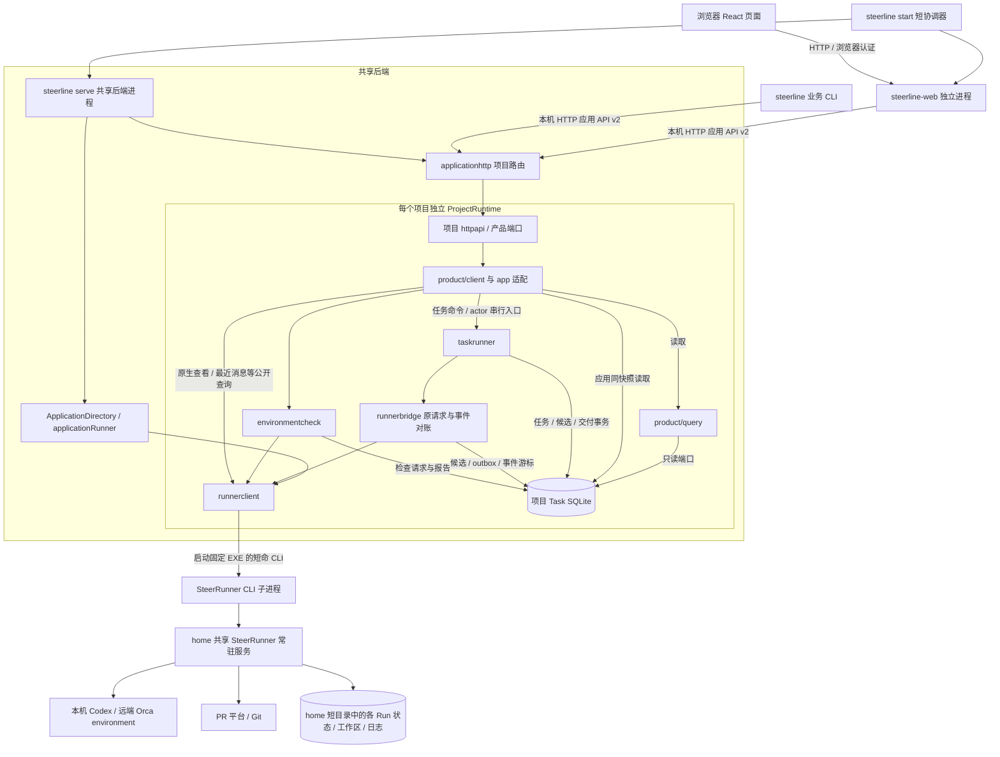
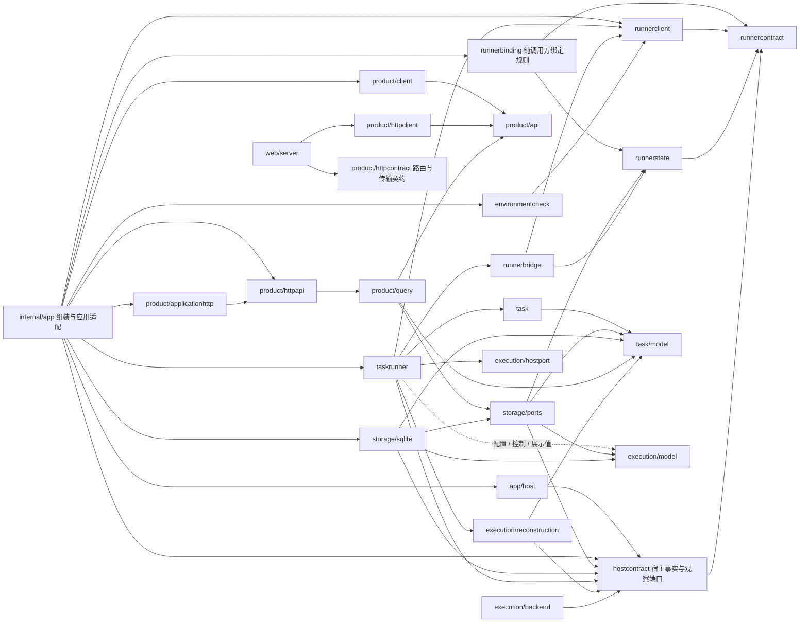
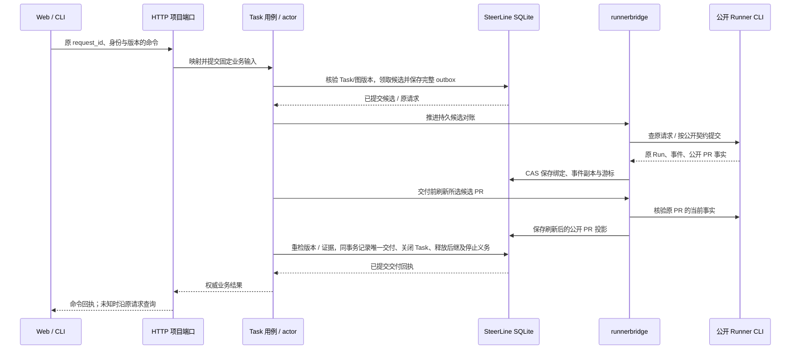

# 当前代码架构

2026-10-20 调用方边界增量：[本轮收口](../acceptance/architecture-boundary-consolidation.md)将候选停止信封准备统一到 runnerbridge、公开 takeover 类型与校验归 runnercontract、调用方绑定规则归纯 runnerbinding；修复 processwindow 的 HTTP 基础设施窄依赖并增加调用方 owner 守卫。下述历史轮次与未实施建议按其各自范围理解。

核对日期：2026-10-19；前四轮已随 PR #350 合入 `64f91853`，本页包含基于该主干的第五轮宿主契约归位。本页按生产代码与 `go list` 的实际依赖维护，区分进程调用、Go 包依赖和资源所有权。原始核对见[架构解耦审视](../acceptance/architecture-decoupling-review.md)，实现与验证见[第一轮](../acceptance/architecture-decoupling-round1.md)、[第二轮](../acceptance/architecture-decoupling-round2.md)、[第三轮](../acceptance/architecture-decoupling-round3.md)、[第四轮](../acceptance/architecture-decoupling-round4.md)、[PR #350 复审](../acceptance/architecture-decoupling-pr350-review.md)及[第五轮验收](../acceptance/architecture-decoupling-round5.md)；其余建议尚未实施。

SteerLine 保留 Task/DAG、候选参与关系与唯一 TaskDelivery，执行已迁到独立 SteerRunner。两者只通过固定 EXE 的 `steerrunner-cli/v1` 协作；SteerLine 不导入 Runner Go 包，不读取其 codec、IPC、数据库或原生日志。当前接入本机 Codex 和远端 Orca environment；各构建/平台的已验与未验范围见[Runner 接入](../integration/steerrunner.md)及专属验收，不以适配器存在推定通过。Web 为唯一交互前端，TUI 已按[退役决策](../acceptance/tui-retirement.md)移除。

## 进程与运行边界

下图箭头表示运行时调用或读写，不表示 Go import。`steerline start` 是短协调器；共享后端承载每项目运行时，各项目没有独立 HTTP listener。应用目录在 census 后初始化一个 home 级 Runner，所有项目借用固定客户端，整体关闭统一结算。见[共享服务验收](../acceptance/shared-runner-service.md)。

项目 Task SQLite 保存 SteerLine 的业务事实；Runner 短目录保存执行事实。候选保存公开 Runner 观察副本与精确 Run/state-dir 绑定，副本不能变成第二套执行状态机。环境检查经独立 `environmentcheck` 用例使用公开 Runner 能力，不领取 Task 或进入任务 DAG。

## Go 包依赖与当前耦合

下图实线表示选取的直接 import；省略标准库、第三方库及部分纯值依赖。虚线同样是**当前存在的直接 import**，标出值得收窄的边，不代表未来方案。无 Go 包循环不等于职责已完全解耦。

目前已形成的边界：

- `task → task/model`，`task/model`、`product/api`、`runnercontract` 无项目内部依赖；`runnerstate` 只依赖 `runnercontract`。
- `runnerclient` 消费公开 `runnercontract`，平台窗口设置复用窄 `processwindow`；后者无业务依赖。`runnerbridge` 通过自身 Store/CLI 接口注入，不导入 SQLite 或 Task 实现。
- `runnerclient / runnerbridge / environmentcheck / runnerbinding` 分别受直接与传递依赖守卫约束，包含未激活标签及 Windows/Linux 图。`runnerbinding` 只依赖公开契约与 caller 纯事实。
- `product/client` 仅依赖 `product/api`，HTTP 服务端经查询、命令、权威回执和原生查看端口调用产品；HTTP 消费端有独立依赖守卫。
- Web 与后端共享 `httpcontract.AllowedProjectRead`；Web EXE 的生产依赖不再到达后端 handler、query、storage 或 execution。候选读取通过现有 `persistenceError` 返回 `storage/ports.ErrNotFound`，`taskrunner` 不再导入 `database/sql`。
- SQLite 生产依赖不再到达 `product/query`。历史/任务详情读取端口只携带 `runnerstate.Candidate` 事实，`CandidateSummary`、`RunnerHistory` 和公开页面序列化归产品层；游标及协议由查询层补充，共享事件读取预算归存储端口，依赖守卫已删除原六项例外。
- 会话、正文和活动读取已收口：`storage/ports` 与 `storage/sqlite` 均无任何 `internal/product/*` 的生产依赖。SQLite 返回 Runner 事件、绑定和正文事实；查询层生成会话引用、能力 DTO、活动标签和公开页，守卫同时拒绝 DTO 别名及间接产品依赖。
- `TaskDeliveryRecord`、`TaskDeliveryEvidence`、`TaskDeliveryReceipt`、`ProjectTaskAuthority` 和 `ValidateDelivery` 已归 `task/model`，只依赖标准库；Task 服务/控制入口、图快照、任务详情事实、项目权威读取与初始化接口不再为这些值导入 `execution/model`。旧包无别名或转发；全标签源码守卫限制定义归属及已收口文件的执行域 import。
- `hostcontract` 统一拥有 service checkpoint、宿主服务/控制状态、内部控制回执、进程身份与只读观察端口，只依赖标准库和公开 `runnercontract`。存储端口引用该契约，不再定义 checkpoint；`reconstruction` 只投影宿主与调用方事实，不再依赖存储端口。旧定义和别名已移除，持久 schema 与 JSON 保持。
- `ProjectRuntime` 持有项目资源并最终关闭；factory、actor 与服务产品客户端借用项目 store，actor 不负责最终关库。见[生命周期验收](../acceptance/application-project-lifecycle.md)。

仍有以下依赖需要如实保留在图中：

| 当前边 | 代码证据与影响 |
| --- | --- |
| `taskrunner / storage / query → execution/model` | Task 交付已归 [Task 纯模型](../../internal/task/model/task_delivery.go)，checkpoint 与宿主事实已归 [宿主契约](../../internal/hostcontract/checkpoint.go)。剩余边来自候选/活动/正文展示、发布配置及[任务图展示](../../internal/product/query/taskgraph/project.go)复用的 `StartupBlockers`；`execution/hostport` 的控制传输接口还复用活动展示值，不表示原生执行状态机仍在 SteerLine。 |
| `internal/app` 同时组装和适配 | [project_runtime.go](../../internal/app/project_runtime.go)负责资源获取/关闭；[client.go](../../internal/app/client.go)负责读取快照、宿主观察和产品投影；[runner_service_wiring.go](../../internal/app/runner_service_wiring.go)负责接线。高依赖数量对组装根正常，但这些实现同包，尚无包级隔离。 |

`httpapi` 的 command 文件已按意图、派发、回执、原生查看拆分，Web 的三个 hook 也已分责；这些属于同包/同应用内的结构整理，不能据此宣称各自可独立编译或替换。见[本轮入口整理验收](../acceptance/product-read-command-web-refactor.md)。

## 模块与资源归属

| Owner | 当前职责与边界 |
| --- | --- |
| `internal/app` | 配置冻结、项目目录、ProjectRuntime、具体 store/Runner/产品端口组装，以及当前应用适配；不构造原生执行 adapter。 |
| `internal/app/host` | SteerLine 服务身份、锁、控制文件、进程观察、心跳、调度和退出观察；不持有 Runner 执行状态机，不导入 SQLite 实现。 |
| `internal/hostcontract` | checkpoint schema 21、宿主服务/控制状态及回执、仓库绑定、进程身份/观察端口的唯一纯值所有者；只依赖标准库和公开 Runner 构建 pin，不持有数据库、进程句柄或最终关闭能力。 |
| `internal/task` / `task/model` | 固定契约、任务输入、DAG、依赖、资格、项目权威、交付记录/证据、交付回执和验证规则；任务纯模型只依赖标准库。 |
| `internal/taskrunner` | Task actor、候选共同 base、固定材料、控制/输入校验、候选派发、核验交付与释放后继；通过公开 Runner 事实投影展示。 |
| `internal/runnerbridge` | 原请求 outbox、Run/PR/分支绑定、事件游标与副本、停止义务和重启旧输入围栏；唯一构造/保存候选 stop 信封，正常对账和启动前准备复用，不创建原生会话或选择 workflow 下一步。 |
| `internal/runnerclient` | 固定 EXE/实例 SHA 校验、CLI 子进程、严格 JSON/退出码、公开 schema 与能力验证；不读 Runner 私有实现。 |
| `internal/runnercontract` / `runnerstate` | 公开协议值及 SteerLine caller 参与关系；无 SQL、native owner 或具体传输实现。 |
| `internal/runnerbinding` | 纯调用方 Run/input、原 submit request_digest、Check 和构建/目录匹配。启动准入与离线重启分别保持原前置；不操作锁/store/进程，不新增输入授权。公开 takeover 报告/逐项校验归 runnercontract；部署 `verify-runner-takeover` 复用 runnerclient 的同一公开验证。 |
| `internal/environmentcheck` | 环境检查请求、报告、显式停止与原请求对账；使用独立 Store/Runner 端口，不推进 Task/DAG。 |
| `internal/storage/ports` / `sqlite` | Task/DAG、候选/outbox/公开事件副本、唯一交付、环境检查、测试生成记录及 service checkpoint；当前 `SchemaVersion = 26`，格式唯一定位见[数据模型](../product-design/data-model.md#当前格式来源)，不提供旧格式迁移。所有读取均返回存储/领域事实，无产品包依赖；活动记录流持有读事务，使用者必须关闭。 |
| `internal/testmanagement` / `model` | 测试清单/安排、generate/1、原候选 Runner R2 产物收集和纯结果汇总；model 仅持有定义/生成/证据记录，SQLite 只依赖 model。生成和收集借用 home Runner 客户端及项目 tick；原请求先保存，未知只对账，报告不可变保存并结合公开 Git 观察投影。无独立 Agent 运行时，结果见专属验收。 |
| `internal/execution/model` / `backend` / `agentlaunch` | 仍被使用的候选/正文/活动展示、配置及进程执行端口；TaskDelivery/项目权威/交付回执、checkpoint 控制回执、进程身份与观察端口已迁出，没有原生 worker 状态转移。 |
| `internal/execution/reconstruction` / `hostport` | 运行视图从 `hostcontract` checkpoint 和独立 Task 权威生成；不再依赖存储端口。宿主控制传输仍复用产品请求/回执和活动展示值；真实候选来自公开 Runner facts，不重建原生执行现场。 |
| `internal/execution/workspace` / `publication` / `process` / `scheduler` | 调用方仓库身份解析、发布配置校验、SteerLine 自身进程/文件能力和 actor 调度；无 native worktree 生命周期或 PR provider 查询实现。 |
| `internal/product/api` / `query` / `client` | 稳定产品 DTO、只读投影及注入能力的内部产品客户端；历史/候选、会话引用、正文分页、能力报告、活动标签和公开序列化预算均从存储事实生成，不再由 SQLite 构造产品 DTO。 |
| `internal/product/applicationhttp` / `httpapi` | 统一项目路由、认证/协议映射、请求登记/对账与产品调用；不以传输回执替代业务结果。 |
| `internal/product/applicationclient` / `httpclient` 及契约/连接包 | 本机 HTTP 消费、发现与公开协议；不访问业务库或具体调度器。 |
| `web/server` / `web/src` | 独立 Web 宿主和 React 页面；浏览器会话、项目选择、连接观察、原信封 journal、草稿与渲染。路由白名单经纯 HTTP 契约共享，生产编译依赖受 HTTP 消费端守卫约束。 |
| `tests/e2e/internal` | 隔离环境、公开 CLI driver 与外部协议夹具；不导入 Runner 内部包，真机验收范围单独登记。 |

旧 actor/worker、adapters、workflow、reliable、conversation owner、执行写表及闲置执行事务端口已物理删除；具体范围见[删除审计](../acceptance/steerrunner-deletion-audit.md)与[后续清理验收](../acceptance/execution-legacy-cleanup.md)。无消费者的记录与空壳字段也已按[主干清理](../acceptance/runtime-shell-cleanup.md)删除；残留包名和仍被消费的值不作为重新引入旧 owner 的理由。

项目 checkpoint 固定 Runner 构建与 state-dir，运行中的客户端固定本次 instance_id；替代实例只在显式重启 SteerLine、重建 ProjectRuntime 时接纳，旧 stop/settlement 闭包保持原目标。候选事务固定原预设名称/参数摘要/完整信封；公开 workflow/audit/materials/轮次请求模型贯穿 taskrunner → product query/API → Web，历史沿候选原提交读取。组合规则只消费 Runner 自包含 schema。源码与验证见[协作 Plan](../spec/runner-collaboration.plan.md)和[验收](../acceptance/runner-collaboration.md)。

## 命令、查询与事务边界

上图合并展示候选启动、后台对账和交付，实际是多个命令/观察周期，不是同一 HTTP 请求同步完成全部步骤。Task 关闭不要求候选先达到 `pr_ready`，也不以兄弟候选未知阻挡正确已合并结果。Runner 的执行完成不自行关闭 Task。[交付事务](../../internal/storage/sqlite/runner_result.go)继续同时核验 Task、图、候选版本与 PR 证据，类型归属调整不能把它拆成多个独立提交。

第四轮只改变这些事实的 Go 所有者：[TaskDelivery/ProjectTaskAuthority](../../internal/task/model/task_delivery.go)、[交付校验](../../internal/task/model/task_delivery_validation.go)及[回执](../../internal/task/model/task_receipts.go)统一归 Task 纯模型，JSON 字段和 SQL/schema 保持。校验复用 Task 的 `Error` 和提交摘要规则，SQLite 继续映射原错误码。同一候选和原 Task 版本重放返回已保存回执，即使当前图已推进也不改回执版本、不重复写事件；更换候选或版本仍拒绝。交付、Task 关闭、图释放及全部候选停止义务继续在一个写事务内完成，故障时整体回滚。

读取使用 [ReadApplicationProjectSnapshot](../../internal/storage/sqlite/application_snapshot.go)在同一读事务采样产品视图、候选与 service checkpoint，再由 app/query 生成产品页。收窄投影依赖时应在该事务内取得足够的事实，事务后纯映射；不能改成各页面分别读库，破坏同快照语义。

历史/候选链现为 `SQLite 读事务 → ProjectView.Candidates / NativeTaskDetail.Candidates → query.ProjectPage / TaskDetail → API DTO`。候选顺序、Task/图/数据库版本和正文仍在原读事务内取得，投影不额外读库或查询 Runner。成功的空候选集合仍生成空历史；读取失败不把部分候选当成功历史，也不隐藏可用任务页。内部任务页仍使用既有纯值容器承载查询层补充的协议/游标，但 SQLite 不生成这些展示元数据。`TaskGraphSnapshot.ReadySnapshot` 只把同快照事实交给 Task 纯规则，不生成产品 DTO。

会话链现为 `NextConversationEvent → ConversationEventRecord（原候选/Run/事件/Final）→ query 会话投影`。过滤和全局事件序号仍由 SQLite 查询；查询层核对原身份、生成 revision 1 正文引用并按同一公开 DTO JSON 长度分页，游标仍绑定原 project/filter/seq。正文读取使用纯值引用，SQLite 核对原 Final、SHA/字节长度并限制返回量；查询层继续核验完整性、16 MiB 上限、256 KiB 分页和 UTF-8 边界。能力读取返回纯模型报告，公开字段筛选由查询层完成。

活动链现为 `OpenActivityView → 原绑定 + ActivityRecords → query 逐条投影/计数 → LogBatch`。记录流保持同一只读事务，按原事件顺序/数量读取；公开活动 JSON 的 1 MiB 预算、工作流标签和投影在查询层计算，超预算记录不推进游标，也不继续读取后续行。最近活动继续选最新五条流程变化与十条技术事件，再按事件序号输出。所有成功、预算终止、身份/读取失败和取消路径都关闭记录流；关闭/提交失败不能返回成功页面。

`ProjectRuntime` 统一取得项目锁、日志、store 和产品端口，借用应用的 Runner 客户端；关闭时先拒绝/排空 Read、Command、Task，再关库并汇总本地关闭与锁释放。`ApplicationDirectory` 等待项目关闭后，由 `applicationRunner` 停止原共享实例，应用停机结果与离线取证各只保存一份共享资源证明。局部 caller 退出后已有执行可能继续，原绑定和停止义务保留。Web 关闭只结束客户端观察；共享后端 PID 退出不证明 Runner/worker 已停止。契约见[统一启动](../spec/unified-startup.spec.md)和[项目生命周期](../spec/application-project-lifecycle.spec.md)。

第五轮将 `ServiceCheckpoint` 与重复的服务/控制状态统一到 `hostcontract`，仓库、原实例、Runner build pin、进程创建身份、心跳、准备状态、控制结果及预留任务的字段保持；checkpoint schema 仍为 21，数据库 schema 仍为 23。存储保存、心跳更新、版本递增与 `ReadApplicationProjectSnapshot` 的事务边界保持，控制/派发权威仍由独立 Task 事实提供。checkpoint 与运行视图双向复制可变字段，预留任务及嵌套回执时间也独立复制；不会因调用方改动投影污染已采样事实。`ProjectRuntime` 仍是项目本地资源的最终所有者，actor/factory 借用 store，排空、幂等关闭和失败保锁不变；Runner 最终所有权已随共享服务上移到应用。

## 进一步解耦的建议

当前外部执行边界已经成立，适合继续做少量内部依赖收口。优先收益是减少跨功能修改和编译牵连，而不是增加服务、包或接口数量。下表保留原建议顺序并标注本轮完成范围，不是已纳入 execution-map 的任务或实施 Plan。

| 顺序 | 建议 | 收益、范围与完成判断 |
| --- | --- | --- |
| 1（本轮完成） | 共享路由白名单归纯 HTTP 契约层 | `httpcontract.AllowedProjectRead` 为后端与 Web 的唯一共享来源；保留后端专用 Task 写入/回执路由。`web/server` 与 Web 命令已纳入消费端守卫，Windows/Linux 生产图及全标签源码检查阻止后端/SQL 依赖回流。 |
| 2（三轮范围已完成） | 收口 SQLite 与产品投影/DTO 的依赖 | 六项旧例外和剩余会话/活动 DTO import 已移除，SQLite/存储端口均无产品包生产依赖。查询层负责公开字段、游标/协议和序列化字节预算；存储继续提供原身份、顺序、正文和同快照事实。活动使用有界只读记录流，避免为投影预算预读整页。 |
| 3（Task 与宿主状态归位已完成） | 把仍使用的类型按真实所有者归位 | Task 交付/项目权威与宿主 checkpoint/服务状态/控制回执/进程观察契约均已归位；旧定义无别名转发，原子交付、同快照和关闭语义已回归。`StartupBlockers`、候选/活动展示与控制传输接口仍可按实际消费者继续收窄，避免创建新的通用大 model 包。 |
| 4 | 在必要时拆开 app 中的组装和产品适配 | 先稳定配置与资源契约，再把 `clientReader`/命令适配等实现移出组装根；`ProjectRuntime` 保留项目本地资源的唯一所有权。依赖多本身不是问题，若日常改查询/命令频繁触及同一包，才值得做这一轮。 |
| 5 | 按实际需求收窄 Runner 调用面与 Web context | `runnerbridge.CLI.Call` 仍接收 CLI 命令串，接口方法也使用 `runnerclient` 的协议别名；需要替换传输或频繁改协议时，可改用 `runnercontract` 值和语义方法。Web 的项目/连接/原请求 hook 已分责，暂可保留现有 context，出现独立功能并行冲突后再拆。 |

第一轮已完成第 1 项及候选错误映射；第二、三轮已完成第 2 项；第四、五轮已完成第 3 项中的 Task 与宿主契约归位。依赖规则由全标签源码与 Windows/Linux 依赖图核对。余下可继续收窄展示/控制传输值及 app 中的组装与产品适配；这些尚未实施。

暂不建议把 Task、候选、交付拆成独立服务/数据库，也不建议引入通用事件总线、插件注册框架或重建 workflow 层。当前一个原子交付事务、每项目资源 owner、Runner 单写执行事实的关系是必要的一致性边界。业务规则、生命周期和真实支持范围分别归[整体架构](../architecture.md)、[Worker 生命周期](../product-design/worker-lifecycle.md)及[接入验收](../acceptance/steerrunner-cutover.md)维护。
