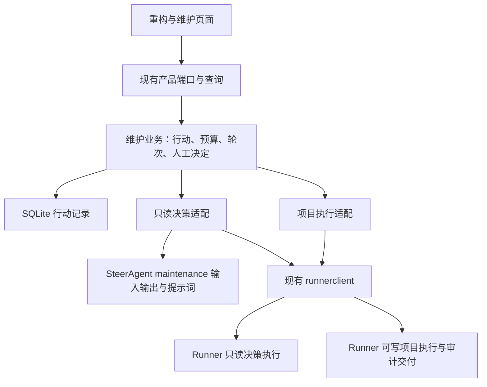

# 重构与维护：实现方案与解耦边界

本文维护[重构与维护](../product-design/refactoring-maintenance.md)最小产品的实现与解耦边界。页面、后台行动及 Runner 接线已实现；通过范围与真实链限制见[专属验收](../../SteerlineFlow/testing/acceptance/refactoring-agent-delivery.md)。当前决策与交付接线见 [Spec](../../SteerlineFlow/spec/refactoring-agent-delivery.spec.md)与 [Plan](../../SteerlineFlow/plans/refactoring-agent-delivery.plan.md)，不启动 roadmap 调度。

## 总体选择

新增一个独立的维护业务模块，沿用现有项目运行时、产品端口、SQLite、配置和 Runner 客户端。一个项目同时推进一个维护行动，由后台 worker 串行处理；页面只提交用户操作和读取结果。

`internal/refactoring` 是唯一业务 owner；其中 `model` 子包仅保存纯值与预算规则，供 SQLite 和查询读取，避免存储反向依赖 worker 或 Runner 客户端。`internal/steeragent/maintenance` 只做纯提示词供给与决策校验；只读工具由明确派生的 Runner generate 执行。`internal/app` 组装现有 Runner、项目就绪、计费与 PR 只读核验，SQLite 只负责事务保存。没有新建通用 Agent 引擎、插件系统或调度服务。

首批建议打通本地 Codex 的完整组合。用户仍选择一套执行配置，由 Runner 的原生配置能力明确派生只读决策和可写执行配置，保持所选模型与目标，不增加单独的维护模型设置。该组合必须同时满足决策、执行、独立审计和交付要求；远端等其他组合在具备完整公开契约后接入，不静默改投本地。

图中两种适配表示不同权限与职责，由同一宿主文件组装，不是两个新服务。源码定位同时见[当前代码架构](current-code-architecture.md)。

## 四条主要边界

| 边界 | 负责什么 | 不承担什么 |
| --- | --- | --- |
| 维护业务 | 行动唯一性、预算、新轮次准入、收尾、人工决定、历史记录及后台推进 | 不推理代码收益，不写项目，不编排 Runner 内部实现和审计步骤 |
| SteerAgent 只读决策 | 读取可信上下文，通过只读工具调查，理解反馈，生成后续提示词及决策说明，提出人工问题 | 不持有数据库或项目写入能力，不创建工作区，不执行修改、Git 或 PR 操作 |
| Runner 适配与执行 | 适配层保存和投递原请求、核对绑定及公开结果；Runner 管工作区、会话、修改、验证、PR 发布及报告原文同步 | 不决定维护预算、方向或人工授权，不修改任务 DAG，不接管维护行动记录 |
| 页面与查询 | 表单、行动卡片、轮次展开、人工答复、PR 与报告展示 | 不根据文本猜执行阶段，不推进循环，不直接调用 Runner 或写项目 |

首轮决策使用固定在启动提交的只读目录。后续决策和报告调用仅接收正式文件材料，依赖行动记录投影出的证据。维护业务负责向 Runner 投递三级执行提示词。

## 最小业务模型与协作接口

业务权威只有维护行动记录。它保存启动时的目标和配置、预算、累计消耗、轮次、当前待决问题、原请求和 Runner 绑定、PR 关联及报告版本。轮次、提示词和执行反馈从属于原行动，不再建立第二套“Agent 任务”或独立工作流记录。

业务只依赖少量按用途划分的接口，接口放在消费者一侧，具体实现由 app 注入：

| 接口用途 | 输入与返回 |
| --- | --- |
| 只读决策 | 方向、策略、当前预算事实、固定项目材料、原轮次反馈和人工决定 → 提示词与必要决策说明，或明确待决问题、结束建议 |
| 项目执行 | 已保存的提示词、原工作区和请求绑定 → 受理事实、公开进展、问题与最终结果；另提供观察和停止 |
| 行动存储 | 读取行动、按版本保存、原子占用或释放项目在途名额 |

结束建议和待决问题是业务控制信息，不是可执行动作脚本。SteerAgent 不能返回任意工具名、shell 命令对象或可直接落库的状态变更。涉及项目执行的内容仍只有提示词，维护业务核验原授权和当前 Runner 资格后才投递。

项目就绪、配置解析与用量读取使用已有所有者的窄入口，不把整个 app、taskrunner 或数据库对象交给决策核心。`internal/steeragent/maintenance` 只接收普通值并准备、校验材料；只读模型执行中的工具由 Runner 提供并限制，不在纯处理代码中实现另一套工具系统。

行动状态只描述业务处境，例如推进中、等待人工、收尾中、已停止和已交付。Runner 的运行状态、输入资格和资源停止情况作为公开事实分别保存，不复制它的步骤状态机。预算是否允许下一轮由确定的业务规则计算，模型不能自行增加预算。

## 最小推进方式

用户的“开始维护”授权本次行动在既定范围和预算内自动产生后续提示词并投递。后台 worker 每次只处理一个已经明确的后继，先保存意图，再调用 Runner；一个行动同时只允许一个待核实或在途业务输入。

SteerAgent 使用固定材料和固定于启动提交的只读目录选题，生成本轮提示词。Runner 在首次可写执行时从固定提交创建 worktree，执行后返回结果与证据。维护业务把结果交回 SteerAgent，在独立于实施的决策会话中审计并按需请求补充证据或修复。

最小实现采用“一次提示词对应一次明确的执行 Run，多次 Run 复用同一受管 worktree”。每个新 Run 都有自己的会话、请求和用量身份，原 Run 保持真实终态；维护行动、分支和累计成果不变，不要求永久存活的会话。

轮次的开始在提交执行前记录，失败不清零。预算只在准备发起新维护轮次时限制准入；审计、修复和收尾继续沿当前成果执行。进入收尾后不再生成新切片，只推进已有成果至 PR 和报告。

人工答复绑定原行动、原问题和当前版本，由 SteerAgent 转成后续提示词；人工答复原文与实际发出的提示词分别保存。“结束并交付”先保存不再开启下一轮的意图，“立即停止”同时覆盖当前只读决策或可写执行，防止停止后迟到的提示词继续被投递。

交付后的“处理冲突并更新报告”原子取得项目在途名额，沿原行动、工作区、分支和 PR 做一次收尾续作。它不重新开始维护预算，也不产生第二个 PR；报告按对应 head/base 保存新版本。SteerAgent 在 PR 版本核验后生成报告，产品保存正文和绑定，Runner 原样同步 PR 正文。

## Runner 已合入契约与本仓接入

Runner #141 已合入 `c404d6e5c50cc32650f9412f9b8b3449c5789e15`，正式契约见[worktree-reuse](https://github.com/erranliu/SteerRunner/blob/c404d6e5c50cc32650f9412f9b8b3449c5789e15/docs/worktree-reuse.md)及[model-usage](https://github.com/erranliu/SteerRunner/blob/c404d6e5c50cc32650f9412f9b8b3449c5789e15/docs/model-usage.md)。先前[能力核实记录](../../SteerlineFlow/testing/acceptance/refactoring-runner-capabilities.md)只证明旧 `dce4dff8` 安装构建，保持其历史结论；合入不代表安装版或 SteerLine 接线已经更新。

| 需求 | Runner 已有能力 | SteerLine 本期接入 |
| --- | --- | --- |
| 同 worktree 多轮 | execute/1 用 reuse_worktree_from_run_id 引用最新已停止并结算的持有者，新 Run/新会话共享原 worktree | 保存原请求、最新持有者、origin/identity，按行动授权串行创建后继 |
| 停止后收尾 | 同一复用契约保留提交、脏文件和 Git 操作状态；原 Run 保持终态 | 停止所有当前决策/执行，核实原结果封存及写者结算后新建收尾 Run |
| 费用 | 主会话总量不变，独立 parser 以 runner_internal 事件及 model_call_coverage 发布 | 按 scope 解码/验证，跨 Run 去重计价并展示未覆盖范围 |

本期消费既有复用规则，不再规划新 Runner 维护工作流：

1. 来源必须是同一 state-dir 的最新持有者。完整 Repository、adapter 和 target 与来源一致；初始 base_revision 不随主线同步改写。公开 origin/identity 必须属于原行动。
2. 原写者、命令、parser、停止及可选文件初始化/封存均已结算。等待或未知先对账，不能认为读取到文件就证明原写者退出。
3. 保留原分支、提交、索引、未提交和未跟踪成果，以及进行中的 Git 状态。身份缺失、替换或被转交时按原错误拒绝，不改路径、清理或重建来绕过。
4. 新请求受理即成为最新持有者，失败或被停止也不能回退至最近成功 Run。未知受理只查本次 request_id，原 Run 结果与费用保持不变。
5. 旧控制和清理不能影响后继；已受理原请求仍沿原号对账，不向已转交的旧 Run 新发控制。

同一能力服务后续轮次、修复、停止后收尾和 PR 冲突续作。每次新会话重新读取行动上下文，初始化成本计入预算；不要求永久存活会话，也不建设新工作区服务。实际新 EXE 的公开能力及本仓受控/真实验收须按 Plan 固定。

首轮使用 `generate/1` 的 `generate.directory` 读取独立固定目录，后续和报告省略目录及仓库输入，工作区成果通过封存结果、运行反馈及 `workspace-git` 的公开 HEAD 和干净状态进入上下文。Runner 在封存结果中说明与本轮判断相关的暂存、未提交和未跟踪成果。证据不足时由决策会话请求 Runner 补充。

维护只采用原只读请求对应的成功 `ContentResult.JSON`。宿主核对原 Run、Final 来源、只读目录和冻结材料，决策核心校验产物及阶段，维护业务再按当前预算决定是否发起写入。缺少结构化结果时记录阻断，`Final.Text` 仅保留为反馈。

收尾三级指令驱动 Runner 验证、推送和发布或更新原 PR。维护宿主查询平台核验 head/base，随后发起只读报告生成并保存正文。独立的同步执行以保存的 PR 版本和报告为输入，完成后再由宿主复核。各步骤使用现有维护行动、Runner 调用和原 worktree 持有者链。

## 预算、异常与恢复

轮次、计时和进入收尾的规则归维护业务；用量归 Runner，价格匹配与金额计算复用[现有计费模块](../../internal/billing/billing.go)。需要计入行动的只读决策、可写执行和独立审计都关联其原 Run，按用量身份去重汇总；不断累加同一累计快照会重复计费，不能采用。

本地 generate 与 execute 已有主会话采集和配置模型归属，Runner #141 又补齐独立 parser 的来源与计量。SteerLine 保留新增 command_id/attempt_id、scope、call_id 等字段，读取每个 Run 同一固定快照的完整事件，分别验证主会话合计和内部覆盖，再按 counted 事件计算金额。不能用全部 scope 的 counted 数和 Token 去比较 main_session 摘要；原候选费用读取也须同步避免混算。

用户已确认美元预算使用“主会话 + 已登记内部调用的已覆盖参考费用”，持续展示 subagents、tool_internal_models、unobserved_provider_calls 等未覆盖范围，不承诺完整账单。这些公开范围外来源本身不禁用美元预算；内部已登记 pending/uncovered、价格缺失或计价依据未知仍保持缺口，不能按零放行新轮次。只读决策沿共享 generate 准入，可写工作计入原执行资源占用。

费用未知不视为零或无限剩余。美元预算启动前确认可用性；已启动后若无法核实剩余额度，停止开启新轮次并自动收尾，保留费用不确定性，不要求人工追加预算。轮次和时间预算仍独立生效，收尾消耗独立标记并计入真实总额。

请求持久化、未知操作只对账原请求、停止责任与构建边界沿用 [Runner 调用生命周期](../product-design/runner-lifecycle.md)。本功能新增的是按行动授权明确创建后继执行 Run，不是放宽原 Run 的恢复资格。重启先恢复观察和停止义务，未知输入不自动重发，不凭重启重新生成后继。首版在核实原状态后，通过已有“结束并交付”入口明确授权沿原 worktree 创建新的收尾 Run；旧 Run 不重开，新身份不得冒充旧会话恢复。

只读决策和项目写入执行分别保存请求与权限绑定，停止义务覆盖两者。执行结束、PR 已发布、报告已生成和资源已停止分别核验。已有 PR、报告或停止请求不因 UI 刷新、费用变化或重复点击而重复创建。

## 实施顺序与验证重点

1. **接入已合入的 Runner 契约。** 固定 #141 或明确后继的新 EXE，补本仓真实字段、能力/来源校验与双 scope 用量读取，先保持原候选计费正确。此后验证停止后新 Run 收尾、独立审计、更新原 PR 和参考费用口径；平台不增加直接写入旁路。
2. **实现维护业务与持久记录。** 接通启动、单行动约束、预算准入、后台推进、人工答复、结束与停止，先用受控 Runner 验证业务边界。
3. **接入 SteerAgent 与真实执行。** 通过独立的提示词准备和 Runner 适配接通多轮反馈；新增固定资产遵循[提示词治理](../prompt-governance.md)，审阅实际正文差异、字节数及独立审核，缺材料不内联兜底。
4. **补最小页面与真实闭环。** 一个表单、当前卡片、历史列表，接通 PR 与同一报告、手动冲突续作，并验证预算耗尽后仍完成交付。

验证集中在有实际风险的边界：决策侧没有项目写权；预算耗尽仍能收尾；同项目重复启动和重复点击不重复执行；停止与迟到结果不再投递新输入；冲突后的收益与报告绑定正确；未知发布不再创建 PR；重启不重复开 worktree 或重发原提示词。自动验证及必要真实链在后续正式 Plan 中按[测试指南](../../SteerlineFlow/testing.md)选取，不以本文描述宣称通过。

不将当前候选专用的 `runnerbridge` 强行泛化，也不复用候选记录、TaskDelivery 或待答建议存储来冒充维护行动。复用既有 `runnerclient`、纯绑定核验、配置和计费能力即可；只有第二个真实消费者出现且语义相同时才提取共享协调代码。
