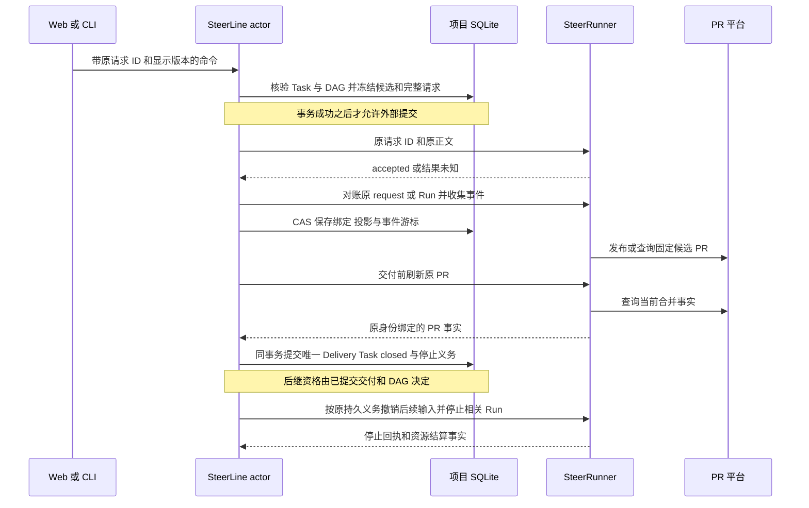
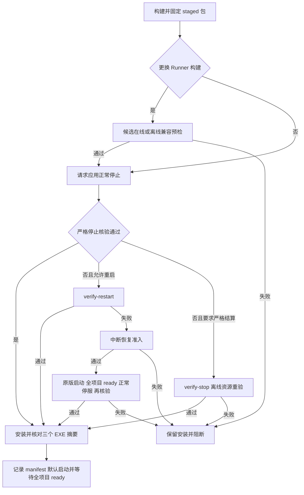

# SteerLine 可靠性交付链路

SteerLine 的可靠性依靠三种独立结果：命令是否送达并被处理、业务成果是否形成唯一交付、执行资源是否停止并可以清理。当前身份、原请求和事务校验大多有必要；可以减少的是重复的跨进程查询、同一权威内的多份命令记录，以及为了取得正常停机回执而重新运行整套应用的操作。

核对日期为 2026-10-21，依据 SteerLine `9e02854e` 加当前分支的部署中断恢复修改；后者已通过隔离定向验证，尚未实际部署及重启实测。Runner 边界另核对本地源码 `8261310d`。下文“当前链路”以该审计基线说明原有边界，“简化建议”为按[首轮审计](../acceptance/reliable-delivery-simplification-audit-20261021.md)修订、经[第二轮审计](../acceptance/reliable-delivery-simplification-audit-round2-20261021.md)复核的方案。其后本批已实现判定/表达收口、完整受理前绑定和同快照观察；实际通过范围与未实施的清单/租约/续装/命令合并统一见[实施验收](../acceptance/reliability-simplification.md)，不把设计审计当作运行资格。

本文提供跨组件导航和简化分析。Worker 节点、异常分类和恢复授权仍归 [worker lifecycle](../product-design/worker-lifecycle.md) 的 W01–W18、E01–E07、V01–V08，不新增状态机、准入服务、回执系统或 roadmap 任务。

## 两条交付链路与事实权威

业务交付是某个 Task 的候选 PR 已真实合并，并在 SteerLine 中提交唯一 `TaskDelivery`。程序部署是某个源码构建包被安装、服务与项目达到可用状态。部署成功不证明业务任务完成；业务交付完成也不要求原生终端已经清理。

| 事实 | 权威与持久位置 | 其他组件怎样使用 |
| --- | --- | --- |
| Task、DAG、候选参与、原请求、唯一交付、停止义务 | SteerLine，每项目 SQLite | actor 串行协调，事务重核版本；Web 只经 HTTP 操作 |
| Run、workflow、逐轮输入、原生会话与资源 | SteerRunner 的单写服务及所属状态 | SteerLine 只消费公开 CLI，不读 Runner 数据库或私有原生日志 |
| PR 身份与是否合并 | 实际 PR 平台，经 Runner provider 查询 | SteerLine 交付前刷新，并在事务中核对原候选和固定发布目标 |
| 应用进程、项目本地关闭和锁 | 宿主身份记录、checkpoint、实际进程与锁 | 不能用 PID、旧回执或窗口消失单独判断 |
| 已安装程序的来源和字节 | staged 包、安装 EXE、`deployment.json` | 摘要证明选中了哪些程序，不证明数据格式兼容或原资源已经退出 |

同一 home 当前共用一个 Runner 常驻服务，各项目保留独立业务库、项目实例和候选。项目实例、Runner 服务实例和共享宿主 PID 分别承担不同职责，不能互换。职责定位见[当前代码架构](current-code-architecture.md)。

## 当前业务交付链路

1. **创建和准入。** 任务定义、依赖与 Spec/Plan 等材料固定到 Git commit 和摘要。开始执行时重核 Task/图版本、前置交付、任务类型、执行预设与共同 base，避免用旧页面或当前默认配置启动另一份工作。候选、任务领取及完整 Runner 请求先在本地保存；保存失败时不提交外部。
2. **跨进程受理。** 调用方保存产品请求与 Runner 请求之间的映射。Runner 的 accepted 表示受理，不表示原生轮次开始、模型已经落实要求或业务成功。连接失败、超时或响应不完整都可能留下未知结果，后续沿原请求对账。
3. **执行和观察。** Runner 拥有 workflow、原生准备、输入意图与结果来源校验。SteerLine 核对原 Run/input digest/分支/PR 绑定、单调 revision 和事件游标，将观察副本与事件同事务保存。它不解释模型正文来补推进执行状态机。
4. **显式反馈。** 当前用户输入固定项目实例、候选及 Runner revision、原问题与完整答案，先保存再转交。产品回执 applied 通常证明本地命令或 outbox 已保存；Runner 接受、原生开始与实际结果另行观察。不能把 applied 显示为“修改已完成”。
5. **核验交付。** 交付前通过 Runner 刷新 PR，核对 provider、仓库、原 Run、工作区/会话、base/head 分支、PR URL/number、merged、MergeCommit/MergedAt 和本次查询时间。SQLite 事务再次核对 Task/图/候选版本、契约和参与资格，然后提交唯一交付、Task closed、图修订及候选停止义务。事务外查询与事务内重核防范的是不同窗口。
6. **交付后收尾。** 任一合格候选即可交付，不等待兄弟候选都变成确定状态，也不要求先达到 `pr_ready`。交付后的停止或清理失败保留诊断，不撤销已经成立的 Delivery。Task closed 后不再轮询该任务候选的 PR；其他原停止义务仍要完成对账。

核心接线为 [taskrunner/service.go](../../internal/taskrunner/service.go)、[runnerbridge/bridge.go](../../internal/runnerbridge/bridge.go) 和 [SQLite 交付事务](../../internal/storage/sqlite/runner_result.go)。完整契约与异常规则分别见[数据模型](../product-design/data-model.md)、[Runner 协作](../spec/runner-collaboration.spec.md)及 [W17–W18](../product-design/worker-lifecycle.md#报告发布与收尾阶段)。

## 身份与回执各自证明什么

### 需要保留的身份层次

| 身份或版本 | 防止的错误 |
| --- | --- |
| home、项目仓库身份、项目状态目录 | 把其他安装、项目或数据库当作当前现场 |
| 项目运行时 instance 与控制 revision | 重启后的新运行时接受旧页面命令；同宿主 PID 下混淆项目 |
| Task、图、候选的本地版本 | 查询外部事实期间任务被作废、换候选或依赖改变 |
| Candidate ID 与 Runner Run ID | 将调用方参与关系和实际执行混为同一对象 |
| 产品 request ID、Runner request ID、完整原请求摘要 | 用户重复点击、丢回执或重启后把一个动作执行两次，或把同 ID 换成另一正文 |
| Run/input digest、原分支、工作区、会话和原生轮次来源 | 用另一执行的结果、PR 或 final 推进当前任务 |
| Runner instance、EXE SHA、resource digest、state-dir | 旧运行时静默接纳替代服务，或新程序误读不兼容状态 |
| 宿主进程创建身份、实例与启动记录 | PID 重用、创建结果未知、旧停机回执被用于新宿主 |

这些身份可以集中验证和统一展示，但不能用一个全局版本号替代：Task 变化、项目换代、Runner 换代和原生轮次变化不是同一个事件。version 字符串也不能替代 EXE 摘要与资源身份。

### 当前主要回执与证明

| 回执或证明 | 能证明 | 不能推定 |
| --- | --- | --- |
| 产品控制回执及 SQLite command result | 原产品命令被拒绝或本地处理已应用，可按原 ID 查询 | Runner 已接收、原生已执行或业务已成功 |
| Runner command receipt 与 action status | 原请求是否被受理、动作的公开处理进度 | 模型要求已落实、PR 已合并或 Task 已交付 |
| Run 投影、事件、带来源的 final/content result | 原执行的公开进度及可核验结果 | 模型总结能取代 PR 平台事实，或任何成功结果都能关闭 Task |
| 刷新的 PR fact | 固定 PR 此次查询得到的身份和合并事实 | 本地交付事务必然已经提交 |
| TaskDelivery / ResultReceipt | 业务交付已提交，同一合法重试返回原结果 | 所有兄弟执行及原生资源已经停止 |
| 项目 checkpoint 与 LocalClosed/LocksReleased | 固定项目的配置/宿主绑定和本地关闭记录 | 记录外的实际锁已释放，或远端 worker 已退出 |
| Runner `last_shutdown` | 核对原实例、stop request、目录与构建后的服务退出/结算结果 | 只见 `not_running` 就能证明所有原生资源已经停止 |
| `service verify-stopped` | 当前格式下按原 Run/Check/input 核对的离线资源结算证明 | 业务成功、创建替代执行或迁移旧数据的授权 |
| `service verify-takeover` | 候选程序对原记录的 compatible/read_only 资格 | 原服务已退出；read_only 获得新输入或停止权限 |
| `verify-restart` | 原宿主/项目/Runner 服务退出及所需绑定与候选资格成立 | `resources_settled=false` 已变成 true |
| 部署 manifest 与 shutdown-verification | 构建包字节、来源和此次替换依据可追溯 | Runner 兼容就代表 SteerLine 自身数据库格式兼容 |

表中存在同一事件在不同权威处留下的相关记录，但多数并非同一回执的无意义复制。例如，Runner 已受理与 SteerLine 已保存该受理结果，中间仍可能发生一次调用方崩溃；交付事务提交与随后原生停止之间同样存在故障窗口。

## 异常与恢复路径

### 命令与业务执行

| 情况 | 当前恢复方式 | 必须保留的边界 |
| --- | --- | --- |
| 意图保存失败 | 返回本地失败，修复后重新处理尚未提交的请求 | 原本地事务未成功，不产生外部提交 |
| 原服务运行期间调用丢回执 | 查询原 request；确知 request_not_found 且授权仍有效时，既有 outbox 可投递原 ID/原正文 | 不换 ID 猜测重做；传输未知不等于明确拒绝 |
| SteerLine 在请求未决时重启 | `RecoverInputs` 取消未发送 pending 输入；unknown 标记 observe-only，查询原 request/Run | 重启后即使查不到原请求，也不自动补发旧 submit/reply/resume |
| Runner 接受成功，调用方保存绑定失败 | 查询原请求，补保存同一 Run、command 和原输入关联 | 不创建替代候选或 Run 来“修复绑定” |
| 用户重复提交或旧页面提交 | 同 ID/同内容返回原结果；内容、实例或版本冲突则拒绝 | 不能只按按钮名称或 Task ID 去重 |
| 观察或 PR 查询断连 | 重读原 Run、事件游标和 PR，保留诊断 | 读取重试不触发新业务输入或重新发布 |
| 原生初始化明确失败并已退出 | Runner 按该后端实际已实现的节点资格和预算处理；需要人工时保留 blocker | SteerLine 不另建重试器，不据通用节点设计推定某后端已支持自动恢复 |
| 登录、权限、环境能力或配置不足 | 修复实际条件后重新核验原目标，按公开 controls 取得必要授权 | 不用循环启动、切换后端或放宽原权限代替修复 |
| 原轮次成功但 final 缺失/来源不符 | 由 Runner 补读原来源；按既有节点规则阻断或处理明确格式问题 | 不以日志尾行、自然语言总结或进程退出补造成功 |
| PR 已合并但发布报告未完成 | 原绑定和刷新事实满足交付门槛即可交付 | 不额外要求 workflow 全部收尾或 `pr_ready` |
| 刷新 PR 后本地事务失败/CAS 冲突 | 沿原候选重核当前版本并补交付；必要时刷新原 PR | 不重新执行实现或发布，不覆盖另一候选已成立的交付 |
| Task 终态后才查到原 submit 已受理 | 绑定迟到原 Run，再执行已持久化的撤销/停止义务 | Task 已结束不意味着可以丢掉未知请求记录 |
| 用户退出一个候选 | 只改变参与关系，保留至少一个参与候选 | 退出参与不是原生 stop 授权，不可复用终态停止语义 |
| Task 已交付但清理失败 | 保持唯一交付和 closed，继续原收尾取证 | 不重开 Task、不重新领取、不删除恢复依据 |

运行内原请求投递与重启后的 observe-only 是有意区别，不能笼统归为“所有 unknown 都无限重试”或“所有 unknown 都永不再投递”。具体实现见 [Bridge.Step / RecoverInputs / deliver](../../internal/runnerbridge/bridge.go)。

调用方不自动补发旧输入，也不表示 Runner 必须停住所有已授权工作。Runner 按原持久 Allowed/ResumeRequired/PendingStop 等事实对账，只在既有授权允许且能够证明尚未发送时继续后继；paused、人工等待、业务阻断和 stop 保持各自含义。SteerLine 不因重建运行时而生成新授权。该边界由[兼容接管契约](../spec/service-generation-recovery.spec.md)和 Worker 规则维护。

### 服务与发布运维

| 情况 | 当前恢复方式 | 必须保留的边界 |
| --- | --- | --- |
| 当前 ProjectRuntime 发现 Runner instance 变化 | 拒绝新业务输入，显式重建 SteerLine 项目运行时后重新准入 | 不在旧运行时内局部改绑定；旧 stop 不停止新实例 |
| 正常同构建重启 | 证明原服务和项目本地关闭，核对原停服 instance/request、pin、配置/checkpoint 与候选 | 不要求保留的原生执行先退出；保留资源未知诊断 |
| 更换 Runner 构建 | staged 候选预检；原服务退出后再核对原记录及候选；新服务取得 writer lease 后实际接管 | 在线预检不能充当停机后证明；compatible/read_only 不是新业务授权 |
| Task 终态或 Generation 取消后重新启动 | 先读各项目既有停止义务并保存原 stop 信封，通过 pending_stops 在 Runner worker 前受理 | 不能先开 worker，再靠异步 tick 补停；未知 stop 保留原信封 |
| 系统重启留下缺失/陈旧宿主停机回执 | 当前分支的 `recover-deployment` 核实原安装和精确退出后，运行原版本一次，等全部项目 ready，正常停服，再完整 verify-restart | 只在部署允许重启时尝试一次；当前实例的冲突/失败回执、活动锁或不兼容不能走此路径绕过 |
| 原 Runner 已退出但资源状态未知 | 可按满足的 restart/takeover 资格更新调用方；严格资源结算、破坏性 reset 仍要求原证明 | 不把服务退出写成原生资源退出；不能用重启资格授权清理 |
| 创建身份不明、pin 丢失、未知旧写者 | 保留现场并阻断；补取原证据或按明确新环境流程处理 | 不猜 PID、不换目录冒充恢复、不强杀另一实例 |
| 安装过程中部分 EXE 已替换而 manifest 未完成 | 当前脚本保留包和错误，不承诺自动回滚；原文件摘要不符时中断恢复也会拒绝 | 上次成功记录不证明当前磁盘仍是一致版本，需按具体阶段修复 |
| 格式不支持或构建不兼容 | 保留原状态并拒绝；默认使用当前格式的新环境 | 未发布版本不自动迁移、双写、旧格式回退或清库 |
| 调试包 reset | 全包预检活动实例/锁、原 Runs/Checks/Generation 和资源证明后，仅重置本包 caller 状态 | 保留定义、契约、依赖、Runner 历史/认证及 Git/PR；缺证明不删除 |

相关入口为 [应用启动和停止](../../internal/app/application_start.go)、[共享 Runner](../../internal/app/application_runner.go)、[启动停止义务](../../internal/app/runner_takeover.go)、[Generation 停止义务](../../internal/app/test_generation_takeover.go)、[离线核验](../../internal/app/application_verify_stop.go)、[中断恢复](../../internal/app/deployment_recovery.go)及[隔离调试包 reset](../../tests/e2e/internal/driver/debug_reset.go)。

环境检查和测试安排生成没有 TaskDelivery，但同样需要保留原 request/Check 或 Generation/Run/input 绑定，纳入共享服务和 reset 的资源核对。生成结果还要核对来源、输入材料和目标文件摘要，防止覆盖用户随后修改的文件；生成完成、保存成功、资源已停止分别判断。可以复用相同取证机制，不能因它们不属于 Task 候选而跳过。

## 当前部署为什么会出现多轮核验

已有安装的主要路径如下。首次空安装没有原宿主需要停止；构建、路径和最终文件摘要校验仍存在。

现在的 `stop` 同时承担“停止应用”和“严格证明原生资源结算”。部署只需要安全替换服务时，原生执行可能按原策略继续，因此第一步会返回错误，再由 verify-restart 证明其实允许更新。这是操作目标与错误表达不匹配；原生资源未知本身仍是应保留的事实。

另一个复杂点是“正式停机回执”被当作主要关闭证明。系统重启后进程确实已退出，但新宿主没有对应正式回执，故普通 verify-restart 拒绝。当前自动恢复将人工步骤自动化，仍需要把原后端和 Web 实际启动起来再停服；它解决了操作负担，尚未消除取证流程本身的绕行。

在线预检、停机后核验与新服务取得 writer lease 时的准入不完全重复：在线期间仍可能新增 Run、变更 revision 或产生停止义务，停机后才能核对最终集合；实际启动又必须在写锁下执行。可以共用纯校验函数和不可变解析结果，不能直接拿在线报告放行之后的状态。

## 可以简化的流程

### 优先级与收益

| 顺序 | 简化项 | 可减少的工作 | 必须保留或补齐 |
| --- | --- | --- | --- |
| 先做 | 按更新目标组织停止与核验 | 避免保留执行的正常更新先报 strict stop 失败，再走分支补救 | 服务退出、项目关闭、候选资格和资源结算仍分别记录 |
| 受理前契约完成后 | 收窄每次命令前的独立 service status 查询 | 减少频繁的短命 CLI、重复 EXE 散列和服务往返 | 完整期望绑定与 ready 在实际动作之前校验；不能先删预查询再补条件 |
| 先做 | Go 与 PowerShell 统一语义校验所有者 | 减少两套证明字段、兼容条件和错误分支的维护 | 脚本继续固定 staged 文件、目标路径与最终安装字节 |
| 先做 | 清理文档中的历史覆盖规则 | 减少“当前到底按哪套规则”的判断 | 保留独有历史证据；长期规则只维护一份 |
| 启动清单与排他协议完成后 | 用直接离线证明替代中断后的整套原版启动停服 | 取消只为补回执而启动后端、Web 和 worker 的绕行 | 原实例绑定的完整清单、实际持有的安装排他租约、原停止义务、最后写锁内准入 |
| 独立下一批 | 产品控制收件箱与本地 command/result 合并 | 减少文件轮询、文件与 SQLite 间的补写窗口 | 只替换普通命令传输，保留原结果补查和旧输入零补发 |
| 后置 | 合并观察快照与事件收集 | 减少一轮观察内重复查询 | Runner 同一读事务输出 Run、事件与游标；散列缓存从首版移除 |
| 目标包与排他协议完成后后置 | 在已有部署包内明确安装提交阶段 | 减少部分安装后的人工定位和幂等续装判断 | 首次替换前冻结完整目标配置与旧/目标摘要；按磁盘判断续装，不按阶段猜测 |

上述是实施先后建议，不是已经占号或纳入执行的任务。收益主要来自减少进程、读写窗口和运维分支；本次未测运行时耗时，不给出性能提升百分比。后文固定首版的前置、接口和拒绝条件；未落实的新能力不能作为当前现场的放行依据。

### 按更新目标组织停止与核验

建议将内部协调统一为“收集事实，再判断目标是否满足”。目标至少区分安全替换服务与要求资源结算的操作，不再让普通部署先调用一个目标更严格的入口并依赖失败转向。

返回同一份有来源的结果，分别包含宿主退出、项目本地关闭、Runner writer 退出、候选兼容和资源结算；各项区分 verified、unverified、conflict 和确有依据的 not_applicable，不用 false 混合失败与未知。由同一个 owner 按目标判断通过或阻断。部署协调可以请求已经授权的正常停止；reset 只读预检再执行其明确重置，不会因为复用事实函数而自动启动或停止服务。正常保留执行显示“可更新，原生资源未结算”，未知身份仍失败。

这能合并协调与表达，不能合并服务退出和资源退出两个事实，也不需要增加长期运行的恢复服务。最小回归是同一份 `resources_settled=false` 证据允许经核实的更新、拒绝破坏性 reset；活动实例、未知 stop 和错误绑定在所有相关入口继续拒绝。

### 用实际命令的实例围栏减少预查询

审计基线的 [Client.call](../../internal/runnerclient/client.go) 对已绑定实例的多数命令先调用 [ValidateInstance](../../internal/runnerclient/binding.go)，内部再执行一次 service status，随后真正命令还会带 `--expected-instance-id`。两次 CLI 都散列所选 EXE。审计基线中，已绑定 Run、没有待处理控制/停止的 `Bridge.Step` 仍执行 inspect、events、inspect；按这条静态成功分支，形成三次预查询加三次实际命令，合计六次 CLI 调用和六次 EXE 校验。其他入口可能再有准入查询；这不是运行时采样结果。

Runner `8261310d` 的 `internal/host/client.go` 与 `internal/host/server.go` 已在连接及服务处理时核对 expected instance；`internal/cli/cli.go` 在携带该参数时禁止 submit/check 隐式启动服务。独立前置查询不是抵抗“查询之后实例又变化”的最终保障，实际命令中的实例围栏才是。

首版选定“实际受理前校验完整绑定”，不采用仅在响应后比较身份的方案。Runner 公开命令增加一个完整期望绑定：instance、规范化 state-dir、EXE SHA、version、resource digest 与协议；来自已验证的 ProjectRuntime 固定客户端，不从本次发现文件改写。缺任一必需字段即拒绝该模式，不退化成仅传 instance。

Runner 在读取实际执行目标后、进入 engine、创建资源、刷新外部 PR 或写入命令记录之前核对完整绑定。ready 到 stopping 的转换与新动作受理共用同一门闩：先取服务受理门闩、核对状态/身份，再在明确的动作受理点交给 engine；stop 在相同顺序下关闭新动作许可。外部 I/O 不持有 SQLite 事务；已受理动作继续按原请求对账，不能因 stopping 把未知写成明确未执行。门闩的锁顺序和 engine 之间不得出现先后反转。

能力声明必须标明完整绑定在副作用前生效，以及携带它的命令禁止隐式启动。普通命令逐项登记覆盖，包含 submit/reply/resume、Run stop、检查、artifact collect、原生会话查看及会访问外部的查询；服务 stop 和离线证明继续使用各自原实例/原请求契约。能力缺失或未覆盖的命令保持原前置检查，不以旧参数兼容实现新保证。响应元数据只作补充核对；所选 EXE 在每次实际 CLI 调用前仍散列，首版没有跨调用散列缓存。

只有在服务端能力、SteerLine 完整参数接线和等价反例都通过后，才删除已覆盖命令的 ValidateInstance 预查询。反例须证明实例替换、错误构建/resource/state-dir、stopping、EXE 替换和能力缺失均在新副作用之前拒绝；还要证明停止受理与新请求竞态不存在检查通过后又插入新动作的窗口。

### 让 Go 拥有证明语义校验

审计基线的 [deployment-stop.ps1](../../scripts/deployment-stop.ps1) 曾在 Go 成功返回后，再解释 restartable、runner_build、runner_service、takeover 等字段；本批已改为一次调用 Go prepare-deployment，脚本只核对 invocation、整包摘要、home/目标及实际 Runner 字节，原关闭/接管证据随结果保存。启动和部署中的原绑定纯比较已经部分归到 [runnerbinding](../../internal/runnerbinding/takeover.go)，不应重新复制。

建议 Go 负责完整身份、关闭与兼容判定，输出固定结果及结构化阻断原因；PowerShell 保留受控调用、staged 包绑定、目标路径和进程检查、安装文件校验与证据落盘。按目标返回允许替换、需要已授权取证、身份冲突或证据缺失等明确结果；恢复只针对原实例缺失/陈旧回执，当前实例冲突不进入恢复。记录必须绑定目标 home、包摘要和本次协调，不能以任意旧 JSON 的 success 继续安装。

第一批只收口判定和表达，沿用现有核验，不承诺覆盖整段替换的新增排他保证。需要直接离线替换或可续安装时，锁必须由实际执行文件替换的同一进程持续持有；不能让短命 Go 校验退出、释放锁，再由 PowerShell 拿报告执行替换。该路径选定 Go 协调器直接复用安装库函数、执行配置与 manifest 原子写入，不再启动会反向取锁的 install 子进程；PowerShell 准备包并调用，避免将“报告落盘”误作锁的跨进程移交。

这不会取消实际校验，只减少语义所有者。最小回归仍覆盖失败退出、缺/错候选证明、错误 staged 摘要和恢复只执行一次；不能以一个无绑定的 success 布尔替代完整证据。

### 以离线事实证明异常退出

直接离线取证仍是目标，但不能仅删除原版启动停服。首版须先落地以下两项能力；当前 `recover-deployment` 不具备这些能力，原门槛保持。

#### 原启动清单

宿主接受业务前保存完整清单，包含 home ID、宿主 instance/完整进程创建身份、全局配置摘要，及按 ConfigID 排序的每个项目的 ProjectID、规范化仓库与 run-dir、配置摘要。先以固定 EXE 的离线 capabilities/schema 做配置预检，再完成项目身份解析、冲突检查与 caller Store 准备，并保留相关锁；不能为了取得 schema 而先启动 Runner worker。准备只初始化/读取 Store，不执行遗留命令。持久化完整清单并核对全部 Store 可读后，才允许本次新启动的 Runner worker 和项目新业务入口开放。准备失败不发布 complete，不以部分清单启动 worker；已存在且按原授权运行的独立执行不因此获得新输入，也不由该清单伪称已经停止。

清单是既有生命周期记录的不可变附件，不是第二份 Task 数据库。为保持 Identity 纯值和可比较性，采用生命周期记录外壳保存原 Identity、complete 标志与清单摘要，不将项目列表塞入网络 Identity，也不在完成清单时更换原实例/进程字段；正文保存为同目录下按摘要命名的私有原子文件。先发布并校验正文，再发布指向它的 complete 实例记录，fsync/原子替换失败视为未完成。正文含原 instance/进程，禁止借用前一宿主的清单。未完成阶段有明确记录，不能按零项目处理。

普通重启也必须保护原清单连续性：在持有驻留租约后、覆盖旧实例记录或创建项目 Store 之前读取并核验上一份完整清单，新 pending 记录保留 last_complete_census 引用；多次未完成启动只沿用这一引用，不新增版本链，也不能把它当成本次 complete 证明。旧清单列明的 Store 缺失时先阻断，不能重新建空库再发布新清单。原项目移除、仓库/run-dir 改绑或停止义务丢失，须沿正式维护取得原资源/义务已处理的证据；不能通过正常 start 重新生成一个子集来绕过。没有历史完整清单的首次采用，必须由可证明的原正式关闭及完整 Store 或真正空环境取得准入；缺证据的历史中断不会被这次启动自动补正。

离线时以该原清单为全集，逐项验证实际配置、Store、checkpoint、原请求及停止义务，并反向检查当前目录的额外项目状态；任一原项目 Store 缺失、格式不支持或绑定不符均阻断。即使项目在最初启动前没有数据库，也不能据此豁免本次缺库：complete 清单只在 Store 准备后生成。真正零项目只接受明确完整的空清单。复制/回退 caller 数据库不属于此恢复能力；清单不能重建丢失的业务记录。

没有绑定完整清单的历史中断不启用此简化，不从当前目录倒推原集合，不回填旧宿主证据。先经既有已授权且未放宽的维护流程完成新版本正常启动，才能为以后中断留下该证据；无法取得原停止义务时保持阻断。

#### 覆盖实际替换的排他租约

新增一项窄的公开安装租约契约，复用现有 OS 文件锁机制，不增加恢复常驻服务。它与部署脚本的串行锁、应用启动协调锁用途不同：前两者安排操作顺序，安装租约直接排斥实际写者。公开锁固定在规范 home 的 `installation-lease/steerline.lock`；Runner 的 namespace 归属绑定记录 home/state-dir、规范路径及该锁文件的 OS 身份，SteerLine 不打开 Runner 私有 writer.lock。锁文件只能显式初始化，拒绝链接、不符 ACL 或文件对象被替换；打开句柄后先核对 OS 身份再加锁，不能按本次请求另选锁路径。该共享/独占锁能力属于新增实现，不把当前仅支持独占的 helper 当作已经具备。

受支持的后端/Web 驻留进程、Runner 的 namespace 启动器及单写服务，在初始化写入/创建 bootstrap 前取得共享安装租约，并由驻留进程持有至退出；启动器只在子进程已独立持锁后释放自己的份额。直接 serve、直接 Runner service start、隐式启动及能写 caller/Runner 状态的离线工具必须遵守同一契约。只读取证 CLI 不启动服务、不写状态，可在安装独占期间使用原 writer lock 读取公开证明。保留的原生执行及资源 owner 不因单纯存活持有此安装租约；它们的原授权、冻结资源和兼容资格另按 Runner 契约核验。

锁序为“外层脚本已有部署串行锁（若经脚本）→ Go 应用启动协调锁 → 独占安装租约 → 按规范路径排序的仓库/run-dir 锁”。PowerShell 持有的 .deploy.lock 不在 Go 中再次获取；直接对准备包调用 Go 入口时，应用启动协调锁已经串行化同 home 的安装/启停操作。Go 先正常停服或确认原实例精确退出，再尝试独占安装租约；不能一边等旧服务释放共享租约，一边已经占有它收尾所需的项目锁。全项目取证、全部文件/配置校验及 manifest 提交由实际替换进程持有独占租约。只读 Runner 证明临时取得并释放其 writer lock，因所有受支持写者被挡住，返回的报告才可供该窗口使用。锁忙或身份冲突直接阻断，不强杀、不无限等待；内部查询不递归获取同一租约。

公开 namespace 归属绑定必须由 Runner 验证规范化 home/state-dir、私有 ACL 和租约引用；首次建立绑定须在明确的离线维护中完成，缺失/不同归属不能由一般业务请求自动补写。原安装及候选程序的受支持入口都具备此契约、当前 namespace 归属已建立，才允许新离线替换路径；未知/不支持的写者不能被当作受租约保护。对不遵守契约的任意旧二进制或直接改私有库，不作排他保证，也不得宣称这种现场满足新路径前置。

所有会启动受支持驻留进程/写者的入口须在取得共享安装租约后、第一次 bootstrap/Store 写入前核对当前部署记录：有未完成安装 pending 引用就拒绝；无 pending 时三个程序必须符合当前已提交 manifest，当前配置的 Runner 选择也必须匹配该安装构建，并通过当前配置语义检查。安装进程崩溃释放独占锁后，pending、混合程序或缺失/未提交的 manifest 均阻断普通 start/serve，不能趁租约空闲启动半包程序。

配置完整摘要只在 pending 安装/续装期间与原/目标字节严格比较。安装完成后的普通预设编辑仍按既有停止、配置校验和重新生成 census 的规则处理，不要求重新构建程序；不能用它更换到与当前安装不符的 Runner pin。如果 pending 还未发布，旧包字节和已提交记录仍一致，显式启动旧包会产生新宿主，使旧准备包的原实例依据失效；以后不能拿旧包证明停止或接管这个新宿主。首次空安装必须先由安装协调器完成初次提交，不能直接裸启动。

SteerLine-owned namespace 的每次新 writer 启动均要求 caller 准入上下文，包括完整当前 census、已提交包、原 caller 快照和完整 pending_stops（空数组也须显式给出）。沿既有 pending-start/bootstrap 保存上下文及本次 startup ID，不另建授权服务。Runner 的入口核验发起者完整 OS 进程创建身份、固定安装版 SteerLine EXE/摘要以及对应的当前宿主实例/清单；普通终端直接 service start、无上下文的隐式启动或旧 startup ID 不取得该 writer 资格。经 broker 创建的驻留子进程沿已验证的原 bootstrap/startup ID 关联，不要求把 broker PID 当成调用方。调用方在项目锁下收集并持久化停止信封，持锁至原信封受理结果确定；Runner 不读取 caller 私有数据库来猜补清单。普通 Runner 独立 namespace 不因这个归属契约自动变成 SteerLine namespace。

完成 manifest 后才释放独占安装租约。先释放安装协调器的仓库/run-dir 准备锁，再启动新后端，由新后端重新取得这些锁、生成自己的 complete census 和 caller 准入上下文。Runner 随后取得共享租约和自己的 writer lease，重新读取最新状态、复核当前候选，在允许恢复/派发 worker 及 ready 之前受理全部原停止义务。应用协调锁持续保留至本次启动结果确定；不在持锁父进程下盲等子进程取同一把锁。若交接窗口出现另一写者，不自动接纳该 ready 实例；部署启动明确要求 fresh writer 而非普通 start 的现成实例复用，冲突则报告已安装但未启动，不回滚或再启动原版。即使新服务未由本次部署启动，受支持的 owned 启动入口也不能绕过 caller 停止义务而先开 worker。

因此证明分成两个有效时点：安装前在实际独占租约内允许替换；启动后在实际 writer lease 内允许 worker。JSON 只记录事实及包/原实例/清单绑定，不携带排他权，也不永久授权下一次操作。协调器崩溃后 OS 释放锁，恢复必须重新取得全部租约和核验，不能延用上一次证明。

通过上述门槛后，仅精确退出且缺失/陈旧回执的原实例可取得 `abnormal_exit` 来源证明；不补造 stop request、不写正常 shutdown、不提升原生资源结算。当前实例失败/冲突、缺清单、活动锁、文件/配置变化或不兼容仍阻断。能力未落实前不得把这份设计解释为当前已经支持直接离线恢复。

### 合并同一权威内的产品命令记录

当前常用产品控制经过文件 `control/requests`、SQLite `commands`、候选 outbox，再由文件 `control/receipts` 返回；Runner 还保存自己的命令事实。见 [host control](../../internal/app/host/control_client.go)、[Actor.TickControl](../../internal/taskrunner/actor.go) 和 [Controls.Handle](../../internal/taskrunner/control.go)。

SteerLine 与 Runner 各自持久化原请求是跨权威边界的必要安排；SteerLine 内部同时维护文件 inbox/receipt 和 SQLite command/result 则有合并空间。当前 Web/业务 CLI 经应用 API，可考虑将普通产品命令的不可变输入、处理结果和原请求查询收口到已有数据库命令记录，由 actor 消费，减少扫描和“DB 已提交但文件回执没写成”的补写路径。

首版只迁 start_task/start_candidate、退出参与、派发控制和显式 reply/resume。HTTP 使用既有 actor 串行入口，完整不可变请求及本地结果保存在同一 commands 记录；候选/outbox 和领域提交仍用已有事务，不引入通用工作队列或扩大一笔事务跨越 Runner。原生会话查看、环境动作、宿主停止和初始化继续沿其必要通道，避免 actor 已关闭时失去停服能力。合法请求的明确业务拒绝也保存原结果；基础认证、请求 ID 或 JSON 无效的请求在进入队列前拒绝。

处理顺序固定如下，原结果查询本身不重做业务：

| 已持久事实 | 处理 | 是否再次调用 apply 或 Runner |
| --- | --- | --- |
| 原 request/body 已有终态结果 | 返回原结果，允许当前实例/显示版本已变化 | 否 |
| 外层结果缺失，但原候选、Withdrawal、派发记录或 Action 已证明本地效果 | actor 只补写原 applied 回执；其含义仍是本地已保存 | 否 |
| 只有命令记录，当前尚无可证明效果 | 仅最初受理该请求的当前 actor 处理轮可在重新核对实例、revision、期限及资格后执行；重启/补查不获取该执行权 | 原处理轮一次，不因查询或重启重发 |
| 原处理已结束且同一读快照能证明无本地效果、无外部未知操作 | 保存明确未应用/拒绝结果，用户后续使用当前资格作新选择 | 否 |
| 存在原 Runner 请求未知或无法证明未应用 | 保持 indeterminate/原 observe-only，查原请求补事实 | 只读对账 |
| 同 ID 改正文/请求人/目标 | 返回幂等冲突，原记录保持 | 否 |

最初处理和被动补查由同一 actor 串行，不能在处理尚在进行时另一个扫描者判定“没有效果”。新 actor 在开放输入前继续执行 RecoverInputs；pending 输入取消、unknown observe-only。仅 Runner 已受理而调用方绑定未知时保留原请求对账，不重构提交正文；查询原结果不受新实例许可替代，提交新输入仍必须满足当前完整许可。文件收件箱移除前须证明这些行为、回执期限和 HTTP 超时窗口保持。

请求进入 actor 后使用该服务的处理上下文，HTTP 超时或客户端断连不取消已经进入的提交，也不把 timeout 写成未应用。普通只读结果查询与 actor 的可写许可分开：项目身份和 Store 可核实时可读原结果，Store 不可读则返回 unavailable，不能用 not_found 诱导重新提交。原处理轮已退出后的被动补查只重建已有事实，不再次获得 apply 权。

### 合并观察与不可变校验时保留边界

没有同快照能力时，inspect、events、再次 inspect 保持 revision 与事件一致性核验。本批已接通 Runner 公开的同快照读取：在自身同一个只读数据库事务中返回原 Run/input、revision、该 Run 的有界事件页及 next cursor，事件 revision 不得超过该投影。游标只越过实际消费的事件，分页截断不跳到未消费的末尾，空页后新提交的事件仍可从原游标读到。SteerLine 继续在原 CAS 事务保存投影、事件和游标；身份错配、revision 倒退或事件超界则整页拒绝。

该读取不启动服务、不采集原生副作用、不刷新 PR；交付前的权威 PR 刷新保持独立。发布并验证该公开能力后，才将已覆盖观察分支替换为一次调用；未覆盖的入口保留现有读取，不静默拼接为假同快照。

散列缓存从首版明确移除。所选 EXE 仍在每次实际调用和替换边界核验；配置解析只可共享已固定的同一份内存字节，不跨变化窗口缓存放行。该批不增加长期缓存、全局证明版本或批量事件总线。

### 用既有部署包表示安装进度

当前三个 EXE、execution.json 与最新 deployment.json 不是一次原子切换。新中断恢复会正确拒绝文件摘要不符，因此部分安装仍可能需要人工判断。这与系统重启导致缺停机回执是另一类问题，不能复用同一种恢复放行。

首版续装只处理同一完整准备包。首次替换前，原子保存不可变 prepared 记录和其引用的完整配置正文：package/home/规范化目标、源码来源、旧成功 manifest 摘要、三个 EXE 的旧/目标 SHA、旧/目标 execution.json 完整字节及摘要、Runner 原/目标 pin、项目配置清单摘要，以及可确定性生成的目标最终 manifest。准备后不能从当前安装目录重算目标配置或重渲染预设；配置中的认证引用按原用途保留，不收集额外私钥或认证材料。停止核验后形成的证明另存包内并绑定 prepared 摘要，不能修改 prepared 来套用新现场。

拿到独占安装租约并完成初次取证后，在任何目标文件写入前，将 pending={prepared 摘要、旧提交记录引用} 原子发布到既有 home 部署记录。它是普通写者的持久启动阻断条件，不表示某个文件步骤已经完成；完整 prepared 包先持久化，再发布引用。已有其他 pending 不覆盖。这样进程崩溃后即使 OS 锁释放，普通启动仍不进入半包状态；不再只靠内存锁或阶段日志防护。

实际替换使用前述由同一 Go 进程持有的独占安装租约及项目锁。恢复先重新取得锁、确认 home 的 pending 恰好引用该 prepared，并验证包内所有字节，再逐个将磁盘文件判为旧值、目标值或冲突：旧值可以安装目标、目标值可以幂等跳过，第三种值必须阻断。pending 内的旧提交记录须与 prepared 一致，其他包或不相干成功提交均冲突。若 home 已原子提交同一目标包且没有 pending，只能在全部目标内容仍一致时报告该包已安装；只有旧提交而无 pending 表示这次替换没有开始，须走新的安装准入，不能重用旧证明。包缺正文或损坏不续装，phase 只定位，不授权跳过磁盘核验。

三个 EXE 都使用同一文件内的临时写入、同步和原子替换，不再对 Runner 使用可留下半文件的直接 Copy-Item；源字节、临时文件与最终目标均与 prepared 摘要比对。配置及最终 manifest 也使用相同目录的原子发布。只有 prepared 明确记录原来不存在的首次安装目标才可将缺文件判为待安装；已有安装文件意外缺失、任意第三种字节或非原子外部改写均冲突，不猜测为本包留下的可恢复中间状态。

取证始终核对原宿主/清单、caller 数据及现时写者，不复用已失效的旧 JSON。安装中 execution.json 可能已是目标值，因此续装校验要读取包中绑定的原配置作为原 checkpoint 的只读比较依据，不能把目标配置硬套原 checkpoint，也不能执行原配置启动旧服务。该比较只支持本次明确的当前格式，不增加历史格式读取或迁移。恢复安装是独立目标，不调用要求三个原 EXE 均未变化的普通中断宿主恢复入口。

所有目标文件和配置达到准备包摘要后，在一次 home 部署记录的原子替换中同时提交目标 manifest 并移除 pending；不是先清 pending 再写 manifest。最终 manifest 不把混合版本记成成功。崩溃发生在提交前后都以 pending/已提交包绑定及实际内容重核，不以 phase 认定提交。发布完成但启动失败，明确报告已安装但未启动/未就绪；显式 NoStart 仅报告安装完成，不冒充 ready。不自动回滚，不因文件完成就清除未知 Run/PR 或引入旧数据兼容。

中断后用户另改配置、另作成功部署、缺原清单或出现不受协调的写者时停止自动续装。要采用新目标必须创建新的准备包并重新取得资格，不能原地修改旧包。

### 先消除文档里的重复规则

审计时资料有实质性的历史覆盖：协作 Spec 的早期 4.2 段写换 Runner 必须全资源结算和新环境，而后来的[兼容接管契约](../spec/service-generation-recovery.spec.md)及实现已支持经证明的原状态接管；worker lifecycle 也保留了“各项目独立 Runner 目录”的旧段落和后来的 home 共享 Runner 说明；部分反馈设计仍描述迁出前的中心 Decision/Operation 与 TUI。

本批已收口协作 Spec 4.2 和 worker lifecycle 的上述换构建/目录规则；迁出前中心/TUI 等更大范围历史正文仍待专门整理。这些文字不意味着代码同时执行了两套流程，却增加理解、实现和恢复操作的负担。建议长期设计直接写当前规则，删除被取代的重复要求，将必要历史说明留给各自验收/归档。本文通过指向源码和较新契约说明当前链路，相关历史正文的全面收口仍需专门完成，避免只增加更多“补充说明”。

## 不应删掉的核验

| 看起来重复的步骤 | 保留原因 | 可简化的边界 |
| --- | --- | --- |
| 查询前资格检查与交付事务内 CAS | 外部查询期间候选、Task 和图可能变化 | 共用纯规则，最终事务重核不能省 |
| 交付前刷新 PR 与已有 PR 投影 | 旧 open/merged 缓存、错误目标或查询失败不能作本次交付依据 | 普通观察可以合并；交付前的权威刷新保留 |
| 原请求持久化与 Runner 回执 | 任一进程可能在对方提交后丢响应 | 合并同权威内副本，保留跨权威原请求映射 |
| 服务实例检查与 Run/input 绑定 | 前者防止访问错服务，后者防止同服务访问错执行 | 可在一次请求中校验，不能只保留其中一个 |
| 停止受理、输入撤销与资源停止 | 接受 stop 不代表所有原生资源已退出 | 统一展示各项事实，不合并为无来源的 stopped |
| 在线兼容预检、停机后最终核验、writer lease 准入 | 三者对应不同时间和写入边界 | 复用不可变部分，不跨可变窗口缓存放行 |
| TaskDelivery 与终态停止义务同事务 | 防止 Task 已结束但丢失停止责任，尤其是迟到受理 | 资源停止可异步，义务保存不能后置 |
| reset 前全体资源核验 | 删除未知请求/Run/Check/Generation 会失去恢复关联 | 不用部署 restartable 证明代替删除资格 |

遇到不可观测的原生创建、缺失来源或真实身份冲突时，简化用户入口可以给出一个明确阻断原因和可执行下一步，但不能通过重试、清库或标记成功消除未知。

## 建议的收敛方向

按以下依赖实施，不把“前提已写进设计”当作“当前实现已经具备”。这些是方案阶段，不是 roadmap Task ID。

| 阶段 | 所有者与成果 | 后续能力的放行条件 |
| --- | --- | --- |
| 判定与表达收口 | SteerLine：按目标收集事实、Go/PowerShell 判定归一、当前文档收口 | 沿现有核验和锁交付，不先删除检查或承诺新离线替换 |
| 实际受理前绑定 | Runner：完整绑定、ready/stop 原子受理及能力声明；SteerLine：固定参数和命令覆盖 | 两仓受理前反例通过后，才移除对应预查询；其他命令保留原行为 |
| 启动证据与安装排他 | SteerLine/Runner：离线配置预检、Store 准备、完整 census、公开共享/独占安装租约、owned namespace caller 启动上下文 | 所有受支持写入口、普通启动与不完整安装阻断均已接线；缺清单/归属/能力的旧中断不启用 |
| 离线替换与安装续装 | SteerLine：同进程持锁安装、prepared/pending/原子提交、fresh writer 交接；Runner：写锁内最终兼容及停止优先 | 依赖上一阶段，且中断/并发/续装矩阵通过；不会只凭旧 JSON 放行 |
| 普通产品命令收口 | SteerLine：命令与结果入库、原效果补查、旧输入零补发 | 独立于上述协议改造，首版不改变候选 outbox 和领域事务 |
| 同快照观察 | Runner/SteerLine：同读事务投影、事件和 cursor | 有界分页与并发反例通过后替换原观察分支；不包含散列缓存 |

原始安装 record、owned namespace 归属和新启动上下文的格式/能力必须由两仓共同明确并一次接通相应读写者，不能只增加调用参数就按新保证放行。新增格式不自动读取/迁移退役格式；当前环境缺前置能力时返回明确不足，保留原来尚未放宽的操作门槛。公开 owner/启动上下文是纯协议值，Runner 不导入 SteerLine 内部包，不扫描 caller 私有库；调用方也不读取 Runner 私有存储。这仍允许先完成低改动的三项，再独立处理协议和恢复改造。启动清单与安装租约有新增实现成本，因此保持可独立启用，不把整套前置强加给只做判定表达收口的第一批。

### 最小实施验证约束

下表是各阶段必须落实的隔离验证条目，尚不是已登记或已通过的新测试。实施前应将实际场景/命令、所属级别、环境、执行时点与证据位置写入各自 Spec/Plan 和专属验收；在入口可运行并通过之前，不删除旧检查。优先复用现有 L1 规则、公开 CLI fixture 和临时目录多进程夹具，不以安装目录作测试现场；没有实际跨组件缺口时不扩大全量或模型矩阵。

| 条目 | 最小触发与通过条件 | 所有者及原边界映射 |
| --- | --- | --- |
| SIM-A01 目标与判定 | 同一资源未知证据允许经核实更新、拒绝 reset；当前回执冲突阻断；脚本错误/错包/缺证明不替换 | SteerLine，首批判定与表达 |
| SIM-A02 实际受理前围栏 | 固定实际发送窗口插入实例替换、错构建/resource/state-dir、stopping 或能力缺失；零新副作用，原请求保持；stop 与新请求有明确原子先后 | 两仓，首轮 P1 身份时点 |
| SIM-A03 原清单完整性 | 原配置及 Store 同时缺失、仅删配置、额外项目、准备中断、真空清单分别判定；普通重启不得建空库或生成子集掩盖旧缺失；正文发布/实例绑定任一窗口中断不产生 complete 假成功；原生执行在完成清单前零新增启动 | SteerLine，首轮 P1 census 来源 |
| SIM-A04 实际排他 | 共享写者存活时独占失败；独占期间 start/serve/bootstrap/离线写拒绝；锁对象被换/路径别名/归属错配阻断；协调器退出释放 OS 锁而普通启动仍受 pending 阻断 | 两仓，首轮 P1 证明有效范围 |
| SIM-A05 写者交接与停止优先 | 在报告返回、项目锁释放、安装租约释放和实际 writer 取得前插入新写者；不复用其 ready；缺/旧 caller 上下文和裸 owned 启动零 worker，正确上下文的原 stop 在新 worker/ready 前受理 | 两仓，原 V06/V07/V08 |
| SIM-A06 原命令效果 | HTTP 丢响应、外层结果缺失而候选/Action 已提交、旧未应用输入、外部未知及同 ID 改正文；效果可补查，零重发旧输入，Store 不可读不伪装 not_found | SteerLine，首轮 P2 命令合并 |
| SIM-A07 不变目标续装 | 各 EXE/配置/manifest 写入前后中断，以及 pending 发布前后中断；恢复只按同一 prepared 和实际旧/目标字节续做，任意配置修改/第三种字节/别包冲突，原子替换不留下半文件 | SteerLine，首轮 P2 目标冻结 |
| SIM-A08 提交与启动分离 | 清 pending 和提交 manifest 不存在分离窗口；已提交后启动失败报告 installed_not_ready，NoStart 不冒充 ready；正常已提交包改预设仍可按既有规则重启 | SteerLine，二轮崩溃/配置反例 |
| SIM-A09 同快照观察 | 写入与分页交错、空页后新增事件、cursor 截断、revision 倒退及来源错配；无丢事件/越界消费，CAS 失败不保存半页，交付前 PR 刷新保持 | 两仓，观察优化 |

实施结果按这些条目逐项登记，源码设计评审不替代真实 OS 租约和跨进程执行结果。直接离线替换及续装的初次采用，必须先有具备新前提的正常版本/环境；不能倒推修复没有留下清单和协调绑定的过去。

最终保留的可靠性骨架应当清晰：原身份与冻结输入、外部调用前持久化、原请求对账、实际命令的实例围栏、权威 PR 核验与原子唯一交付、持久停止义务、按操作目的使用退出/兼容/结算证明。其余协调层可以压缩，原生授权及未知事实的边界保持。

## 规则与实现索引

| 主题 | 主要入口 |
| --- | --- |
| Worker 节点、异常及恢复授权 | [worker lifecycle](../product-design/worker-lifecycle.md) |
| 身份、事务和格式 | [数据模型](../product-design/data-model.md)、[runnerstate](../../internal/runnerstate) |
| 候选冻结、投递与原请求恢复 | [taskrunner](../../internal/taskrunner/service.go)、[runnerbridge](../../internal/runnerbridge/bridge.go)、[候选事务](../../internal/storage/sqlite/runner_candidates.go) |
| PR 刷新、唯一交付及停止义务 | [交付事务](../../internal/storage/sqlite/runner_result.go)、[TaskDelivery 校验](../../internal/task/model/task_delivery_validation.go) |
| 实例、构建及接管 | [runnerclient](../../internal/runnerclient/client.go)、[runnerbinding](../../internal/runnerbinding/takeover.go)、[兼容接管契约](../spec/service-generation-recovery.spec.md) |
| 启停、离线与中断恢复 | [application_start](../../internal/app/application_start.go)、[verify-stop/restart](../../internal/app/application_verify_stop.go)、[deployment recovery](../../internal/app/deployment_recovery.go) |
| 部署脚本、当前操作与实测范围 | [build-deploy](../../scripts/build-deploy.ps1)、[安装部署](../integration/install-deploy.md)、[中断恢复验收](../acceptance/deployment-interrupted-recovery.md) |
| 辅助执行及 reset | [环境检查](../../internal/environmentcheck/service.go)、[测试生成](../../internal/testmanagement/generation.go)、[调试包 reset](../../tests/e2e/internal/driver/debug_reset.go) |

现有验证范围按各专属验收判断；本文的源码分析与简化建议不扩大本机或 Orca 原生资格，也不把部署回执、测试报告或人工验收互相替代。
