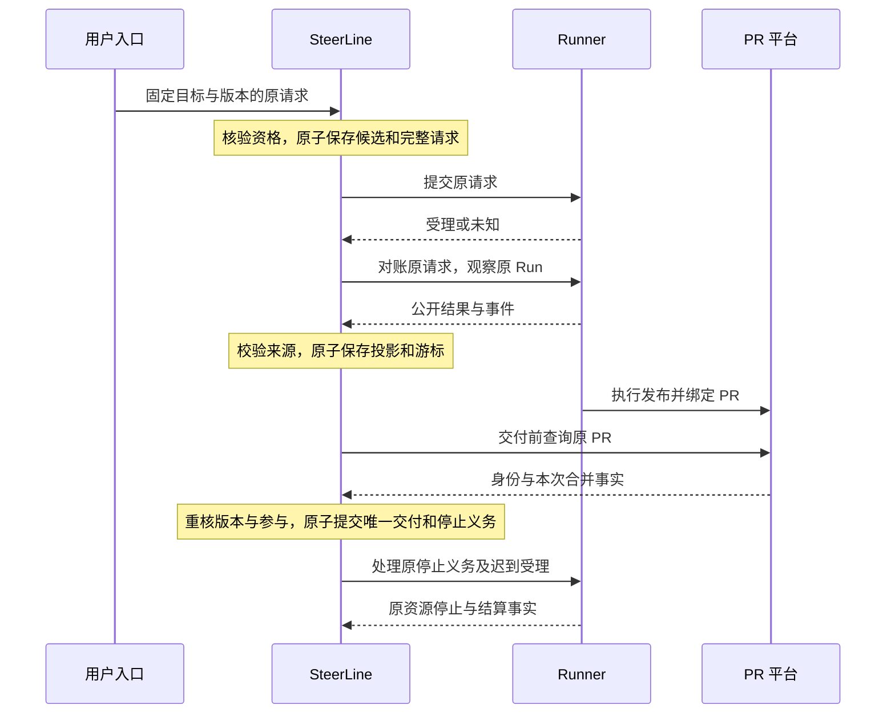

# SteerLine 可靠性交付链路

本文串联命令受理、任务交付与资源结算的事实和核验边界。节点异常、重试和恢复统一见 [Worker 生命周期](../product-design/worker-lifecycle.md)，操作步骤见[安装部署](../integration/install-deploy.md)。旧简化分析及实施验证约束见[历史方案](../../SteerlineFlow/archive/design/reliability-simplification-analysis.md)，各版本验收见[历史证据入口](../../SteerlineFlow/archive/design/runner-reliability-history.md)。

## 事实权威与完成含义

| 事实 | 负责方 | 能证明什么 |
| --- | --- | --- |
| Task、依赖、候选、原请求和唯一交付 | SteerLine | 已保存的业务意图、参与资格与任务交付 |
| Run、工作流、原生会话和资源 | Runner | 原执行的公开进展、结果和停止事实 |
| PR 身份与真实合并 | PR 平台 | 固定 PR 本次查询的合并事实 |
| 宿主、项目关闭与锁 | SteerLine 宿主及实际进程、锁 | 原实例本地关闭和退出情况 |
| 程序包与安装结果 | 构建包及部署记录 | 所选程序来源、字节和实际安装结果 |

受理、执行开始、PR 就绪、任务交付、资源停止、安装完成与服务就绪是不同结论。例如，PR 已合并且任务交付已提交，不要求清理先成功；安装完成但服务启动失败，则只报告已安装、未就绪。

## 当前业务交付链路

外部 I/O 在本地事务外执行，资格与版本在提交时再次核验。Task 与图、候选及固定材料、原生执行、PR 分别绑定，不能用另一候选的结果或当前默认方案替代原事实。实际调用前保存意图；保存失败零发送，已调用但保存结果失败则补收原事实。

SteerLine 对已绑定候选使用 Runner 的同快照 `observe` 读取 Run 和有界事件页，将投影、事件和游标在同一事务保存。身份错配、revision 倒退或事件越界整页拒绝，CAS 失败不保存半页；游标仅越过实际消费事件。原请求对账、启动前离线读取及控制前版本核对仍按各自接口进行；观察不触发输入，也不替代交付前的平台查询。

交付前，SteerLine 直接按候选冻结的 provider 查询原 PR，核实仓库、base/head、原绑定和实际合并证据；再在本地事务重核任务、图、候选与参与资格，提交唯一交付、关闭任务、释放后继并保存全部候选的停止义务。任一合格候选可以交付，不等待兄弟状态全部确定，也不要求先处于 pr_ready。任务关闭后不再查询其候选 PR，停止和迟到受理责任仍保留。

## 必须保留的核验

| 核验 | 保留原因 |
| --- | --- |
| 服务实例、构建与原 Run/input 绑定 | 防止错服务、错执行和过期输入；实际命令的前置不能只靠一次预查询代替 |
| 原请求及跨进程回执 | 任一方可能提交成功后丢响应；接受不证明开始或业务完成 |
| 交付前平台刷新及事务内重核 | 旧 PR 投影不证明本次合并；查询期间任务与参与资格仍可能改变 |
| 唯一交付与停止义务同事务保存 | 防止任务已结束而丢失未知或迟到执行的收尾责任 |
| 服务退出、本地关闭与资源结算分别证明 | PID 退出、窗口关闭、not_running 或 stop 接受不能证明原生资源停止 |
| 按目的核对部署、升级与 reset | 可重启不等于可删数据；换构建还需业务、资源及控制全部排空 |

公开完整绑定能力只覆盖其声明的命令。覆盖范围内在实际受理前检查；其他入口保留必要预查询，每次实际 EXE 校验仍执行。报告、摘要和缓存记录证明事实，不转移锁或授予下一次操作资格。

## 停服、部署与升级

同一 home 的项目共用 Runner 服务，业务库及项目实例独立。应用停机需要逐项目结算本地关闭和锁，再核对原 Runner 实例、请求、目录、构建及最终资源证明；单项目失败不跳过其他收尾。读取旧投影不能替代停机后的最终证据。

同构建重启按原资源和授权恢复观察；Runner 可以继续原授权下已证明未发送的后继，SteerLine 不生成新的恢复输入。当前 Runner state/v8 不支持活动任务跨构建接管，`service verify-takeover` 已删除。换构建由正式部署入口先处理原服务和原业务，再核验资源停止、所有 Run 的业务终态及未完成控制；仅 pr_ready 或服务已退出不足。原版和候选程序按当前公开契约核验同一 Run/input 集合，失败保留原文件和诊断。

部署通过 `prepare-deployment` 统一组织现有停止与证明，脚本核对本次调用、目标 home、完整暂存包和 Runner 摘要，再执行文件操作。系统中断导致缺失或陈旧回执时，仅在现有恢复准入及授权允许下运行原版本一次、正常关闭并重新核验；当前实例冲突、文件变化或不兼容继续阻断。具体操作和范围见[安装部署](../integration/install-deploy.md#同构建更新与重启)。

完整离线启动清单、覆盖实际文件替换的安装排他租约、prepared/pending 续装和产品命令承载合并仍属未实施方案。当前部署报告不是持续持有的 writer lease，不能凭旧 JSON 直接离线替换或续装；历史方案中的兼容接管前提也不作为 v8 准入。

## 规则与证据入口

| 主题 | 入口 |
| --- | --- |
| 节点、异常、授权及原请求恢复 | [Worker 生命周期](../product-design/worker-lifecycle.md) |
| 身份、冻结、事务与格式 | [数据模型](../product-design/data-model.md) |
| 原请求、迟到接受与停止义务 | [runnerbridge](../../internal/runnerbridge/bridge.go) |
| 平台查询与唯一交付 | [PR 所有权 Spec](../../SteerlineFlow/spec/task-pr-merge-ownership.spec.md) · [交付事务](../../internal/storage/sqlite/runner_result.go) |
| 当前升级和排空 | [Runner 升级核验](../../internal/runnerclient/upgrade.go) · [v8 验收](../../SteerlineFlow/testing/acceptance/runner-v8-install-reset.md) |
| 停止、部署与中断恢复 | [安装部署](../integration/install-deploy.md) · [中断恢复验收](../../SteerlineFlow/testing/acceptance/deployment-interrupted-recovery.md) |
| 简化方案、已实施与未实施范围 | [历史方案](../../SteerlineFlow/archive/design/reliability-simplification-analysis.md) · [实施验收](../../SteerlineFlow/testing/acceptance/reliability-simplification.md) |

本文维护当前核验关系，不追加审计过程或实现日志；历史固定版本的成功、失败和未验结论均按原记录保留。
