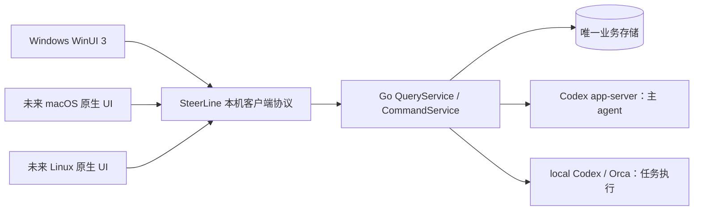

# 第二阶段技术架构方案

状态：产品与架构方案；已选范围的执行要求见[独立 Spec/Plan 索引](../spec/README.md)及[共同接口](../spec/phase2-constraints.md)。范围依据：[第二阶段产品愿景](../roadmap/product-vision.md)、[架构约束](../roadmap/architecture-constraints.md)、[控制台约束](../roadmap/console-constraints.md)。

## 目标与边界

第二阶段让人在 SteerLine 原生 UI 中与 Codex 主 agent 讨论目标、审阅规划草稿和影响，明确确认任务创建与执行决策，并追溯目标、Spec/Plan、DAG、运行、PR 和交付证据。主 agent 仅支持 Codex，不提供多 agent 协作或子 agent 调用。任务执行仍沿用本机 Codex 与 Orca 远端两条后端；主 agent 会话和任务 worker 的执行身份分开。

每个项目为主 agent 绑定一个持久的规划 worktree。新 session 使用同一目录的新 Codex thread，不继承旧 session 的消息、摘要或 fork 历史；worktree 中的文件状态保持原样。多个历史 session 可浏览，但同一规划 worktree 的写入轮次必须串行，避免两个 session 同时修改同一套文档。任务 worker 使用其执行身份绑定的工作区，不借用规划 worktree。

UI 是客户端，不是任务、规划、决策或交付状态的业务写者。服务必须校验人的确认、版本和当前资格；Codex 的建议或文本输出本身不构成创建任务或推进 roadmap 的授权。第二阶段不重做第一阶段的执行状态机、后端适配器或数据库权威。

## 技术选择

| 层 | 第二阶段选择 | 职责 |
| --- | --- | --- |
| Windows UI | C# + WinUI 3 / Windows App SDK | 原生窗口、输入编辑、导航、列表、图与证据展示；保存可恢复的视图状态 |
| 产品核心 | 现有 Go 服务 | Query/Command、规划提案和版本、任务 DAG、执行、决策、PR 核验及恢复 |
| 主 agent | 本机 Codex CLI 的 `app-server`，由 Go 服务经 stdio 管理 | Codex 会话、轮次、流式消息、工具事件和 Codex 审批 |
| 本机客户端协议 | 服务提供的版本化 HTTP/JSON 查询与命令、SSE 事件流 | 供原生 UI 连接、补读和重连；不作为另一套业务状态来源 |
| 持久化 | 复用第一阶段交付的 SQLite 与受管正文/事件存储 | Go 服务单写；UI 不访问表、Codex 私有日志或 Orca 原始协议 |

Windows UI 采用 WinUI 3，选型参考[微软文档](https://learn.microsoft.com/en-us/windows/apps/get-started/)；[OpenAI Docs](https://learn.chatgpt.com/docs/app-server)提供 app-server 会话、审批与事件协议，并区分稳定与实验字段。第二阶段按能力验证 Spec 固定实际通过的 Codex 版本、权限配置和字段，不能以文档存在某个方法代替 Windows 原生验收。

输入区使用 WinUI 原生文本控件承载编辑、输入法、选区和撤销；Markdown、代码差异等只读内容可在 UI 设计时评估局部使用 WebView2，不因此把整个界面或业务逻辑改成网页。

主 agent 可读整个仓库，但项目内写入只允许发生在 `docs/**`。由于正式 `docs/roadmap/` 和 `docs/spec/` 路径必须始终有效，建议 Codex 进程对 worktree 使用只读权限配置；它提交目标路径和候选正文给 Go 的受控文档写入口，服务仅将允许的 Markdown 草稿写到固定 worktree 的 `docs/.steerline-drafts/`。正式路径只由服务在完整校验和人工确认后发布。这样新 session 仍能读取前一 session 留下的目录状态，同时不能直接制造实现代码、测试或任意 artifact。默认 `workspace-write` 会把当前目录纳入可写工作区，不能用它实现这条限制。受控写入口可经 Codex app-server 客户端工具或本机 MCP 提供，具体协议以真实版本探测后固定。[OpenAI Docs：Permissions](https://learn.chatgpt.com/docs/permissions)。

草稿目录由服务分配身份和目标路径，限制文件类型、大小及数量；不接受路径遍历、目录联接或指向工作区外的链接。服务不把草稿当作已发布的 roadmap、Spec 或 Plan。Codex 命令、工具和子进程的实际权限仍须在 Windows 原生沙箱中验证；仅靠提示词或检查最终 Git diff 不能证明越界写入没有发生。

各平台届时运行各自的本机 Go 服务；图中共用的是协议与核心代码，不是跨平台连接同一台服务。macOS/Linux UI 是未来接入位置，不表示这些平台的服务生命周期、Codex 或 Orca 能力已通过原生验收。

## 业务接口与数据流

第一阶段已交付的[中心执行模型 Spec](../spec/02-execution-model-and-adapter.md)提供 Go 的 SQLite 单写者、`QueryService` 和 `CommandService`；[会话 Spec](../spec/pr-04b-conversation-events.spec.md)提供规范事件、正文与分页。第二阶段实施前应核对已落地接口与本方案所需的差异；`#3` 的本机原生验收和 `#4`/`#6` 的远端生产门槛仍按[执行依赖图](../roadmap/execution-map.md)独立完成。第二阶段在现有业务权威外增加薄的本机协议适配层，不让 C# 客户端重写业务校验，也不把现有 `control/requests` 文件目录、SQLite 表或 Codex JSON-RPC 直接作为 UI 契约。

客户端协议至少覆盖三类操作：

1. **查询**：项目/服务状态、目标及草稿版本、任务与 DAG、会话和运行、决策、PR 与证据；分页结果携带稳定对象 ID、数据版本和查询游标。查询不能隐式改变业务状态。
2. **命令**：保存或审阅草稿、确认创建任务批次、启动任务、提交决策等。请求携带精确目标、预期版本、幂等键和发起者；响应区分已提交、已接受、已执行、被拒绝和结果待核实。服务端再次核验资格，不能依赖按钮禁用。
3. **事件**：SSE 提示客户端有新状态或会话输出。事件携带可恢复的服务查询游标；断线后先从持久查询补读，再继续订阅。SSE 只负责传递更新，不作为唯一持久记录或执行完成证据。

例如，主 agent 提出三个任务时，UI 先展示拆分和依赖。人确认进入规格编写后，服务预留正式任务 ID 并建立受控草稿槽；主 agent 写候选 roadmap、Spec 和 Plan。人的“确认创建”绑定整套草稿版本与正式基线，服务发布文档并提交专用规划分支。规格尚未进入执行目标分支时，保留原 publication 并等待用户以保留规划 commit 的 merge/fast-forward 集成；服务不自动合并或推送。核验提交祖先和契约文件内容后才创建中心 DAG。同内容 squash/cherry-pick 不符合首版后续同步条件。创建尚未开始时人可受控结束等待；已发布文档和占号保留，提案回到 needs_review。Git 与数据库部分完成沿原身份对账；具体算法见[正式发布 Spec](../spec/phase2-document-publish.spec.md)。

主 agent 不能修改 `.git` 或 Git 共享引用。正式任务 ID 的占用、`task-ids` 记录、规划文档的 Git 提交及中心 DAG 创建由 SteerLine 在相应的人工确认后按固定身份办理。提交前对整套候选文档执行路径、类型、身份、链接、依赖与 Spec/Plan 一一对应校验，并核对固定文件版本；`roadmap_task_id.py check` 是已有校验的一部分，不能当成全部语义质量检查。发布期间锁定该规划 worktree 的写入与正式文档读取；故障后先按 Git 与操作记录恢复或阻止新动作，不把部分写入的正式目录当作有效版本。任一步骤结果待核实时保留原身份与现场，不自动再占号或重派。

多个 Markdown 文件无法靠逐个覆盖获得原子可见性。实施 Spec 必须给出整套正式文档的可见版本、发布锁和崩溃恢复算法，并用故障注入证明 UI 与服务查询始终读取上一套或下一套完整有效版本；如果原始文件路径也被要求在发布的每个瞬间都可供外部进程无锁读取，则需另行设计原子目录/版本切换，不能把普通逐文件复制宣称为满足要求。SteerLine 无法阻止其他程序直接改动工作树；检测到外部修改时应立即阻止相关发布和任务创建，保留差异供人核实。

## 本机连接与生命周期

Windows UI 与 Go 服务是两个独立进程。现有[服务窗口契约](../spec/pr-03-service-lifecycle.spec.md)继续适用：用户从固定入口打开可见服务窗口；退出 UI 不停止服务或 worker；关闭服务窗口结束服务，UI 显示离线或待核实状态，不自行创建替代服务。主 agent 的 app-server 由服务持有，UI 关闭不直接终止会话；服务重启后按持久 thread ID 恢复并对账。

建议服务仅在本机回环地址开放客户端协议，使用随机端口与仅本机用户可读的实例凭证。发现记录包含协议版本、项目及服务实例身份；客户端连接后核对身份和能力，凭证放在请求头，不放入 URL 或日志。实际 Windows ACL、浏览器来源拒绝、端口冲突和旧实例记录的处理须在实施 Spec 中验证。该本机协议不直接开放远程访问。

服务在线时 UI 从服务查询；服务离线而需要重新打开历史时，由同一 Go `QueryService` 的只读命令入口返回相同 DTO。这个短时只读入口不得启动调度、消费命令或改写 SQLite，UI 也不自行解析数据库。其具体命令和权限边界留待实施 Spec 固定。

## Codex 主 agent 边界

每个规划会话绑定可恢复的 Codex thread ID；Go 服务读取 app-server 事件并关联 SteerLine 的项目、提案版本和 artifact ID。对话文字、工具活动、提案草稿、人工确认和任务执行结果分别建模。Codex 的工具审批不替代 SteerLine 的产品确认；主 agent 不持有绕过 `CommandService` 创建任务或更改 DAG 的入口。

主 agent 只能产出文档候选，不能编写或运行嗅探器、测试、实现代码等执行产物。此类需求先写成符合目录规则的任务 Spec/Plan，再由 SteerLine 依任务 DAG 派发执行。服务需要验证 Codex CLI 是否能对主 agent 禁用或拦截通用执行工具；若不能代码化保证“只规划、不执行”，该能力是第二阶段的交付阻塞，不能只靠提示词或 UI 隐藏按钮宣称满足。固定配置还须设置 `agents.enabled=false` 禁用多 agent 工具，并在目标版本验证其生效。[OpenAI Docs：配置项](https://learn.chatgpt.com/docs/config-file/config-reference)。

输入框、草稿保存、多行编辑、历史输入复用属于 UI；会话恢复、轮次开始、运行中追加输入及中断通过经验证的 app-server 方法实现。已发送输入的“编辑并重跑”仅在真实 Codex App 对照中确认会话历史与文件状态语义均可一致实现时提供，否则第二阶段不显示该入口。不得将仅回退对话历史包装成文件已回退。禁用子 agent 的方法及单 agent 约束也须通过实际 Codex 版本验证，不能仅靠 UI 隐藏入口。

## 未来原生平台的扩展点

未来平台分别实现原生窗口、输入法、文件选择器、通知、快捷键和安装体验，复用同一版本化产品协议及 Go 业务规则。Go 中只有服务承载、进程与工作区等平台事实通过受限适配器分别实现和验收；Windows 可见服务窗口策略不强加给 macOS/Linux。新平台启用前分别验证 Codex CLI、沙箱、Git 与执行后端能力，不把 Windows 的实测结论直接移植过去。

跨平台共享的是业务 DTO、命令语义、错误码、事件游标和协议契约测试，而不是 UI 控件树或第二套数据库模型。新增平台时不需要重新实现任务状态机，也不需要把 WinUI 代码抽成预设的通用 UI 框架。

## 实施前须固定的验证

- 第一阶段 Query/Command、会话与 DAG 的实际交付接口；若有差异，以先落地的业务权威为准，修订本方案后再写第二阶段 Spec。
- 本机协议的版本、身份、凭证保护、离线只读与事件补读；UI 重启和服务重启均不得重复提交有副作用命令。
- Codex app-server 的 Windows 原生会话恢复、流式事件、审批、单 agent 约束，以及与 Codex App 输入行为的实测差异。
- 固定规划 worktree 上的“全仓可读、仅 `docs/**` 可写”、新 session 不继承对话上下文、并发写入串行化，以及非文档产物拒绝。
- 原生 UI 关闭、重新打开、切项目和服务窗口关闭时，草稿、阅读位置、待决策与运行事实分别保持正确；不能用 UI 状态代替服务回执。
