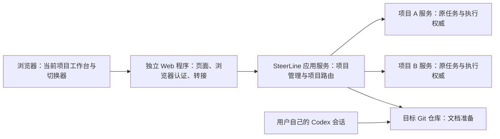

# 项目管理与统一 Web 入口（方案）

状态：2026-10-15 原规划先确认整体方案；随后用户直接授权实现先行的独立 Web 与已有配置项目切换，当前结果见[专属验收](../acceptance/web-project-switch.md)。添加、结构核验与纳管仍为后置设计，没有执行准备提示词或修改安装环境。本文是项目切换、添加和纳管职责的设计入口；[结构核验](project-structure.md)维护仓库要求，[Codex 准备提示词](project-onboarding-prompt.md)供用户复制执行。后置添加能力不表示已经交付。

用户随后明确分批：[独立 Web 与已有项目切换 Spec](../spec/web-project-switch.spec.md)/[Plan](../spec/web-project-switch.plan.md)先行，继续只读展示 etc 中的已配置项目，不引入结构门槛；[项目添加 Spec](../spec/project-onboarding.spec.md)/[Plan](../spec/project-onboarding.plan.md)后置，才落实下文的准备、核验、登记、初始化准入。两个批次独立验收；先行批次不依赖后置批次，也不把已配置项目标成结构已通过。

## 确认的产品方向

2026-10-15 后继重构规划见[统一启动 Spec](../spec/unified-startup.spec.md)/[Plan](../spec/unified-startup.plan.md)：一个 start.bat 启动多项目后端与独立 Web，项目服务改为后端内运行时，不支持产品 TUI。本次实现采用该拓扑：Web 重启隔离继续保留，后端停止覆盖全部项目；实际已验/待验见[统一启动验收](../acceptance/unified-startup.md)。项目添加仍后置，消费同一宿主及应用 v2，登记本身不自动启动项目/派发任务。

- 主界面始终围绕一个当前项目：其 DAG、任务、候选、问题、文档和设置。项目切换器放在当前项目名称处，支持搜索、最近使用和进入“添加项目”。不把默认首页改成跨项目任务大盘。
- Web 采用一个稳定本机地址；项目写在页面 URL 和请求目标中，不为每个项目分配浏览器端口。每个标签页可以选择不同项目。
- 页面资源、浏览器会话与转接由独立 Web 程序承载，可以独立调试、更新和重启。项目管理由 SteerLine 的 Go 应用服务实现，Web 不读取配置目录判断项目资格、不核验仓库、不建库、不直接管理项目进程。
- 添加流程为：填写目标 → 取得提示词 → 用户在 Codex 准备仓库 → 回到 SteerLine 核验 → 明确确认纳管 → 服务建立项目状态并登记。Codex 自述完成不能替代核验。
- Web 为唯一交互前端，原 TUI 已按独立退役 Spec 删除；本方案不重新引入终端前端。

## 当前实现与缺口

调查基线：`b657baf39d82ff33e47c7175799421c340748a8d`。

| 位置 | 实际行为 | 本方案的整合方向 |
| --- | --- | --- |
| [app/config.go](../../internal/app/config.go)、[application_directory.go](../../internal/app/application_directory.go) | 从应用 home 的 etc 加载项目配置；由应用目录解析现有项目配置 | 项目目录与资格由应用服务统一返回，不能把“有 JSON 文件”等同于纳管完成 |
| [web/server/server.go](../../web/server/server.go)、[application_service.go](../../internal/app/application_service.go) | 已拆出独立 Web；应用服务提供配置目录及按项目转接 | 后续添加复用该 Go 应用入口，不重建网关 |
| [native_project_open.go](../../internal/app/native_project_open.go)、[service_admission.go](../../internal/app/service_admission.go) | 启动及部分命令入口可以初始化原生项目数据库；没有本文规定的文档结构门槛 | 复用原初始化/身份/事务能力，但在所有初始化入口之前增加统一纳管准入 |
| [service_preflight.go](../../internal/app/service_preflight.go)、[native_state_preflight.go](../../internal/app/host/native_state_preflight.go) | 已有仓库、发布目标、执行环境、状态位置及格式核验 | 复用具体检查；区分项目结构、纳管参数与执行环境，不把会触碰执行环境的完整启动检查当成结构检查 |
| [planning-ui.md](planning-ui.md#长期技术文档与结构约定) | 原型约定架构、并行开发、测试、Spec/Plan 规范及设计目录 | 本方案把角色与结构要求集中到结构核验文档，原型仍只是交互参考 |
| [task/model/contract.go](../../internal/task/model/contract.go)、[task/documents.go](../../internal/task/documents.go) | 创建任务核验固定 Spec/Plan、验收引用、Git commit 与摘要 | 保留，添加项目不生成假任务或绕过任务准入 |

当前没有已实现的“复制准备提示词 → 服务核验 → 纳管”完整入口。本文落实用户希望采用的流程，不把原型、人工配置或既有 preflight 描述成已具备该功能。

## 服务归属与启动边界

这里的“应用服务”是 Go 后端的应用级入口，不是某一个项目的 worker 服务。它必须在零个已管理项目、所有项目服务均离线时也能提供添加与核验；不能为添加第一个项目而先创建一个临时项目数据库。当前 `serve-app` 已能在零配置/全离线时提供身份与只读目录；添加和核验仍按后置 Spec 补齐。

应用级入口由 `steerline.exe` 承载，独立于各项目服务的生命周期；一个应用 home 只允许一个项目管理写者。当前统一入口为 `steerline start/stop/status`，低层为 `steerline serve` 与 `steerline-web serve/open/stop`，协议为 `steerline-application/v2`；后置管理写入按其实施 Spec 扩展。各项目在共享后端内分别持有 actor、数据库与仓库锁；不合并 worker、调度器或业务数据库。

当前 `LoadConfig` 会组合全局执行方案，部分 preflight 还会验证具体后端；添加候选不能直接套用这条完整运行接线。应用级启动、候选解析与结构核验须有不依赖执行方案就绪的入口；纳管参数及原生权威初始化使用必需的窄输入，执行目录/账户/Orca 可用性留给执行就绪检查。实施时应拆出并复用已有具体检查，不构造一个假的项目或默认 worker 来满足旧入口。

Web 只连接应用级 API。Go 应用服务负责项目目录、仓库身份、准入结果、登记、状态初始化，以及将现有项目查询/命令送往相应项目服务。独立 Web 程序仍可包含最小浏览器认证与代理代码；业务资格不在其中实现。

浏览器只接触一个稳定端口。项目服务内部原生 API 的随机端口继续由服务发现解析。Web 端口属于应用级配置，不再放进每个项目配置。当前用户授权打开本 home 的 Web 入口，服务据正式项目目录检查访问范围；不允许页面指定任意后端 URL。其他 home（例如独立调试包）不是同一项目集合。

应用服务停机不应停止已经运行的项目服务；Web 重启也不停止它们。项目服务离线仅使该项目业务操作不可用，项目切换、添加和其他项目仍可使用。浏览器断线不能被解释为项目已经停服。

## 当前项目与切换

项目切换器显示显示名、仓库简要位置及在线/离线/配置错误状态。先行版零项目显示“尚无已配置项目”和只读说明，后置添加完成后再提供“添加项目”；已有项目时可记住本浏览器最近选择，但不能在服务端保存一个供全部标签页共用的当前项目。

切换后进入目标项目相应页面；原任务/候选不存在时回到目标项目的 DAG 或执行列表，不带着同号 Task 自动定位。URL 必须包含稳定项目 ID，重名项目用路径区分。先行版同 common-dir 的重复配置显示冲突并拒绝路由，后续登记也按 Git common-dir 保持唯一；不能仅按目录名识别项目。

查询缓存、草稿、页面选择与原请求记录按项目及相应实例/执行身份隔离。切换时保留原项目草稿，取消旧查询、资格检查及尚未提交的发送回调；已提交命令及未知结果留在原项目，继续按原 ID 查证，绝不改投当前项目。服务实例变更后更新连接身份，不改写旧信封。列表加载和项目连接分别限时，一个错误配置或慢连接不能拖住整个切换器。

## 添加流程

| 步骤 | 用户看到与操作 | Go 服务承担 | 允许的副作用 |
| --- | --- | --- | --- |
| 1. 填写目标 | 服务机器上的仓库目录、显示名、Git remote、目标分支和发布目标；已有值可供核对 | 只读解析目标，识别同仓库是否已管理，返回必要补充项 | 不写目标仓库、项目配置、项目状态或数据库 |
| 2. 准备仓库 | 复制完整提示词，在自己的 Codex 会话执行 | 提供带版本的提示词和结构要求；不启动或调度 Codex | 应用服务无仓库写入；用户自己的 Codex 按提示词和授权修改文档 |
| 3. 返回核验 | 点击“核验项目”，看到逐项结果、文件路径与修复建议 | 按结构核验文档检查精确 Git 版本及纳管参数，生成有依据的核验结果 | 允许保存应用级核验记录；不建项目库、不登记项目 |
| 4. 确认纳管 | 核验通过后查看目标、分支、固定 commit、状态目录及提示，再点击“添加项目” | 复核原输入和版本，取得原仓库/登记互斥，执行原生初始化并发布正式登记 | 仅此步允许创建项目数据库、受管状态和应用项目配置 |
| 5. 完成 | 成功后切换到该项目，显示项目服务是否在线；首次新库为空 DAG，明确复用当前格式数据库时保留原数据 | 返回同一添加请求的结果，项目目录纳入该项目 | 不生成 Task、不导入旧格式任务、不自动派发；启动项目服务属于另外的显式操作 |

步骤 1–3 的候选只属于添加面板，不出现在正式项目切换列表。已管理的同一仓库直接提供打开原项目入口，不再建立添加候选。用户也可以从步骤 1 直接核验已经准备好的仓库，不强迫重复运行 Codex。

准备提示词不含安装路径内的写命令、认证数据或“调用 SteerLine 创建任务”等操作。复制提示词不代表用户授权 SteerLine 修改仓库。Codex 无法完成时，结果应明确列出未完成事项，用户可返回继续准备或取消。

核验采用选定分支的已提交版本；工作区里新建文件但没有进入该版本，不能算通过。需要 PR 合入的仓库，先完成其已有合入流程，再返回核验，不因“Codex 执行过”放行。核验通过只证明本版结构规则与已检查参数，不证明文档语义正确、测试通过或 worker 已可运行。

## 纳管提交、重复请求与失败

正式项目目录及项目配置由应用服务持有，复用现有应用配置职责，不在 Web 保存另一份管理真相。单纯复制一个配置文件进 etc 不能绕过准入自动成为正式项目。具体登记格式与应用级协议是待实现项，不把当前配置文件假定为已经包含准入记录。

添加请求绑定原 request ID、应用 home、仓库 common-dir、目标分支/commit、结构规则版本/文档摘要及纳管参数摘要，记录受理时的应用实例事实。最终提交重新核验这些事实；原分支、清单、路径、配置或发布目标发生变化时返回“需重新核验”，不消费旧通过结果。不能接受浏览器自报 passed。应用重启后查询只读，显式继续仍用原请求 ID/正文并重核当前实例和原依据，不自动重放。显示名改变不产生新的仓库身份。

先核验、再初始化、最后发布登记。初始原生权威沿用 manual 且 paused 的现有规则。首次添加不要求已有 Spec/Plan 或任何 Task；空数据库、空 DAG 是正常结果。所有能够初始化项目的 CLI、宿主和客户端路径都必须受同一准入约束，不能只在 Web 按钮上检查；客户端不能借原初始化路径隐式添加。

数据库与文件发布不能假装成一笔跨介质事务。应用服务需持久保留最小添加请求/完成事实，放在应用级目录，不在未通过核验的项目下建数据库，也不向已有严格运行目录塞入新类型的临时文件。实施时选定唯一最终登记发布点：初始化成功且登记原子发布后，项目才进入正式目录。

- 核验失败：返回实际失败项，不建库、不修改目标仓库。
- 重复添加或同仓库并发：用规范仓库身份串行核验，返回已有项目或原添加结果，不建第二份数据库。
- 初始化失败：不发布正式项目，保存具体原因；保留已发生的状态供同一请求核对，不自动删除目录后重试。
- 初始化成功但登记/回执失败：项目仍不冒充添加成功；重试先核对原请求、原数据库权威与发布记录，再补齐原提交，不换 ID 重建。不能把自己的半成品当陌生旧库删除。
- 已有数据库：只有当前格式及仓库/remote/branch 权威均匹配才允许明确复用；旧格式或其他身份阻断。不新增迁移、自动重置、旧版读取或静默接管。

删除、归档、迁移项目及移动仓库不在本次添加流程范围内；不能用“重新添加”暗中完成这些操作。

## 实施前应固定的范围

本方案选择“本机已有 Git 仓库 + 外部 Codex 文档准备 + 服务结构核验 + 明确纳管”。不提供自动创建远端仓库、自动安装工具、由 Web 调度 Codex 准备、自动推送或自动合并。执行环境/账户是否就绪与项目纳管分开显示；Orca 登记只属于选择相应执行方案时的就绪条件，不是所有项目的结构门槛。

两个批次的实施接线、能力补齐和最小测试安排归各自 Spec/Plan，结果分别登记 [Web 切换验收](../acceptance/web-project-switch.md)及[项目添加验收](../acceptance/project-onboarding.md)。本轮只做文档静态核对，不把这些未来能力登记成已验收，也不加入 roadmap 执行清单。
