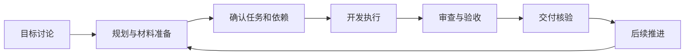

# SteerLine 项目流程与 Runner 职责

本文维护 SteerLine 参与项目开发的总体设计，说明流程、职责和用户参与边界。标为“当前”的内容概括已有能力，实际可用及已验范围见对应设计和[验收记录](../../SteerlineFlow/testing/acceptance/README.md)；标为“未来设计”的内容尚未形成完整产品能力。

## 1. 定位与基本原则

SteerLine 围绕项目目标组织任务、依赖、执行和交付，让多个 Agent 的工作能够衔接为持续开发流程。用户决定目标、优先级、关键取舍与授权范围；SteerLine 维护项目工作依据与推进条件；SteerRunner（下称 Runner）管理一次执行及其内部工作流；执行 Agent 完成具体开发工作。

项目规范、任务要求和实际结果共同构成推进依据。自动化应在明确范围内减少日常协调，需要用户判断的事项保留清晰入口。

## 2. 参与项目的完整流程

项目首次接入时，需要准备项目约定、任务文档、测试入口和环境要求。当前已有[初始化指南](../../SteerlineProjectGuideDoc/project-initialization.md)，完整的自动调查、适配与纳管仍在建设。持续开发围绕以下闭环进行：

| 环节 | 工作依据与 SteerLine 的作用 | 继续条件 |
| --- | --- | --- |
| 目标与规划 | 从用户目标形成 Roadmap、任务范围和待决问题 | 目标、范围与关键问题已确认 |
| 材料与任务 | 用 Spec 说明成果和通过条件，用 Plan 安排实施与验证，建立依赖 | 材料有效、依赖成立、具备开工条件 |
| 开发执行 | 将确认的任务与执行方案交给 Runner，展示进展并转交反馈 | 执行成果经过所选流程检查 |
| 审查与验收 | 汇集成果、测试结果及人工待验项 | 满足任务约定的审查与验收条件 |
| 交付与继续 | 核验实际合并，记录任务交付，释放满足依赖的后续任务 | 交付事实成立，后续任务满足各自条件 |

**当前：** 规划讨论主要在外部聊天中进行；产品已有 Roadmap 读取、解析、文档生成、确认与入图，以及任务依赖、开发候选、反馈和合并核验能力。审查可由所选 Runner 流程承担，人工验收仍需按任务安排参与。各环节尚未由产品内主 Agent 统一管理，后续任务可开工也不等于已经启动。

**未来设计：** 由 SteerLine 主 Agent 承接需求讨论、规划、执行监督与结果回顾，在用户授权内持续组织整个闭环。

## 3. 如何落实流程设计

SteerLine 通过四类手段参与流程：用规范和任务材料提供共同依据；用依赖与准入检查控制开工；用流程指令、配套工具与反馈组织执行；用测试、验收和交付事实判断成果。

Agent 负责理解需求、作出工程判断和执行工作；系统负责核验可以明确检查的条件。提示词传达要求，实际检查落实约束。材料存在不能证明内容正确，Agent 声明完成也不能代替成果核验。

**当前：** 上述手段已在任务执行、Roadmap 转正等环节分别使用。**未来设计：** 将它们贯穿项目周期，并由主 Agent 维护材料、识别流程缺口和组织补齐。

## 4. SteerLine 与 Runner 的职责边界

以下是长期职责划分；各项能力的交付程度仍按前文的当前与未来说明判断。

每个 Runner Run 只承担一个范围与完成条件明确的任务，并在任务要求和授权内管理内部 workflow。Runner 可以调查和解决任务内问题；无法继续且需要补充任务依据、改变任务范围或协调其他任务时，应保留现场并上报。SteerLine 负责组织解决、维护正式材料和任务关系，再明确授权后续执行。

“一个任务”限定每个 Run 的业务范围，不限制 Runner 服务同时承载多个独立 Run。任务内的实现、验证、报告、审计、修复和发布可以属于同一 Run；任务拆分、依赖调整、跨任务取舍和后续任务的派发由 SteerLine 管理。

| 事项 | SteerLine 负责 | Runner 负责 |
| --- | --- | --- |
| 规划与材料 | 业务目标、任务范围、依赖和项目要求 | 执行受托的生成或分析工作，返回结果 |
| 执行安排 | 选择执行方案，提交任务材料与授权 | 判断执行能力，准备工作区和会话 |
| 执行内部流程 | 提供项目要求，消费进展与结果 | 管理所选流程中的实现、报告、审计、修复和发布 |
| 问题与反馈 | 判断项目影响，组织补充材料与跨任务协调，收集并转交必要的用户决定 | 解决任务内问题；无法在原范围内解决时保留现场、说明缺口并上报，按有效输入继续 |
| 成果与交付 | 核验任务交付，更新任务和依赖 | 核验本次执行产物，报告发布结果 |
| 停止与恢复 | 决定任务是否继续，跟踪未完成责任 | 管理原执行、会话及资源的停止与恢复 |

Runner 承担模型与原生 Agent 执行，包括开发及辅助生成。SteerLine 根据业务需要提出请求和使用结果。执行 Agent 按任务要求实现、测试、修复并提交成果；任务是否交付由 SteerLine 核验。

Runner 拥有执行内部流程，流程选择和推进均受任务要求及授权约束；任务明确要求的审计、验证或验收条件不得由 Runner 自行取消。**当前：** SteerLine 通过执行预设显式选择 Runner 已发布的 workflow，Runner 按所选流程管理内部步骤；尚未实现由 Runner 自主判断并选择是否审计的能力。项目要求怎样落实到任务由 SteerLine 管理，执行步骤怎样推进由 Runner 管理。

执行 Agent 应先在已有材料、仓库及授权范围内调查。编译失败、任务内缺陷或已授权的合并冲突处理，可以由 Runner 组织解决。需求材料相互矛盾、前置交付缺失，或解决问题需要改变任务范围、调整其他任务、超出本任务约定修改公共接口时，应将相关事实、已尝试的处理、未完成事项及需要补充的信息交回 SteerLine；Runner 不自行重定义任务或代替 SteerLine 协调其他任务。

**当前：** 已有问题展示、答案保存与沿原 Run 投递的通道。主 Agent 当前收敛为给定上下文中的提示词建议模块，独立模块重构处于草稿阶段，生产生成保持阻断；采用、修改材料及继续执行均由外部业务承担。原问题、反馈与恢复输入的资格见[决策与反馈](decisions.md)。

## 5. 自动推进与用户参与

**当前：** Runner 可在已授权的任务范围内，按所选流程连续完成执行步骤；SteerLine 根据任务依赖和派发设置推进合格任务。用户参与规划确认、产品取舍、权限处理、必要人工验收及 PR 合并决策。自动派发与合并后释放依赖，均不代表系统可以自行扩大任务范围。

反馈属于原目标和约定范围时，可以在原输入资格允许下继续原执行。补充信息不自动构成继续执行的授权；目标、成果或依赖发生变化时，应由 SteerLine 重新确认受影响的规划与任务依据，按更新后的契约固定执行输入，不改写原 Run 已冻结的请求和材料。暂停、失败或重启后的继续资格，需要结合原执行事实和已有授权判断；需要新决定时回到用户。

**未来设计：** 主 Agent 在约定范围内承担日常协调、监督和问题归并，把关键取舍及超出授权的事项提交用户。**当前阶段：** 主 Agent 只接收明确上下文并提供后续对话提示词，模块重构草稿保留生产阻断；原生能力和两类明确来源的实际生产接线尚未验收，见[主 Agent 设计](main-agent.md)。更多来源和自主推进须显式扩展边界。

## 6. 失败、未知结果与完成判定

失败时保留已有成果、失败原因和未完成事项；结果未知时先核实原操作；恢复依据原执行事实继续。问题应说明实际影响，阻塞相关任务或环节。上述原则贯穿当前执行与交付；具体可恢复范围见[异常与恢复规则](worker-lifecycle.md)。

“完成”需要分别判断：执行结束表示本轮工作已停止；测试通过表示实际执行的检查通过；PR 就绪表示成果已提交供审阅；任务交付表示已核验其合并与任务归属；资源停止表示相关执行资源已确认停止。

例如，PR 已创建但尚未合并时，Runner 可以报告发布就绪，SteerLine 仍需等待并核验合并后才能记录任务交付。测试和人工验收是否满足要求，还须查看对应结果。

## 7. 持续维护

项目流程、职责归属、授权范围或完成条件改变时更新本文；实现方式和版本变化维护在专业文档中。当前能力与未来设计随实际交付更新，验证结论以对应范围的证据为准。

本文维护总体设计；[架构总览](../architecture.md)说明系统职责，[具体产品设计](README.md)补充功能规则，Spec/Plan 承载单次变更，验收记录证明实际结果。各处通过链接关联，避免重复维护同一规则。
