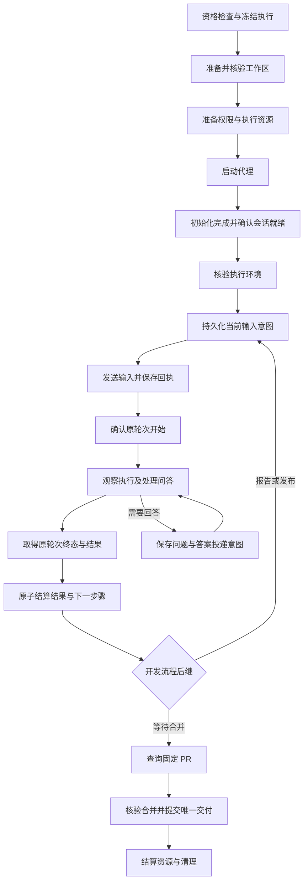

# Worker 流程异常处理与重试

Worker 执行域统一管理工作区准备、代理初始化、输入投递、轮次观察、结果结算和资源恢复。每个节点都必须说明正常出口、异常事实、允许的动作和停止条件；平台适配器提供证据，不能自行决定重跑任务或推进业务步骤。

本文是这些规则的长期维护入口。下文“统一设计”定义后续实现应遵循的行为；[当前实现与缺口](#当前实现与缺口)区分已有能力与待补能力，不表示完整流程已经实现或验收。当前流程由 Runner 的 development/1 或 development-audited/1 执行，调用边界见[协作契约](../spec/runner-collaboration.spec.md)；[PR 流程契约](../spec/worker-pr-flow.spec.md)保留迁出前来源。本文不启动实现任务、不修改已冻结执行，也不改变安装现场。

迁出前的三层职责重构已按 [Spec](../spec/worker-three-layer.spec.md)与[Plan](../spec/worker-three-layer.plan.md)完成 Workflow、ReliableExecution 和 ExecutionAdapter 拆分，保持现有行为；初始化失败重试等新增能力另行实施。当时规则归到 workflow/reliable，Service 负责记录映射、异步交接和原子提交；当前执行实现归独立 SteerRunner，历史实施证据以[专属验收](../acceptance/worker-three-layer.md)为准。

SteerRunner 跨仓代码切换已落地，切换安排见[接入 Plan](../spec/steerrunner-cutover.plan.md)，结果见[接入验收](../acceptance/steerrunner-cutover.md)。迁出后 W01–W18 的执行/资源事实、E01–E07 异常处理及恢复授权由 Runner 的单写服务管理；SteerLine 只持久化 Task/DAG、候选到 Run 的绑定、原 CLI 请求与事件投影，并在自己的事务内决定 W17 的 TaskDelivery。下文节点和异常分类继续作为共同语义入口，不新增另一套 worker 状态机。当前分支的 app service 已切换到 taskrunner/runnerbridge/runnerclient，旧根执行 actor/worker 及旧执行写表已删除；原生 owner、旧写表、闲置执行端口和旧原生重建函数已删除；跨进程受控基础闭环和用户保留的三项本机交付/恢复回归已通过；Runner 独立本机真机已通过，最新产品真机包仍在验证。两个 Orca 目标验收已由用户取消，不记为通过。

跨进程边界的具体规则：未知提交只查原 request_id；任务结束时在同一事务保存全部候选的停止义务，迟到接受的 Run 仍须撤销输入；Runner 的停止回执与原生进程停止分别投影。服务重启不重新发送已保存的答案、反馈或 resume。交付只接受本次刷新、身份一致的已合并 PR，不能要求候选先到 pr_ready，也不能由其他候选的未知状态阻塞正确候选交付。发布报告未完成时已经核实的 PR 可以绑定，但不因此推进 Runner 的流程里程碑。

本次最小验证映射：V 的来源/身份/权限边界复用三层规则定向测试；Runner 实际 EXE 场景验证未知零重发、恢复零自动输入、缺 final 零推进、权限资源不合格零会话创建；SteerLine 的 SLC-A01–A04 验证原请求、事务回滚、迟到绑定与停止义务。真机能力按本机和 Orca 目标分别登记，沙箱拒绝或缺原生事实保持未验/失败，不以 helper 或模型报告代替。

本地 MXC 权限差异：工具 TEMP/TMP 由原生 AppContainer 管理，可与 app-server 的宿主临时目录不同。Runner 保持固定工作区/Git 写入根，不强迫工具临时目录穿透到宿主 Git admin，不修改原生权限。验收须在真实工具 token 内核验 AppContainer、原生临时文件读写及本包兄弟目录拒写；旧的 TEMP=Git admin 路径断言不能用于 MXC。app-server 自身临时目录仍由 Runner 固定在所属工作区管理目录。具体真机结果仍按两个仓库专属 acceptance 登记。

本次本机资格探测预算与 Runner 外部命令统一为 30 秒，覆盖冷启动的原生版本查询。每 Attempt 仍只在资格缺失时探测，失败阻断且零新会话/输入，不自动重试，不缓存跳过版本或权限资源校验。运行失败与重验明细见专属 acceptance。

本轮审计补充 W12/V 输入边界：原生多题回答必须完整匹配原题集，重复 JSON 键、额外题目、固定题的附加答案、空回答及未提供选项在原生意图前拒绝。调用方保留已绑定 PR，不接受后续投影丢失/替换；失败不改原候选。两仓定向测试通过，最新产品真机与最终固定版本 R1 仍未通过，详见[接入验收最新段](../acceptance/steerrunner-cutover.md#pr-审计修复与主干同步)，不以历史通过抵消新失败。

统一启动接入的 W18 差异：多个 SteerLine 项目共用应用宿主 PID，各自保留 Task actor/store/实例和独立 Runner state-dir。Task 创建/加前置经该 actor 串行提交并发布快照；原输入/恢复规则不变。项目停机分别记录本地关闭、锁与资源结算；仅 Runner service not_running 不证明原生已停止，未知提交、缺投影或最后已知活动的 Run 保留资源未核实诊断。初始化中可能已启动独立 Runner 而无 actor 回执时也不能把资源结算写成 true。本次仅验证统一启动的空闲双项目、受控输入/停止反例及消费者；完整组合真机/恢复验收未因此通过。

W18 停服取证修复：停机前的候选投影不能证明停机后的资源状态。Runner 在全部 worker 退出并读取已提交原生停止事实后、释放写锁前发布最终结算；公开 service status 只在写锁空闲时返回 last_shutdown，新写者先使旧记录失效。SteerLine 核对原实例、停止 request_id、state-dir 和固定 EXE 摘要，再接受 resources_settled；不按旧 running 投影误拒绝，也不按 not_running 或旧 stopped 投影放行。缺记录、错配、超时、Orca 脱离观察或任一 Run 停止未核实仍阻断。变更范围与验证见[停服结算验收](../acceptance/runner-shutdown-settlement.md)，既有安装环境的失败回执不被改写。

部署 W18 补充：更新前由暂存的新 CLI 请求停机，避免重复调用安装版旧校验。原回执未通过时，显式 verify-stop 只能在原宿主/Web 已退出、各项目 LocalClosed/LocksReleased 且实例、配置摘要、checkpoint 和实际锁一致后，经新 Runner 的 service verify-stopped 取得逐 Run 资源证明，并核对候选的原 Run/input_digest/目录。Runner 在既有写锁下只读当前格式，复用 managed 恢复的原 Job owner+root 消失证明；不启动服务、恢复代理、重发输入或改写历史失败。证明不全继续阻断替换，新证明另存部署包。当前安装现场未用于验证，具体自动项见同一[验收](../acceptance/runner-shutdown-settlement.md)。

测试所有者按 [测试精简 Spec](../spec/runner-test-convergence.spec.md)收敛：W02–W16/W18 执行专项由 Runner 验证；W01、W12 调用方授权、W17 及迟到接受/停止义务由 SteerLine 验证。SteerLine 的完整 L2 仍用本机 Codex 实际走通实现、报告、发布和真实 PR 合并/交付；原生恢复/沙箱/Orca 不再在 SteerLine 重复建设矩阵。节点、异常和恢复规则不变，具体状态见[专属验收](../acceptance/runner-test-convergence.md)。

## 职责与规则归属

Orca 远端认证接线（2026-10-17）：Runner 主干 `d4969d0` 已提供可信执行主机 helper，W03/W05–W07 的认证、同权限无模型预检与准备回执由它维护；缺 `agent_launch.runtime_executable` 仍在零业务输入时拒绝。SteerLine 调试生成器补齐 helper 路径/SHA 的显式配置与早期缺参拒绝，不更改节点、异常、重试或恢复授权。V01/V02/V05/V07 的具体接线验证见[专属验收](../acceptance/orca-runtime-wiring.md)；既有安装候选不改绑、不自动恢复。下表历史缺口不代替该固定 Runner 的实际能力与验收范围。

本次 W16/V05 实测另发现 broker 拒绝发布查询中的 `mergeCommit { oid }`。只读字段白名单由 Runner 修复，SteerLine 不绕过认证或替 worker 执行查询；旧失败保持 blocked，补丁 helper 以新 SHA/新包实测。任务节点与输入/重试规则不变，结果仍登记上述专属验收。

W02/W18 的调用方目录布局：SteerLine 用本地卷根 `slr/<128-bit base32 key>` 绑定完整应用 run-dir，避免深 home 超出 Runner 的认证 socket 长度限制。所有启动/检查/查询/停服证明共用此路径；查询不创建，启动才准备私有目录，别名拒绝。重置先核实原资源停止，再只删所属摘要目录。节点、异常分类、重试和恢复授权均不变，旧 Run 不迁移或改绑。V01/V06/V07 的本次增量为真实 socket、跨 home/项目隔离及原目录停止/清理；[专属验收](../acceptance/runner-short-state-path.md)记录边界和结果。

原会话查看不参与 W01–W18 的执行推进：拆分 Runner 后补回公开 CLI，由原执行 owner 在既有 worker gate 内校验原身份和只读 thread/workspace，再开独立窗口；零新服务/会话/业务输入，原节点与 E01–E07 不变。验证映射及当前已验/待验范围见[专属验收](../acceptance/native-session-viewer.md)。

安装迁移发现 W18 的 Windows broker 差异：WMI 可将调用者原有但禁用的特权启用。Runner 在原返回句柄所指的挂起子进程上，仅禁用这些被额外启用的原有特权，再完整比对授权组和特权；不新增或启用特权，不放宽用户、完整性级别、restricted/elevated 或 EXE 身份检查。`USED_FOR_ACCESS` 是访问历史位，不参与授权属性比较。无法保持原权限仍拒绝启动。本次验证仅覆盖真实空闲服务启动/退出及权限反例，不替代任务执行/恢复验收；见[安装迁移验收](../acceptance/install-cutover-20261015.md)。

“Worker 层”指独立 SteerRunner 内持久化的 worker 执行规则（迁出前位于本仓 `internal/execution`），而非仅内存中的 Worker 或 observer 句柄。本仓现存 `execution/model`、`backend` 仅承载调用方仍消费的展示/配置值及进程执行端口；Task 交付规则已归 `task/model`，service checkpoint、宿主服务/控制状态和进程观察契约已归 `hostcontract`，见[第四轮](../acceptance/architecture-decoupling-round4.md)与[第五轮解耦验收](../acceptance/architecture-decoupling-round5.md)。W18 的资源最终所有者、排空/关闭顺序、失败保锁与原实例停服/结算证明不变；本轮验证其定向回归，不改变节点、异常、重试或恢复矩阵。观察器不存在时，Execution、Attempt、Command、Operation 仍足以确定原目标和恢复边界。

| 所有者 | 负责内容 |
| --- | --- |
| Worker 执行域 | 节点推进、异常分类、重试预算、恢复资格、输入授权、结果来源与迟到事件处理；由现有 Service actor 单写提交 |
| ReliableExecution | 通用准备推进、显式适用性门槛、部分回执合并、原输入/结果核验、恢复分类、准备/核验期限；不解释业务步骤 |
| 生命周期与主机端口 | 表达工作区、代理、会话、输入、轮次、停止、清理和恢复的通用事实及可用能力 |
| 具体适配器和资源 owner | 读取真实原生身份、查询原请求、识别启动退出、执行受控动作；不持有中心业务库写权 |
| 开发流程定义 | 选择 implement、report、publish 等业务步骤，解释结构化业务结果；不在适配器中解析业务 JSON |
| 任务应用与交付逻辑 | 领取资格、Task/DAG 和唯一交付；worker 节点成功不能自行关闭 Task |
| Query 与 UI | 投影已提交事实和允许的操作；不能通过重开页面、打开终端或直接写数据库恢复执行 |

身份、事务与持久格式归[数据模型](data-model.md)，仓库及锁归[工作区准备](worktree-preparation.md)，问题和授权归[决策与反馈](decisions.md)，原 final 来源归[会话事件](conversation-events.md)。本文维护节点间的异常处理和重试决策，其他文档链接这些规则，不复制另一套流程。

### 三层目标与节点归属

Workflow 选择业务步骤、构造输入、解释结果和决定后继；ReliableExecution 管理业务无关的准备、可靠投递、观察、异常分类及恢复；ExecutionAdapter 提供原生动作、证据和能力。技术重试不进入 Workflow，业务失败后的新实施/格式补报仍由 Workflow 决定；中层不能为了恢复自行生成业务 prompt。

执行生命周期的技术可靠性契约由第二层统一对外负责。原生取证机制属于 adapter，原子保存/CAS/意图提交确认属于 actor 与存储基础设施；它们不能另外决定技术重试或恢复。Workflow 不补做执行资格核验，也不能绕过第二层调用 adapter。未来初始化增强仍归第二层，当前三层重构只迁移已有规则。

| 节点 | 目标职责归属 |
| --- | --- |
| W01 | 现有任务应用核验资格，actor 固定身份和执行意图 |
| W02–W13 | 中层管理执行规则；adapter 取证/执行。W12 的业务问题展示与用户答案授权仍由应用负责，中层只处理匹配的原请求投递 |
| W14 | 中层接受原执行事实，Workflow 结算业务结果/后继，actor 合成一次原子提交 |
| W15 | Workflow 管理报告来源及格式补报；每次新输入继续使用中层 |
| W16 | Workflow 管理发布意图和业务结果；中层可靠执行；已有 provider owner 核验/绑定 PR |
| W17 | 现有 Workflow/交付与任务应用核验 PR、提交唯一 Delivery；不归执行中层 |
| W18 | 中层依据已授权动作管理资源结算，adapter/资源 owner 提供停止与清理事实 |

actor、持久化记录及存储仍是唯一提交边界，不新增各层独立保存。中层只接窄执行快照/意图/授权，不接完整 WorkflowRun、RunView、Service 或 Task/PR 状态；当前混合记录由 actor 映射。规则实现和记录保存采用该所有权；不要求新增平台调用或改变现有阶段行为。

## 统一设计

### 流程与状态

正常准备和执行顺序如下。代理初始化不构成 implement 的业务轮次；app-server 的协议握手和 thread 准备与终端代理的启动提示词可以不同，由适配器提供等价的就绪事实。

不用一个 `failed` 同时表达业务失败、断网、代理退出和结果未知。沿用现有状态的不同职责：

| 信息 | 含义与边界 |
| --- | --- |
| WorkflowRun 的流程和步骤 | 当前应完成的业务动作，开发流程为 `implement.execute → implement.report → publish → await_merge → delivered`，保留既有一次格式补报分支 |
| Execution 与原生轮次事实 | 代理和轮次是否活动、结束、等待或停止；不替代 WorkflowRun，也不代表 Task 交付 |
| Operation 结果 | 原外部动作的 pending、in_flight、accepted、confirmed、rejected 或 unknown 事实；仅 accepted 不等于节点完成 |
| 准备记录和环境 blocker | 当前准备进度、期限、实际环境阻断及核验结果；与业务问题分开 |
| RecoveryFacts 和恢复资格 | running、question、completed、interrupted、unverified 等已核实事实及允许动作 |

后文 W01–W18 是稳定的文档节点编号，不要求新增同名数据库枚举或第二套状态机。节点实现复用现有记录；只有当前记录确实无法表达必要事实时才增补字段。

### 路径能力与核实状态

中层统一可靠性目标，按 adapter 能力声明和原生事实选择适用流程。机制显式区分 not_applicable（可跳过该机制）、unsupported（必需能力缺失，阻断）与 unverified（继续原目标取证或待处理，不能成功推进）；零值等同 unverified。声明适用能力的原生事实再区分 required 与 ready，不用布尔 false 把未核实当作无需执行。本地 Codex 不跑 Orca 专属 TUI 启动、READY 模型轮次或 terminal/pane/provider 连接步骤；其 app-server 握手/thread 准备仍是必要门槛。

### 本地 Codex 与 Orca 路径差异

全部路径都遵循同一节点职责、异常分类和副作用门槛，但不要求每个 W 节点对应独立 RPC 或 Operation。本地 Codex 使用受管 app-server，不是 Orca 中的 Codex TUI；目前将进程启动、连接/握手和 thread 准备合在 `prepare_session` 操作内。一个组合操作失败仍须返回已经取得的部分绑定及失败位置，不能将进程、连接和会话都统一当作“未启动”。

| 节点或事实 | 本地 Codex app-server | Orca 单终端本机与远端 |
| --- | --- | --- |
| W02 工作区准备 | 中心通过 Git 准备固定本地 worktree，保存路径/分支/base | 经 Orca 准备执行主机上的工作区；远端还须配对和匹配仓库登记 |
| W03 权限与运行环境 | 冻结受管沙箱、linked-worktree 写入根、worker runtime 和工具/认证环境；准备失败保留已生成资源 | 沿执行主机原生权限、账户、目录信任和启动配置；远端不自动继承中心认证 |
| W04/W05 资源与启动 | 启动精确 owned app-server，保存 OS 进程、endpoint 和 generation；可核验受管进程树 | 绑定原 runtime/terminal/incarnation/worktree，再执行原生 agent 启动或冻结命令；shell 存活不代表 agent 存活 |
| W06 初始化与 ready | 连接固定 endpoint，完成 initialize/initialized，创建或恢复有效 thread 并核对 cwd；当前不发送模型 READY 提示词 | 观察当前代理和 provider session；显式命令路径还有初始化模型轮次，须排除旧 session/初始化结果对业务基线的污染 |
| W06 就绪能力边界 | 协议与 thread 就绪不证明首次模型请求、账户路由和全部工具权限一定可用；真实请求失败仍按相应节点分类 | 初始化轮次成功提供真实模型调用的有限证据，也不证明全部业务工具能力；必要环境条件仍须另核验 |
| W07 环境核验 | 使用当前参数、路径、沙箱/能力检查；当前未实现本文所列的统一 HostEnvironmentPort 探针流程，不能宣称已经完成实际读写探针 | 同样不能仅凭终端可输入宣布环境通过；已有共享 preparation/probe 模型不等于所有 Orca 执行已接入，按当前实现能力列明核验范围 |
| W08/W09 输入准备与发送 | 保存当前输入，调用固定 thread 的 turn/start；成功回执含原生 turn ID。thread/start、turn/start 的 RPC 超时仍可能产生副作用 | 原输入经 terminal send，输入接受与原生业务轮次开始分别取证；当前准备/完成不读取屏幕或 draft，未知原输入不补 Enter |
| W10 开执行 | 成功的 turn/start 回执被当前适配器归一化为 InputAccepted 与 TurnStarted；后续 turn/started 和原 thread/turn 事件继续校验。回执丢失不能换 ID 再调 turn/start | 通过原请求开始回执及绑定 pane/provider 的可信 working 事实确认；accepted 未 started 继续对账 |
| W11–W13 观察问答与结果 | JSON-RPC 请求/回复、原生 turn 事件和精确 thread/turn 历史；原请求身份必须保留 | 原终端/原生状态查询与主 agent 证据；不能凭屏幕 idle、标题或人工新回复结算原输入 |
| 服务停止与恢复 | 冻结 stop_execution，停止并核实精确受管写者；旧写者停止且原 thread 可核实后，可用新进程/Attempt 恢复同 thread | 冻结 continue_execution，中心只脱离观察；原执行可能继续。原 terminal/runtime/provider 丢失后的原业务会话重建仍不支持 |
| W14–W18 业务结算与收尾 | 共用步骤、报告、PR 核验与唯一交付；具体进程/工作区 owner 负责资源结算 | 共用同一业务规则；原生终端/工作区 owner 提供其停止和清理事实 |

本地路径仍有需要处理的准备异常：可执行文件或沙箱配置非法、app-server 已启动但 process 回执保存失败、连接/握手超时、thread 已创建但回执丢失、空 thread 在首个 turn 前连接丢失、turn/start 成功但原生回执未保存。已有 thread ID 时优先核验或恢复原 thread；不知道 thread/start 是否成功时先对账原准备，不再调用 thread/start 猜测性创建会话。

因此统一的是 worker 决策与恢复规则，而不是代理启动命令或原生事件序列。本地路径无需为匹配 Orca 人为增加一轮 READY 模型调用，也无需模拟 terminal/draft/provider 状态。新增初始化失败分类、期限和重试资格应覆盖两条路径，由端口表达实际失败位置和证据；不能仅在 Orca 启动函数里增加重试循环。

### 输入与身份边界

输入必须区分代理初始化、执行环境探针、任务业务、业务报告、发布和用户答案。已有 preparation 与 Turn purpose 按实际需要补齐即可；初始化结果不能占用业务的 SourceCommand/SourceTurn 或被当作 implement final。

终端、代理进程、provider session 和业务 turn 是不同身份。原终端仍存活不能证明代理仍活着，同一个 terminal 内重新启动代理也可能产生新 session。准备就绪必须绑定当前启动记录及原生会话，而不能只看 `agentIdentity=codex`、终端标题、空闲屏幕或字面 `READY`。

输入副作用的保护边界从持久化“准备进入外部调用”开始，不等到出现 started 回执才生效。业务输入进入外部调用后，即使未收到 accepted 或 started，也必须按“可能已经执行”处理。`accepted=true, started=false` 表示开始尚未证明，不证明没有执行。

每次创建新的启动或发送操作前，先保存完整意图、冻结输入摘要、目标身份、操作 ID、代次和授权。中层在实际调用前再次检查原 workspace/pending input 及其正文/写入授权，准备机制仍须 required；资格核验前后期限已经耗尽时零调用。对账先校验原意图身份；调用后缺失、无终态或身份冲突的回执属于未核实结果，保留原请求对账资格，不能按正常成功推进。同一原请求的对账保留原 ID；确认允许重新执行后创建新操作 ID，关联前次操作，旧记录不可覆盖。原生 JSON-RPC ID 或 CLI 请求参数本身不证明幂等，只有平台明确提供的持久去重能力才可以依赖。

### 异常分类与动作

分类依据是原动作的事实和副作用范围，不仅是错误字符串。适配器可以返回原生错误用于诊断，worker 消费通用事实和能力，不按 Codex/Orca 名称分支，也不扫描终端文字来决定重发。

| 类别 | 典型情况 | 统一处理 |
| --- | --- | --- |
| E01 暂时读取失败 | 查询超时、观察断连、provider 限流 | 有界重试读取或重接原观察；保留业务步骤，不重发输入 |
| E02 明确操作失败 | 已核实代理初始化失败并退出；平台明确拒绝且无待核实副作用 | 根据节点的重试资格和预算决定重新执行；失败事实不抹掉 |
| E03 需要环境或人工处理 | 登录失效、目录信任、审批、非法配置、缺少能力、真实业务问题 | 保存具体 blocker 或 Decision；条件变化并核验后继续，不循环尝试相同失败 |
| E04 操作结果未知 | 调用后超时、回执丢失、发送接受但开始未证明、发布副作用未知、项目/资源停止未核实 | 对账原请求；禁止换 ID 重发、补 Enter 或新建替代执行 |
| E05 身份或事实冲突 | terminal/runtime/session 变化、不同结果正文、目标 PR 不符、共享宿主下项目实例失配 | 保留冲突和原绑定，阻断推进；按初始化或业务边界决定是否有恢复资格 |
| E06 已结束但结果不可用 | 原成功轮次缺 final、正文不完整、报告格式错误 | 缺原生证据先补读；明确格式问题按流程允许补报；不能用模型声明填补来源缺口 |
| E07 本地提交失败或并发变化 | 意图保存失败、回执提交失败、CAS 冲突、旧实例结果到达，包含已关闭项目运行时的迟到事件 | 未保存意图不调用外部；已调用则核验并补提交原事实，不重做外部动作；过期事实不推进当前执行 |

一条故障可以同时有多个事实。例如代理退出属于明确进程事实，但此前的业务发送仍可能是 E04。确认进程退出不能把未知发送、push、PR 创建或答案投递一起改成失败。

统一动作只有以下几类，作为 worker 决策复用，不另建恢复服务或策略注册框架：

- **等待和读取**：同一节点内核验原事实，包括接回原观察、补读原结果和限流退避。
- **对账原操作**：只处理既有请求；平台支持精确去重重放时必须确认它仍是同一个请求，不能转成新的输入。
- **重新执行明确失败的准备动作**：满足本节点资格、原操作已结算、旧相关写者停止、预算和授权有效时，记录新的操作后执行。
- **继续原会话**：人工授权新的业务输入，重新核验原会话、工作区、未知操作和版本；沿现有恢复入口。
- **等待条件处理或保持未核实**：明确说明缺什么证据、需要什么动作，不无限保持“正在启动”。

### 重试预算与授权

读取重试、启动重试、业务新轮次和格式补报分别计数。一次轮询不算一次代理启动；一次报告补报也不能重置启动预算。

| 动作 | 预算与停止条件 |
| --- | --- |
| 只读查询和原观察重接 | 每次调用有期限，失败后退避；活跃任务可以周期核验，但单次核验必须返回，不能阻塞其他任务。限流采用 provider 的有效 Retry-After 并设置上限 |
| 工作区或资源准备 | 沿用原持久化准备总期限；暂时故障且明确无未知副作用时有限重试。原路径、branch、base 和配置不随重试变化 |
| 代理启动与初始化 | 设计初始上限为总计三次启动，第二、三次前分别等待 5 秒和 15 秒；同时受准备总期限约束。具体预算由 worker 能力/配置冻结，待实施验证后调整，不能覆盖已经冻结的现场 |
| 等待 ready 或开始执行 | 使用持久化期限并核验原状态；期限到达表示等待预算耗尽，不能直接推断代理退出或输入未执行 |
| 业务失败恢复 | 不自动重跑实现、测试、提交或发布；沿现有人工继续授权生成新业务输入 |
| 报告格式修正 | 保留已有 implement.report 的一次格式重试及 publish.report 的一次补报；只整理原结果，不重做源动作。次数持久化，仍受会话和授权门槛约束 |

首次启动授权可在同一服务实例、同一冻结执行范围内覆盖上述有限准备重试；它不授权任意更换配置、后端、工作区或重复业务执行。现有“停服后不自动继续”规则保留：服务换代可以自动核验和结算事实，但不会仅因还有重试预算就启动代理、发送探针、答案或业务输入；新副作用先经过当前正式继续授权。

准备期限、启动次数、下一次重试时间、原失败与授权归属都必须可从持久记录恢复。中心重开、手工再核验、重复查询和连接恢复不自动清零。等待用户回答与长时间模型执行不能按普通 RPC 超时判失败；需要明确的原生终态或正式停止事实。

## 节点异常与恢复矩阵

表中的“重新执行”均受上文副作用、身份、预算和授权门槛约束。准备阶段必须保持领取与资源意图的关联，失败不自动释放任务让另一 worker 与旧执行同时工作。

### 准备阶段

| 节点 | 正常出口 | 异常情况 | 处理与重试边界 |
| --- | --- | --- | --- |
| W01 资格检查与冻结执行 | Task 可领取，契约、依赖/base、profile 和执行身份已保存 | 依赖未交付、base 不含前置合并、配置非法、领取竞争、保存失败 | 任务应用拒绝不合格领取；CAS 冲突重读资格，不沿过期意图启动。确定不合格不自动重试。失败领取不产生外部副作用 |
| W02 工作区准备 | 固定独立路径、分支、base 和 Git 身份核实并保存 | fetch 失败、锁占用、路径冲突、部分 worktree 创建、创建成功但回执丢失、远端仓库未登记 | 暂时读取失败可退避；已调用创建则先按原操作核对 Git/平台登记和精确路径。缺远端配置或冲突阻断；不另造同名目录、reset、删库或换 base |
| W03 权限与资源准备 | 冻结的写入根、沙箱、工具能力和执行主机符合要求 | 登录/信任缺失、执行目录不可用、能力不足、资源启动/策略记录只完成一半 | 保存环境 blocker；修复条件后核验原资源。不得把运行权限升级或后端切换作为重试；部分成功按原记录对账 |
| W04 终端或服务资源绑定 | 唯一目标 terminal 或精确 owned app-server 已绑定 | 默认终端晚出现、多终端、连接断开、runtime/incarnation 不符、进程创建回执未知 | 晚出现可在期限内读取等待；多目标拒绝猜选；未知创建只核验原意图。不补建第二终端或启动第二写者 |
| W05 Agent 启动 | 启动命令/原生启动请求接受，当前启动记录及代理身份可核实 | 命令拒绝、可执行文件缺失、启动接受后卡住、代理立即退出、回执未知 | 接受只推进到初始化中；暂时初始化失败且旧代理明确退出、无业务派发才允许有限新启动。未知接受/退出状态只对账；配置错误或缺能力等待处理 |
| W06 Agent 初始化与 ready | 当前初始化完成，原生会话有效且能接受下一输入，必要初始化条件已满足 | 账户路由超时、初始化提示词仍运行、hook/握手失败、旧 session 状态缓存、provider 尚未建立或发生变化 | 读取原启动对应事实，不用代理名称或旧 idle 提前宣布 ready。明确失败按 W05 资格重试；必要 hook/能力失败阻断，不因 READY 文本忽略。初始化结果不写业务 final |
| W07 执行环境核验 | 当前准备探针/能力核验通过，证据绑定当前资源及准备记录 | probe 未开始、读写/删除失败、探针身份错误、工具证据缺失、回执晚到、环境在核验后变化 | 探针属于准备输入，发送未知按 W09/W10 对账。明确失败可重新核验已处理条件；新准备使用新 nonce/记录，旧回执不能验证新资源。不以文字“检查通过”代替规定证据 |

原生默认启动与显式 agent_launch 都必须最终满足 W06 的通用就绪要求。某后端没有独立探针时，W07 由它支持的能力核验完成，不能伪造工具回执。

### 业务输入与执行阶段

| 节点 | 正常出口 | 异常情况 | 处理与重试边界 |
| --- | --- | --- | --- |
| W08 当前输入准备 | 完整 Command、来源、步骤、输入版本、目标会话及 Operation 意图已提交 | 原主 agent 未就绪、原生输入资格未知、源结果不符、权限失效、保存失败、提交前会话变化 | 不发输入，重读原生资格；不增加屏幕/draft 门槛。业务发送前重新核验准备状态与身份，不能只信旧 ready。已确认无调用的输入可在有效授权下继续派发 |
| W09 输入发送与接受 | 保存原请求的真实接受/拒绝回执 | 明确拒绝、调用超时、丢回执、仅 bytesWritten、原生输入结果不明、重复请求 | 明确无副作用的拒绝可重新建立有效意图；其他情况只对账原请求。相同请求 ID 和 payload 返回原事实，不能再补 Enter；接受不等于开执行 |
| W10 原轮次开始确认 | 原 Command 对应的原生 turn/可信 working 事实已匹配并保存 | accepted 但 started 未证明、启动延迟、别的输入抢占、pane/provider 改变、原生状态缺口 | 期限内读取原请求和轮次；到期转为待核验，不能把 started=false 当未执行。身份冲突冻结该输入，不改绑到新 session，也不重发 |
| W11 执行观察与交互 | 持续核实原轮次，直到问题或真实终态 | 断连、长时间无输出、模型/工具明确失败、目录/权限阻断、用户直接操作终端、进程退出 | 断连接回原观察；静默不证明结束。明确失败保存失败并进入恢复资格核验；人工输入作为额外事实，不能覆盖原 Command。进程退出和业务副作用未知分别处理 |
| W12 问题与答案投递 | 问题、答案和原请求回执分别保存；原轮次恢复或新反馈轮次开始 | 答案已保存未发送、原 call 已失效、答案发送未知、轮次已结束、重复答复、答案版本过期 | 不自动回答；相同请求对账，过期答案保留原因，不能改投新 call/turn。PR 轮询保留尚未确认投递的 answer_saved，不以新可选问题替换原答案。运行中回复原请求与结束后新轮次反馈分别处理；服务换代不自动投递旧答案；人工停止参与后也不得新投递反馈或恢复输入 |
| W13 原终态与结果采集 | 原生终态、成功/失败、中断和完整原 final/必要缺口分别落盘 | succeeded 无正文、正文截断/冲突、来源不符、旧 final、failed/interrupted 无 final | 原成功缺结果只补读；不能用最后一条消息或人工新回复补造原 final。明确失败/中断即使无 final 也应进入可判定的恢复状态，不无限等待成功正文 |
| W14 结果结算与步骤推进 | 原结果、步骤转移和下一输入意图原子提交 | 重复/矛盾结果、事务失败、旧实例晚到、结果成功但下一轮未派发、Task 已终态 | 相同结果幂等，矛盾结果保留冲突；事务失败核对已提交范围，不重跑原轮次。下一输入仍经过 W08–W10 和当前授权；旧事实不能重开终态 |

### 报告发布与收尾阶段

| 节点 | 正常出口 | 异常情况 | 处理与重试边界 |
| --- | --- | --- | --- |
| W15 实现报告与格式补报 | report 绑定原 implement 的 Command/turn 和结果，结构化状态合法 | 源失败或缺失、原 final 缺口、报告格式非法、报告轮次失败、误把 report done 当实现成功 | 来源缺口先核验；单纯格式错误按一次补报规则。已发送 report 的失败恢复复用现有实施核验流程，不能用新报告掩盖源失败；报告约束不冒充原生强只读权限 |
| W16 发布与 PR 绑定 | 原发布轮次完成，PR 身份经 provider 核验并绑定 | push/PR 创建未知、无 URL、查询失败、返回另一个 PR、publish 结果格式错、已有 PR | 对账原分支/固定 PR；已有 PR 复用，另一 URL 不能替换绑定。读取可重试；未知发布不重新执行。publish.report 只补格式，不能重做 push/创建或抹去失败 |
| W17 等待合并与唯一交付 | 正确 PR 的真实 merged、MergeCommit/MergedAt 经核实，Delivery/Task closed/依赖释放原子提交 | provider 超时/限流、open、closed_unmerged、合并证据缺失、错仓库/base/head 分支、交付提交失败、多个候选竞态 | open 等待；closed_unmerged 保留原 PR 并待正式处理；读取故障保留核验状态。真实合并证据完整且现有交付门槛通过才提交；提交失败补提交同一交付，不重新发布。任一合格候选可交付，其他候选查询未知不阻塞它；Task closed 后全部候选停止 PR 查询；人工退出候选不参加交付，停止与交付在候选版本/参与资格事务上仲裁 |
| W18 停止资源与清理 | 本执行拥有或明确绑定的每个资源，其停止/释放/清理结论已保存 | 停止回执丢失、写者未核实退出、资源已经不存在、部分清理、无关路径、Task 先完成 | 对账原停止/清理操作；已不存在须按精确身份核实。一个失败不跳过其他资源；无法确认时保留诊断。共进程宿主下，项目运行时停止与宿主进程退出分别核验，不能杀共享 PID 停单项目。清理失败不撤销已提交 Delivery；不得为方便恢复删除工作区、认证、历史或 Git/PR 事实。人工候选退出只取消 caller 参与，不授权 Runner stop 或清理；Task 终态及停服继续沿各自授权结算 |

发布与交付沿现有 [PR 流程](../spec/worker-pr-flow.spec.md)和[数据模型](data-model.md)门槛：不恢复候选 SHA/阶段成果快照锁，不凭 worker done 或 PR 创建关闭任务。终态 Task 禁止新业务输入，迟到结果只结算其原资源与历史。

## 跨节点恢复规则

### 代理初始化期间的状态变化

W05/W06 必须能观察“代理出现 → 初始化进行 → 会话建立 → 初始化结束”，而不是在第一次识别代理名称时绑定业务结果基线。由当前启动的关联证据建立就绪状态，初始化轮次结束后再准备业务输入基线。

就绪提交同时固定当前代理/session 和初始化结束的原生证据边界，业务观察从其后的基线开始。旧初始化的 working/done、旧 final 和迟到 session 元数据不能启动或结束业务轮次。任意 provider 变化都不能仅凭“还在初始化”被接受，必须能够关联到本次启动；缺关联证据时保持未核实。

在业务输入尚未进入外部调用前，确认旧代理已退出、初始化操作及准备输入均已结算、目标工作区和冻结配置仍一致时，允许在有效启动授权内重新初始化。首次业务派发前的准备失败可接受下一次初始化生成的 session，但这是待补的准备恢复能力，不是放开所有会话替换。

如果已经保存不可变 worker binding，重建代理进程/会话按现有 Attempt/generation 规则保留旧 binding，并原子登记新 Attempt；同一准备下仅重读原启动不新增 Attempt。准备的多次启动记录与 worker Attempt 分开，不能把旧记录的 launch_confirmed 或 provider ID 清空后复用。旧进程退出和迟到回执均关联原代次。

人工在原 terminal 重启成功也走相同核验规则：先查是否存在业务派发或未知准备副作用，再确认当前代理、工作区、冻结方案与就绪事实。具备必要公开证据和采纳能力才允许继续；不能因为 terminal handle 未变而直接解除 blocker。业务派发后仍沿原会话恢复，不把新 provider 当原轮次。

### 断连与服务换代

断线首先影响观察，不自动改变原轮次结局。服务可以核验身份、补读结果、重接观察、对账已保存请求和核验既有 PR；不得因观察器消失重建 worker。

停服行为由 worker 的冻结能力声明：`stop_execution` 核实受管执行资源停止，`continue_execution` 只脱离中心观察。声明不证明现场实际停止或存活；以原资源事实为准。重开后允许只读核验与原结果结算，新启动、探针、业务轮次和答案投递继续受正式授权门槛约束，见[停机恢复契约](../spec/worker-stop-recovery.spec.md)。

重新执行任何副作用前再核验原绑定、当前 Attempt、操作结果、未知动作、旧写者、恢复/Decision 版本和授权。相同核验事实不重复生成 Decision 或递增版本；过期授权不能消费到新的失败或另一候选。

### 共进程宿主与项目运行时

2026-10-15 的[统一启动与多项目宿主](../spec/unified-startup.spec.md)已实施，实际覆盖范围见[专属验收](../acceptance/unified-startup.md)。该拓扑下，各项目 actor、存储、执行和资源 owner 独立，共享一个后端 OS 进程；项目实例不能由 PID 替代。服务换代规则仍用于每项目运行时，不能因宿主 PID 存活就判定原项目实例仍在运行。

Web 重启只影响观察入口。后端正常停止先阻止全部项目新业务输入及后继阶段派发，再分别办理原冻结 stop_execution / continue_execution 动作及 W18 资源结算；某项目失败不跳过兄弟收尾，不结束共享 PID 来停止单项目。本地 actor/库/锁尚未关闭时不得开替代项目运行时；本地已关闭而 worker/外部操作未知时，允许重开原库取证和结算，仍禁止替代 worker 或新输入。宿主停机结果必须分别记录本地关闭和策略资源结算，宿主整体退出另按精确进程及租约核实；只有 PID 退出不能证明干净停止。超时或证据不全沿 E04/E05/E07 处理，不能用一份新宿主结果覆盖原未知事实。

后端崩溃会同时影响全部项目。重开只允许按原记录取证、结算及判断正式继续资格，不自动重新启动代理、投递答案/输入或清除原未知操作。此变化只调整服务宿主覆盖范围和身份/停止核验，不新增 worker 恢复或重试状态机；实现与验证安排归[统一启动 Plan](../spec/unified-startup.plan.md)，实际结果归其专属验收。

### 业务失败与会话丢失

正常业务轮次共用原会话/Attempt。原会话活动时接回观察；原轮次明确失败或中断、无未知动作且工作区可核实时，由现有继续入口授权新的业务轮次。新轮次可以检查并复用已有修改，不 reset 或伪造旧结果。

本地 Codex 在旧写者确认停止、原 thread 可读取时，可用新进程/Attempt 恢复同 thread。Orca 原 terminal/runtime/provider 丢失或被替换时，现行能力不支持自动重建原业务会话，保留具体原因。不得清空原 session 来启动新会话冒充恢复，详见[原会话恢复](../spec/product-simplification-04-conversation-recovery.spec.md)与[核心断连恢复](../spec/worker-disconnect-recovery.spec.md)。

当前核验已移除屏幕、draft、tui-idle、可见完成标记和正文展示比对；就绪、输入开始和结果完成使用原始主 agent/请求/状态/完整回复证据。旧测试指南或历史契约中的屏幕保护不恢复为当前门槛，见[核验收敛记录](../acceptance/workflow-verification.md)。

输入未派发、明确拒绝、已接受、已开始和未知必须分别处理。只有证明原业务调用未发生或被明确拒绝且无副作用，才可在有效授权下形成新的发送；started 缺失、读不到旧历史、代理退出或等得太久都不是这个证明。

### 事务并发与迟到事实

一个节点始终遵循“保存意图 → 外部动作 → 校验回执身份 → 提交事实 → 判断后继”。外部 I/O 不放入 SQLite 事务；节点进展与派发资格由同一个 worker 写者提交。

进程创建成功但回执未提交、发送成功但中心崩溃、结果已读取但事务失败，都恢复到原操作核验，不能从节点入口重新做一遍。新 actor 接管、Task 丢弃或交付、Attempt 换代后，异步回执只能登记自己的原操作或资源，不能推进当前执行、重复生成下一输入或污染兄弟候选。

停止/取消先禁止新输入和重试，再结算原操作及 owned 资源。没有原资源停止证据时，不把“取消按钮已受理”当旧写者退出；未知发布事实也不能被停止覆盖。UI 查询失败、控制请求重复或缓存旧状态均不改变这些边界。

## 持久证据与展示

在现有 Execution、Attempt、Command、Operation、准备记录和恢复事实中维护下列必要信息，不另存一份平行 checkpoint 作为权威：

- 固定项目/任务/执行/Attempt、配置摘要、工作区/branch/base、资源与会话身份。
- 当前节点对应的原操作 ID、输入 purpose、输入摘要、原请求 ID、接受/开始/完成事实及来源。
- 准备期限、启动记录/次数、退避时间、失败分类、旧写者结论和可重试资格；新增字段仅覆盖现有模型无法表达的部分。
- 已保存答案与实际投递事实、初始化/探针和业务结果的区分、结果缺口、PR 核验与交付事实。
- 当前允许动作及其前置条件、恢复/授权版本、原操作与后续尝试的关联。

UI 至少能区分“准备工作区”“启动代理”“初始化中”“核验环境”“输入已接受，等待开执行”“执行中”“等待回答”“已失败可继续”“状态未核实”“等待合并”和“已交付”。这些是现有事实的展示，不应全部成为新的持久状态枚举。显示失败节点、已知与未知、重试次数/下次时间和需要处理的条件；不要把 reconciling 一律显示为“启动中”，也不把接受回执显示为已执行。

## 当前实现与缺口

### 协作边界与多 Workflow 接入（2026-10-17）

[协作 Spec](../spec/runner-collaboration.spec.md) / [Plan](../spec/runner-collaboration.plan.md)已按用户授权实施，实跑与待验范围登记在任务验收。SteerLine 保存执行预设与原提交；Runner 受理时固定参数/材料/模板，逐轮发送前保存最终输入，原生身份按生命周期绑定并推进 workflow。调用方消费多流程目录、组合 schema、audit_model 和公开审计/材料/请求模型投影。本文中 development/v3 等迁出前流程名不构成 SteerLine 当前执行引擎；当前消费固定 Runner 的 development/1 与 development-audited/1，不改写历史契约或验收。

| 节点 / 异常 / 验证 | 本次实现差异及验证边界 |
| --- | --- |
| W01 / E03 / V01、V08 | 区分部署配置、预设、原提交与受理参数/模板；预留同事务固定名称/摘要/请求。固定公开契约后 caller 可先用 fixture 开发，Runner 实际组合 schema/构建才是跨仓联验前置；样例留测试资产，不增生产样例协议 |
| W08–W14 / E04、E07 / V03、V04、V06、V08 | 逐轮结果/授权确定后再保存完整 prompt/model/来源，已存输入恢复不重渲染；Session/Turn 不在受理时预填。原 request_id/revision/授权保持，旧/兄弟报告或缺 final 不放行；真实新增字段由同一 N1 经正式产品查询核对，空闲配置查询不能代替 |
| W15–W16 / E07 / V05 | 审计路由、findings 裁决、修复预算和模型回切由 Runner 原 workflow owner 管理；SteerLine 只选择/显示，不建立本地审计状态机，不新增发布资格或技术重试 |
| W17–W18 / E04、E05 / V06–V08 | 同构建换预设仅影响重启后新候选；新 Runner 实例只在显式重启 SteerLine、重建 ProjectRuntime 初始化时接纳。旧运行时发现替代实例拒绝新业务输入、保留原绑定，不自动/局部重绑；新运行时准入/客户端/停服结算同源绑定，原 Run/input_digest 保持、旧停止不影响新实例。未结算阻断换构建，新构建只用无旧状态新环境；U1 分别验证旧拒绝和显式重启后新接纳 |

W/E/V 编号及既有异常、重试和输入恢复语义不变；上表明确配置/构建准入和实例归属，不新增重放授权或运行中实例切换入口。不扩展 Orca 支持或复测原生矩阵。V03/V06 补齐实际 CLI expected-instance 围栏（不是只查 status）；W01/W08 在重建准入前只读对账原 Run/请求，冲突不上线，pending 意图撤销、unknown submit/控制仅观察原 ID 且零自动重发。三类变化的完整规则只在协作 Spec 4.2 维护；实施与实际已验/待验结果归[本任务验收](../acceptance/runner-collaboration.md)，上表不代替真实链和资源结算证据。

本文既有“服务换代后自动核验/结算事实”不授权存活的 SteerLine ProjectRuntime 接纳替代 Runner 实例；本次 caller 实例边界仍须显式重启 SteerLine、重建 ProjectRuntime。读取服务状态用于诊断或保留原事实，与接受新实例作为业务/停服目标分别判断。

2026-10-17 [Web 候选停止参与修复](../plans/web-candidate-stop.plan.md)区分 caller `participation=abandoned` 与资源停止义务 `stop_requested`。人工退出事务保护最后一个参与候选，固定原请求、操作者、时间并与同候选 Bridge 派发串行；准备中/未知执行仍可退出。人工退出后不主动轮询、重连、发输入或 Runner stop，保留最后执行事实；Task 终态仍可为包括已退出候选在内的原 Run 增加停止义务并处理迟到接受。W12/W17/W18、E04/E05、V03/V06–V08 沿原语义：未知退出只查原请求，其他请求或 Task 结项不能冒充本请求成功；退出不证明原生已停。Web 以权威停止快照及原回执切换候选，不抢后续用户选择。最小自动验证及人工未验边界见[专属验收](../acceptance/web-candidate-stop.md)，不扩大为 Runner 原生停止或完整产品真机验收。

2026-10-16 [应用与项目生命周期收拢](../spec/application-project-lifecycle.spec.md)已按审计后的范围实施：`ProjectRuntime` 唯一持有最终 store、锁、日志、product/handler 和原 Runner 绑定；actor EndActor 仅提交 stopped/ready=false checkpoint，不拥有 Runner 或 store.Close。进程内 Read/Command/Task 封闭并排空后再关闭资源；本地关闭与原 Runner 结算分别记录，后者未知仍关闭本地资源。本地失败继续保留锁/宿主，不新增恢复入口。只读 catalog 不创建活动目录，Close-before-Start 零启动，pending 结果不冒充成功。旧逐项目 start/run/listener、停止采样及专属回执接线已删除。关联 W01、W08–W14、W17–W18 / E04、E05、E07 / V01、V03、V06–V08；既有原请求、停机重试/最终证明、节点/异常/授权/恢复语义保持；本次差异与自动验证归[专属验收](../acceptance/application-project-lifecycle.md)，不增加 worker 状态机。

2026-10-16 [产品读取、命令入口与 Web 容器重构](../spec/product-read-command-web-refactor.spec.md)已按审计范围实施：caller participation、提交和停止请求显式传到详情/历史，Runner 观察状态由同一纯规则产生，交付标签仍来自 TaskDelivery。命令解析/映射/派发/权威匹配分责，仍沿唯一 registry/记录 owner；Web 连接与原请求对账由对应 hook 持有。关联 W12/W17、V06/V08 的只读呈现与原请求边界，不修改节点/异常矩阵、重试、恢复、停止及交付资格；详情/历史状态混合解释、Web 猜参与和正常派发重复构造映射的缺口已收拢。原生与其他既有未验项不在本轮补验；实际结果归[专属验收](../acceptance/product-read-command-web-refactor.md)。

2026-10-16 执行域遗留清理删除本仓无生产消费者的旧生命周期端口、原生事件处理、候选辅助规则和状态转移函数，以及对应专属测试。产品读取仍使用的值类型和编解码保留；W01–W18、E01–E07、V01–V08 的语义、调用方输入/恢复围栏和交付事务均不变。验证及保留边界见[专属验收](../acceptance/execution-legacy-cleanup.md)。

### 执行权限与 Git 环境检查的差异及缺口（2026-10-16）

本轮按用户授权实现 [SteerLine 接入 Spec](../spec/environment-check.spec.md) / [Plan](../spec/environment-check.plan.md) 的 caller/HTTP/Web；[本仓验收](../acceptance/environment-check.md)区分调用方自动结果、真实 Runner 契约前置和人工待验。Runner 前置已拆到其仓库 `docs/spec/environment-check.spec.md` / `.plan.md` 与专属 SREC 验收，由 Runner 维护权限和检查契约；本仓不重复定义。检查复用本文件节点/异常语义，不运行 development 的 W15–W17，也不另建 worker 状态机。统一规则的拟议增量与缺口如下：

| 节点 / 异常 / 验证 | 拟议差异与待补能力 |
| --- | --- |
| W03 / E03 / V01 | Runner 准备沙箱或使用用户明确选择的完全访问，两种模式均无需审批；检查与普通执行共用权限编译、冻结和实际上下文。拒绝自动审核依赖、临时提权和失败切换模式；完全访问不等于 OS 管理员权限 |
| W06–W07 / E05–E06 / V02 | 业务同权限确定性预检不增加模型轮次；独立主动检查才增加 Agent 实测。sandbox 复用有效 SA 准备，全访问由本功能补同模式预检、不伪造 MXC。缺原生认证/预检/取证机制为 unsupported；已有机制而缺现场凭据/权限/事实则失败或未核实，模型或全访问不能绕过 |
| W08–W14 / E04/E07 / V03/V06/V08 | 检查输入与业务输入隔离；原请求未知、迟到和重启零自动输入不变。不把一个模型回合当原子操作；每次外部写动作须有原意图/目标/结算，同轮重复/丢回执不靠提示词去重，不伪造 Task/Candidate |
| W18 / E04–E05 / V07 | 独立检查会话/工作区/引用/PR 纳入原资源 owner 与服务停服结算；能力结果和清理结果分别保存。按 owned 身份及引用 SHA 清理，不删除冲突或无关资源，不以取消受理证明已停止 |
| W07 验证边界 | 历史检查不替代新业务工作区的准备核验；本期只检查执行权限与 Git/必需 PR，构建、测试和业务资源后置为项目定制用例 |

Runner 负责以上执行专项（其 SREC-A01–A06），SteerLine 负责原请求与公开报告的项目隔离、绑定及展示（本仓 SLEC-A01–A04）。按实际支持的目标/模式分别交付，远端待前置不冒充已通过，也不阻断可用本机接入；真实发布/集成仍须复用 SA 的最终提交与自身交付门槛已满足。首期三命令、inspect 快照、stop 统一收尾，无独立事件/清理接口；回执/失败报告/单调 revision 由 Runner 公开契约统一，边界 canary 留原生专项验收。本仓原请求持久化、零重派、版本/上下文保护及展示已接入；本轮复审补充 V03/V06/V08：浏览器对账不存在也不自动补发，原 stop 的核验不依赖旧 start，检查写请求复用原实例准入且不能另启常驻 Runner。该准入不执行 Task/DAG 资格核验；Runner 原生权限、SA 正例/L2 与远端机制未在本仓实现或验收，不改写其他工作树的历史结果。

W11–W14 的展示与活动提示：Runner 随业务提交原子记录 workflow stage/status/diagnostic 的真实变化，SteerLine 只投影公开事件。当前可见执行可额外只读查询一条最佳努力消息摘要及通知观察时间；消息缺失、读取错误或页面刷新均不改变执行事实、允许动作、输入授权或恢复资格。V04/V06 增量覆盖白名单/身份隔离、查询零输入、切换与后台取消；自动/人工结果见[专属验收](../acceptance/execution-observability.md)。

截至本次源码梳理，下面只列实现边界，不维护逐次验收结果。测试执行和已验/待验事实仍归 `docs/acceptance/` 的任务专属文档。

| 范围 | 已有基础 | 待补或现有限制 |
| --- | --- | --- |
| 持久化副作用和并发 | ReliableExecution 的事实/身份/对账规则、actor 生命周期 Operation、异步回执提交、原身份/版本守卫、first-wins | 按本矩阵检查各入口是否共享同一异常分类，不新增平行规则 |
| 工作区和环境准备 | 固定工作区意图、准备总期限、blocker、nonce 与探针核验 | 部分现场或后端没有准备记录；不能默认所有执行已具备统一准备路径 |
| Runner 状态目录 | SteerLine 以完整应用 run-dir 派生本地卷根短目录；查询、准备、停服及重置共用；路径/别名/隔离已做定向验证 | 旧目录不迁移；安装现场原候选保持旧绑定。当前部署与验证状态见[短目录验收](../acceptance/runner-short-state-path.md) |
| Orca 显式启动 | 原唯一终端、启动操作、未知发送不重发；Runner `d4969d0` 的可信 helper 路径会提交绑定原 app-server/session、权限、配置、helper SHA 和期限的准备回执后才输入 | SteerLine 调试接线见[专属验收](../acceptance/orca-runtime-wiring.md)；缺 helper 仍拒绝。有限启动重试及替代 provider/terminal 的原会话恢复不由本次接线新增 |
| Runner 跨仓交接 | 新 application 对 accepted+ResourcePending 继续核验原 Operation；准备超时撤销输入，迟到就绪不自动续跑；caller 重启撤回未消费授权，未知旧控制只查原 ID | SteerLine app/查询已切换到 taskrunner/runnerbridge/runnerclient，旧执行 owner 和无消费者端口已删除；实际原生交付/恢复范围按专属验收判断，远端未验/失败不因源码清理转为通过 |
| Ready 与业务开始 | 原生主 agent/会话就绪读取、输入基线、接受/started/working/done 取证 | 初始化与业务基线要完整分开；初始化期间 provider 变化可能过早进入业务会话冲突 |
| 原业务会话恢复 | RecoveryFacts、原请求核验、同 thread 恢复、Orca 原终端重接 | Orca 替代 provider/terminal 的原业务会话恢复仍不可用；业务未知发送禁止重发 |
| 多项目共进程宿主 | 应用宿主内各项目持独立 actor/锁/实例；应用 v2 直接调用原项目用例；原 worker 停止策略保持 | 聚合停止先关闭全部输入资格，逐项目结算并发布绑定原宿主的私有 shutdown.json；本地关闭未知保留锁，worker 未知但本地已关闭允许原库取证。验证边界及结果见[专属验收](../acceptance/unified-startup.md) |
| 报告发布与交付 | Runner development/1 或 development-audited/1、源结果绑定、有限补报、固定 PR 查询、唯一 Delivery；PR 观察保留 pending/answer_saved，原反馈仍走 actor 投递入口（[本机 Web 验收](../acceptance/web-frontend.md)） | 未知发布仍需原事实核验；不以这份设计声明所有故障窗口已有自动恢复 |

实现初始化重试前必须补齐适配器证据：原启动是否真正失败、代理是否退出、是否还存在相关写者、当前就绪状态是否属于这次启动。现有 Orca terminal connected/status 表达的可能只是 PowerShell 宿主状态，不能单凭它证明 Codex 退出或重试安全。缺少公开能力时应明确阻断并列入具体实施步骤，不能仅解析屏幕错误文字后发送命令。

### 源码定位

| 归属 | 当前源码 |
| --- | --- |
| SteerLine Task/候选协调及唯一交付 | [taskrunner](../../internal/taskrunner/service.go)、[runner_result](../../internal/storage/sqlite/runner_result.go) |
| SteerLine 原 CLI outbox、迟到接受及停止义务 | [runnerbridge](../../internal/runnerbridge/bridge.go) |
| SteerLine 固定 EXE/公开 CLI 与 schema | [runnerclient](../../internal/runnerclient/client.go)、[runnercontract](../../internal/runnercontract/views.go) |
| SteerLine 实际服务与公开事实投影 | [service wiring](../../internal/app/runner_service_wiring.go)、[projection](../../internal/taskrunner/projection.go) |
| Runner 原生生命周期与持久提交 | [application（固定迁出版本）](https://github.com/erranliu/SteerRunner/tree/5f664a9/internal/application) |
| Runner Workflow / ReliableExecution / 原生适配器 | [execution（固定迁出版本）](https://github.com/erranliu/SteerRunner/tree/5f664a9/internal/execution) |

历史已冻结 Spec/Plan 中的 SteerLine 旧 worker 路径只作为来源证据，不再代表当前服务入口。Runner 的外部 workflow 为 `development/1`，其内部阶段规则沿用迁出的三层设计；配置中保留的 Task 契约协议字段不构成旧执行入口。

### 初始化失败场景的恢复边界

账户路由超时后，同一终端再次启动成功，证明启动命令可用，不证明旧业务输入未执行。若原记录只有初始化失败，满足准备重试资格后可以采用新初始化记录；若已经有业务输入接受回执而 started 尚未证明，则属于 W09/W10 的未知执行结果。

后者先按原请求、原 provider session 和原生轮次核验；不能直接清除诊断、改绑当前 provider 或重复 implement 提示词。能证明原业务未派发或明确拒绝后，才重新建立有效发送意图；不能证明时保留未核实。新业务会话不冒充原会话恢复，后续动作沿正式产品能力和授权处理。

## 最小验证与维护

修改节点规则时按受影响范围选择验证，不穷举所有节点与所有故障组合。以下 V01–V08 是稳定的设计核验分组，不是新注册的 E2E 场景 ID，也不表示已执行验收。

| 分组 | 必须核验的边界 |
| --- | --- |
| V01 准备与启动 | worktree/资源创建成功丢回执只对账；代理明确退出后才有限重试；配置/权限缺失不循环启动 |
| V02 初始化与会话 | 初始化状态变化不提前开业务；旧 READY/旧 provider 不能验证当前准备；无业务派发时安全重试与人工重启采纳；必要证据缺失保持阻断 |
| V03 输入投递 | 未保存意图零发送；明确拒绝、accepted 未 started、丢回执分别处理；未知发送零重发、零补 Enter |
| V04 观察问答与终态 | 断连只接原观察；重复答案只投原请求；明确失败无 final 可恢复；成功缺 final 不补造；人工输入不替代受管结果 |
| V05 结果与发布 | 原来源绑定、有限格式补报、不重做发布、PR 读取重试与未知发布对账、源失败不被 report done 覆盖 |
| V06 服务换代与身份 | 准备预算不重置；重开零新启动/输入；只读核验与结算允许；旧回执不推进新 Attempt 或兄弟候选；共进程核对共享 PID 下各项目独立实例/换代 |
| V07 交付停止与清理 | Delivery 重复提交唯一；任一合格候选交付；closed 后零 PR 查询/新业务；部分清理不撤销交付，未知旧写者不重建；共进程核对单项目停止不杀宿主、聚合停止不跳过兄弟；停服最终结算绑定原实例/请求/目录/EXE，旧投影不能代替最终证据 |
| V08 持久化窗口 | 保存意图失败、外部成功提交失败、结果提交后下一输入未发送、Task 终态与回执并发均不重复副作用 |

复用[分级测试入口](../../tests/e2e/README.md)及现有 lifecycle、recovery、environment、stage 和 commit boundary 测试；新增能力在其实施 Plan 中按验收项 ID 明确场景、环境、命令、时点、通过条件与证据位置。设计文档的 V 编号只用于维护映射，不能代替任务专属验收项或注册场景。缺少驱动/原生证据时一并规划补齐，不能以“后续补验”代替必要能力。

维护本文时遵循以下约定：

1. 新增 worker 节点、输入类型、异常原因或重试/恢复行为，先检查并同步对应 W/E/V 条目；编号不重新编排，新增条目追加或细分并保留引用。
2. 统一规则在本文维护；任务 Spec/Plan 链接本文并记录本次差异、实现范围和测试计划，不复制完整矩阵。固定 Git commit 中的旧任务契约和原始验收事实不改写。
3. 实现某项能力后同步“当前实现与缺口”，结果登记在该任务 `docs/acceptance/` 文档；纯设计整理不创建 Task ID、roadmap 执行项或未执行的验收成功记录。
4. 文档与代码不一致时明确修正文档或实现，不增加旧数据迁移、双写或回退路径。异常恢复不能修改安装数据库、清空诊断或用新资源冒充原身份。
