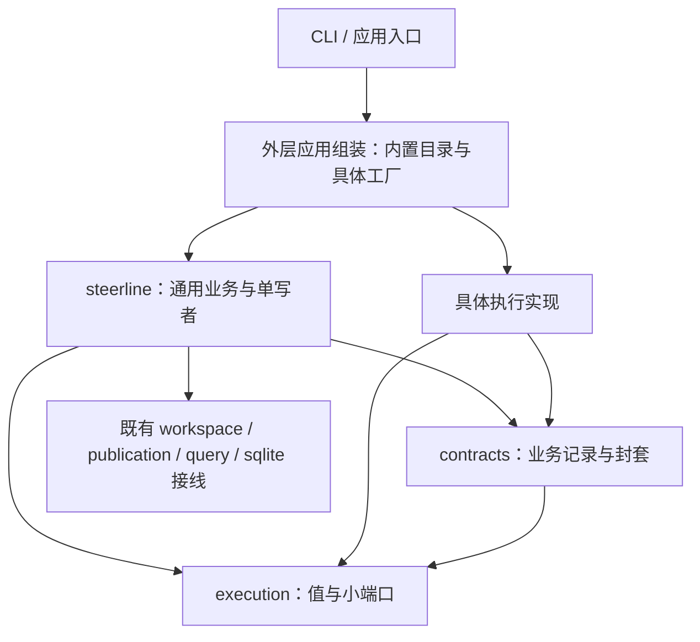
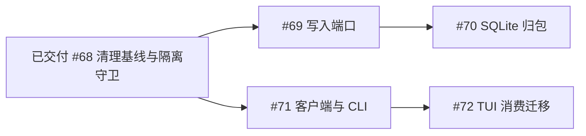

# 主包与执行实现解耦规划

目标标识：`CORE-IMPLEMENTATION-DECOUPLING`。

使主包只处理通用任务/执行契约和业务事务，具体执行方式由实现包和外层应用组装负责。最终 `internal/steerline/` 直属生产与测试 Go 文件的文件名、标识符、字面量、注释和 import 均不包含 Codex/Orca 关键字；主包直接及传递依赖不包含对应实现包。新执行实现不要求修改中心状态机、配置分支或恢复逻辑。

复用已交付的执行契约、主包隔离和重构后清理基线，继续推进存储、客户端两条线。#69–#72 遵守 [后续维护共同约束](../spec/core-maintenance-constraints.md)，保持 [执行隔离共同约束](../spec/core-decoupling-constraints.md)；每项独立 Spec/Plan，本规划不是实现入口。

## 范围与关键缺口

通用事件/问题、配置/原生绑定封套、来源/mapper/宿主端口及外层唯一构造已经接通；主包生产/测试隔离、依赖守卫、测试归位及重构后清理基线已交付。后续写消费者仍依赖具体 Store/宽事务接口，TUI 仍混合产品读取与默认 I/O，需要按 #69–#72 继续解耦。

需要同时解决类型、调用、存储载荷、工厂和测试归属。仅改文件名、把整个 Service 接口传入子包、在 contracts 中保存另一份原生业务状态，均不能完成目标。中心继续拥有唯一业务写者、intent/receipt 提交屏障、人工恢复门槛和 TaskDelivery；平台实现不获得这些写权限。

Store/SQLite 写层由 #69/#70 收窄写端口并迁移唯一存储实现，#71/#72 建立产品客户端适配并切换 CLI/TUI。整个目标不引入插件系统、不扩展平台支持或 remote 权限证据。remote 仍按现有能力明确拒绝不支持的请求，其协议回归与真实准入验收分别表达。

## 后继复用的基础

#69/#71 复用 [#68 清理基线](../validation/core-decoupling-07-cleanup/README.md)的唯一调用链、模块和断言映射。当前模块职责与源码位置见 [架构索引](../architecture/current-code-architecture.md)；[#67 隔离守卫](../validation/core-decoupling-06-boundary/README.md)持续保护直属源码、全构建条件依赖及第三实现接线。后继不重新实施这些基础能力，也不据此扩大原生支持或解除 remote 权限拒绝。

## 目标所有者

| 所有者 | 保留职责 | 本系列迁入内容 |
| --- | --- | --- |
| `execution` | 通用纯值与小端口 | 统一事实、问题、资源/操作交接及来源读取边界 |
| `contracts` | 业务持久与展示 DTO | 版本化、有身份和摘要的实现数据封套；不定义原生配置或解释载荷 |
| `steerline` | Task/WorkflowRun/Execution/Decision/Operation/TaskDelivery 事务与通用协调 | 使用显式注入目录和通用事实；不持有具体客户端、mapper 或 native DTO |
| 现有实现包 | 原生协议、参数、资源、观察与对账 | 配置/绑定/问题 codec、平台步进、会话来源及宿主事实解析 |
| 外层应用组装 | CLI/服务/查询入口接线 | 内置目录、具体工厂、实现默认值及生命周期资源构造 |
| 外层集成测试 | 真实应用端口与实现接线验收 | 含平台名称、原生 fixture 和具体配置的跨层用例 |

新增位置是 `internal/steerlineapp/` 和 `internal/steerlineintegration/`，均与主包目录并列。复用现有执行实现包，不再建立一个把全部平台揉在一起的大包。

箭头表示源码依赖。运行时通过已注入端口调用具体实现，不能形成实现包反向导入主包的依赖环。

## 剩余独立任务

| 任务 ID | 任务名称 | 交付范围 | 硬前置 | 执行规格 |
| --- | --- | --- | --- | --- |
| 69 | 中心写入端口收窄 | 命令、worker、任务/DAG/交付及会话的窄提交接口接通真实消费者 | #68 | [Spec](../spec/core-decoupling-08-write-ports.spec.md) · [Plan](../spec/core-decoupling-08-write-ports.plan.md) |
| 70 | SQLite写入实现归包 | 连接/schema/SQL/事务执行归唯一存储模块，复用既有只读 Reader | #69 | [Spec](../spec/core-decoupling-09-sqlite.spec.md) · [Plan](../spec/core-decoupling-09-sqlite.plan.md) |
| 71 | 产品客户端适配层与CLI接入 | 公共产品 DTO/小接口、唯一默认适配与现有 CLI 产品入口 | #68 | [Spec](../spec/core-decoupling-10-client.spec.md) · [Plan](../spec/core-decoupling-10-client.plan.md) |
| 72 | TUI与中心实现解耦 | TUI 消费注入产品接口，删除中心/存储依赖和默认 I/O 薄桥 | #71 | [Spec](../spec/core-decoupling-11-tui.spec.md) · [Plan](../spec/core-decoupling-11-tui.plan.md) |

## 顺序与交接

剩余存储线为 #69 → #70，客户端线为 #71 → #72；#69/#71 的 #68 硬前置能力已具备。每项一个实现 PR，两线可按下述修改归属并行，执行安排以用户选定范围为准。

| 交接 | 下游获得的实际能力 | 共享修改与开工门槛 |
| --- | --- | --- |
| #68 → #69/#71 | 已交付清理基线的唯一调用链、模块和测试归属 | 写端口/中心提交归 #69，公共客户端 DTO/CLI/adapter 归 #71；共享组装段顺序集成 |
| #69 → #70 | 已被全部实际消费者使用的窄提交契约 | SQL/schema/连接归 #70，保持原子写集合与只读快照，客户端契约不变 |
| #71 → #72 | CLI 已消费的纯产品契约与唯一 adapter | TUI 迁视图消费者并删除暂存薄桥，不另建查询/控制或资格实现 |

可以提前只读盘点、准备 fixture 或审阅契约；完整实现等待各自未完成的硬前置整体交付。迁移自己的完整消费者并当场删除原实现与无用转发，保留必要断言映射；不以文件不重叠推定共享类型、组装或事务改动可并行。规划维护不启动实施。

## 两条后续线与并行边界

后继删除或迁移前继续核对所有 OS/构建标签、产品入口、脚本/嵌入资源与测试消费者；保留当前格式恢复、未知结果、旧格式拒绝样本和原生验收证据，不通过改名、删断言或兼容回退绕过边界。

存储线拥有提交纯契约、中心业务消费者、Store/schema/SQL 及存储构造段；客户端线拥有产品纯 DTO、adapter、CLI/TUI 及客户端构造段。客户端只消费应用查询/命令，不能依赖写端口或具体 Store；存储不得改变公共产品语义。contracts 原共享字段形状不并行修改，必要改变由类型所有者集中交付；组装与 quick/守卫入口顺序集成。两线分别按硬前置开工，不存在 #70 必须先于 #71/#72 的隐藏依赖。

#71 必须接通 CLI 真实消费者，TUI 可暂存只做映射的薄接线，由 #72 删除；#69 必须接通全部写消费者，#70 不补漏。每次迁移删除原实现，存储保持命令/worker/任务交付及会话各自原子事务，UI 不获得业务写入权。HTTP/SSE、规划领域和新 UI 仍按原独立规格执行，#45 的硬前置不因本目标改变。

## 后继完成验收

1. #67 的直属生产/测试源码、文件名、全构建条件依赖和反向依赖守卫保持有效，复用既有代表断言，不重建完整故障矩阵。
2. 中心全部生产写消费者使用窄端口，不依赖具体 Store/SQL 类型或共享全能事务接口；SQL、schema、连接及事务执行只保留一个存储实现，复用既有只读 Reader。
3. worker 绑定/附件/checkpoint、命令幂等、任务/DAG/真实唯一交付和会话正文/source cursor 各自原子边界不变。未知结果只读对账、原身份、准备/业务分流与恢复人工门槛继续成立。
4. CLI/TUI 消费同一纯产品契约和唯一 adapter；console 无中心、存储、默认实现或应用组装依赖，迁移完整消费者并删除暂存薄桥。
5. 不增加旧版读取、迁移、双写、自动替换或回退，不扩展平台/remote 权限支持。格式变化明确拒绝旧格式并保留现场。

最小验收按各任务独立 Spec/Plan 执行，核对实际包/用例命中，稳定后跑一次既有 quick。仅修改真实启动/权限时追加对应最小原生证据；规划维护只核对身份、依赖、引用与剩余范围，不执行代码测试、中心建任务或数据库操作。
