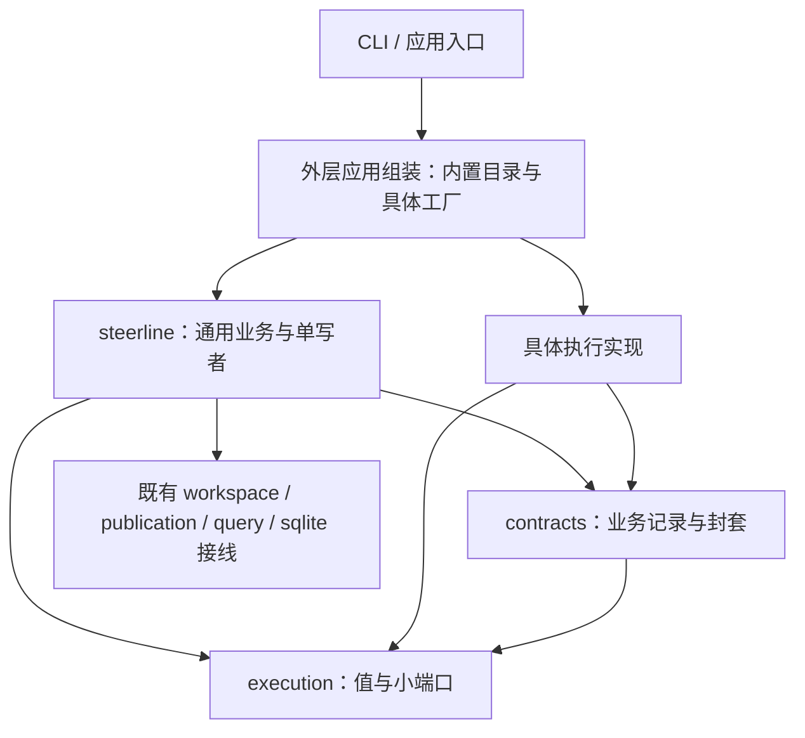
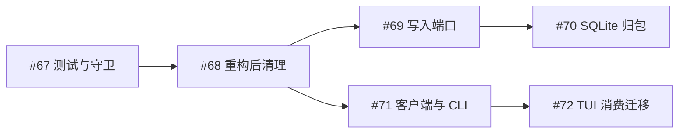

# 主包与执行实现解耦规划

目标标识：`CORE-IMPLEMENTATION-DECOUPLING`。

使主包只处理通用任务/执行契约和业务事务，具体执行方式由实现包和外层应用组装负责。最终 `internal/steerline/` 直属生产与测试 Go 文件的文件名、标识符、字面量、注释和 import 均不包含 Codex/Orca 关键字；主包直接及传递依赖不包含对应实现包。新执行实现不要求修改中心状态机、配置分支或恢复逻辑。

承接[执行隔离验收记录](../validation/execution-isolation-cleanup/README.md)对应的纯值、策略、需求、快照与适配器包，继续推进剩余的平台协调、原生数据和具体组装，随后清理重构残留并推进存储、客户端两条线。#65–#67 执行要求固定在[解耦共同约束](../spec/core-decoupling-constraints.md)，#68–#72 见[后续维护共同约束](../spec/core-maintenance-constraints.md)；每项独立 Spec/Plan，本规划不是实现入口。

## 范围与关键缺口

通用事件/问题、配置/原生绑定封套、来源/mapper/宿主端口及外层唯一构造已经接通；主包生产源码与依赖清零。剩余平台测试/fixture 和最终结构守卫归 #67。后续写消费者仍依赖具体 Store/宽事务接口，TUI 仍混合产品读取与默认 I/O，需要在执行隔离收口后继续解耦。

需要同时解决类型、调用、存储载荷、工厂和测试归属。仅改文件名、把整个 Service 接口传入子包、在 contracts 中保存另一份原生业务状态，均不能完成目标。中心继续拥有唯一业务写者、intent/receipt 提交屏障、人工恢复门槛和 TaskDelivery；平台实现不获得这些写权限。

#65–#67 不搬迁 Store/SQLite 写层；#68 清理完成后，由 #69/#70 单独收窄写端口并迁移存储实现，#71/#72 建立产品客户端适配并切换 CLI/TUI。整个目标不引入插件系统、不扩展平台支持或 remote 权限证据。remote 仍按现有能力明确拒绝不支持的请求，其协议回归与真实准入验收分别表达。

## 现有文件的迁移归属

以下路径相对于 `internal/steerline/`，只列剩余消费者；生命周期删除/断言归属见[验收记录](../validation/core-decoupling-03-lifecycle/README.md)。

| 剩余消费者 | 迁移任务 | 中心保留 |
| --- | --- | --- |
| `codex_conversation.go`、`codex_history_port.go`、`conversation_*` | #65 来源/读取/mapper/采集构造 | 预算、正文/来源事务与 checkpoint |
| `worker_environment_orca.go`、`implementation_bindings.go`、`worker_environment.go` 及准备输出采集 | #65 宿主证据/工具、准备文件、open-terminal 与原生视图 | 授权、nonce/deadline、人工门槛与消费 |
| `orca_worker_prepare.go` 剩余命令编译、`orca.go`、`orca_remote_adapter.go`、Config/Profile/registry 与产品入口 | #66 唯一默认工厂与应用组合；#65 接走宿主调用 | 通用端口/快照/事务 |
| 剩余平台 fixture/测试 | #67 随真实入口归位与守卫 | 一份中性业务矩阵 |

最终扫描全部直属文件及依赖，不能仅按删除清单判断完成。

## 目标所有者

| 所有者 | 保留职责 | 本系列迁入内容 |
| --- | --- | --- |
| `execution` | 通用纯值与小端口 | 统一事实、问题、资源/操作交接及来源读取边界 |
| `contracts` | 业务持久与展示 DTO | 版本化、有身份和摘要的实现数据封套；不定义原生配置或解释载荷 |
| `steerline` | Task/WorkflowRun/Execution/Decision/Operation/TaskDelivery 事务与通用协调 | 使用显式注入目录和通用事实；不持有具体客户端、mapper 或 native DTO |
| 现有实现包 | 原生协议、参数、资源、观察与对账 | 配置/绑定/问题 codec、平台步进、会话来源及宿主事实解析 |
| 外层应用组装 | CLI/服务/查询入口接线 | 内置目录、具体工厂、实现默认值及生命周期资源构造 |
| 外层集成测试 | 真实应用端口与实现接线验收 | 含平台名称、原生 fixture 和具体配置的跨层用例 |

新增位置是 `internal/steerlineapp/` 和 `internal/steerlineintegration/`，均与主包目录并列。复用现有执行实现包，不再建立一个把全部平台揉在一起的大包。

箭头表示源码依赖。运行时通过已注入端口调用具体实现，不能形成实现包反向导入主包的依赖环。

## 剩余独立任务

| 任务 ID | 任务名称 | 交付范围 | 硬前置 | 执行规格 |
| --- | --- | --- | --- | --- |
| 67 | 主包隔离守卫与测试归位 | 主包源码/测试清零、依赖守卫、第三实现接线和最小完整回归 | #66 | [Spec](../spec/core-decoupling-06-boundary.spec.md) · [Plan](../spec/core-decoupling-06-boundary.plan.md) |
| 68 | 主包解耦重构后代码清理 | 按最终调用关系删除死代码/重复规则/无用辅助，同步模块及验证索引 | #67 | [Spec](../spec/core-decoupling-07-cleanup.spec.md) · [Plan](../spec/core-decoupling-07-cleanup.plan.md) |
| 69 | 中心写入端口收窄 | 命令、worker、任务/DAG/交付及会话的窄提交接口接通真实消费者 | #68 | [Spec](../spec/core-decoupling-08-write-ports.spec.md) · [Plan](../spec/core-decoupling-08-write-ports.plan.md) |
| 70 | SQLite写入实现归包 | 连接/schema/SQL/事务执行归唯一存储模块，复用既有只读 Reader | #69 | [Spec](../spec/core-decoupling-09-sqlite.spec.md) · [Plan](../spec/core-decoupling-09-sqlite.plan.md) |
| 71 | 产品客户端适配层与CLI接入 | 公共产品 DTO/小接口、唯一默认适配与现有 CLI 产品入口 | #68 | [Spec](../spec/core-decoupling-10-client.spec.md) · [Plan](../spec/core-decoupling-10-client.plan.md) |
| 72 | TUI与中心实现解耦 | TUI 消费注入产品接口，删除中心/存储依赖和默认 I/O 薄桥 | #71 | [Spec](../spec/core-decoupling-11-tui.spec.md) · [Plan](../spec/core-decoupling-11-tui.plan.md) |

## 顺序与交接

2026-10-02：#65 已合并；#66 外层组装与主包生产隔离已实现并独立复审修复，完全访问组合 core 6/rules 90/targeted 22 全通过，见[交付与复审记录](../validation/core-decoupling-05-composition/README.md)。本 PR 真实合并后才启动 #67；活动表保留剩余任务。

#65 → #66 → #67 → #68 串行交付；#68 后分为存储 #69 → #70 和客户端 #71 → #72，两线可按下述修改归属并行，每项一个实现 PR。#65 消费[生命周期端口](../validation/core-decoupling-03-lifecycle/README.md)；#63 复用[通用事件与问题 #62](../spec/core-decoupling-01-events.spec.md)及[验收记录](../validation/core-decoupling-01-events/README.md)，不意味着整个主包隔离已完成。

| 交接 | 下游获得的实际能力 | 共享修改与开工门槛 |
| --- | --- | --- |
| #62 → #63 | 已接通的通用事件与问题路由/回执封套 | WorkerEvent、Decision 和 contracts 的共有形状整体交付后再扩配置/绑定 |
| #64 → #65 | 单步副作用、只读对账、统一收据与 actor 交接 | 准备/业务轮、消息消费和恢复门槛继续唯一归中心；采集不推进业务 |
| #65 → #66 | 与具体客户端/mapper 无关的中心服务与采集端口 | Service 字段、来源 checkpoint 与宿主动作固定后再外移最终构造 |
| #66 → #67 | 所有入口均可显式注入，无根包默认平台注册 | 完整产品构建/入口接线通过后再锁定零关键字、依赖和扩展性守卫 |
| #67 → #68 | 完整生产/测试隔离、实际构造与守卫 | 只清理最终可删残留，#65–#67 必须完成的迁移/删除不能延期 |
| #68 → #69/#71 | 清理后的唯一调用链、模块和测试归属 | 写端口/中心提交归 #69；公共客户端 DTO/CLI/adapter 归 #71，共享组装段顺序集成 |
| #69 → #70 | 已被全部实际消费者使用的窄提交契约 | SQL/schema/连接归 #70，保持原子写集合与只读快照，客户端契约不变 |
| #71 → #72 | CLI 已消费的纯产品契约与唯一 adapter | TUI 只迁视图消费者并删除暂存薄桥，不另建查询/控制或资格实现 |

可以提前只读盘点、准备 fixture 或审阅契约；完整实现等待硬前置交付。#65–#68 共享配置、契约、Service 和恢复路径，不按文件不重叠推定可并行。#69/#70 与 #71/#72 的并行按独立接口及下节修改归属落实。

每个阶段迁走自己的完整消费者并当场删除原实现与无用转发；#63 只允许尚未进入生命周期/采集阶段的方法通过唯一 codec 消费临时解码视图，不保留旧持久字段，由 #64/#65 删除。#67 只负责最终边界证明和剩余测试归位，不承担前五项遗留的生产搬迁。平台专属测试随职责迁移，中心通用规则改用中性 fake，完整原生集成断言通过外层应用入口保留。

## 两条后续线与并行边界

#68 核对所有 OS/构建标签、实际产品入口、脚本/嵌入资源与测试消费者后删除；当前格式恢复、未知结果、旧格式拒绝样本和原生验收证据保留。清理不通过改名、删断言或补一条兼容路径完成。

存储线拥有提交纯契约、中心业务消费者、Store/schema/SQL 及存储构造段；客户端线拥有产品纯 DTO、adapter、CLI/TUI 及客户端构造段。客户端只消费应用查询/命令，不能依赖写端口或具体 Store；存储不得改变公共产品语义。contracts 原共享字段形状不并行修改，必要改变由类型所有者集中交付；组装与 quick/守卫入口顺序集成。两线分别按硬前置开工，不存在 #70 必须先于 #71/#72 的隐藏依赖。

#71 必须接通 CLI 真实消费者，TUI 可暂存只做映射的薄接线，由 #72 删除；#69 必须接通全部写消费者，#70 不补漏。每次迁移删除原实现，存储保持命令/worker/任务交付及会话各自原子事务，UI 不获得业务写入权。HTTP/SSE、规划领域和新 UI 仍按原独立规格执行，#45 的硬前置不因本目标改变。

## 完成验收

1. 直属生产及测试 Go 文件名和源码的大小写不敏感 `codex|orca` 命中均为零，没有忽略名单。动态值可以传递，源码不硬编码实现 key 或原生协议名。
2. 主包及其通用契约的直接/传递依赖不包含具体执行实现、应用组装或集成测试包；实现包不依赖主包。守卫位于主包之外。
3. 主包没有原生 envelope/method/问题/terminal/Dispatch 解释，没有原生配置字段分支，也没有具体客户端或 mapper；逐项审阅全体注册回调、快照、事件和恢复消费者。
4. 一个在外层定义的中性第三实现通过同一配置受理、事件/问题、反馈及恢复端口；无需改主包生产文件。fake 不替代权限认证，强制准入仍生效。
5. 原 intent/receipt/消息 ack 提交屏障、原身份、深复制、恢复人工门槛、准备/业务分流、当前格式恢复/幂等及真实唯一 TaskDelivery 均保持。复用既有代表用例，不重建完整矩阵。
6. 新格式有明确版本拒绝；没有旧版读取、迁移、双写、隐藏 worker、自动替换或回退实现。无双实现、空包和仅为测试导出的任意中心写接口。

最小验收按各任务 Plan 执行，稳定后跑既有 quick；修改真实启动/权限时才追加对应原生证据。规划阶段只核对任务身份、依赖、引用与范围，不执行代码测试、中心建任务或数据库操作。

#68–#72 另需证明删除依据与消费者映射完整、中心写消费者不依赖具体 Store/宽事务、SQL 只有一个实现、CLI/TUI 共用客户端接口且 console 无中心/存储/默认实现依赖；#67 隔离守卫全程保持，存储原子性与当前格式恢复语义不变。各项最小通过条件以其独立 Spec/Plan 为准。
