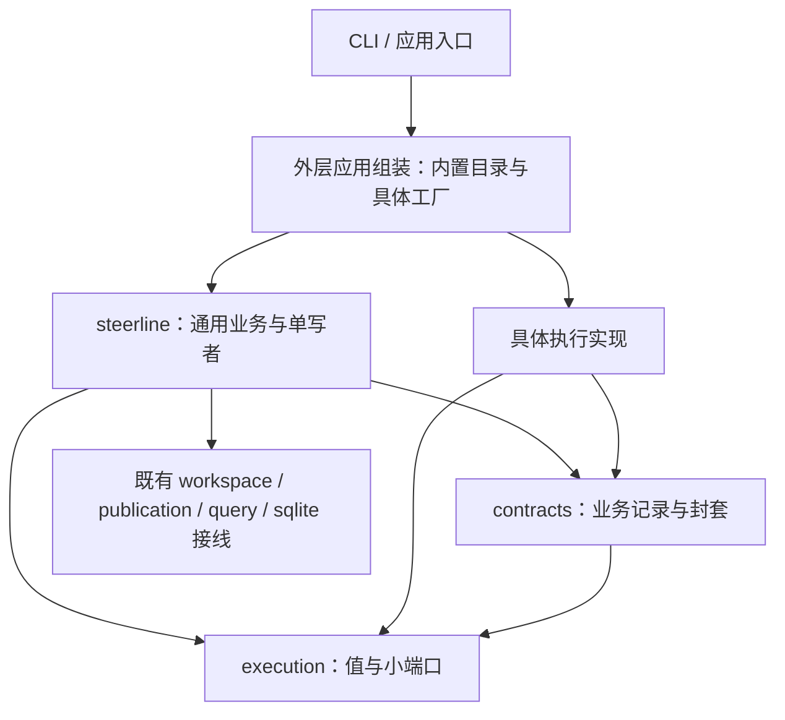

# 主包与执行实现解耦规划

目标标识：`CORE-IMPLEMENTATION-DECOUPLING`。

使主包只处理通用任务/执行契约和业务事务，具体执行方式由实现包和外层应用组装负责。最终 `internal/steerline/` 直属生产与测试 Go 文件的文件名、标识符、字面量、注释和 import 均不包含 Codex/Orca 关键字；主包直接及传递依赖不包含对应实现包。新执行实现不要求修改中心状态机、配置分支或恢复逻辑。

承接[执行隔离验收记录](../validation/execution-isolation-cleanup/README.md)对应的纯值、策略、需求、快照与适配器包，继续推进剩余的平台协调、原生数据和具体组装。完整执行要求固定在[共同约束](../spec/core-decoupling-constraints.md)及以下六份独立 Spec/Plan，本规划不是实现入口。

## 范围与关键缺口

目前平台知识不仅存在于平台命名文件，还贯穿普通文件：`WorkerEvent` 携带原生 envelope，注册回调接受可写 Service/Run，Config/Profile 和持久绑定暴露原生字段，业务协调按平台组织，Service 持有具体会话 mapper/观察器。

需要同时解决类型、调用、存储载荷、工厂和测试归属。仅改文件名、把整个 Service 接口传入子包、在 contracts 中保存另一份原生业务状态，均不能完成目标。中心继续拥有唯一业务写者、intent/receipt 提交屏障、人工恢复门槛和 TaskDelivery；平台实现不获得这些写权限。

本范围不重写 Store/SQLite 写层、不引入插件系统、不扩展平台支持或 remote 权限证据。remote 仍按现有能力明确拒绝不支持的请求，其协议回归与真实准入验收分别表达。

## 现有文件的迁移归属

以下路径相对于 `internal/steerline/` 直属目录，覆盖现有 20 个平台命名生产文件。一个文件混有多种职责时按方法及消费者拆分，完成该职责时删除对应原实现；不能将整个文件搬入实现包并把业务写者一起带走。

| 文件组 | 迁移任务 | 中心保留的内容 |
| --- | --- | --- |
| `codex_worker_evidence.go`、`orca_worker_evidence.go` | #62 原生解码与通用事实；剩余结算 I/O 在 #64 | 通用事件的业务接受与持久化 |
| `codex_git_sandbox.go` | #63 固定资源/权限编译输入归对应实现 | 项目策略及资源回执摘要/归属核验 |
| `codex_worker.go`、`codex_worker_recovery.go`、`codex_worker_reply.go`、`codex_feedback_hooks.go` | #64 分步启动/恢复/回复及结果解释 | 通用业务资格、恢复人工门槛、原子写集合 |
| `orca_worker_prepare.go`、`orca_worker_dispatch.go`、`orca_worker_observation.go`、`orca_worker_terminal.go`、`orca_worker_workspace.go`、`orca_worker_relay.go`、`orca_remote_service.go`、`orca_execution_operations.go` | #64 操作/观察/对账归实现、协调通用化；宿主/工具解释交 #65 | 准备/业务用途、已持久操作推进、Decision、消费与 TaskDelivery |
| `orca_feedback_hooks.go` | #64 回复/结果协调通用化；#65 宿主动作与准备接线 | 可信动作和文字反馈资格 |
| `codex_conversation.go`、`codex_history_port.go` | #65 来源发现、读取、mapper 和原生采集构造 | 通用采集预算、正文/来源事务与 checkpoint |
| `orca.go`、`orca_remote_adapter.go` | #63 具体配置转换；#64 I/O 调用；#66 仅有消费者的剩余构造外移 | 无平台转发或别名入口 |

普通文件也必须一起调整：Config/Profile/snapshot/registry 在 #63/#66 处理；worker_* 业务与 Service 观察接线在 #62/#64 处理；conversation_*、worker_environment 和具体 mapper 字段在 #65 处理；Claim/查询/CLI/控制台构造在 #66 处理。最终扫描全部直属文件，不能仅以这 20 个文件删除完毕判定完成。

## 目标所有者

| 所有者 | 保留职责 | 本系列迁入内容 |
| --- | --- | --- |
| `execution` | 通用纯值与小端口 | 统一事实、问题、资源/操作交接及来源读取边界 |
| `contracts` | 业务持久与展示 DTO | 版本化、有身份和摘要的实现数据封套；不定义原生配置或解释载荷 |
| `steerline` | Task/WorkflowRun/Execution/Decision/Operation/TaskDelivery 事务与通用协调 | 使用显式注入目录和通用事实；不持有具体客户端、mapper 或 native DTO |
| 现有实现包 | 原生协议、参数、资源、观察与对账 | 配置/绑定/问题 codec、平台步进、会话来源及宿主事实解析 |
| 外层应用组装 | CLI/服务/查询入口接线 | 内置目录、具体工厂、实现默认值及生命周期资源构造 |
| 外层集成测试 | 真实应用端口与实现接线验收 | 含平台名称、原生 fixture 和具体配置的跨层用例 |

新增位置是 `internal/steerlineapp/` 和 `internal/steerlineintegration/`，均与主包目录并列。复用现有执行实现包，不再建立一个把全部平台揉在一起的大包。

箭头表示源码依赖。运行时通过已注入端口调用具体实现，不能形成实现包反向导入主包的依赖环。

## 剩余独立任务

| 任务 ID | 任务名称 | 交付范围 | 硬前置 | 执行规格 |
| --- | --- | --- | --- | --- |
| 64 | 通用执行生命周期与副作用接线 | 中心以统一分步 intent/receipt 推进准备、启动、观察、反馈、恢复、清理 | #63 | [Spec](../spec/core-decoupling-03-lifecycle.spec.md) · [Plan](../spec/core-decoupling-03-lifecycle.plan.md) |
| 65 | 会话采集与宿主交互实现隔离 | 具体 history/mapper/来源发现及宿主解释归实现，预算/授权/持久化留中心 | #64 | [Spec](../spec/core-decoupling-04-conversation.spec.md) · [Plan](../spec/core-decoupling-04-conversation.plan.md) |
| 66 | 内置实现组装与主包依赖反转 | 目录/工厂/默认值移到外层，所有产品入口显式注入同一能力 | #65 | [Spec](../spec/core-decoupling-05-composition.spec.md) · [Plan](../spec/core-decoupling-05-composition.plan.md) |
| 67 | 主包隔离守卫与测试归位 | 主包源码/测试清零、依赖守卫、第三实现接线和最小完整回归 | #66 | [Spec](../spec/core-decoupling-06-boundary.spec.md) · [Plan](../spec/core-decoupling-06-boundary.plan.md) |

## 顺序与交接

剩余 #64 → #65 → #66 → #67 串行交付，每项一个实现 PR。#64 消费 #63 已交付的配置与原生绑定封套；#63 复用[通用事件与问题 #62](../spec/core-decoupling-01-events.spec.md)及[验收记录](../validation/core-decoupling-01-events/README.md)，不意味着整个主包隔离已完成。

| 交接 | 下游获得的实际能力 | 共享修改与开工门槛 |
| --- | --- | --- |
| #62 → #63 | 已接通的通用事件与问题路由/回执封套 | WorkerEvent、Decision 和 contracts 的共有形状整体交付后再扩配置/绑定 |
| #63 → #64 | 固定实现 key/版本、codec、快照和原资源事实 | Config/Profile/ExecutionRecord/摘要串行；配置和持久消费者已迁移，唯一 codec 的生命周期临时视图在 #64 删除 |
| #64 → #65 | 单步副作用、只读对账、统一收据与 actor 交接 | 准备/业务轮、消息消费和恢复门槛继续唯一归中心；采集不推进业务 |
| #65 → #66 | 与具体客户端/mapper 无关的中心服务与采集端口 | Service 字段、来源 checkpoint 与宿主动作固定后再外移最终构造 |
| #66 → #67 | 所有入口均可显式注入，无根包默认平台注册 | 完整产品构建/入口接线通过后再锁定零关键字、依赖和扩展性守卫 |

可以提前只读盘点、准备 fixture 或审阅契约；完整实现等待硬前置交付。阶段间共享配置、契约、Service 和恢复路径，不按文件不重叠推定可并行。

每个阶段迁走自己的完整消费者并当场删除原实现与无用转发；#63 只允许尚未进入生命周期/采集阶段的方法通过唯一 codec 消费临时解码视图，不保留旧持久字段，由 #64/#65 删除。#67 只负责最终边界证明和剩余测试归位，不承担前五项遗留的生产搬迁。平台专属测试随职责迁移，中心通用规则改用中性 fake，完整原生集成断言通过外层应用入口保留。

## 完成验收

1. 直属生产及测试 Go 文件名和源码的大小写不敏感 `codex|orca` 命中均为零，没有忽略名单。动态值可以传递，源码不硬编码实现 key 或原生协议名。
2. 主包及其通用契约的直接/传递依赖不包含具体执行实现、应用组装或集成测试包；实现包不依赖主包。守卫位于主包之外。
3. 主包没有原生 envelope/method/问题/terminal/Dispatch 解释，没有原生配置字段分支，也没有具体客户端或 mapper；逐项审阅全体注册回调、快照、事件和恢复消费者。
4. 一个在外层定义的中性第三实现通过同一配置受理、事件/问题、反馈及恢复端口；无需改主包生产文件。fake 不替代权限认证，强制准入仍生效。
5. 原 intent/receipt/消息 ack 提交屏障、原身份、深复制、恢复人工门槛、准备/业务分流、当前格式恢复/幂等及真实唯一 TaskDelivery 均保持。复用既有代表用例，不重建完整矩阵。
6. 新格式有明确版本拒绝；没有旧版读取、迁移、双写、隐藏 worker、自动替换或回退实现。无双实现、空包和仅为测试导出的任意中心写接口。

最小验收按各任务 Plan 执行，稳定后跑既有 quick；修改真实启动/权限时才追加对应原生证据。规划阶段只核对任务身份、依赖、引用与范围，不执行代码测试、中心建任务或数据库操作。
