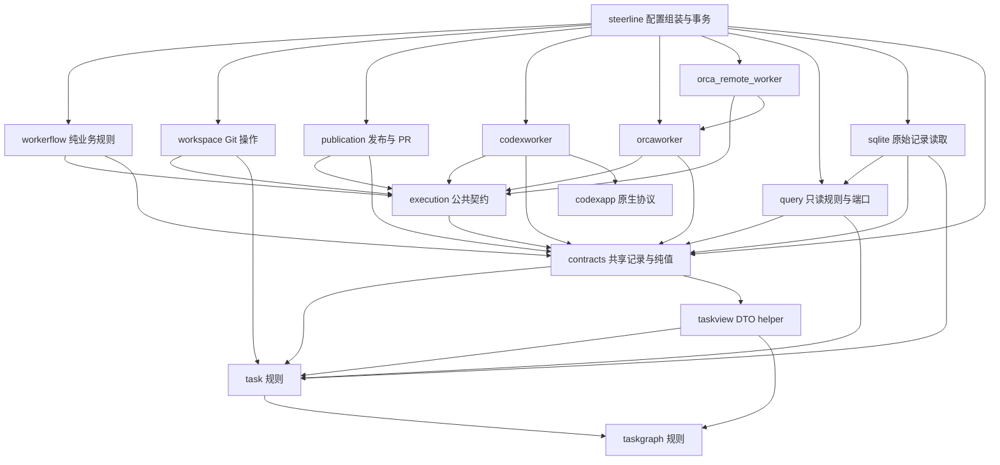
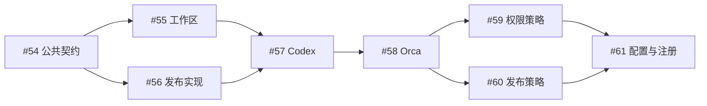

# 项目执行抽象与配置隔离规划

目标标识：`EXECUTION-ISOLATION`。

SteerLine 将项目执行规则与 Codex、Orca 等具体实现分开。项目定义权限边界、工作区要求、发布责任和必要能力；执行方案选择目标、agent、model 与实现选项；适配器落实固定请求并返回事实。更换执行方案时，项目规则不会随之隐式变化。

剩余规划为 #55–#61 七项任务：前四项迁移职责，后三项落实项目策略和配置隔离。已交付 #54 的公共执行契约作为 #55/#56 必要前置复用，见[验收记录](../validation/execution-isolation-01-contracts/README.md)，01 文档不回写。每项剩余任务各有独立 Spec/Plan 和实现 PR，执行要求见[共同约束](../spec/execution-isolation-constraints.md)。

## 抽象范围

| 抽象 | 项目或中心定义 | 执行实现负责 |
| --- | --- | --- |
| 执行权限 | 文件访问、网络及超出边界的授权规则 | 参数映射、能力拒绝、落实证据；Windows sandbox 等实现选项归具体后端 |
| 工作区 | 逻辑仓库身份、base、执行分支、隔离及保留规则 | 创建和核验 worktree、解析实际资源、执行明确清理请求 |
| 会话 | Execution、逻辑 Session、Turn、反馈和恢复语义 | 操作 thread、terminal、Dispatch 等原生资源，核对原身份 |
| 交互事件 | 输入接受、轮次开始、问题、结束、宿主阻断、观察缺口 | 解释原生协议并保留来源、原始证据和消费位置 |
| 发布交付 | worker 或宿主发布责任、PR 关联、真实合并结项 | Git 发布操作、请求传输、PR provider 查询 |
| 执行需求 | 项目必需能力、工具和认证引用 | 检查目标是否满足要求，说明不可用原因 |

可配置的项目策略与固定共同契约分开。输入接受、轮次开始、轮次结束和任务完成不能互相替代；观察断线、进程退出和结果未知也分别表达。恢复保留已有人工继续门槛，明确区分原会话重接和用户选择的新会话。

第一期权限模型保持最小范围，不增加通用 RBAC、命令或域名白名单。环境需求只检查必要条件，不建设自动安装器，不把认证秘密复制进任务契约、执行快照或提示词。共同事件只表达执行流程所需事实，详细正文与活动展示继续使用现有会话模型。

## 分包与文件归属

以下是目标文件规划，实际创建随对应职责迁移进行，不先提交空包或占位文件。文件均相对于 `internal/steerline/`。

| 包 | 目标文件 | 职责 |
| --- | --- | --- |
| `contracts` | 复用 `records.go`、`runtime.go`、`execution.go`、`environment.go`、`query.go` 并扩必要冻结字段 | 业务持久/展示 DTO 引用 execution 底层值，不实现平台行为 |
| `query` | 复用 `ports.go`、`project.go`、`tasks.go`、`events.go` | 按消费者分开的只读能力与规则，不绑定 SQLite 或业务写库 |
| `sqlite` | 复用现有 Reader、记录/任务/DAG/checkpoint/project 读取文件 | 同事务原始数据采样与有界 SQL，中心保留投影组合和写事务 |
| `execution` | 已交付公共接口/身份/问题/事实/错误文件；新增 `policy.go`、`publication.go`、`requirements.go` 及必要纯校验 | 底层纯值/小接口不依赖项目包；contracts 引用它们，01 不重迁 |
| `workspace` | `git.go`、`prepare.go`、`inspect.go`、`resources.go`、`cleanup.go` | Git 与本机工作区操作，资源路径解析 |
| `publication` | `request.go`、`publish.go`、`pr.go`、`provider.go`、`gitea.go`、`command.go`、`policy.go` | 发布请求、Git 发布、PR 外部事实及项目发布责任 |
| `codexworker` | 增加 `backend.go`、`config.go`、`permissions.go`、`command.go`，复用已有文件 | Codex 执行操作、权限编译、命令构造和原生身份核验 |
| `codexapp` | 复用已有客户端、传输、参数及原生问题文件 | Codex app-server 协议，不决定项目策略 |
| `orcaworker` | 增加 `backend.go`、`config.go`、`events.go`，复用已有协议文件 | Orca 资源、终端、派发、消息、观察和对账 |
| `orca_remote_worker` | 复用已有 preflight/start/messaging/observation/run 与配置 | 远程原生会话、两端身份、消息/回执/结算，不重新并入本机 shell 路径 |
| `workerflow` | 保留 `state.go`、`recovery.go`，调整 `prompt.go` | 纯业务规则和固定任务指令；后端选择移出 `mode.go` |
| 主包 `steerline` | `project_config.go`、`execution_profiles.go`、`execution_registry.go`、`execution_snapshot.go`、`execution_service.go` | 项目配置、全局方案、实现组装、快照组合与执行事务接线 |
| 主包 `steerline` | 保留 `worker_start.go`、`worker_events.go`、`worker_completion.go`、`worker_feedback.go`、`worker_pr.go`、`worker_state.go` 等现有接线 | 业务推进、待决策和 TaskDelivery 事务，沿用已完成的 worker 文件重组 |

业务持久/查询 DTO 归 contracts，底层执行类型由已交付 execution 唯一拥有。query 定义只读端口，sqlite 读原始记录，中心组合投影并拥有连接/schema/业务写入；不复制记录或让底层反向依赖它们。

主要依赖固定为 contracts → execution，execution 不导入项目包；query/平台使用必要底层值与业务 DTO，SQL 只采样原始记录，中心组合投影/事务。现有 facade 别名指向单一定义可保留，01 已删除的公共别名不恢复。远程协议保持独立，不能用中心工作区或命令代替远端现场。

## 任务与独立交付

| 任务 | 交付范围 | 硬前置 | 执行规格 |
| --- | --- | --- | --- |
| #55 | 工作区与 Git 资源迁移 | #54 | [Spec](../spec/execution-isolation-02-workspace.spec.md) · [Plan](../spec/execution-isolation-02-workspace.plan.md) |
| #56 | 发布与 PR 实现迁移 | #54 | [Spec](../spec/execution-isolation-03-publication.spec.md) · [Plan](../spec/execution-isolation-03-publication.plan.md) |
| #57 | Codex 执行适配器迁移 | #55、#56 | [Spec](../spec/execution-isolation-04-codex.spec.md) · [Plan](../spec/execution-isolation-04-codex.plan.md) |
| #58 | Orca 执行适配器迁移 | #57 | [Spec](../spec/execution-isolation-05-orca.spec.md) · [Plan](../spec/execution-isolation-05-orca.plan.md) |
| #59 | 项目执行权限策略 | #58 | [Spec](../spec/execution-isolation-06-policy.spec.md) · [Plan](../spec/execution-isolation-06-policy.plan.md) |
| #60 | 项目发布责任契约 | #58 | [Spec](../spec/execution-isolation-07-publish-policy.spec.md) · [Plan](../spec/execution-isolation-07-publish-policy.plan.md) |
| #61 | 执行需求与配置注册收口 | #59、#60 | [Spec](../spec/execution-isolation-08-resolution.spec.md) · [Plan](../spec/execution-isolation-08-resolution.plan.md) |

## 顺序与并行条件

实线是本系列最终集成的前置关系，不表示所有准备工作必须等待。默认串行沿上述关系推进；采用并行开发时按下表限定范围。

| 组合 | 开工条件 | 并行范围和集成条件 |
| --- | --- | --- |
| #55 与 #56 | #54 合入，共同请求及资源类型已固定 | 两个独立包可完整并行；共享中心文件指定一个集成人，后合入方更新基线并验证共同接线 |
| #57 与 #58 | 公共契约固定后可准备 Orca 低层迁移 | Orca 协议与事实整理可提前；#58 最终基于已合入 #57，使用其命令构造并删除原 Codex 参数拼接 |
| #59 与 #60 | #58 合入 | 行为/适配可并行；contracts 共享值/记录、项目配置、快照、提示词/UI 串行集成，每项完整接通 |
| #61 | #59、#60 合入 | 基于两类完整策略进行最后组合和依赖检查 |

公共契约修改集中处理，不能在两个并行 PR 中各自发展同一类型。明确接口生产者、消费者和共享文件所有者；后合入方核验双方的契约与持久化顺序。未知依赖或文件不重叠不构成可并行证据，也不能改变已经固定到任务 Spec 的串行要求。

## 每轮迁移与验证

每轮先明确类型、函数、消费者、依赖及副作用所有者，再建包移入完整职责，更新生产调用和必要测试，删除原实现。每次合入都应形成可编译、可独立工作的结果。当前轮范围内不得保留双实现、旧版兼容或提交失败后回退到旧路径；不把必要的接线与删除留给最后一轮。

剩余前四轮保持现有三条链路，后三轮交付配置行为变化。远程取消仍不支持，协议/Service 回归不作为双机认证。格式变化按[项目规则](../../AGENTS.md)拒绝旧格式并保留现场，不迁移、双写或跨后端回退；当前格式内恢复/幂等仍成立。

验证默认使用已有最小入口、受影响包的定向用例和必要的 import 检查，复用现有 fixture。搬迁不增加完整故障矩阵或重新认证全部平台；实际启动和权限行为改变时补必要的原生证据，模拟测试不能代替权限落实证明。只有具体失败或未解决风险才扩大测试，确需全量时使用现有并行入口。

每轮 Spec 固定范围、接口交接、前置与最小验收；Plan 固定该轮搬迁顺序、接线、删除项和验证命令。实现 PR 描述列明最终所有者、行为变化、实际验证及有消费者的剩余项。

## 与已有规划的关系

承接主干已落地的[协议与终态边界](../spec/architecture-01-worker-protocol.spec.md)、[显式原子提交](../spec/architecture-02-worker-commit.spec.md)、[Runtime 与后端边界](../spec/architecture-03-runtime-boundary.spec.md)及 worker 文件重组。本系列迁移共同契约和实现所有者，保留现有协调器、绑定/回执附件事务和只读 Runtime，不重复建设它们。

权限迁移保留现有 local Windows elevated 默认、冻结与 unelevated 分散根拒绝；新的项目策略由 #59 交付。#60 冻结 publisher 和完整非秘密发布目标，#59/#60 串行扩展同一个执行快照，不等 #61 再合并两份结构。

contracts/query/sqlite 和底层 execution 已落地。新纯策略/需求归 execution，contracts 冻结记录引用它们，中心组合，#61 不重做 Store/SQL。#58 承接独立远程协议和本机链路；#59 针对实际目标验证策略支持，不能凭远程已能启动推定权限落实。共享记录串行集成，剩余依赖不变。

Orca 已交付的显式 Windows 实现选择、无 model 受管命令、安全 args、隐式临时根排除、准备/业务轮分离和宿主恢复由后续迁移保持。已证实的 Orca unelevated 组合不因套用 local 限制而被删除。#54 的已实施契约保持固定；#57 迁移唯一 Codex 参数生产者，#58 基于现成契约承接准备/阻断与可信接收方，保留中心 WorkerEnvironment 和平台工具证据边界。

[worker 环境就绪原范围](../spec/worker-environment-readiness.spec.md)已交付，后续沿用其工具/原子收据/结算与重查并发证据。#59 将已有权限编译和两阶段冻结改为项目策略来源，新快照/授权接线须独立验证；不把已交付能力反向设为等待 #59，也不重复完整就绪工程。

[停服恢复](../spec/worker-service-recovery.spec.md)的人工门槛、代次与原身份核验继续成立；本系列不借搬迁重新自动发送已保存输入或静默替换 worker。[持续 worker 流程](../spec/worker-flow.spec.md)及其后续明确补充仍决定业务状态，测试、修复、审查来自固定任务契约。

## 系列完成目标

项目权限、工作区要求、发布责任和执行需求有明确归属；共同会话、事件和操作事实不携带业务代码必须解释的原生协议。所有执行路径使用固定项目策略和方案，能力不足时明确拒绝。

新增执行配置主要修改对应实现、配置校验与注册接线，Task 状态机、反馈流程、PR 交付判定和 UI 主状态无需增加后端分支。已有执行在配置变化后继续使用原快照及原资源身份，当前格式恢复与唯一交付规则保持成立。
