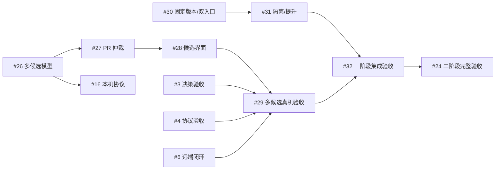
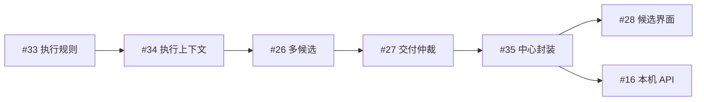
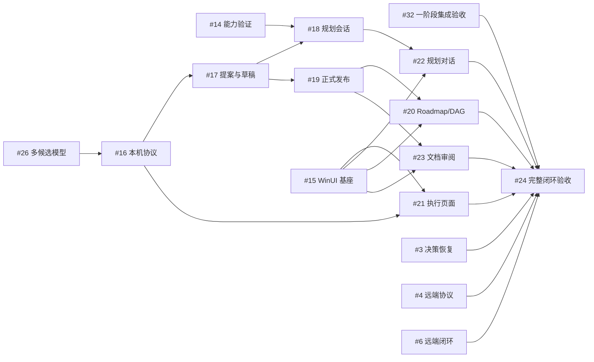

# 已规划 Spec 的执行依赖

这里列出 [主 roadmap](roadmap.md) 中尚待交付的规划任务、执行 Spec 与硬前置；已登记的中心 Task 与新增待登记规划分别注明。原 #3/#4/#6 已按当前受测范围完成原中心 TaskDelivery；4 秒 viewer 和定向故障回执分别见[Spec 03 最终范围](../validation/spec03-final-scope-audit-2026-09-28.md)。长期无人值守归 #32，具体证据见下文引用。

下文的 `#数字` 均指任务 ID。“直接开工前置”列出必须已有的实现或证据；“集成与交付条件”说明何时才能验收并交给后续任务。共享接口的并行准备不等于允许越过各 Spec 的硬前置。

## 跨链路的接口与并行条件

- **#6 与当前执行接口的共享修改**：Service、配置、worker 上下文、Query/Command、Task DTO 和测试夹具存在共同修改面。独立协议样例可并行；涉及共同接口的修改串行集成，后集成方校验接口并运行受影响回归。`#6` 只接 native，不增加既有运行时任务的可变依赖。
- **接口前置与硬前置**：接口固定后可以准备独立样本、只读展示或测试；需要真实平台、数据库或 UI 的集成验收仍须等待对应前置实现。并行建议不改变各 Spec/Plan 明定的串行交付要求；调整顺序时先修订受影响的 Spec/Plan。

## 单 worker 流程精简与既有规划的交接

| 任务 ID | 任务名称 | 目标 / 执行 Spec | 直接开工前置 | 集成与交付条件 |
| --- | --- | --- | --- | --- |
| 36 | 单 worker 持续执行与统一待决策 | `WORKER-FLOW` · [Spec](../spec/worker-flow.spec.md) · [Plan](../spec/worker-flow.plan.md) | 无未完成硬前置；复用已交付 Task/DAG、会话、Query/Command 与 PR provider | WF1–WF12；同 worker 多轮反馈、统一待决策、移除项目逻辑验证、真实 PR 合并与当前格式恢复。与下列共享修改串行集成 |

- **语义冲突 #33/#34**：原固定契约要求保持五步与 applied 门槛，#36 明确删除这些中心业务门槛。#33/#34 先交付时，#36 消费其包和上下文；#36 先交付时，旧任务先完成执行规格协调。不存在通过新增一条依赖边就自动更新任务契约的效果。
- **共享修改 #26/#27/#35**：候选/交付/SQLite 封装的身份与唯一 TaskDelivery 继续复用；其步骤证据假设按 #36 Spec §2 协调，不同时写同一生产接线。#36 不交付多候选或替代这些任务的封装范围。
- **接口消费者 #28/#16/#21**：消费五阶段主状态、原会话反馈和 PR DTO；不用 failed/unknown 或 retry 按钮建立另一套主流程。实现前固定消费者适用的新执行契约，现有已创建 TaskContract 不被本文改变。
- **验收及独立工作 #29/#32/#24、#30/#31**：前一组按最终固定流程验证交付；后一组版本隔离可在独立资源准备，共享恢复/配置入口串行集成。已测旧步骤后端不能直接认证持续会话能力。

#36 是本次新增的规划任务，尚无中心创建/补边回执。本节说明规格和共享修改关系，不宣告中心 DAG 已改变，也不把后文记录的既有硬前置替换掉。

## 后续仍依赖的已交付基础

- [执行控制台与轮次折叠](../spec/pr-04-console.spec.md)及[验收报告](../validation/pr-04c-console.md)：#3 的决策卡片、UI 状态与精确折叠已有受测证据；#6 复用相同的查询与能力展示边界。
- [双执行后端](../spec/pr-04a-execution-backends.spec.md)与[Windows 验收报告](../validation/pr-04a-execution-backends.md)：`#3` 的本机 Orca 验收和 `#6` 复用固定 ExecutionRef、Operation、能力报告、ReadOutput 及双后端操作边界；会话 phase/turn、资源结算与 Linux 原生验收不在该后端 Spec 的交付范围内。
- [会话事件](../spec/pr-04b-conversation-events.spec.md)与[本机验收报告](../validation/pr-04b-conversation-events-2026-09-24.md)：`#3`/`#6` 复用统一会话 DTO、完整正文、分页、来源缺口与版本化能力报告；精确 turn/phase/final 仅在报告列明的本机 Codex/Orca 范围内通过。
- [中心执行模型](../spec/02-execution-model-and-adapter.md)：`#3`/`#6` 复用 WorkflowRun/Execution/StepAttempt、SQLite 单写者、Query/Command、Operation 和 minimal-v1 流程；当前有人值守远端原生闭环已由 #6 真实交付。
- [人工决策与恢复](../spec/pr-05-intervention.spec.md)与[原中心结项](../validation/phase1-task-closure-2026-09-28/README.md)：#6 复用已验收的 SQLite CommandService、固定答案和应用证明；#3 已完成原中心 Task Delivery。
- [原生项目接入](../spec/beads-exit.spec.md)与[验收记录](../validation/beads-exit/README.md)：`#6` 沿用固定 worker 上下文，已按独立远端门槛结项。
- [统一观察契约](../spec/pr-01-observation.spec.md)：#3 沿用已测选择、游标、来源换代及 raw 读取；未来受影响平台版本按能力重新核验。
- [服务控制协议](../spec/pr-02-control.spec.md)与[服务窗口生命周期](../spec/pr-03-service-lifecycle.spec.md)：#3 沿用请求/实例身份、回执、连接分类和停止确认；关闭控制台不停服，关闭服务窗口结束服务。Linux detached 原生会话生命周期仍未实测，不属于当前 Windows #3 关闭前置。
- [真实远端能力报告](../spec/orca-probe/remote-capability-report-2026-09-23.json)与[字段映射](../spec/orca-probe/field-mapping.md)：`#4`/`#6` 复用已实测派发、身份、问答和恢复语义；远端精确会话能力仍须独立验证，不能从本机 `#1` 的验收外推。
- [verify 结果校验器](../../internal/steerline/remoteprotocol/verify_result.go)：已接入中心；P13 正负向真机 verify 回执及任务 103 的三项实际检查证明固定候选门槛，未测无效结果仍按各自条件核对。

Spec 完成交付后从未完成表移出；仍有消费者时只保留必要交接。本图不记录 PR、提交或文档维护历史。

## 第一阶段模块重构与交接

本组按[共同约束](../spec/modular-refactoring-constraints.md)划分职责、包依赖和状态所有者。下列任务与依赖均已进入中心 DAG；[创建记录](../validation/modular-refactoring-task-creation/README.md)保存原生命令回执与完整回读。#3/#4/#6 的原中心交付已完成；后续共用 Service/SQLite、构建产物或 Orca 宿主的工作仍须串行协调。固定 TaskContract 的 Git 引用不因本图状态更新而改变。

| 任务 ID | 任务名称 | 目标 / 执行 Spec | 直接开工前置 | 集成与交付条件 |
| --- | --- | --- | --- | --- |
| 33 | 执行规则包提取 | `PHASE1-MODULARITY` · [Spec](../spec/workflow-rules.spec.md) · [Plan](../spec/workflow-rules.plan.md) | 无未完成硬前置 | workflow 纯规则、全部生产接线、错误语义及包依赖检查通过；供 #34 消费 |
| 34 | 执行上下文封装与服务职责收缩 | `PHASE1-MODULARITY` · [Spec](../spec/execution-context.spec.md) · [Plan](../spec/execution-context.plan.md) | `#33` | 显式上下文、单写者、不同任务交错与当前格式恢复通过；作为 #26 已追加的硬前置 |
| 35 | 中心命令查询与SQLite边界封装 | `PHASE1-MODULARITY` · [Spec](../spec/center-boundary.spec.md) · [Plan](../spec/center-boundary.plan.md) | `#27` | center 包无 SQL 旁路/反向依赖，事务、查询及恢复回归；向 #28/#16 交接 |

中心已创建 #33 → #34 和 #27 → #35，并追加 #34 → #26、#35 → #28、#35 → #16。原 #26 → #27、#27 → #28、#26 → #16 继续保留，全部为完整交付后的 AND 硬前置；追加关系没有重绑定原执行契约。

代码集成顺序为 #33 → #34 → #26 → #27 → #35 → #28/#16。#30/#31 独立推进；与本组共用 Service/SQLite/启动恢复入口时串行集成并回归此前已交付的边界。

## 第一阶段新增范围与第二阶段的交接

[第一阶段版本交付方案](phase-1-delivery.md)的 #26–#32 已有独立规格和中心任务；原有依赖已回读核验，结构重构新增前置在表中单独标注。`#33/#30` 可使用独立资源推进，#26 遵守新增重构顺序；共用 Service/SQLite、构建产物或真实 Orca 宿主的集成和故障注入串行协调。规格必须先集成到执行目标分支才能按原固定契约开始实现。

| 任务 ID | 任务名称 | 目标 / 执行 Spec | 直接开工前置 | 集成与交付条件 |
| --- | --- | --- | --- | --- |
| 26 | 多候选模型与准入 | `PHASE1-CANDIDATES` · [Spec](../spec/task-candidates.spec.md) · [Plan](../spec/task-candidates.plan.md) | `#34`（中心追加） | 交付精确候选身份/Query/Command；multiple 发布在 #27 仲裁交付前受控拒绝 |
| 27 | PR 胜出与落选候选对账 | `PHASE1-CANDIDATES` · [Spec](../spec/candidate-delivery.spec.md) · [Plan](../spec/candidate-delivery.plan.md) | `#26` | 唯一交付、在途冻结、迟到冲突和 closed 后资源对账通过 |
| 28 | 候选观察界面 | `PHASE1-CANDIDATES` · [Spec](../spec/candidate-console.spec.md) · [Plan](../spec/candidate-console.plan.md) | `#27`、`#35`（后者为中心追加） | 真实 Windows TUI 展示/输入和中心命令身份通过；跨主机 agent 证据不在本任务代验 |
| 29 | 多候选本机与远端真机验收 | `PHASE1-CANDIDATES` · [Spec](../spec/candidate-native-acceptance.spec.md) · [Plan](../spec/candidate-native-acceptance.plan.md) | `#28`；`#3`、`#4`、`#6` 已交付 | 当前认证目标上两后端双候选/后继真实合并及故障恢复均通过 |
| 30 | 固定版本与双入口 | `PHASE1-RUNTIME` · [Spec](../spec/versioned-runtime.spec.md) · [Plan](../spec/versioned-runtime.plan.md) | 无未完成硬前置 | 不可变版本、固定入口与实例身份通过；切换资格由 #31 接入 |
| 31 | dev 隔离与 stable 提升 | `PHASE1-RUNTIME` · [Spec](../spec/runtime-isolation-promotion.spec.md) · [Plan](../spec/runtime-isolation-promotion.plan.md) | `#30` | home/仓库隔离、受控提升、失败继续和当前格式恢复通过 |
| 32 | 第一阶段集成验收 | `PHASE1-DELIVERY` · [Spec](../spec/phase1-release-acceptance.spec.md) · [Plan](../spec/phase1-release-acceptance.plan.md) | `#29`、`#31` | 固定组合构建真实两链、24 小时运行、dev 并行及提升验收通过 |

第二阶段原有边保留，并已通过[追加前置能力](../spec/native-task-add-predecessors.spec.md)加入 `#26 → #16` 与 `#32 → #24`。`#14/#15` 可同步准备；#16 消费 #26 的身份接口，超出其冻结规格的新 API/WinUI 范围须另有执行契约。中心新边收紧执行资格，原 TaskContract 的 Git 引用保持不变。[创建与回读证据](../validation/phase1-task-creation/README.md)列出原请求和精确快照。

上图展示原 #26–#32 的中心关系。模块重构新增关系另见下图；各任务的真实交付仍由中心 PR 合并核验决定。

本图中的新增任务及边均已由中心回读确认；为便于阅读，原有 #27 → #28 和 #26 → #16 在此局部图中省略，实际 DAG 保留。

## 第二阶段硬前置与并行集成

本组公共契约随独立规格固定，C 等草案字母不再承担依赖身份。表中列出直接硬前置，传递前置由图继承；已交付基础见各 Spec。没有依赖边的任务可独立开发，但服务的实际执行并发仍受现有槽策略约束。

| 任务 ID | 任务名称 | 目标 / 执行 Spec | 直接开工前置 | 集成与交付条件 |
| --- | --- | --- | --- | --- |
| 14 | Codex 规划主 agent 能力验证 | `PHASE2` · [Spec](../spec/phase2-agent-capabilities.spec.md) · [Plan](../spec/phase2-agent-capabilities.plan.md) | 无未完成硬前置 | 本 Spec 全部验收通过；共享接口有变更时同步消费者和受影响回归。 |
| 15 | WinUI 基座与原生输入 | `PHASE2` · [Spec](../spec/phase2-winui-foundation.spec.md) · [Plan](../spec/phase2-winui-foundation.plan.md) | 无未完成硬前置 | 本 Spec 全部验收通过；共享接口有变更时同步消费者和受影响回归。 |
| 16 | 本机客户端协议与历史查询 | `PHASE2` · [Spec](../spec/phase2-local-api.spec.md) · [Plan](../spec/phase2-local-api.plan.md) | `#26`、`#35`（中心追加） | 本 Spec 全部验收通过；共享接口有变更时同步消费者和受影响回归。 |
| 17 | 规划提案与受控草稿 | `PHASE2` · [Spec](../spec/phase2-planning-drafts.spec.md) · [Plan](../spec/phase2-planning-drafts.plan.md) | `#16` | 本 Spec 全部验收通过；共享接口有变更时同步消费者和受影响回归。 |
| 18 | Codex 规划会话服务 | `PHASE2` · [Spec](../spec/phase2-planning-sessions.spec.md) · [Plan](../spec/phase2-planning-sessions.plan.md) | `#14`、`#17` | #14 必须有通过证据，复用 #17 guard；与 #19 的 Service/存储接线串行集成。 |
| 19 | 正式文档发布与任务创建 | `PHASE2` · [Spec](../spec/phase2-document-publish.spec.md) · [Plan](../spec/phase2-document-publish.plan.md) | `#17` | 复用 #17 guard 与正式读模型；与 #18 独立开发，共享接线后合入方回归双方。 |
| 20 | Roadmap 与 DAG 原生浏览 | `PHASE2` · [Spec](../spec/phase2-roadmap-ui.spec.md) · [Plan](../spec/phase2-roadmap-ui.plan.md) | `#15`、`#19` | 使用 #19/#17 已交付的真实版本查询；与另一文档页面可分头开发，共享 WinUI 导航串行集成。 |
| 21 | 执行与待处理原生界面 | `PHASE2` · [Spec](../spec/phase2-execution-ui.spec.md) · [Plan](../spec/phase2-execution-ui.plan.md) | `#15`、`#16` | 未通过的第一阶段能力保持不可用；本任务交付不代替 #24 完整后端验收。 |
| 22 | 规划对话原生界面 | `PHASE2` · [Spec](../spec/phase2-conversation-ui.spec.md) · [Plan](../spec/phase2-conversation-ui.plan.md) | `#15`、`#18` | 真实会话/工具经 #18；不等 #19，但无审阅发布副作用入口。 |
| 23 | 文档审阅与确认原生界面 | `PHASE2` · [Spec](../spec/phase2-review-ui.spec.md) · [Plan](../spec/phase2-review-ui.plan.md) | `#15`、`#19` | 使用 #19/#17 已交付的真实版本查询；与另一文档页面可分头开发，共享 WinUI 导航串行集成。 |
| 24 | 第二阶段完整闭环验收 | `PHASE2` · [Spec](../spec/phase2-integration.spec.md) · [Plan](../spec/phase2-integration.plan.md) | `#20`、`#21`、`#22`、`#23`、中心追加的 `#32`；`#3`、`#4`、`#6` 已交付 | 全部前置真实交付；本任务逐项完成两后端和跨组件故障验收，不以样例代替。 |

- 规划 worktree、提案、ID 预留、正式/草稿读模型与写入 owner/generation 由 #17 单独实现；#18/#19 共同消费，不各建状态或锁。#19 推进正式版本，#20/#23 的真实交付等待它完成。
- #16 只拥有传输、认证和既有执行映射；#17/#18/#19 分别拥有自身业务 handler、DTO 和恢复。共同信封已在 [Spec 共同约束](../spec/phase2-constraints.md)中固定，不能将 #16 的内部里程碑当作放行。
- #18/#19 在 Service、Query/Command、SQLite 接线处串行集成；#20/#21/#22/#23 在 WinUI 导航、连接与输入公共组件处串行集成。独立业务文件可并行开发，后合入方重跑受影响消费者。
- 第二阶段复用已交付远端链路的测试宿主、二进制或远端资源时分时验收；隔离工作区不隔离全局 CLI 配置、进程或真实 Orca runtime。不得在另一项验收途中替换它使用的构建或重启共享宿主。
- #24 是最终验收的唯一任务归属，不承担各上游任务缺失的实现。各组件交付与完整产品交付分别记录；任务创建时保留上述固定 AND 依赖，不新增部分完成放行机制。
