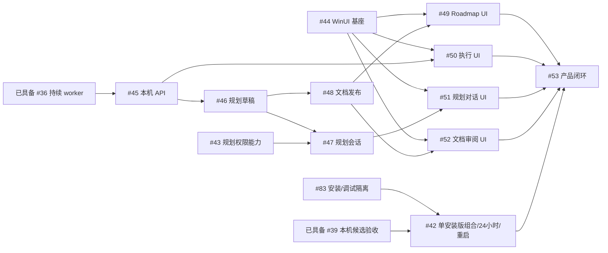

# 执行依赖与交接

本图对应[主 roadmap](roadmap.md)中的活动规划。每项执行以独立 Spec/Plan 为准，运行时资格以中心 DAG 为权威。

[二期草稿与审核准入](phase2-draft-roadmap-admission.md)仅登记目标，主agent、独立审核和成熟度等待不成为一期前置，也不自动新增本页的正式任务或DAG边。#43–#53图示仍为原固定基础关系；受新准入机制影响的范围需在实施前重新固定对应Spec/Plan与正式依赖。

## 固定前置

第一阶段统一只交付和验收本地 Codex 与本机 Orca。远程准入、派发、反馈、恢复、取消及本机/远端混合流程暂移出一期，也不列作一期阻塞或待补验；后续另行规划。保留既有远端代码、协议定义及历史证据，不将它们声明为当前支持或完成条件。Git remote 和托管 PR 发布仍属于本机交付链。

已具备持续worker/原会话反馈、各配置独立候选、宽松五候选开始检查、合并前放弃和唯一交付，以及执行需求准入、配置注册和固定原生绑定封套。候选TUI 实现已具备；CC5 已于 2026-10-04 由用户人工确认通过，本机不同后端方案验收已完成（#39），按需复用[当前证据](../validation/candidate-acceptance.md)。后续复用这些能力，保持原身份、版本、提交屏障及恢复授权；当前接口归属需要核实时按需查[架构索引](../architecture/current-code-architecture.md)。图中已交付基础节点和原硬前置ID仅表达依赖，不要求阅读历史Spec/Plan，也不解除未完成的原生验收限制。

| 任务 ID | 任务名称 | 交付范围 | 硬前置 | 执行规格 |
| --- | --- | --- | --- | --- |
| 83 | 本机安装与调试路径隔离 | 固定安装 exe、显式调试 exe/home、状态隔离与共存 | 无 | [Spec](../spec/local-runtime-isolation.spec.md) · [Plan](../spec/local-runtime-isolation.plan.md) |
| 42 | 第一阶段集成验收 | 单安装版双本机链、24 小时、调试共存与同构建重启 | `#39`、`#83` | [Spec](../spec/phase1-release-acceptance.spec.md) · [Plan](../spec/phase1-release-acceptance.plan.md) |
| 43 | Codex 规划主 agent 能力验证 | 规划 agent 权限与受控工具能力证明 | 无 | [Spec](../spec/phase2-agent-capabilities.spec.md) · [Plan](../spec/phase2-agent-capabilities.plan.md) |
| 44 | WinUI 基座与原生输入 | Windows 原生窗口、IME/多行输入和导航基座 | 无 | [Spec](../spec/phase2-winui-foundation.spec.md) · [Plan](../spec/phase2-winui-foundation.plan.md) |
| 45 | 本机客户端协议与历史查询 | 五阶段/原会话反馈的本机 HTTP/SSE 与离线查询 | `#36` | [Spec](../spec/phase2-local-api.spec.md) · [Plan](../spec/phase2-local-api.plan.md) |
| 46 | 规划提案与受控草稿 | 规划工作区、提案/ID 预留、草稿与文档权威 | `#45` | [Spec](../spec/phase2-planning-drafts.spec.md) · [Plan](../spec/phase2-planning-drafts.plan.md) |
| 47 | Codex 规划会话服务 | 受控规划会话、草稿工具和写入仲裁接线 | `#43`、`#46` | [Spec](../spec/phase2-planning-sessions.spec.md) · [Plan](../spec/phase2-planning-sessions.plan.md) |
| 48 | 正式文档发布与任务创建 | 正式文档版本、目标分支集成与中心创建 | `#46` | [Spec](../spec/phase2-document-publish.spec.md) · [Plan](../spec/phase2-document-publish.plan.md) |
| 49 | Roadmap 与 DAG 原生浏览 | Roadmap/DAG 原生浏览与精确关联 | `#44`、`#48` | [Spec](../spec/phase2-roadmap-ui.spec.md) · [Plan](../spec/phase2-roadmap-ui.plan.md) |
| 50 | 执行与待处理原生界面 | 五阶段、完整会话与统一反馈原生页面 | `#44`、`#45` | [Spec](../spec/phase2-execution-ui.spec.md) · [Plan](../spec/phase2-execution-ui.plan.md) |
| 51 | 规划对话原生界面 | 规划会话和受控草稿工具的原生对话 | `#44`、`#47` | [Spec](../spec/phase2-conversation-ui.spec.md) · [Plan](../spec/phase2-conversation-ui.plan.md) |
| 52 | 文档审阅与确认原生界面 | 规划文档差异、固定版本确认与发布回执 | `#44`、`#48` | [Spec](../spec/phase2-review-ui.spec.md) · [Plan](../spec/phase2-review-ui.plan.md) |
| 53 | 第二阶段完整闭环验收 | 规划到真实任务交付再回规划的完整产品链 | `#49`、`#50`、`#51`、`#52`、`#42` | [Spec](../spec/phase2-integration.spec.md) · [Plan](../spec/phase2-integration.plan.md) |

仓库关系不自动修改中心 DAG。实施前核对已创建任务的固定契约；若中心仍固定旧版本前置或其他旧范围，须先受控替换并同步消费者身份/依赖。移出规划的任务须按中心受控流程处置，本页不宣告运行时已处置，也不掩盖旧任务后继阻塞。

## 接口和共享修改

| 所有者 | 交接内容 | 集成规则 |
| --- | --- | --- |
| #36 | 主阶段、原会话输入/输出、PR 关联和 TaskDelivery | #42/#45 消费；不另建步骤或专用恢复状态机 |
| 已具备本机候选 | 各配置固定身份、独立反馈、宽松五候选检查、放弃与唯一交付 | #42 复用，迁移按实际影响定向重验；放弃不保证停止，数量不建硬槽 |
| #83 | 实际 exe/home/config 传递、安装/调试入口及状态隔离 | #42 消费；启动器、console 启服、项目 re-exec 串行集成；不引入版本选择 |
| #43/#47 | 规划 agent 的权限、受控工具及会话 | 可复用底层会话能力，规划 guard 与任务 worker 权限分别管理 |
| #45/#46/#48 | 传输、草稿权威、正式发布与中心创建 | 复用 Query/Command；发布/反馈各自按同一个写者和原请求对账 |
| #44 | 原生输入和导航组件 | 页面复用同一客户端、草稿和正文组件；共享导航串行集成 |

## 验收分工

单 worker 持续交互与本机多候选竞争已有证据。#83 用最小 controlled 共存场景验实际路径/子进程/误用拒绝；#42 在固定安装 exe 上验双本机链、同构建当前格式重启及 24 小时，#53 验完整规划/UI/执行闭环。#53 消费 #42 的单安装版结论，不等待完整双版本管理。现有 L2/L3 按影响复用，短时 E2E 不等于安装入口或长期运行已验收。

优先推进 #45 → #50，#43/#44 可按各自前置准备；#42 的长运行只阻塞最终验收，不增加 API/UI 开工前置。涉及新草稿/审核准入范围的任务在实施前重新固定对应 Spec/Plan；不凭优先级建议改变既有硬前置。

不同任务人工并行和自动派发策略沿既有能力；共享工作区、平台宿主、构建或 SQLite 接线时串行协调。新任务只有固定前置整体交付后可领取，没有接口提前完成的放行状态。
