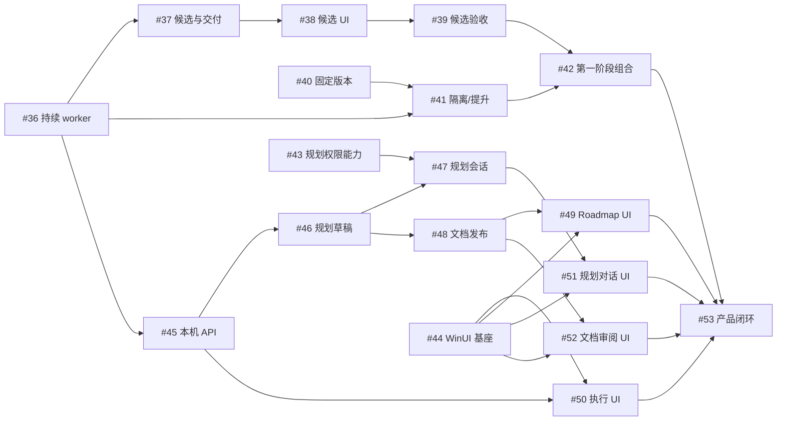
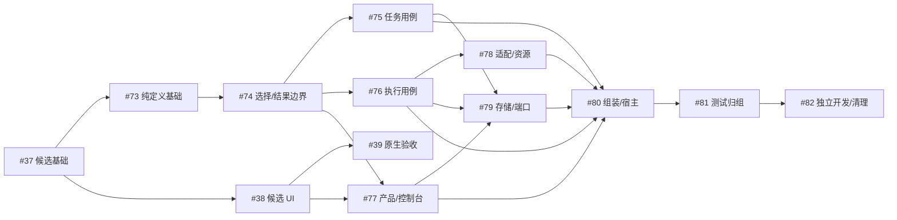

# 执行依赖与交接

本图对应[主 roadmap](roadmap.md)中的活动规划。每项执行以独立 Spec/Plan 为准，运行时资格以中心 DAG 为权威。

[任务执行控制台解耦与目录整理](three-line-modularization.md) 由 #73–#82 的独立 Spec/Plan 交付，下面同步其硬前置及与 #38/#39 的接口/共享修改条件；阶段代号仅供定位。

[二期草稿与审核准入](phase2-draft-roadmap-admission.md)仅登记目标，主agent、独立审核和成熟度等待不成为一期前置，也不自动新增本页的正式任务或DAG边。#43–#53图示仍为原固定基础关系；受新准入机制影响的范围需在实施前重新固定对应Spec/Plan与正式依赖。

## 固定前置

第一阶段统一只交付和验收本地 Codex 与本机 Orca。远程准入、派发、反馈、恢复、取消及本机/远端混合流程暂移出一期，也不列作一期阻塞或待补验；后续另行规划。保留既有远端代码、协议定义及历史证据，不将它们声明为当前支持或完成条件。Git remote 和托管 PR 发布仍属于本机交付链。

已具备持续worker/原会话反馈、各配置独立候选、宽松五候选开始检查、合并前放弃和唯一交付，以及执行需求准入、配置注册和固定原生绑定封套。候选TUI 实现已具备；CC5 由用户人工补验，按明确授权不阻止 #39 开发，本机不同后端方案验收仍由 #39 交付。后续复用这些能力，保持原身份、版本、提交屏障及恢复授权；当前接口归属需要核实时按需查[架构索引](../architecture/current-code-architecture.md)。图中已交付基础节点和原硬前置ID仅表达依赖，不要求阅读历史Spec/Plan，也不解除未完成的原生验收限制。

| 任务 ID | 任务名称 | 交付范围 | 硬前置 | 执行规格 |
| --- | --- | --- | --- | --- |
| 39 | 多候选本机验收 | 本地 Codex/本机 Orca 双候选竞争、反馈隔离、唯一交付与恢复/放弃验收 | `#38` | [Spec](../spec/candidate-native-acceptance.spec.md) · [Plan](../spec/candidate-native-acceptance.plan.md) |
| 40 | 固定版本与双入口 | 不可变构建、stable/dev 固定入口和身份 | 无 | [Spec](../spec/versioned-runtime.spec.md) · [Plan](../spec/versioned-runtime.plan.md) |
| 41 | dev 隔离与 stable 提升 | 独立 home、静止可恢复会话下的受控提升 | `#40`、`#36` | [Spec](../spec/runtime-isolation-promotion.spec.md) · [Plan](../spec/runtime-isolation-promotion.plan.md) |
| 42 | 第一阶段集成验收 | 本机双链与版本组合、stable 24 小时、dev 并行和提升恢复 | `#39`、`#41` | [Spec](../spec/phase1-release-acceptance.spec.md) · [Plan](../spec/phase1-release-acceptance.plan.md) |
| 43 | Codex 规划主 agent 能力验证 | 规划 agent 权限与受控工具能力证明 | 无 | [Spec](../spec/phase2-agent-capabilities.spec.md) · [Plan](../spec/phase2-agent-capabilities.plan.md) |
| 44 | WinUI 基座与原生输入 | Windows 原生窗口、IME/多行输入和导航基座 | 无 | [Spec](../spec/phase2-winui-foundation.spec.md) · [Plan](../spec/phase2-winui-foundation.plan.md) |
| 45 | 本机客户端协议与历史查询 | 五阶段/原会话反馈的本机 HTTP/SSE 与离线查询 | `#36` | [Spec](../spec/phase2-local-api.spec.md) · [Plan](../spec/phase2-local-api.plan.md) |
| 46 | 规划提案与受控草稿 | 规划工作区、提案/ID 预留、草稿与文档权威 | `#45` | [Spec](../spec/phase2-planning-drafts.spec.md) · [Plan](../spec/phase2-planning-drafts.plan.md) |
| 47 | Codex 规划会话服务 | 受控规划会话、草稿工具和写入仲裁接线 | `#43`、`#46` | [Spec](../spec/phase2-planning-sessions.spec.md) · [Plan](../spec/phase2-planning-sessions.plan.md) |
| 48 | 正式文档发布与任务创建 | 正式文档版本、目标分支集成与中心创建 | `#46` | [Spec](../spec/phase2-document-publish.spec.md) · [Plan](../spec/phase2-document-publish.plan.md) |
| 49 | Roadmap 与 DAG 原生浏览 | Roadmap/DAG 原生浏览与精确关联 | `#44`、`#48` | [Spec](../spec/phase2-roadmap-ui.spec.md) · [Plan](../spec/phase2-roadmap-ui.plan.md) |
| 50 | 执行与待处理原生界面 | 五阶段、完整会话与统一反馈原生页面 | `#44`、`#45` | [Spec](../spec/phase2-execution-ui.spec.md) · [Plan](../spec/phase2-execution-ui.plan.md) |
| 51 | 规划对话原生界面 | 规划会话和受控草稿工具的原生对话 | `#44`、`#47` | [Spec](../spec/phase2-conversation-ui.spec.md) · [Plan](../spec/phase2-conversation-ui.plan.md) |
| 52 | 文档审阅与确认原生界面 | 规划文档差异、固定版本确认与发布回执 | `#44`、`#48` | [Spec](../spec/phase2-review-ui.spec.md) · [Plan](../spec/phase2-review-ui.plan.md) |
| 53 | 第二阶段完整闭环验收 | 规划到真实任务交付再回规划的完整产品链 | `#49`、`#50`、`#51`、`#52`、`#42` | [Spec](../spec/phase2-integration.spec.md) · [Plan](../spec/phase2-integration.plan.md) |

## 任务执行控制台解耦与目录整理

目标：`TASK-EXECUTION-CONSOLE-DECOUPLING`。#73 的纯定义和实际消费者基线见[验收记录](../validation/three-line-01-types/README.md)；#77 为避免共同 TUI 重写另等 #38。#39 不成为本目标硬前置；它仍按自己的范围与能力门槛验收。

| 任务 ID | 任务名称 | 交付范围 | 硬前置 | 执行规格 |
| --- | --- | --- | --- | --- |
| 74 | 任务选择与执行结果边界 | 任务工作/原子领取与规范化结果边界、执行核验归属 | `#73` | [Spec](../spec/three-line-02-task-execution-boundary.spec.md) · [Plan](../spec/three-line-02-task-execution-boundary.plan.md) |
| 75 | 任务应用用例归包 | 任务创建/依赖/挑选/结果应用归 task | `#74` | [Spec](../spec/three-line-03-task-usecases.spec.md) · [Plan](../spec/three-line-03-task-usecases.plan.md) |
| 76 | 执行应用用例归包 | 候选/会话/恢复/交付/清理归 execution | `#74` | [Spec](../spec/three-line-04-execution-usecases.spec.md) · [Plan](../spec/three-line-04-execution-usecases.plan.md) |
| 77 | 产品查询与控制台契约收窄 | 公开 DTO 收窄、唯一 query/client 和 console 归包 | `#74`、`#38` | [Spec](../spec/three-line-05-product-console.spec.md) · [Plan](../spec/three-line-05-product-console.plan.md) |
| 78 | 执行适配与资源目录归组 | 后端协议与 Git/PR/进程资源归组 | `#76` | [Spec](../spec/three-line-06-adapters-resources.spec.md) · [Plan](../spec/three-line-06-adapters-resources.plan.md) |
| 79 | 存储目录与消费者端口收口 | 唯一 SQLite 归 storage、消费者窄端口与原子提交 | `#75`、`#76`、`#77` | [Spec](../spec/three-line-07-storage-ports.spec.md) · [Plan](../spec/three-line-07-storage-ports.plan.md) |
| 80 | 应用组装与服务宿主收口 | 配置构造归 app、服务承载归 host，删除旧主包/contracts | `#75`、`#76`、`#77`、`#78`、`#79` | [Spec](../spec/three-line-08-app-host.spec.md) · [Plan](../spec/three-line-08-app-host.plan.md) |
| 81 | 测试支持与集成目录整理 | testkit 与 tests/integration、runner/断言映射 | `#80` | [Spec](../spec/three-line-09-testkit-integration.spec.md) · [Plan](../spec/three-line-09-testkit-integration.plan.md) |
| 82 | 独立开发证明与最终清理 | 三线实际独立改动证明、残留清理与最小交付/恢复组合 | `#81` | [Spec](../spec/three-line-10-independence-cleanup.spec.md) · [Plan](../spec/three-line-10-independence-cleanup.plan.md) |

#73 的唯一类型、实际消费者及残留字段交接见[验收记录](../validation/three-line-01-types/README.md)。#74 接通选择/结果公共基础后，#75/#76 可分线，#77 另等待 #38 整体交付。#78 在 #76 后；#79 等 #75/#76/#77；后续按正式硬前置交付，不以接口草案提前放行。

| 并行工作 | 开工与接口条件 | 共享修改与集成条件 |
| --- | --- | --- |
| #74 与 #38/#39 | #74 等 #73；#39 复用已合入 #38，仅验本机，不依赖远端准入 | #74 只改业务边界/事务；query 资格原因、公共 DTO/工厂段串行集成，不同时重写 TUI |
| #75 与 #76；#77 与两者 | 已交付 #74 的工作/结果小端口；#77 同时等 #38 | #75 拥有任务，#76 拥有执行，#77 拥有产品/console；按 #74 字段/函数/文件清单分拆，Service/Config/提交协调和 app/cmd/runner 共用段指定一个集成所有者 |
| #78 与未完成产品/存储工作 | #76 整体交付；#79 仍须自身三项硬前置 | 适配/资源与其他目录分别所有；backend/API 形状变化先由定义所有者集成，构造段顺序修改 |
| #73–#82 与 #39 | #39 在隔离固定构建/配置/平台现场运行，不依赖重构全部完成 | 不在现场运行中替换可执行文件/配置；迁移后记录构建与入口映射，实际接线/身份/协议/宿主行为受影响才定向重验；原证据不能覆盖改变的构建行为 |
| 与 #40/#41、#45 或规划基础 | 各自既定 Spec 前置仍成立 | 共享配置、类型、恢复、protocol/app 接线先确定唯一所有者；只迁实际消费者，不创造空 planning/transport，不增加全面重构硬前置 |

#74 必须交付实际 Service/CommandService 拆分、字段与文件所有权清单，并先拆共同协调段。每项自己完成真实消费者/构造/测试/守卫切换，不能把编译修复留给 #80；迁出定义不留永久 alias、转发或第二写路径。公共类型变更先顺序集成，再推进消费者。

本表是规划安排；具体职责/前置/证据规则已落实在每份 Spec/Plan 与 #38/#39 规格中。Git 文档任务身份不代表中心 DAG 已创建，本次不启动实现或向中心创建任务。

## 接口和共享修改

| 所有者 | 交接内容 | 集成规则 |
| --- | --- | --- |
| #36 | 主阶段、原会话输入/输出、PR 关联和 TaskDelivery | #41/#45 消费；不另建步骤或专用恢复状态机 |
| #37 | 各配置固定身份、宽松五候选检查、单候选放弃与唯一交付 | #38/#39消费；数量不用预留/硬槽，放弃不保证停止；#45初版不依赖分叉 |
| #40/#41 | 固定版本选择、真实工作轮次及恢复条件 | 配置/服务恢复入口串行集成；空闲会话不被直接视作活动进程 |
| #43/#47 | 规划 agent 的权限、受控工具及会话 | 可复用底层会话能力，规划 guard 与任务 worker 权限分别管理 |
| #45/#46/#48 | 传输、草稿权威、正式发布与中心创建 | 复用 Query/Command；发布/反馈各自按同一个写者和原请求对账 |
| #44 | 原生输入和导航组件 | 页面复用同一客户端、草稿和正文组件；共享导航串行集成 |

## 验收分工

#36 验单 worker 持续交互；#39 验多候选竞争；#42 验固定版本、24 小时和提升组合；#53 验完整规划/UI/执行闭环。上游证据可复用，接口或平台改变的部分定向重验，不重复构造已删除的五步与答案应用证明矩阵。

不同任务人工并行和自动派发策略沿既有能力；共享工作区、平台宿主、构建或 SQLite 接线时串行协调。新任务只有固定前置整体交付后可领取，没有接口提前完成的放行状态。

#74 已实现的工作/结果/领取/丢弃端口及 Service/CommandService/Config 的实际拆分见[交接清单](../validation/three-line-02-task-execution-boundary/integration-ownership.md)。当前待协调聊天独立复审并真实合并，不重新规划 #74；Task ID 与硬前置保持。#75/#76 合并后按其唯一文件所有者推进，共用构造/CLI/runner/守卫段由 #76 单点顺序集成。#77/#79/#80/#81/#82 按用户当前指令暂停。
