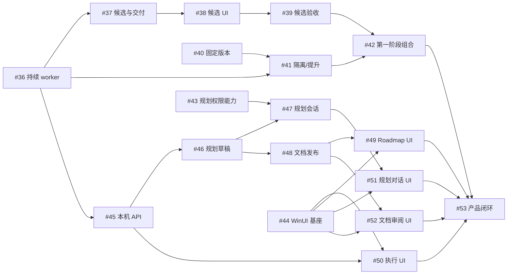
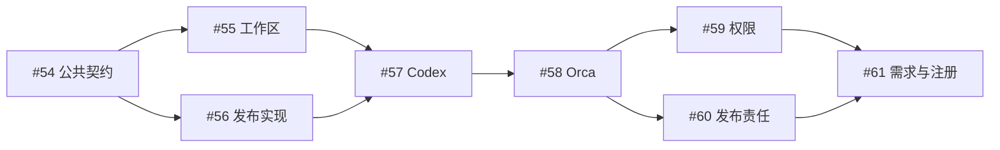

# 执行依赖与交接

本图对应[主 roadmap](roadmap.md)中的 26 项活动规划。每项执行以独立 Spec/Plan 为准，运行时资格以中心 DAG 为权威。

## 固定前置

| 任务 ID | 任务名称 | 交付范围 | 硬前置 | 执行规格 |
| --- | --- | --- | --- | --- |
| 36 | 单 worker 持续执行与统一待决策 | 原会话持续交互、统一待决策、移除中心项目验证、真实 PR 交付 | 无 | [Spec](../spec/worker-flow.spec.md) · [Plan](../spec/worker-flow.plan.md) |
| 37 | 多候选会话与唯一PR交付 | 候选创建与完整运行、反馈隔离、唯一交付及落选事实 | `#36` | [Spec](../spec/candidate-workers.spec.md) · [Plan](../spec/candidate-workers.plan.md) |
| 38 | 候选观察界面 | 候选列表/选择和原会话反馈的 TUI 增量 | `#37` | [Spec](../spec/candidate-console.spec.md) · [Plan](../spec/candidate-console.plan.md) |
| 39 | 多候选本机与远端真机验收 | 多候选本机/远端竞争和混合后端增量验收 | `#38` | [Spec](../spec/candidate-native-acceptance.spec.md) · [Plan](../spec/candidate-native-acceptance.plan.md) |
| 40 | 固定版本与双入口 | 不可变构建、stable/dev 固定入口和身份 | 无 | [Spec](../spec/versioned-runtime.spec.md) · [Plan](../spec/versioned-runtime.plan.md) |
| 41 | dev 隔离与 stable 提升 | 独立 home、静止可恢复会话下的受控提升 | `#40`、`#36` | [Spec](../spec/runtime-isolation-promotion.spec.md) · [Plan](../spec/runtime-isolation-promotion.plan.md) |
| 42 | 第一阶段集成验收 | 版本组合、stable 24 小时、dev 并行和提升恢复 | `#39`、`#41` | [Spec](../spec/phase1-release-acceptance.spec.md) · [Plan](../spec/phase1-release-acceptance.plan.md) |
| 43 | Codex 规划主 agent 能力验证 | 规划 agent 权限与受控工具能力证明 | 无 | [Spec](../spec/phase2-agent-capabilities.spec.md) · [Plan](../spec/phase2-agent-capabilities.plan.md) |
| 44 | WinUI 基座与原生输入 | Windows 原生窗口、IME/多行输入和导航基座 | 无 | [Spec](../spec/phase2-winui-foundation.spec.md) · [Plan](../spec/phase2-winui-foundation.plan.md) |
| 45 | 本机客户端协议与历史查询 | 五阶段/原会话反馈的本机 HTTP/SSE 与离线查询 | `#36` | [Spec](../spec/phase2-local-api.spec.md) · [Plan](../spec/phase2-local-api.plan.md) |
| 46 | 规划提案与受控草稿 | 规划工作区、提案/ID 预留、草稿与文档权威 | `#45` | [Spec](../spec/phase2-planning-drafts.spec.md) · [Plan](../spec/phase2-planning-drafts.plan.md) |
| 47 | Codex 规划会话服务 | 受控规划会话、草稿工具和写入仲裁接线 | `#43`、`#46` | [Spec](../spec/phase2-planning-sessions.spec.md) · [Plan](../spec/phase2-planning-sessions.plan.md) |
| 48 | 正式文档发布与任务创建 | 正式文档版本、目标分支集成与中心创建 | `#46` | [Spec](../spec/phase2-document-publish.spec.md) · [Plan](../spec/phase2-document-publish.plan.md) |
| 49 | Roadmap 与 DAG 原生浏览 | Roadmap/DAG 原生浏览与精确关联 | `#44`、`#48` | [Spec](../spec/phase2-roadmap-ui.spec.md) · [Plan](../spec/phase2-roadmap-ui.plan.md) |
| 50 | 执行与待处理原生界面 | 五阶段、完整会话与统一反馈原生页面 | `#44`、`#45` | [Spec](../spec/phase2-execution-ui.spec.md) · [Plan](../spec/phase2-execution-ui.plan.md) |
| 51 | 规划对话原生界面 | 规划会话和受控草稿工具的原生对话 | `#44`、`#47` | [Spec](../spec/phase2-conversation-ui.spec.md) · [Plan](../spec/phase2-conversation-ui.plan.md) |
| 52 | 文档审阅与确认原生界面 | 规划文档差异、固定版本确认与发布回执 | `#44`、`#48` | [Spec](../spec/phase2-review-ui.spec.md) · [Plan](../spec/phase2-review-ui.plan.md) |
| 53 | 第二阶段完整闭环验收 | 规划到真实任务交付再回规划的完整产品链 | `#49`、`#50`、`#51`、`#52`、`#42` | [Spec](../spec/phase2-integration.spec.md) · [Plan](../spec/phase2-integration.plan.md) |

## 接口和共享修改

| 所有者 | 交接内容 | 集成规则 |
| --- | --- | --- |
| #36 | 主阶段、原会话输入/输出、PR 关联和 TaskDelivery | #37/#41/#45 消费；不另建步骤或专用恢复状态机 |
| #37 | 精确候选身份、查询/反馈和唯一交付 | #38/#39 消费；#45 初版不依赖多候选 |
| #40/#41 | 固定版本选择、真实工作轮次及恢复条件 | 配置/服务恢复入口串行集成；空闲会话不被直接视作活动进程 |
| #43/#47 | 规划 agent 的权限、受控工具及会话 | 可复用底层会话能力，规划 guard 与任务 worker 权限分别管理 |
| #45/#46/#48 | 传输、草稿权威、正式发布与中心创建 | 复用 Query/Command；发布/反馈各自按同一个写者和原请求对账 |
| #44 | 原生输入和导航组件 | 页面复用同一客户端、草稿和正文组件；共享导航串行集成 |

## 验收分工

#36 验单 worker 持续交互；#39 验多候选竞争；#42 验固定版本、24 小时和提升组合；#53 验完整规划/UI/执行闭环。上游证据可复用，接口或平台改变的部分定向重验，不重复构造已删除的五步与答案应用证明矩阵。

不同任务人工并行和自动派发策略沿既有能力；共享工作区、平台宿主、构建或 SQLite 接线时串行协调。新任务只有固定前置整体交付后可领取，没有接口提前完成的放行状态。

## 执行配置隔离

目标：`EXECUTION-ISOLATION`。各任务的硬前置如下；准备性阅读与低层实验不构成提前领取资格。承接主干已完成的 worker 事实、协调器、显式提交及只读 Runtime，迁移所有者不重建这些机制。

| 任务 ID | 任务名称 | 交付范围 | 硬前置 | 执行规格 |
| --- | --- | --- | --- | --- |
| 54 | 公共执行契约归包 | 共同类型、事实与接口归包 | 无本系列前置 | [Spec](../spec/execution-isolation-01-contracts.spec.md) · [Plan](../spec/execution-isolation-01-contracts.plan.md) |
| 55 | 工作区与 Git 资源迁移 | Git/worktree 操作与资源解析分离 | #54 | [Spec](../spec/execution-isolation-02-workspace.spec.md) · [Plan](../spec/execution-isolation-02-workspace.plan.md) |
| 56 | 发布与 PR 实现迁移 | 发布操作及 provider 与中心事务分离 | #54 | [Spec](../spec/execution-isolation-03-publication.spec.md) · [Plan](../spec/execution-isolation-03-publication.plan.md) |
| 57 | Codex 执行适配器迁移 | Codex 操作、命令与恢复证据归适配器 | #55、#56 | [Spec](../spec/execution-isolation-04-codex.spec.md) · [Plan](../spec/execution-isolation-04-codex.plan.md) |
| 58 | Orca 执行适配器迁移 | Orca 资源、派发、观察与对账归适配器 | #57 | [Spec](../spec/execution-isolation-05-orca.spec.md) · [Plan](../spec/execution-isolation-05-orca.plan.md) |
| 59 | 项目执行权限策略 | 项目权限、参数映射、冻结与必要原生证据 | #58 | [Spec](../spec/execution-isolation-06-policy.spec.md) · [Plan](../spec/execution-isolation-06-policy.plan.md) |
| 60 | 项目发布责任契约 | 显式 publisher、支持矩阵及执行冻结 | #58 | [Spec](../spec/execution-isolation-07-publish-policy.spec.md) · [Plan](../spec/execution-isolation-07-publish-policy.plan.md) |
| 61 | 执行需求与配置注册收口 | 需求匹配、实现注册与配置隔离收口 | #59、#60 | [Spec](../spec/execution-isolation-08-resolution.spec.md) · [Plan](../spec/execution-isolation-08-resolution.plan.md) |

| 所有者与组合 | 接口交接及开工条件 | 共享冲突与集成规则 |
| --- | --- | --- |
| #54 → #55/#56 | 公共工作区、操作、事件和请求契约；#54 合入后可完整并行 | 公共类型集中修改；准备、Git 和发布中心接线由集成人串行处理 |
| #55/#56 → #57 | 规范资源、PR/provider 与发布请求，前置整体合入 | #57 不复制资源解析或发布事务 |
| #57 → #58 | 迁移现有有/无 model 受管命令、安全 args 和固定 argv；#58 领取等待 #57 | #54 后可整理原平台/准备 fixture；#58 保留中心 WorkerEnvironment 与原工具证据边界 |
| #58 → #59/#60 | 完整两类适配器；#58 合入后可并行开发各自策略 | 同一个执行快照、完整摘要、项目配置和 UI 串行集成；发布纯值归 execution，后合入方保留全部字段及版本拒绝 |
| #59/#60 → #61 | 实际权限和 publisher 的支持矩阵、冻结与展示；两前置均合入 | #61 只做需求/注册和最终调用检查，不补欠缺上游行为 |

worker 环境就绪原范围已交付，#54 已实施的契约保持固定；#57/#58 在后续迁移中承接其平台事实与所有者，#59 改为项目策略来源。准备和宿主恢复不反向依赖未完成 #59；保留原 nonce/deadline、轮次用途、工具/收据/结算和可信中心动作，新策略冻结接线由 #59 验证。原硬前置与并行组不变。
