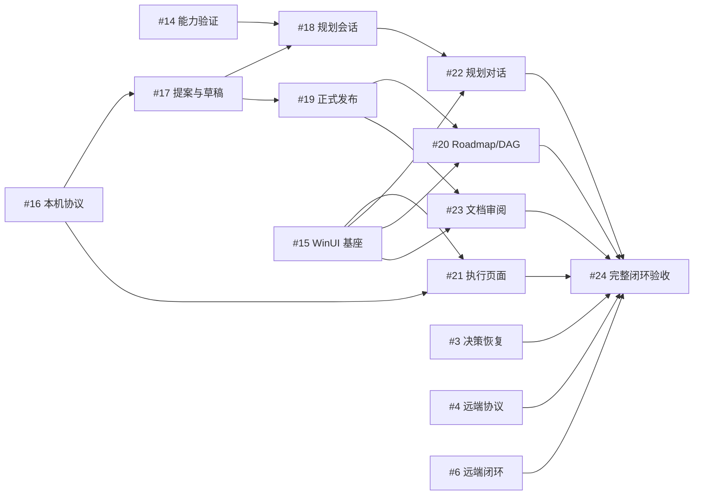

# 已规划 Spec 的执行依赖

这里直接列出 [主 roadmap](roadmap.md) 中尚未完成的执行 Spec 与验收，以及它们的开工、集成和验收前置。`#3` 的实现已交付，原生验收仍开放；`#4` 的 P13 已有中心正反向真机证据，P10 等协议门槛仍开放；`#6` 已有受监管分阶段真机证据，原生任务完整闭环和生产能力认证仍开放。执行范围和门槛以各 Spec/Plan 为准；本表用于安排顺序，不能放宽其中的要求。

下文的 `#数字` 均指任务 ID。“直接开工前置”列出必须已有的实现或证据；“集成与交付条件”说明何时才能验收并交给后续任务。共享接口的并行准备不等于允许越过各 Spec 的硬前置。

第一阶段尚未完成的任务为 #3/#4/#6；第二阶段 #14–#24 各有独立 Spec/Plan，直接硬前置和集成规则见下文。第一阶段能力的最终汇合由 #24 验收，不能用 UI 样例代替原生证据。

## 未完成范围与直接依赖

| 任务 ID | 任务名称 | 目标 / 执行 Spec | 直接开工前置 | 集成与交付条件 |
| --- | --- | --- | --- | --- |
| 3 | 人工决策与恢复闭环 | `INTERVENTION` · [Spec](../spec/pr-05-intervention.spec.md) · [Plan](../spec/pr-05-intervention.plan.md) · [剩余门槛](../validation/pr-05-intervention.md) | 决策接口已交付；Windows TTY 和本机 Orca 已有部分真实证据，已失败的 Codex attempts 按原身份结算且不重放 | 用户报告实际系统剪贴板粘贴通过，未由验证会话独立观察；精确折叠导航、符合资格的恢复确认、Codex 成功应用及应用后重启恢复证明、指定 Orca 故障注入仍待验收。Windows linked-worktree Git 管理目录写入限制仍需解决；accepted 回执不能代替应用证明。 |
| 4 | Orca 远程协议验证 | `REMOTE-PROTOCOL` · [Spec](../spec/01-orca-remote-protocol.md) · [Plan](../spec/01-orca-remote-protocol.plan.md) · [剩余门槛](../spec/orca-probe/remaining-gates.md) | 无未完成任务前置；复用已有真实远端报告、字段映射及 `#6` 中心 P13 正反向证据 | 完成固定 8 KiB 上限的发送前拒绝与 P10 宿主权限提示人工处置；未认证的能力保持生产阻断。 |
| 6 | 分阶段远程闭环 | `REMOTE-WORKFLOW` · [Spec](../spec/03-remote-execution-and-viewer.md) · [Plan](../spec/03-remote-execution-and-viewer.plan.md) | 已交付的 `#3` 决策接口、`#5` 模型与 `#9` 原生任务权威；`#4` 已实测的协议及限制 | P13、受监管分阶段执行和部分恢复路径已有真机证据；仍须完成原生任务来源的发布、合并、TaskDelivery 结项，Windows 可见服务关窗、可见 viewer、资源释放异常及其余本任务验收。生产启用前完成 `#4` 剩余必需门槛；远程取消保持不可用。 |

`#6` 复用当前单一原生中心权威接入远程执行，远端生产能力仍按自身门槛验收。`#3` 的本机决策验收、`#4` 的协议门槛与 `#6` 的原生任务闭环各自独立。

## 跨链路的接口与并行条件

- **#6 与当前执行接口的共享修改**：Service、配置、worker 上下文、Query/Command、Task DTO 和测试夹具存在共同修改面。独立协议样例可并行；涉及共同接口的修改串行集成，后集成方校验接口并运行受影响回归。`#6` 只接 native，不增加既有运行时任务的可变依赖。
- **#3/#4 与 #6 的验收资源**：本机 TTY/Orca 验收与远端探测可在固定版本和独立资源上继续；共享仓库、CLI 构建产物或平台执行不能被同时改写。`#6` 改变已测调用路径时重跑受影响项，不把此前版本证据直接标为新实现通过。
- **#3 的原生验收**：复用 `#0` 固定执行身份、`#1` 会话事件、`#2` 控制台与 `#5` SQLite 中心权威。用户报告实际系统剪贴板粘贴通过，已接受答案和回执有真实证据；精确折叠、恢复确认与成功应用仍须独立验收。已失败的 Codex attempts 仅按原身份对账，不重放；具体证据与剩余故障注入见[验证记录](../validation/pr-05-intervention.md)。
- **#4 与本机工作**：剩余远端探测可与 `#3` 的本机验收并行，探测与适配器集成不能同时占用同一真实远端测试执行资源。本机 `#1` 的精确 turn/phase 及 `#3` 的应用证明验收不代替远端能力证据；远端分页/恢复证据也不代替远端精确会话验证。
- **#6 复用已交付的原生接入**：远程闭环沿用 `#9` 的中心任务权威、固定执行上下文和恢复接口；P13 中心正反向证据已取得，但原生任务来源的完整交付与生产能力认证仍待验收，不扩大版本、消息大小或取消能力。
- **接口前置与硬前置**：接口固定后可以准备独立样本、只读展示或测试；需要真实平台、数据库或 UI 的集成验收仍须等待对应前置实现。并行建议不改变各 Spec/Plan 明定的串行交付要求；调整顺序时先修订受影响的 Spec/Plan。

## 后续仍依赖的已交付基础

- [执行控制台与轮次折叠](../spec/pr-04-console.spec.md)及[验收报告](../validation/pr-04c-console.md)：`#3` 的剩余 TTY 验收沿用决策卡片和 UI 视图状态；`#6` 复用同一查询与能力展示边界。
- [双执行后端](../spec/pr-04a-execution-backends.spec.md)与[Windows 验收报告](../validation/pr-04a-execution-backends.md)：`#3` 的本机 Orca 验收和 `#6` 复用固定 ExecutionRef、Operation、能力报告、ReadOutput 及双后端操作边界；会话 phase/turn、资源结算与 Linux 原生验收不在该后端 Spec 的交付范围内。
- [会话事件](../spec/pr-04b-conversation-events.spec.md)与[本机验收报告](../validation/pr-04b-conversation-events-2026-09-24.md)：`#3`/`#6` 复用统一会话 DTO、完整正文、分页、来源缺口与版本化能力报告；精确 turn/phase/final 仅在报告列明的本机 Codex/Orca 范围内通过。
- [中心执行模型](../spec/02-execution-model-and-adapter.md)：`#3`/`#6` 复用 WorkflowRun/Execution/StepAttempt、SQLite 单写者、Query/Command、Operation 和本地 minimal-v1 流程；远程生产执行仍待 `#6`。
- [人工决策与恢复](../spec/pr-05-intervention.spec.md)与[验证记录](../validation/pr-05-intervention.md)：`#6` 复用同一 SQLite CommandService、固定答案与应用证明；`#3` 的真实 TTY/Orca 门槛仍待完成。
- [原生项目接入](../spec/beads-exit.spec.md)与[验收记录](../validation/beads-exit/README.md)：`#6` 沿用固定 worker 上下文，仍按独立远端门槛验收。
- [统一观察契约](../spec/pr-01-observation.spec.md)：`#3` 的剩余验收沿用选择、游标、来源换代及 raw 读取。
- [服务控制协议](../spec/pr-02-control.spec.md)与[服务窗口生命周期](../spec/pr-03-service-lifecycle.spec.md)：`#3` 的剩余验收沿用请求及实例身份、回执、连接分类和停止确认。Windows 服务窗口默认 manual，关闭控制台不停服；关闭服务窗口结束服务。Linux detached 路径尚无原生会话生命周期实测。
- [真实远端能力报告](../spec/orca-probe/remote-capability-report-2026-09-23.json)与[字段映射](../spec/orca-probe/field-mapping.md)：`#4`/`#6` 复用已实测派发、身份、问答和恢复语义；远端精确会话能力仍须独立验证，不能从本机 `#1` 的验收外推。
- [verify 结果校验器](../../internal/steerline/remoteprotocol/verify_result.go)：`#6` 已接入 worker_done、检查回执及执行端 HEAD 的核验；P13 的真实中心证据见[剩余门槛](../spec/orca-probe/remaining-gates.md)。

Spec 完成交付后从未完成表移出；仍有消费者时只保留必要交接。本图不记录 PR、提交或文档维护历史。

## 第二阶段硬前置与并行集成

本组公共契约随独立规格固定，C 等草案字母不再承担依赖身份。表中列出直接硬前置，传递前置由图继承；已交付基础见各 Spec。没有依赖边的任务可独立开发，但服务的实际执行并发仍受现有槽策略约束。

| 任务 ID | 任务名称 | 目标 / 执行 Spec | 直接开工前置 | 集成与交付条件 |
| --- | --- | --- | --- | --- |
| 14 | Codex 规划主 agent 能力验证 | `PHASE2` · [Spec](../spec/phase2-agent-capabilities.spec.md) · [Plan](../spec/phase2-agent-capabilities.plan.md) | 无未完成硬前置 | 本 Spec 全部验收通过；共享接口有变更时同步消费者和受影响回归。 |
| 15 | WinUI 基座与原生输入 | `PHASE2` · [Spec](../spec/phase2-winui-foundation.spec.md) · [Plan](../spec/phase2-winui-foundation.plan.md) | 无未完成硬前置 | 本 Spec 全部验收通过；共享接口有变更时同步消费者和受影响回归。 |
| 16 | 本机客户端协议与历史查询 | `PHASE2` · [Spec](../spec/phase2-local-api.spec.md) · [Plan](../spec/phase2-local-api.plan.md) | 无未完成硬前置 | 本 Spec 全部验收通过；共享接口有变更时同步消费者和受影响回归。 |
| 17 | 规划提案与受控草稿 | `PHASE2` · [Spec](../spec/phase2-planning-drafts.spec.md) · [Plan](../spec/phase2-planning-drafts.plan.md) | `#16` | 本 Spec 全部验收通过；共享接口有变更时同步消费者和受影响回归。 |
| 18 | Codex 规划会话服务 | `PHASE2` · [Spec](../spec/phase2-planning-sessions.spec.md) · [Plan](../spec/phase2-planning-sessions.plan.md) | `#14`、`#17` | #14 必须有通过证据，复用 #17 guard；与 #19 的 Service/存储接线串行集成。 |
| 19 | 正式文档发布与任务创建 | `PHASE2` · [Spec](../spec/phase2-document-publish.spec.md) · [Plan](../spec/phase2-document-publish.plan.md) | `#17` | 复用 #17 guard 与正式读模型；与 #18 独立开发，共享接线后合入方回归双方。 |
| 20 | Roadmap 与 DAG 原生浏览 | `PHASE2` · [Spec](../spec/phase2-roadmap-ui.spec.md) · [Plan](../spec/phase2-roadmap-ui.plan.md) | `#15`、`#19` | 使用 #19/#17 已交付的真实版本查询；与另一文档页面可分头开发，共享 WinUI 导航串行集成。 |
| 21 | 执行与待处理原生界面 | `PHASE2` · [Spec](../spec/phase2-execution-ui.spec.md) · [Plan](../spec/phase2-execution-ui.plan.md) | `#15`、`#16` | 未通过的第一阶段能力保持不可用；本任务交付不代替 #24 完整后端验收。 |
| 22 | 规划对话原生界面 | `PHASE2` · [Spec](../spec/phase2-conversation-ui.spec.md) · [Plan](../spec/phase2-conversation-ui.plan.md) | `#15`、`#18` | 真实会话/工具经 #18；不等 #19，但无审阅发布副作用入口。 |
| 23 | 文档审阅与确认原生界面 | `PHASE2` · [Spec](../spec/phase2-review-ui.spec.md) · [Plan](../spec/phase2-review-ui.plan.md) | `#15`、`#19` | 使用 #19/#17 已交付的真实版本查询；与另一文档页面可分头开发，共享 WinUI 导航串行集成。 |
| 24 | 第二阶段完整闭环验收 | `PHASE2` · [Spec](../spec/phase2-integration.spec.md) · [Plan](../spec/phase2-integration.plan.md) | `#20`、`#21`、`#22`、`#23`、`#3`、`#4`、`#6` | 全部前置真实交付；本任务逐项完成两后端和跨组件故障验收，不以样例代替。 |

- 规划 worktree、提案、ID 预留、正式/草稿读模型与写入 owner/generation 由 #17 单独实现；#18/#19 共同消费，不各建状态或锁。#19 推进正式版本，#20/#23 的真实交付等待它完成。
- #16 只拥有传输、认证和既有执行映射；#17/#18/#19 分别拥有自身业务 handler、DTO 和恢复。共同信封已在 [Spec 共同约束](../spec/phase2-constraints.md)中固定，不能将 #16 的内部里程碑当作放行。
- #18/#19 在 Service、Query/Command、SQLite 接线处串行集成；#20/#21/#22/#23 在 WinUI 导航、连接与输入公共组件处串行集成。独立业务文件可并行开发，后合入方重跑受影响消费者。
- #3/#4/#6 与第二阶段共用测试宿主、二进制、远端资源时分时验收；隔离工作区不隔离全局 CLI 配置、进程或真实 Orca runtime。不得在另一项验收途中替换它使用的构建或重启共享宿主。
- #24 是最终验收的唯一任务归属，不承担各上游任务缺失的实现。各组件交付与完整产品交付分别记录；任务创建时保留上述固定 AND 依赖，不新增部分完成放行机制。
