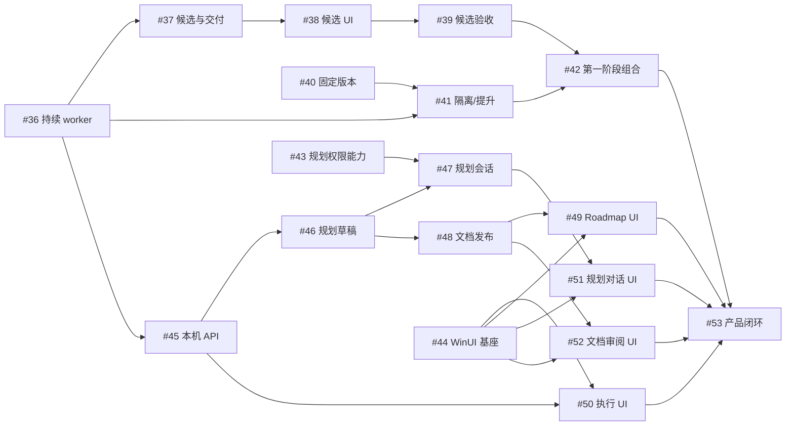
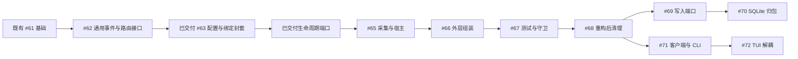

# 执行依赖与交接

本图对应[主 roadmap](roadmap.md)中的活动规划。每项执行以独立 Spec/Plan 为准，运行时资格以中心 DAG 为权威。

## 固定前置

#36 的持续 worker 功能、#61 的执行需求/注册基础和 #63 的配置/原生绑定封套是后继可复用能力，不再作为活动实施任务；原验收范围分别以[持续 worker Spec](../spec/worker-flow.spec.md)、[执行隔离验收](../validation/execution-isolation-08-resolution/README.md)和[#63 Spec/Plan](../spec/core-decoupling-02-bindings.spec.md)为准。图中基础节点只表示后继依赖，未完成的原生验收限制不据此解除。

| 任务 ID | 任务名称 | 交付范围 | 硬前置 | 执行规格 |
| --- | --- | --- | --- | --- |
| 37 | 多候选会话与唯一PR交付 | 候选创建与完整运行、反馈隔离、唯一交付及落选事实 | `#36` | [Spec](../spec/candidate-workers.spec.md) · [Plan](../spec/candidate-workers.plan.md) |
| 38 | 候选观察界面 | 候选列表/选择和原会话反馈的 TUI 增量 | `#37` | [Spec](../spec/candidate-console.spec.md) · [Plan](../spec/candidate-console.plan.md) |
| 39 | 多候选本机与远端真机验收 | 多候选本机/远端竞争和混合后端增量验收 | `#38` | [Spec](../spec/candidate-native-acceptance.spec.md) · [Plan](../spec/candidate-native-acceptance.plan.md) |
| 40 | 固定版本与双入口 | 不可变构建、stable/dev 固定入口和身份 | 无 | [Spec](../spec/versioned-runtime.spec.md) · [Plan](../spec/versioned-runtime.plan.md) |
| 41 | dev 隔离与 stable 提升 | 独立 home、静止可恢复会话下的受控提升 | `#40`、`#36` | [Spec](../spec/runtime-isolation-promotion.spec.md) · [Plan](../spec/runtime-isolation-promotion.plan.md) |
| 42 | 第一阶段集成验收 | 版本组合、stable 24 小时、dev 并行和提升恢复 | `#39`、`#41` | [Spec](../spec/phase1-release-acceptance.spec.md) · [Plan](../spec/phase1-release-acceptance.plan.md) |
| 43 | Codex 规划主 agent 能力验证 | 规划 agent 权限与受控工具能力证明 | 无 | [Spec](../spec/phase2-agent-capabilities.spec.md) · [Plan](../spec/phase2-agent-capabilities.plan.md) |
| 44 | WinUI 基座与原生输入 | Windows 原生窗口、IME/多行输入和导航基座 | 无 | [Spec](../spec/phase2-winui-foundation.spec.md) · [Plan](../spec/phase2-winui-foundation.plan.md) |
| 45 | 本机客户端协议与历史查询 | 五阶段/原会话反馈的本机 HTTP/SSE 与离线查询 | `#36` | [Spec](../spec/phase2-local-api.spec.md) · [Plan](../spec/phase2-local-api.plan.md) |
| 46 | 规划提案与受控草稿 | 规划工作区、提案/ID 预留、草稿与文档权威 | `#45` | [Spec](../spec/phase2-planning-drafts.spec.md) · [Plan](../spec/phase2-planning-drafts.plan.md) |
| 47 | Codex 规划会话服务 | 受控规划会话、草稿工具和写入仲裁接线 | `#43`、`#46` | [Spec](../spec/phase2-planning-sessions.spec.md) · [Plan](../spec/phase2-planning-sessions.plan.md) |
| 48 | 正式文档发布与任务创建 | 正式文档版本、目标分支集成与中心创建 | `#46` | [Spec](../spec/phase2-document-publish.spec.md) · [Plan](../spec/phase2-document-publish.plan.md) |
| 49 | Roadmap 与 DAG 原生浏览 | Roadmap/DAG 原生浏览与精确关联 | `#44`、`#48` | [Spec](../spec/phase2-roadmap-ui.spec.md) · [Plan](../spec/phase2-roadmap-ui.plan.md) |
| 50 | 执行与待处理原生界面 | 五阶段、完整会话与统一反馈原生页面 | `#44`、`#45` | [Spec](../spec/phase2-execution-ui.spec.md) · [Plan](../spec/phase2-execution-ui.plan.md) |
| 51 | 规划对话原生界面 | 规划会话和受控草稿工具的原生对话 | `#44`、`#47` | [Spec](../spec/phase2-conversation-ui.spec.md) · [Plan](../spec/phase2-conversation-ui.plan.md) |
| 52 | 文档审阅与确认原生界面 | 规划文档差异、固定版本确认与发布回执 | `#44`、`#48` | [Spec](../spec/phase2-review-ui.spec.md) · [Plan](../spec/phase2-review-ui.plan.md) |
| 53 | 第二阶段完整闭环验收 | 规划到真实任务交付再回规划的完整产品链 | `#49`、`#50`、`#51`、`#52`、`#42` | [Spec](../spec/phase2-integration.spec.md) · [Plan](../spec/phase2-integration.plan.md) |

## 接口和共享修改

| 所有者 | 交接内容 | 集成规则 |
| --- | --- | --- |
| #36 | 主阶段、原会话输入/输出、PR 关联和 TaskDelivery | #37/#41/#45 消费；不另建步骤或专用恢复状态机 |
| #37 | 精确候选身份、查询/反馈和唯一交付 | #38/#39 消费；#45 初版不依赖多候选 |
| #40/#41 | 固定版本选择、真实工作轮次及恢复条件 | 配置/服务恢复入口串行集成；空闲会话不被直接视作活动进程 |
| #43/#47 | 规划 agent 的权限、受控工具及会话 | 可复用底层会话能力，规划 guard 与任务 worker 权限分别管理 |
| #45/#46/#48 | 传输、草稿权威、正式发布与中心创建 | 复用 Query/Command；发布/反馈各自按同一个写者和原请求对账 |
| #44 | 原生输入和导航组件 | 页面复用同一客户端、草稿和正文组件；共享导航串行集成 |

## 验收分工

#36 验单 worker 持续交互；#39 验多候选竞争；#42 验固定版本、24 小时和提升组合；#53 验完整规划/UI/执行闭环。上游证据可复用，接口或平台改变的部分定向重验，不重复构造已删除的五步与答案应用证明矩阵。

不同任务人工并行和自动派发策略沿既有能力；共享工作区、平台宿主、构建或 SQLite 接线时串行协调。新任务只有固定前置整体交付后可领取，没有接口提前完成的放行状态。

## 主包与执行实现解耦

目标：`CORE-IMPLEMENTATION-DECOUPLING`。详情见[目标规划](core-implementation-decoupling.md)，执行要求见[共同约束](../spec/core-decoupling-constraints.md)。既有 #61 的纯需求/注册基础可直接消费；不等待 remote 权限证据补齐，也不解除其现行拒绝。

| 任务 ID | 任务名称 | 交付范围 | 硬前置 | 执行规格 |
| --- | --- | --- | --- | --- |
| 67 | 主包隔离守卫与测试归位 | 主包测试清零、结构守卫与外层第三实现闭环 | #66 | [Spec](../spec/core-decoupling-06-boundary.spec.md) · [Plan](../spec/core-decoupling-06-boundary.plan.md) |
| 68 | 主包解耦重构后代码清理 | 最终调用关系下的死代码/重复规则/无用辅助清理与索引同步 | #67 | [Spec](../spec/core-decoupling-07-cleanup.spec.md) · [Plan](../spec/core-decoupling-07-cleanup.plan.md) |
| 69 | 中心写入端口收窄 | 窄提交契约接通命令/worker/任务/DAG/交付/会话，保留原子边界 | #68 | [Spec](../spec/core-decoupling-08-write-ports.spec.md) · [Plan](../spec/core-decoupling-08-write-ports.plan.md) |
| 70 | SQLite写入实现归包 | 连接/schema/SQL/事务归唯一存储模块，复用只读 Reader | #69 | [Spec](../spec/core-decoupling-09-sqlite.spec.md) · [Plan](../spec/core-decoupling-09-sqlite.plan.md) |
| 71 | 产品客户端适配层与CLI接入 | 产品纯契约、唯一默认 adapter 和 CLI 产品读取/命令消费者 | #68 | [Spec](../spec/core-decoupling-10-client.spec.md) · [Plan](../spec/core-decoupling-10-client.plan.md) |
| 72 | TUI与中心实现解耦 | TUI 消费产品接口，删除中心/存储依赖及默认 I/O 薄桥 | #71 | [Spec](../spec/core-decoupling-11-tui.spec.md) · [Plan](../spec/core-decoupling-11-tui.plan.md) |

| 交接 | 接口前置与开工条件 | 共享修改及集成要求 |
| --- | --- | --- |
| #62 → #63 | 通用事件/问题、可信路由封套及唯一原生 codec 已交付 | WorkerEvent/Decision/contracts 形状串行，#63 复用路由 codec，不造第二份 |
| #64 → #65 | 单步 intent/receipt 和只读对账端口已交付 | actor/workerMessages/消费屏障唯一，宿主与采集不取得业务写权 |
| #65 → #66 | 通用采集、宿主端口与 Service 字段已交付 | 客户端/mapper/native 状态归实现，外层只组合，不搬走中心事务 |
| #66 → #67 | 所有产品入口显式注入，主包生产清零 | #67 迁剩余平台测试和加守卫，不承担生产消费者搬迁 |
| #67 → #68 | 生产/测试隔离及构造链实际完整，守卫有效 | 清理最终可删残留，不补 #65–#67 应完成的迁移；保留恢复/拒绝证据与实际断言 |
| #68 → #69/#71 | 一致基线、唯一调用链和模块归属 | 写入端口/Store 归 #69，产品 DTO/CLI/adapter 归 #71；不同时改共享 contracts 形状 |
| #69 → #70 | 全部写消费者已使用窄端口和固定提交声明 | SQL/连接/schema 唯一迁移，原事务和 query Reader 不变；客户端不依赖具体存储 |
| #71 → #72 | 实际 CLI 消费的产品纯契约、唯一 adapter 和暂存桥清单 | TUI 切换消费者并删除桥，不另建 I/O；模型/渲染不解释平台配置或写资格 |

#65–#68 按硬前置串行整体交付后开工，一项一个实现 PR。#65 使用已交付配置/绑定封套和[生命周期端口](../validation/core-decoupling-03-lifecycle/README.md)，不重建副作用协调。可以提前只读盘点、审阅接口和准备 fixture；不能把接口草案或包内实验当作提前领取资格。前述串行阶段共享 execution/contracts、Service 和恢复入口，不按文件不同允许并行实施。旧到新测试路径映射随职责迁移交付，quick 不得因名称变化漏跑或重复矩阵。

2026-10-02：#65 已合并；#66 外层组装与主包生产隔离已实现并独立复审修复，完全访问组合 core 6/rules 90/targeted 22 全通过，见[交付与复审记录](../validation/core-decoupling-05-composition/README.md)。本 PR 真实合并后才启动 #67；活动表保留剩余任务。

#68 后按[后续维护约束](../spec/core-maintenance-constraints.md)并行存储 #69 → #70 与客户端 #71 → #72，各自仍等待硬前置。写端口/中心提交/SQL/schema 的修改由存储线负责；产品 DTO/CLI/adapter/TUI 由客户端线负责。两线通过稳定应用 Query/Command 接口隔离，不存在存储先完成才允许客户端开工的隐含边。共享类型形状和应用组装、守卫/quick 构造段必须指定所有者并顺序集成；冲突未解决时暂停该共享改动，不能用双实现或任意写入口绕过。

与多候选/本机 API/版本隔离工作同时进行时，涉及 Config、ExecutionRecord、Service、恢复、事件/问题、CLI 或 query 构造入口的修改需串行集成；既有任务的固定 Spec 不被本表自动修改。API 消费通用业务端口，新实现适配和组装不进入产品 UI。中心 DAG 不因本次规划文件变化自动建任务或改边。
