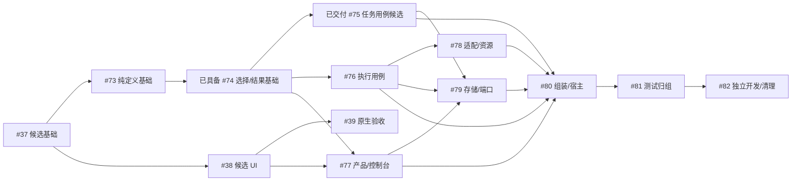

# 任务执行控制台解耦与目录整理 Roadmap

目标标识：`TASK-EXECUTION-CONSOLE-DECOUPLING`。

本目标把任务、执行、控制台划为三个可以独立开发的业务边界，并把包与目录整理纳入同一轮交付。任务线负责提供与挑选工作；执行线负责容量、派发、交付核验和结项，向任务线提交执行结果；控制台只通过产品契约查询与操作。三条线的日常功能改动应无需修改另外两条线的内部实现，共同业务语义变化通过明确契约协同。

本文维护 #76–#82 的剩余实现安排；#75 任务应用候选及 #76 必要公共接线见[交付与交接](../validation/three-line-03-task-usecases/README.md)；#73 的唯一类型基础及残留交接见[验收记录](../validation/three-line-01-types/README.md)。M01–M10 只用于定位阶段，各对应一个独立任务、Spec/Plan 和实现 PR；任务身份及活动规划遵循 [Roadmap 目录约定](readme.md)。正式执行以固定 Spec/Plan 和中心 DAG 为准。

本目标服务于 [产品愿景](product-vision.md) 的两个近期交付节点：一阶段加强同任务分叉候选执行与唯一交付，二阶段增加受控规划主agent与原生UI。三条开发线是当前解耦边界，不把未来全部业务强行归入这三个包。

## 已具备基础与剩余问题

已具备执行后端隔离、唯一应用组装、窄提交端口、SQLite唯一实现，以及CLI/TUI共用的注入式产品客户端。本目标保留这些能力：业务不依赖具体后端或SQL，客户端不拥有业务写权限，提交/恢复仍核验原身份与版本。需要核对源码归属时按需查 [当前架构](../architecture/current-code-architecture.md)，不要求先阅读已交付Spec/Plan或历史验收链。

当前剩余问题如下：

- `internal/steerline` 主包仍同时持有任务、执行、决策、控制、恢复与提交用例。
- 任务选择与执行结果边界已接通 task 工作/规范结果端口、执行核验和专用原子提交；任务应用用例已由 #75 迁入 task；执行 actor 的完整迁包及领取文档端口集成仍由 #76 负责。后继消费已固定小端口，执行资格仍以各自硬前置真实交付为准。
- 产品公共快照仍包含完整 Domain/Runtime 和内部记录，控制台虽已隔离实现 import，仍会受到内部模型形状变化影响。
- `contracts` 混合任务、执行、展示、宿主与持久类型；业务、后端、查询、存储和测试工具按不同层次平铺，存在职责相近的小包及两处集成测试目录。

## 范围与保留行为

继续使用同仓库、同一个 `go.mod`、当前服务部署方式和 SQLite。package 用于源码依赖隔离，目录用于表达所有权；不因三条开发线而引入独立版本、多个数据库或新的进程间协议。

本轮包含业务职责调整、用例归包、纯类型归属、产品视图收窄、目录归组、小包合并、配置与服务宿主收口、测试归位及边界守卫。每阶段同时迁移调用者和测试、删除被替代实现，避免先全仓改路径再重做业务拆分。

保留当前任务/DAG 规则、持续 worker、人工并行与自动派发行为、原会话反馈、恢复授权、唯一交付和 UI 生命周期。责任换所有者不代表改变产品行为。失败、轮次结束、最终回复、交付成功和任务关闭继续分别表达。

第一阶段产品流程只含本地 Codex/本机 Orca；存量远端适配代码只保留迁移、编译与协议保护，不要求远端真机验收。

不扩展多候选、规划 agent、HTTP/SSE、WinUI、共享部署、动态插件、新后端或远端权限。相关已有产品任务保持自己的范围与固定 Spec，本目标不自动成为它们的新硬前置。

“不扩展”限定本轮实现范围，不允许契约锁死单候选、只有任务worker的会话或只有Go客户端的产品。M01/M02核对既定多候选身份与结果语义，M05核对跨语言查询/命令和来源作用域；实际能力仍由其产品任务交付，未装配时明确unsupported。

结构搬迁不强制改变数据格式。确需调整内部配置、记录或协议时，由该格式唯一所有者在对应阶段统一处理版本与拒绝边界；不新增旧版读取、迁移、双写或回退。当前支持格式内的恢复和原请求对账必须成立。

## 业务所有权

| 所有者 | 独立负责 | 边界要求 |
| --- | --- | --- |
| 任务线 | 任务创建与固定契约、依赖、资格、优先级与挑选；接收结果并更新任务记录、结果关联和 DAG 资格 | 不理解后端、session、turn、执行槽位、PR 核验和资源清理 |
| 执行线 | 派发模式与并发容量、方案冻结、Workflow/Execution/Attempt、会话与决策、恢复、发布、交付受理与核验、关闭决定、清理 | 通过任务端口取得固定工作并提交规范化结果；具体后端不获得业务写权限 |
| 控制台线 | 项目与对象选择、导航、输入、折叠、滚动、阅读锚点和偏好 | 只消费产品契约，不能自行计算业务资格或构造后台实现 |
| 产品层 | CLI/TUI 共用查询、命令与回执、连接诊断、组合视图和唯一客户端 | 显示任务与执行提供的事实，保持同一读快照；不成为第二业务写者 |
| 服务宿主 | 服务循环、心跳、控制传输与命令路由、进程承载和资源关闭 | 消费注入的小端口，不承载任务或执行状态机 |
| 应用组装 | 读取配置、构造具体实现与连接、注入各自端口 | 不决定任务资格、交付或恢复授权 |
| 存储 | 唯一连接/schema/SQL/事务、前值与版本重检、身份和唯一约束 | 不解释平台协议、不调用应用用例或后端工具 |

执行线决定“是否已经满足交付与关闭条件”。任务线应用经过执行线核验的结果，只校验任务身份、固定契约、领取归属、预期版本、结果去重和合法状态转换，并据此维护 DAG。详细 PR 证据和 worker 事实归执行线，不通过把它们包装为不透明载荷继续留给任务解释。

丢弃由任务线记录任务意图与状态；涉及执行时，由执行线提供是否可丢弃的核验事实并负责停止与清理。交付和丢弃竞争由同一提交边界重检。不能在任务侧重新查询 PR、停止进程或把待核实现场当作可安全清理。

## 与一阶段分叉执行和二阶段的对齐

### 一阶段分叉执行

已具备的分叉执行是一个Task下多个独立WorkflowRun，各自持有worker会话、Execution、工作区、分支、PR和反馈。首个候选完成领取；后续候选增加工作流，不重新挑选或领取同一Task，也不新建另一份可写Candidate权威。一期输入稳定roadmap；候选默认一个、人工逐个新增，不另设single/multiple模式。各候选可选不同冻结配置，开始时观察参与数已达5个拒绝，不建立数量预留、硬槽或停止确认门槛，接受竞态偶尔超出。

任务挑选以Task为粒度；候选创建、精确反馈、候选集合交付核验及资源结算归执行线。所有执行级查询、命令、游标和UI选择绑定明确WorkflowRun/Execution/会话，不能通过task_id选“最后一个”或“最新一个”运行；不能唯一定位时返回明确歧义。

候选失败、停止或轮次结束不是Task完成。执行线按已知候选及历史PR集合核验，只有一个符合既定条件的真实合并结果才能提交任务级交付；多个合并或事实缺失进入待决策。交付后其他候选的输出、资源与迟到合并仍保留，不能覆盖原结果、再次释放后继，或把落选视作已停止。新增候选与交付、丢弃均在原Task/集合版本上仲裁。

合并前可放弃单个候选，立即退出实验和数量检查；停止不支持/未知不回滚放弃、不阻止人工新实验，历史与迟到PR继续保留。已知PR合并后拒绝放弃，合并竞态如实记录冲突，不覆盖交付。业务与查询/控制基础已具备，TUI 实现已具备，CC5 已由用户人工确认通过；本机不同后端方案增量由 #39交付。解耦不把宽松5个检查改成资源硬上限，不自动创建竞争候选或评分/融合，不建新的交付门槛。迁移时回归集合身份和竞争边界；尚未完成的原生验收不能以fake宣称已支持。

### 二阶段主agent与规划领域

二期采用[草稿与审核准入目标](phase2-draft-roadmap-admission.md)：主agent维护草稿，独立审核agent检查Spec质量及是否基本不受前置变化影响。合格且可固定的内容才由SteerLine受控纳入正式roadmap；需要修改或等待前置的任务留草稿，按相关条件变化重新审核。当前 #46–#48是旧基础范围，尚未包含独立审核或成熟度门槛，实际实施前修订相应Spec/Plan并固定新任务，不能隐式把审核agent当worker加入一期。

依照 [第二阶段共同约束](../spec/phase2-constraints.md)，规划是独立业务领域。未来由 #46–#48 建立 `internal/planning/`，拥有PlanningWorkspace、Proposal、DraftFile、PlanningSession/Turn、文档版本、统一写入guard和规划Publication。本轮只明确该归属与接入点，不创建空规划包、通用插件机制或尚无消费者的规划实现。

规划主agent仅支持本机Codex；它在草稿范围内讨论/修改候选规划。审核agent由服务独立调度、只审固定快照与前置证据，两者均不能直接写正式任务集合或调用worker派发。reserve、正式文档发布、任务创建和执行产品命令仍须人的确认，主agent不能运行实现、通用shell或子agent。规划域经任务创建端口提交已确认的固定批次，不能绕过任务用例直接写DAG；主agent也不能借worker的权限配置或派发入口取得执行权。

规划文档Publication与执行PR publication分别归planning和execution。二者都可使用原Operation/幂等基础，但不共用业务状态机、确认记录或写入guard。共享Git规划ref与SQLite的部分完成由planning按原动作对账，不能把它和任务领取/交付声明为跨系统单事务。

Codex协议传输、确定轮次事件、正文与游标可以复用经过验证的基础；原生协议实现的路径不赋予其业务所有权。#43验证受控工具与权限后，#47才能接主agent。规划不复用任务worker的自动派发、发布PR、退出结项或session恢复授权规则。

规范会话值与读取接口必须按实际来源区分任务候选与规划session。当前worker的Workflow/Execution/Attempt绑定只约束worker来源；未来planning来源使用自己的session/turn/workspace/generation，不伪造Task或Execution ID。正文、去重、游标和恢复按项目及来源作用域隔离，共用存储不混合权限。新规划session保持同一规划worktree但使用空白新thread，不继承旧上下文，也不与一阶段候选分叉混为同一功能。规划身份及来源支持由 #47 实际交付。

### 二阶段原生UI与产品协议

`product/api`定义产品语义，`product/client`是Go的CLI/TUI客户端，不是C#客户端的代码复用要求。#45在产品侧提供HTTP/JSON、SSE和离线只读协议承载；#44及后续页面在独立Windows客户端目录实现C#/WinUI。未来目录建议为 `internal/product/transport/` 与 `apps/windows/`，本轮不创建这些尚未实现的包或应用。原生UI经协议消费相同语义，不import Go包，也不读取SQLite、文件控制目录或平台私有日志。

公开契约需要稳定、可序列化的目标/版本/回执/错误/能力/游标，不能把Go句柄、接口、Config、Runtime或TUI专有状态作为线上DTO。领域接口由对应产品任务增加，宿主与协议适配负责显式接线，不能把command/source/domain枚举永久封闭为task与execution两种。未交付领域返回unsupported，不接受永远不能执行的命令。

规划页面分别标注document_version、proposal/version与graph/database revision；Git文档与SQLite状态不制造全局原子快照。执行视图的同数据库读取继续保持同事务。用户建议、草稿保存、文档发布、任务创建、执行与真实交付各有状态和关联；SSE仅通知，重连从持久查询补读。

### 产品推进与结构整理的顺序

#37 的候选身份、领取和唯一交付及 #73 的纯定义基础已具备，#74 实际端口及共同字段/文件拆分见[交接清单](../validation/three-line-02-task-execution-boundary/integration-ownership.md)，作为后续用例迁包基础；不必等 #39 才开始业务迁移。#77 的产品/控制台迁移等待 #38，避免共同 TUI/DTO 重写。#39 仍等待 #38，并可与解耦线使用隔离固定构建并行；构建换入迁移后只对实际受影响入口定向重验。版本线与 #39 仍按原条件汇入 #42。

二阶段 #43能力验证、#44 WinUI基座可以独立准备；#45沿既定 #36前置交付协议，不等待M01–M10全部完成。#46–#48经稳定任务创建、产品和协议基础接入规划；#49–#52接领域页面，#53保持现有产品汇合条件。M01–M10是本目标内部顺序，不自动加入这些产品任务的运行时DAG。

正式安排时，对多候选、API、规划与重构共用的模型、会话存储、配置和组装段选定唯一修改所有者，顺序集成同一契约。目录迁移涉及既有产品Spec中的路径变化时，在实际任务交付中同步消费者与必要规格，不由本次目标审计改写产品任务的业务范围或硬前置。

## 目标目录与包边界

```text
cmd/
  steerline/
  test-feedback/
  orca-probe/

internal/
  app/                      # 配置加载、实际构造与依赖注入
    host/                   # 服务循环、心跳、控制传输与路由
  task/                     # 任务应用用例、挑选与结果应用
    model/                  # 任务值对象、固定契约、DAG和资格纯规则
  execution/                # 派发、会话、恢复、交付与结项用例
    model/                  # 执行记录及状态转换纯规则
    backend/                # 后端纯契约、能力、意图、事实与回执
    adapters/               # 分组目录，不要求存在Go package
      codex/
      orca/
      orcaremote/
    workspace/              # Git工作区操作
    publication/            # PR/provider操作
    process/                # OS进程与执行宿主
  product/
    api/                    # 产品公开纯值与小接口
    client/                 # 唯一产品客户端
    query/                  # 查询、纯投影、页面组合与展示格式化
  console/                  # TUI与独立视图状态
  storage/
    ports/                  # 纯读取与原子提交契约
    sqlite/                 # 唯一SQLite实现
  testkit/
    boundary/               # 架构和测试依赖守卫
    feedback/               # 测试报告
    process/                # 测试进程工具
    protocol/               # 测试协议fixture

tests/
  integration/              # 实际应用构造和跨模块验证
  e2e/                      # 现有分级场景与环境
```

这是目标所有权与路径；实施前在各正式 Spec 中核对实际消费者，细化具体文件归属。分组目录不必成为 package。只为纯规则/用例、协议实现、外部副作用、存储和产品公开契约保留独立包；同一所有者内的小职责先用文件组织，不另建通用 `common`、`utils`、`manager` 或共享全能 Service。

| 当前所有者 | 目标归属与整理 |
| --- | --- |
| task、taskgraph 和主包任务规则 | 合并到 task/model，任务应用用例归 task；派发与PR规则移出 |
| workerflow、contracts 中执行记录与纯规则 | execution/model；任务输入到worker提示的转换归 execution 用例 |
| 现有 execution 纯后端契约 | execution/backend，保持不依赖业务用例或具体实现 |
| 主包执行、决策、会话、恢复及交付用例 | execution，状态与外部动作经原提交屏障组织 |
| codexworker、codexapp、orcaworker、orca_remote_worker | execution/adapters 下对应实现；codexapp 先核对共享消费者，再决定并入或保留专用协议子包 |
| workspace、publication、processhost | execution 下对应独立副作用包 |
| query、projection、taskview、activityview | 收拢到 product/query；领域规则仍调用 model 的唯一实现，不复制 |
| clientcontracts、steerlineclient、console | product/api、product/client、console；消除完整内部记录向UI泄漏 |
| persistence、sqlite | storage/ports、storage/sqlite；窄端口和原子事务不因目录整理放宽 |
| steerlineapp、主包服务承载/配置/安装入口 | app、app/host 与 cmd 按构造/承载/参数职责归位 |
| coreboundary、testboundary、testfeedback、testprocess、testprotocol | testkit 下对应支持包；生产不能依赖 |
| steerline/integration、steerlineintegration | tests/integration；包内单元测试随真实所有者迁移 |
| contracts、steerline 主包 | 类型与消费者逐阶段归位后删除；不保留永久别名或转发门面 |

## 依赖与公开契约

纯模型是应用、查询和存储可以共同消费的边界，不是把所有跨线类型重新集中起来的共享包。任务输入及任务接收的结果归 `task/model`；执行记录与事实归 `execution/model`；后端操作与来源契约归 `execution/backend`；页面摘要、用户命令及回执归 `product/api`；提交声明归 `storage/ports`。每个公开类型只有一个定义所有者。

| 消费者 | 允许的项目内直接依赖 | 必须阻止 |
| --- | --- | --- |
| task/model | 自有纯值与规则，原则上仅标准库 | 执行业务/后端、产品、存储、服务宿主 |
| execution/backend | 标准库 | 业务模型、用例、SQL和具体实现 |
| execution/model | execution/backend 与自有纯规则 | task/execution应用用例、adapter、SQL、产品、宿主 |
| product/api | 标准库及确有必要的稳定纯标量 | 完整Domain/Runtime、持久记录、业务/客户端/存储实现 |
| storage/ports | 各线所需纯模型、后端纯值及公开纯契约 | product/query、业务用例、具体SQL、组装和宿主 |
| task | task/model、自己的小端口、必要storage/ports | 直接使用execution模型或backend；执行应用/具体adapter、具体存储、product实现、组装和UI |
| execution | 执行model/backend、任务小端口及task/model、必要storage/ports | task内部实现、具体adapter/SQL、组装和UI |
| product/query | 纯模型、api、读取端口及纯投影 | task/execution应用实现、具体存储、adapter、组装 |
| product/client | api及注入的产品读取/命令/连接端口 | 业务实现、具体SQL、adapter、组装 |
| console | product/api | task/execution内部、query/client实现、SQL、adapter、组装 |
| storage/sqlite | ports、纯模型和product/query纯投影 | 应用用例、组装/宿主、具体后端和测试工具 |
| 执行adapter与资源实现 | backend及必要执行纯值、实际协议/副作用协作 | task/execution应用实现、业务写端口、组装和UI |
| app/host | 注入的业务/查询端口及必要纯值 | 具体adapter/SQL、UI、应用构造包 |
| app | 需要构造和连接的实际实现 | 测试fixture与runner |

业务用例、具体实现、SQL、组装与测试工具的禁止边界同时检查直接和传递依赖。共享纯存储端口可引用任务与执行纯值，task经该纯包出现执行纯值的间接依赖不视为执行实现耦合；任务实际消费的方法签名、转换声明和读取结果不得携带Execution/Workflow、PR或session记录。task不能直接import execution模型/backend，也不能从聚合连接获得另一线的方法。用 import 图和实际端口签名/消费者检查共同验证，不用目录关键字或简单纯包黑名单制造无法成立的矩阵。

小接口优先在消费者侧定义，具体实现通过结构匹配满足；app 完成注入，避免 execution 为取任务而 import task 应用包。app/host 的业务入口接口与路由契约不引用具体服务类型。上述矩阵描述本轮已实现领域；未来planning沿相同纯值/用例/传输分层接入，不被塞进execution或宿主，也不获得任务/执行任意写权限。

product/query 保留唯一查询与分页/正文规则。被存储读取复用的投影只依赖纯模型和api，不经读取端口回到自己；storage/ports 不导入 query，防止 `query → ports → query` 的环。产品公开摘要按页面语义定义，不复制一整份可写Runtime或持久数据库模型。服务工作状态的重建归execution/model，不依赖产品页面投影；现有projection需按服务重建和产品展示两个实际消费者归位，共同选择规则保留在model中，避免产品层成为执行层的反向依赖。

## 跨线工作与结果交接

任务向执行提供固定工作及选择依据：项目/任务身份、固定契约及摘要、预期任务与图版本、领取归属。任务负责顺序、优先级、任务类型过滤及明确指定任务的选择；执行负责是否有容量、模式是否允许、方案和环境是否满足。工作选择结果只是待领取对象，不能跳过正式领取时的事务重检；它不等同于同Task的执行候选。新增执行候选复用原领取及共同base，由执行用例核验后保存独立工作流与启动意图。

执行向任务提交规范化任务级结果：稳定结果身份、原领取与获胜结果关联、任务与契约摘要、预期版本、结果类别及交付引用。详细Workflow/Execution/原生身份、PR合并证据、会话正文与清理进度由执行线持有；任务只使用稳定关联标识校验归属，不接收另一线的完整记录。每个执行候选的轮次/停止/失败结果留在执行线，不逐个驱动Task关闭。任务不依据任意 `success=true` 关闭；只接受受控执行用例提交且可关联到已核验唯一交付记录的完成结果。客户端和后端不能调用任意结果应用入口。

失败、待决策、待核实、交付成功分别表达。只有已核验的唯一交付结果允许关闭并释放后继；失败和未知结果只记录真实状态，不据此解锁DAG或生成替代worker。当前格式重启从原记录和请求对账，不能依赖进程内事件投递才完成结果同步。

跨线提交由执行用例组织任务转换与执行转换，通过专用原子提交端口完成。任务在该边界提供有身份和前值的转换声明，不先单独保存“已领取/已关闭”；各自用例仍只获得所需读取和声明能力，不暴露通用事务、任意表写入或另一线的可变对象。

保留以下提交边界：

1. 创建任务、固定契约、依赖与命令回执保持同事务。
2. 首次领取任务、冻结首个执行/Workflow/Attempt与启动intent保持同事务；后续候选在原领取、Task与候选集合版本上原子增加工作流和启动intent，不重复领取。提交后才准备资源和启动worker。领取回执不等同于worker已启动。
3. 已核验交付记录、结果关联、任务关闭及图版本更新保持既有原子边界；执行终态与清理按照现有屏障推进，不把当前多个真实步骤虚构成单事务。
4. 丢弃、交付竞争和后继资格由持久前值重检；停止与清理使用精确原执行身份，清理失败不撤销交付。
5. 操作intent先提交，回执/绑定提交后才授权下一步或ack；会话正文、事件、source cursor独立原子提交，heartbeat只写服务元数据。

提交后的事件可供活动和UI刷新，不替代领取/结果同步事务；超时仍只对账原请求，不重派或隐式切换后端。

## 分阶段交付

各阶段现已对应正式任务。每项完整切换真实消费者、构造和测试并删除迁出路径；保留原子提交与产品语义，未迁定义保持唯一所有者并明确后继。执行要求完整位于独立 Spec/Plan，不以本文代替。

| 阶段定位 | 正式任务 | 硬前置 | 独立规格 |
| --- | --- | --- | --- |
| M04 | #76 执行应用用例归包 | `#74` | [Spec](../spec/three-line-04-execution-usecases.spec.md) · [Plan](../spec/three-line-04-execution-usecases.plan.md) |
| M05 | #77 产品查询与控制台契约收窄 | `#74`、`#38` | [Spec](../spec/three-line-05-product-console.spec.md) · [Plan](../spec/three-line-05-product-console.plan.md) |
| M06 | #78 执行适配与资源目录归组 | `#76` | [Spec](../spec/three-line-06-adapters-resources.spec.md) · [Plan](../spec/three-line-06-adapters-resources.plan.md) |
| M07 | #79 存储目录与消费者端口收口 | `#75`、`#76`、`#77` | [Spec](../spec/three-line-07-storage-ports.spec.md) · [Plan](../spec/three-line-07-storage-ports.plan.md) |
| M08 | #80 应用组装与服务宿主收口 | `#75`、`#76`、`#77`、`#78`、`#79` | [Spec](../spec/three-line-08-app-host.spec.md) · [Plan](../spec/three-line-08-app-host.plan.md) |
| M09 | #81 测试支持与集成目录整理 | `#80` | [Spec](../spec/three-line-09-testkit-integration.spec.md) · [Plan](../spec/three-line-09-testkit-integration.plan.md) |
| M10 | #82 独立开发证明与最终清理 | `#81` | [Spec](../spec/three-line-10-independence-cleanup.spec.md) · [Plan](../spec/three-line-10-independence-cleanup.plan.md) |

#73 的纯定义/backend/API/ports 和实际消费者见[归属清单](../validation/three-line-01-types/ownership.md)；宽产品快照由 #77 收窄，SQL 路径和消费者端口由 #79 收口，剩余宿主/聚合由 #80 消除。#79 不重做已交付存储能力，不把各消费者小端口拼成新的全能业务接口。各阶段即时迁移自身测试与守卫，#81 只做最终测试目录归组。

## 依赖与并行条件



#73 的唯一类型、实际消费者及后继字段见[归属清单](../validation/three-line-01-types/ownership.md)。#74 接通选择/结果公共基础后，#75/#76 可分线，#77 另等待 #38 整体交付。#78 在 #76 后；#79 等 #75/#76/#77；后续按正式硬前置交付，不以接口草案提前放行。

| 并行工作 | 开工与接口条件 | 共享修改与集成条件 |
| --- | --- | --- |
| #74 与 #38/#39 | #74 等 #73；#39 复用已合入 #38，仅验本机，不依赖远端准入 | #74 只改业务边界/事务；query 资格原因、公共 DTO/工厂段串行集成，不同时重写 TUI |
| #75 与 #76；#77 与两者 | 已交付 #74 的工作/结果小端口；#77 同时等 #38 | #75 拥有任务，#76 拥有执行，#77 拥有产品/console；按 #74 字段/函数/文件清单分拆，Service/Config/提交协调和 app/cmd/runner 共用段指定一个集成所有者 |
| #78 与未完成产品/存储工作 | #76 整体交付；#79 仍须自身三项硬前置 | 适配/资源与其他目录分别所有；backend/API 形状变化先由定义所有者集成，构造段顺序修改 |
| #73–#82 与 #39 | #39 在隔离固定构建/配置/平台现场运行，不依赖重构全部完成 | 不在现场运行中替换可执行文件/配置；迁移后记录构建与入口映射，实际接线/身份/协议/宿主行为受影响才定向重验；原证据不能覆盖改变的构建行为 |
| 与 #40/#41、#45 或规划基础 | 各自既定 Spec 前置仍成立 | 共享配置、类型、恢复、protocol/app 接线先确定唯一所有者；只迁实际消费者，不创造空 planning/transport，不增加全面重构硬前置 |

#74 必须交付实际 Service/CommandService 拆分、字段与文件所有权清单，并先拆共同协调段。每项自己完成真实消费者/构造/测试/守卫切换，不能把编译修复留给 #80；迁出定义不留永久 alias、转发或第二写路径。公共类型变更先顺序集成，再推进消费者。

本表是规划安排；具体职责/前置/证据规则已落实在每份 Spec/Plan 与 #38/#39 规格中。Git 文档任务身份不代表中心 DAG 已创建，本次不启动实现或向中心创建任务。

## 最小验证与证据

实施阶段遵循 [测试总入口](../testing.md) 与 [E2E环境和扩展约定](../../tests/e2e/README.md)。本次规划只核对链接、依赖、范围和文档一致性，不运行产品测试。

| 改动方向 | 最小必要验证 | 选择依据 |
| --- | --- | --- |
| 纯类型、包归属、目录移动 | 受影响包编译/定向规则、全源码与Windows/Linux依赖守卫、实际应用构造 | 不把关键词或路径变化当作行为隔离；守卫保留负向注入反例 |
| 选择、领取、结果与结项 | 现有SQLite代表原子回滚、版本冲突、重复领取、唯一交付/丢弃竞争及DAG解锁断言 | 不重建全量故障矩阵，不将失败/未知结果当作完成 |
| 已交付分叉候选的迁移 | 一组候选身份/反馈隔离，加首次与后续启动、唯一交付/迟到合并的既有代表断言 | 复用 #37–#39证据，不重做完整竞争矩阵；能力未交付不以fake宣称已支持 |
| 会话与恢复 | 原身份、原请求对账、回执提交屏障、事件/正文/cursor回滚和人工门槛代表用例 | 不从超时或进程缺失推断可重派 |
| 产品与TUI | 同快照、游标/Unicode、项目隔离、方案/决策、原请求回执与退出不停止worker的代表测试 | 产品fixture测交互，实际adapter经外层构造测接线 |
| 最终组合 | 一次L1及`delivery.basic`、`recovery.waiting-merge-restart`受控场景 | 各场景按正式runner独立选择，不默认跑Full/L2/live |
| 真实协议、启动或权限实际变化 | 对应最小原生场景与原身份/回执证据 | 纯搬包复用原本机证据；远端不在一期原生验收范围，fake不证明新增平台支持 |

每阶段稳定后运行必要定向及一次既有L1；前置证据没有因代码变化失效时直接复用。迁移保存旧到新测试名/包/子测试映射，核对实际run/pass命中，零匹配、skip或缺证据不能作为通过。守卫扫描所有OS/tag生产源码及必要测试入口，生产依赖至少核验Windows/Linux的直接和传递图，不因包改名减少检查。

后续每份正式Plan须列“测试计划”：测试级别、组/场景ID、环境、精确命令、执行时点、通过条件和证据位置；未选择相关组时简述原因。新增独立开发证明或环境能力时一并规划，不把本文的阶段编号当作已注册测试ID。

## 完成标准与后续接入

1. 调整任务优先级/挑选规则，只需任务所有者和对应测试，不修改执行、UI、具体存储或其公共契约。
2. 调整现有执行容量或恢复规则，只需执行所有者和对应测试，不修改任务内部实现或UI。新增或改变产品语义仍需明确契约变更。
3. 调整控制台导航/输入/展示，只需console与产品fixture，不启动真实worker，也不修改业务内部模型。
4. 三个证明必须走实际生产入口或其注入端口，给出修改范围与测试证据；不能仅用mock、改名或无调用的新包宣称完成。证明可复用本轮实际改动，不必增加用户未要求的永久功能。
5. 实际依赖符合矩阵，任务无PR/session/派发规则，执行无任务内部写权限，UI无内部Domain/Runtime与默认I/O实现，SQLite无业务/平台反向依赖。
6. 保持当前原子提交、固定身份、命令幂等、同快照读取、恢复授权、唯一交付与资源生命周期；旧包、contracts聚合和临时桥全部删除，测试断言有唯一所有者。
7. cmd、构建/安装/launcher、runner/suite及测试文档中的路径与最终结构一致；全OS源码索引、所有权图、实际入口和剩余原生限制记录在交付文档中。当前架构页只在实际实现后更新为新结构。
8. 已交付分叉候选的Task/领取/Workflow/Execution关系和唯一交付不被收窄为单运行；公共操作不能按task_id猜候选。规划来源、受控主agent和WinUI传输有清晰归属，未交付能力不被伪装为可用，也不要求完成全部整理才能开始对应产品任务。

按剩余 #76–#82 的独立 Spec/Plan 顺序实施，活动条目同步维护在 [主 roadmap](roadmap.md) 与 [执行依赖](execution-map.md)。若实际盘点确需进一步拆分，应为新增独立交付重新占用任务 ID、形成独立 Spec/Plan 并同步依赖；不能共用原身份或在实现中默改范围。

#74 的实现与验证候选见[验收记录](../validation/three-line-02-task-execution-boundary/README.md)。#75/#76 在 #74 合并后仅消费已接通的小端口，按文件清单分线；公共定义、app/cmd/runner 段由 #76 单点顺序集成。用户当前暂停 #77/#79/#80/#81/#82，本次不启动其它任务。

#75 已从活动实现条目移出，任务 ID 与后继 #79/#80 的固定基础保留；本次候选仍待协调独立复审/合并，不据此提前放行后继。真实任务能力及 #76 领取文件核验/共同配置接线见[交付与接口交接](../validation/three-line-03-task-usecases/README.md)。
