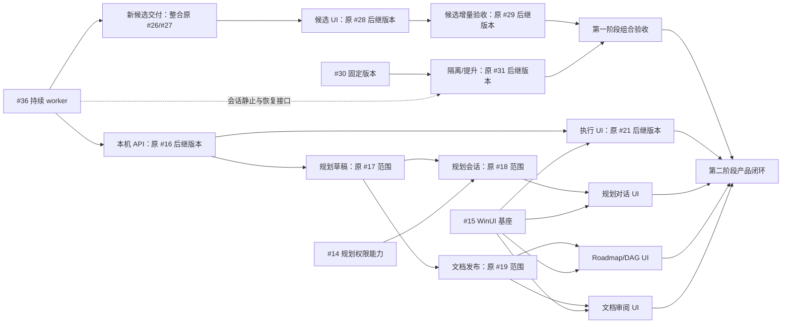

# #36 后的 Roadmap 精简审查

本次按 [#36 Spec](../spec/worker-flow.spec.md) 和 [Plan](../spec/worker-flow.plan.md)审查全部 22 项活动规划。本文给出后续裁减与重新规划建议，不是新的执行 Spec，不授权运行时丢弃任务、删边、改绑契约或迁移数据库。

2026-09-29 的中心只读投影显示 #14–#24、#26–#35 共 21 项均为 open，已各自绑定旧规格/依赖；#36 已进入文档规划，该投影中尚未登记。该采样不代替执行前重新查询。各处“取消、吸收、合并、后移、移除依赖”均为目标建议，旧任务在正式处置前仍保留在主 roadmap 和中心记录中。

## 1. 建议采用的交付结构

1. **先交付 #36。** 由它完成持续 worker、统一反馈、五个主阶段、真实 PR 交付，以及替换旧流程所必需的执行上下文整理。无需先提取随后要删除的旧步骤规则。
2. **取消 #33 的独立交付，吸收 #34 的必要部分。** #33 的主要提取对象就是五步门槛；#34 中正确路由任务/会话、固定执行配置和状态单写的部分直接是 #36 必须完成的工作。全面组件拆分不扩大为 #36 的额外目标。
3. **多候选保留，#26/#27 合并重新规划。** 一个候选对应一条完整的 #36 worker 会话；候选创建和真实 PR 交付作为一个可用功能交付，不发布“worker 可以运行却被中心禁止提 PR”的中间产品。
4. **#35 后移，不作为 API 或界面交付前置。** 先通过已有 Query/Command 边界使用中心；全面搬迁 SQL/Go 包等新业务稳定后按实际问题决定。#36 不顺带承担“所有 SQL 都搬包”。
5. **解开本机 API 对多候选和全面重构的依赖。** #16 的后继规格消费 #36 的单会话状态/反馈接口；多候选以后作为身份精确的查询扩展。执行 UI 和规划链不用等待候选仲裁才能开始。
6. **保留版本隔离、规划能力和原生 UI。** 调整其受影响接口和验收用例，不把移除“目标项目验证”扩大为取消 SteerLine 自己的工程验证或规划文档发布核验。

按此结构，近期比现有 22 项减少 4 个独立交付项：取消 #33、吸收 #34、合并 #26/#27、后移 #35。最终新编号和任务边界在正式重规划时确定；本次不复用旧 ID 来指向新的交付范围。

## 2. 逐项核对

| 现有任务 | 建议 | 保留的价值与具体裁减 |
| --- | --- | --- |
| #36 单 worker 持续执行与统一待决策 | 先做，作为执行基线 | 负责状态/worker/反馈/PR 主链；只做这条链必要的代码整理，不扩成通用模块重构 |
| #33 执行规则包提取 | 建议取消独立任务 | 删除对象占其核心范围：五步推进、验证/审查证据链、修复上限。仍需要的小量主阶段转换放在现有执行所有者内，不为包数量单独交付 |
| #34 执行上下文封装与服务职责收缩 | 必要部分吸收进 #36 | 精确任务/会话路由、固定配置、事件单写必须随持续 worker 完成；去掉旧 StepAttempt 重试及五步/applied 保持门槛。其余全面拆组件后移 |
| #35 中心命令查询与SQLite边界封装 | 后移，解除产品链上的先行要求 | 唯一权威与事务边界继续遵守；“全部 SQL 调用迁到新 center 包”不应挡住本机 API 和观察 UI |
| #26 多候选模型与准入 | 与 #27 合并为新规格 | 保留候选身份、一次 claim、各自会话/工作区、显式新增与幂等。去掉逐步骤执行和先运行后禁发布门槛；重新确定新格式来源 |
| #27 PR 胜出与落选候选对账 | 与 #26 合并为新规格 | 保留唯一 TaskDelivery、用户选用合并 PR、多个合并冲突及落选资源事实；删除跨候选 verify/review 证据和中心阻止在途 worker 发布的保证 |
| #28 候选观察界面 | 保留，缩为候选增量 | 只增加候选列表/选择、精确会话反馈和 PR/资源归属，复用 #36 待决策；不再建候选专用 retry/recovery/applied 界面，不等全面 SQL 搬包 |
| #29 多候选本机与远端真机验收 | 保留，缩为多候选增量 | 验同任务两会话并行、反馈不串线、真实交付竞争、落选会话观察；复用 #36 的单 worker 基础证据，不再从五步矩阵和答案应用证明开始重验 |
| #30 固定版本与双入口 | 主体保留，可独立准备 | 构建摘要、稳定入口和正确版本/home 连接仍必要。构建源码 dirty 与目标项目 worker dirty 是不同问题，stable 的干净构建要求不受 #36 删除项目门槛影响 |
| #31 dev 隔离与 stable 提升 | 保留，调整维护资格 | 不要求空闲可恢复会话必须销毁才可提升；核验活动轮次/在途消息和新版本能否重接。维护屏障收口到中心真正拥有的启动/发送/任务写操作，不列已删除的项目步骤/发布入口 |
| #32 第一阶段集成验收 | 保留，缩为组合增量 | 聚焦 fixed stable 24 小时、dev 隔离、升级重接及多候选组合；删除旧五步/应用证明验收，复用 #36/#29 的功能证据。24 小时目标本次不取消 |
| #14 Codex 规划主 agent 能力验证 | 保留，复用协议基础证据 | #36 可共享 thread/turn/输入/历史等基础适配证据；规划 agent 的受控工具、无通用执行/无越权写入仍需独立验收，不能用任务 worker 的宽权限代验 |
| #15 WinUI 基座与原生输入 | 保留 | 原生窗口、IME、多行输入、视图持久化与 UI 生命周期基本不受影响，可独立准备 |
| #16 本机客户端协议与历史查询 | 重新固定接口与前置 | 保留 HTTP/认证/SSE/离线查询；动作收敛到开始、原会话反馈、派发/服务控制及明确丢弃。目标依赖 #36 的接口，不强制等待多候选和全面 SQL 封装 |
| #17 规划提案与受控草稿 | 主体保留 | 任务编号、固定 Spec/Plan、受控草稿、正式版本和写入仲裁是规划权威；不因取消项目代码验证而删除。实现只消费本机 API 的新接口，不耦合五步执行模型 |
| #18 Codex 规划会话服务 | 主体保留，共用底层会话能力 | 规划会话的权限、草稿工具和写入 guard 仍独立；复用 #36 支持的同 thread 恢复/输入/事件能力，不另写一套底层会话客户端，也不合并两种业务权限 |
| #19 正式文档发布与任务创建 | 主体保留 | Git 发布、文档版本和中心任务创建的部分失败对账仍必要；其“验证”是任务契约/文档一致性，不是已删除的 worker 测试门槛 |
| #20 Roadmap 与 DAG 原生浏览 | 保留 | 文档版本、任务图和关联展示仍有独立价值；执行详情链接改消费 #36 的状态/会话 DTO |
| #21 执行与待处理原生界面 | 明显简化 | 五个主阶段和一个完整反馈输入；删除另列需处理业务阶段、专用恢复按钮、步骤候选核验和应用证明 UI。错误/unknown 作为信息继续可见 |
| #22 规划对话原生界面 | 主体保留 | 规划主 agent 的真实输入、审批与草稿交互；可共享文本输入/正文组件，不能因名字都叫“对话”而合并业务会话 |
| #23 文档审阅与确认原生界面 | 保留 | 它审阅规划文档和任务创建，并非中心控制的代码 review 步骤；固定版本人工确认、完整差异和发布结果继续保留 |
| #24 第二阶段完整闭环验收 | 保留，改验收链 | 验规划→用户确认→任务创建→持续 worker/用户反馈→真实合并→规划反馈；复用第一阶段证据，不再次独立重建五步、重试与 applied 矩阵 |

## 3. 不能仅替换名词的六处冲突

### A. “先实现不能发布的候选”失去控制点

[#26 Spec](../spec/task-candidates.spec.md)当前规定在 #27 交付前可实现/验证/审查，但中心拒绝所有发布 PR。#36 的 worker 自己负责创建 PR，中心没有一个必经的 publish_pr 派发入口可以卡住。建议把候选创建和交付仲裁组成一个新实现任务。若仍要拆两个任务，前者只能交付不启用的内部准备，不能把半条候选流程开放给用户。

### B. “胜出后禁止落选 worker 发布”超出中心能力

[#27 Spec](../spec/candidate-delivery.spec.md)把新步骤、回答应用和发布事务作为禁止推进的入口。新模式只能停止中心新增输入/启动，对已运行 agent 的 Git/PR 动作不能保证同步禁止。新规格应明确：记录胜出、停止新增推进、按已支持能力停止/联系原会话，继续观察可能迟到的 PR 或合并；保留冲突与资源事实。不能将“已标为落选”显示为“已停止”。

### C. “会话存在”不再等于不能切版本

[#30](../spec/versioned-runtime.spec.md)/[#31](../spec/runtime-isolation-promotion.spec.md)目前偏向要求所有外部执行停止/结算。持续会话会长时间空闲等待反馈，必须用实际工作轮次和未结算发送区分繁忙与可恢复空闲。具体提升资格由重新规划后的 Spec 固定：没有活动轮次/不确定外部动作、反馈意图可恢复、目标构建能重接原会话。维护时禁止新的中心发送；中心不声称能给独立 worker 加“禁止发布”锁。

### D. 老格式迁移例外不能直接继承

[#26](../spec/task-candidates.spec.md)和[第一阶段共同约束](../spec/phase1-delivery-constraints.md)要求 schema 5 到多候选格式转换，并维护 legacy-v1/candidates-v2 摘要模式。#36 会固定持续会话的新格式且不承诺旧 minimal-v1 迁移。后续候选规格应以 #36 实际交付格式为输入重新确定保留范围，删除过期的 schema 5 双模式要求；不能先构建马上失效的兼容路径。当前格式内恢复及既有真实交付证据仍须保留，具体跨格式转换需单独明确。

### E. 客户端不需要等所有后端功能和代码搬包

[#16 Spec](../spec/phase2-local-api.spec.md)主体是已有 Query/Command 的传输适配，原本无硬前置，后来在中心追加了 #26/#35。#36 有稳定单会话 DTO 后即可形成对应 API，候选能力尚未提供时明确 unsupported。后续添加候选查询不要求让规划与执行 UI 等待整个多候选链。包边界可以继续收敛，包是否搬到新目录不构成产品接口能力。

### F. “待决策”不能连带简化所有领域状态

#36 合并的是任务执行停下后的用户交互。它没有把规划提案、文档发布、权限审批或 stable 版本选择都改成自由文字会话。#17/#19 的文件版本、ID 预留、人工确认和事务资格仍由中心拥有；#23 是文档审阅 UI。不要全库替换 review/verify/applied 等单词，必须看它们所属领域。

## 4. 建议的目标依赖图

以下是目标规划关系，**不是当前中心 DAG，也不代表旧编号可以直接改绑**。“后继版本”和“新候选交付”在正式重规划时各取得自己的 Spec/Plan 和新编号。

实线是建议的新规划硬前置，虚线是接口/集成约束。#30 的版本文件和 #15 的输入界面可以独立准备；#14 的规划权限验证同样可独立推进。#35 不再出现在产品关键路径，#33/#34 不作为 #36 的前置。第一阶段组合验收仍是第二阶段最终发布验收的汇合条件，不阻止单独准备 UI 和规划服务。

## 5. 验收职责去重

| 归属 | 应负责的独有证明 | 可复用的前置证据 |
| --- | --- | --- |
| #36 | 单会话多轮、统一反馈、PR 发现/合并、当前格式重启与不重发；所有宣告支持的执行模式 | 已有平台消息和真实 PR provider 基础能力 |
| 原 #29 的后继版本 | 多候选同时工作、反馈隔离、胜出/落选及迟到竞争 | #36 同会话和单任务交付证据；接口改动仍做针对性回归 |
| 原 #32 的后继版本 | 固定 stable 24 小时、dev 隔离、受控提升及当前格式恢复 | #36/#29 的功能矩阵，只补组合、时长和版本切换风险 |
| 原 #24 的后继版本 | 真实规划、人工确认、文档/中心创建、原生 UI 与执行结果返回规划 | 前三项已完成的执行能力；不代替上游缺失门槛 |

复用不等于不做集成回归。若该任务改变了会话协议、状态格式或 PR 交付接线，重验受影响项；不按“每个阶段都必须从头跑五步”复制验收矩阵。

## 6. 规格与旧任务的处置顺序

1. 本次只形成审查和规划文字修正。保留全部旧任务身份、Spec/Plan 与中心依赖记录；不把建议标成已取消、已合并任务或已交付。
2. 后续确认重规划范围时，先形成完整目标任务清单、独立 Spec/Plan 和依赖闭包。合并 #26/#27、替换 #16 等改变交付身份的范围分配新 ID；不在旧数字上覆盖另一项任务。#36 尚未固定到中心时可直接收敛其必要实现边界。
3. 特别核对替换的传递影响：旧 #17 仍依赖旧 #16，旧 #28 仍依赖旧 #27/#35；只增加一个新任务不会解除它们的固定阻塞。对受影响的未开工后继一起重新规划，不能给旧前置补造 Delivery，也不能用 add-predecessors 删除或替换边。
4. 旧任务的正式丢弃须按现有中心命令逐项核验状态、PR 和外部执行后取得回执，再移出活动表；已交付任务保留真实交付。旧 ID 永不复用。本文不会直接触发这些操作。
5. 新规格集成到执行目标分支后，以固定 commit 登记新任务图，回读确认后才宣告可执行。当前中心仍按旧图计算 Ready 的事实要明确展示，不能用新文档安排冒充已经生效的执行资格。

## 7. 本轮文档处理边界

同步修正产品愿景、第一阶段交付说明、架构/控制台规划约束和第二阶段推进说明中已过时的五步、应用证明和专用恢复表述。主 roadmap 与 execution-map 链接本审查并区分推荐路线与当前固定任务记录。既有执行 Spec/Plan 保留原范围，本审查表逐项列出后续需修改的位置；本轮不批量重写这些文件造成“已重新固定契约”的假象。

本审查是尚待落实的规划处置清单，相关新 Spec/Plan 和中心任务处置完成后将其结论并回主表，再移除此临时审查入口；不长期维护第三份任务状态表。
