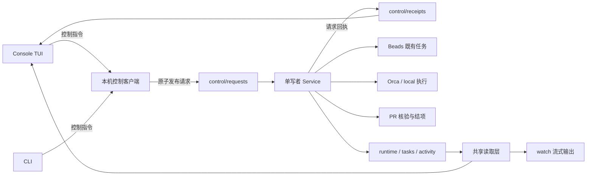

# 控制台升级：Spec + Plan 总览

状态：总体设计。PR 1（观察契约）已合并；PR 2（服务控制协议与定向执行）实现完成、待审核；PR 3–5 仍待实现。初始评估基线：`63ff023`；PR 2 从含 PR #12 的最新 `main` 开始。日期：2026-09-23。

目标：把现有 viewer 升级为本机控制台 TUI，用户通过控制台选择既有任务开始执行、查看运行状态、处理人工决策和恢复。任务仍由外部来源提供，当前实现为 Beads。

## 与最新主线的集成约束

- PR #8 已提供任务详情、完整 Runtime 读取、activity/conversation/raw 三种日志视图和布局修复。实施本组计划时在这些功能上增量修改，不能以旧基线文件覆盖它们；Plan 中已经完成的接口提取步骤转为核对与复用。
- PR #9 的 [目标架构](../architecture-direction.md) 约束新的中心状态机与远程执行。本组文件协议和 runtime v4 是现有 local/Orca terminal v2 的本机控制适配，不把当前单 Run/单执行槽固化为未来 QueryService/CommandService 的业务唯一性约束。
- 控制台通过观察/命令接口访问状态，文件是当前传输/存储实现。若目标架构的 SQLite 权威存储与执行模型在某一后续 PR 开始前已经合入，该 PR 必须复用已落地的权威接口并同步调整其 Spec/Plan，不能再建立竞争的业务状态写者。
- 本组停服终止 worker 的规则适用于现有本机执行路径；未来受监管远端执行遵循目标架构中“中心停机与取消远端 worker 分开”的规则。

## 执行与审核约定

用户已授权按依赖顺序实施、提 PR、审核修复及合并。每个实现 PR 使用独立 Codex 任务，模型固定 `gpt-6-luna`、推理强度 `xhigh`。协调任务在实现 PR 提交后审核最终 diff、修复确认的问题、完成必要验证并合并；确认合并后才创建下一个实现任务。实现任务自行提交和推送分支、创建 PR，不自行合并，也不启动下一阶段。

## PR 拆分与依赖

| PR | 交付内容 | 文档 | 前置依赖 |
| --- | --- | --- | --- |
| 1 | 统一读取契约，修复日志与选中项一致性 | [Spec](pr-01-observation.spec.md) · [Plan](pr-01-observation.plan.md) | 无 |
| 2 | 服务控制协议、定向启动、派发模式与回执 | [Spec](pr-02-control.spec.md) · [Plan](pr-02-control.plan.md) | PR 1 |
| 3 | 后台服务启动、连接、停止与实例识别 | [Spec](pr-03-service-lifecycle.spec.md) · [Plan](pr-03-service-lifecycle.plan.md) | PR 2 |
| 4 | 多项目控制台、任务启动与运行详情 | [Spec](pr-04-console.spec.md) · [Plan](pr-04-console.plan.md) | PR 1–3 |
| 5 | 完整决策交互、在线恢复与审计闭环 | [Spec](pr-05-intervention.spec.md) · [Plan](pr-05-intervention.plan.md) | PR 2、4 |

按 1 → 2 → 3 → 4 → 5 合并。每个 PR 都有可独立验证的交付；PR 4 是可用的执行控制台，PR 5 完成全部人工介入流程。这里的 PR 仅是交付拆分，本文档提交不代表已经创建远端 PR。

## 已选定的产品行为

1. **界面形态**：沿用 Go + Bubble Tea，在当前 TUI 基础上升级。主入口为 `steerline console`；TTY 下普通 `watch` 和 `viewer.bat` 保留为兼容入口。
2. **打开控制台**：读取配置和已有状态。没有后台服务时显示离线信息，由用户在控制台启动服务。
3. **启动服务**：控制台启动独立进程，初始为手动派发模式。服务不会因此领取新的 ready 任务；它会恢复 PR 核验和既有人工答案的消费。已提交答案本身就是续跑授权，启动界面需显示此类待应用答案。
4. **开始任务**：用户选择一个 ready 任务，服务重新核验后领取并启动。槽忙或任务失去资格时给出原因，本期不建立另一套持久执行队列。
5. **自动调度**：用户可显式启用。现有 `steerline run` 默认自动调度的 CLI 行为保留，控制台清楚显示连接到的实际模式。
6. **暂停派发**：阻止新的领取和显式重试，当前 worker、决策续跑和 PR 核验继续。它不表示冻结 agent。
7. **停止服务**：停止新派发，按现有 `shutdown_grace` 等待当前 worker，超时终止其执行并保留现场。操作文案说明这个实际后果；与关闭控制台分开。
8. **关闭控制台**：退出 UI，后台服务与 worker 继续运行。任务执行期间关闭或崩溃 UI，不能连带杀死服务。
9. **状态权威**：服务持有仓库与运行目录锁，单写 runtime；UI/CLI 提交指令，服务执行状态转换。Orca 执行事实、PR 平台事实和 Beads 任务事实仍遵循现有边界。
10. **恢复支持范围**：保留现有恢复条件。自动化 retry 首期只支持 local；Orca 支持现有同终端决策续跑和人工结果接回，不在本轮加入死亡终端中新起 agent 的续跑。

这些是本设计采用的具体选择，实施时无需重新推断“开始执行”或“暂停”的含义。

## 结构与数据流

采用本机文件指令通道，复用现有原子写入能力和状态目录。请求有唯一身份和独立回执，不能把“文件写成功”当作“任务已启动”。本期不引入网络监听、Web 前端或新数据库。

## 交付边界

- 可浏览的任务范围是提供方的 ready 候选以及本机已记录 runs。外部尚未 ready 的完整 DAG、任务创建/拆分/编辑、任务优先级调整不属于本轮。
- 单项目保持一个执行槽；不同仓库仍可各有一个服务。人工决策和 unknown 执行保留现有调度阻塞约束。
- 任务、run、attempt、decision、command 身份分开。重试保持 task_id/run_id，日志切换到新 attempt；每轮决策有独立 decision_id。
- 保留 `watch --json/--raw/--no-tui` 的脚本接口和离线日志读取。
- PR 合并仍由外部人工流程完成；控制台展示状态与链接，完成判定继续通过平台核实和结项回读。

## 版本与发布

- PR 1 不改变 runtime schema。
- PR 2 引入 runtime v4、control 协议 v1、候选任务快照 v1；PR 3–5 使用这一版本中已定义的字段。后续若需要新增无法被同版本旧程序读取的字段，必须另行升级版本，不能仅依赖“字段可选”。
- 新程序读取 runtime v1–v4，只有取得服务/维护锁的写者升级快照。只读打开旧状态不触发迁移。
- 老二进制不能读 v4。首次升级需显式停服后安装同版本服务和控制台；安装器已有的运行中 exe 占用错误继续保留。
- 每份 Plan 列明需要更新的既有文档。这一目录描述目标；现有 README 和协议文档在对应实现 PR 合并时才改成新行为。

## 整体验收场景

1. 空项目打开控制台 → 启动后台服务 → ready 列表出现；在点击开始前没有 claim、worktree 创建或 agent 启动。
2. 选择 B 开始 → 只领取 B；反复按键或两个控制台同时操作不能启动两个 worker，也不能因 B 不可用而改跑 A。
3. 退出控制台再打开 → 连接原服务和原运行，日志续读、状态和命令结果可恢复。
4. agent 请求决策 → 显示完整问题与选项 → 人工提交 → 明确区分已提交、服务已接受、续跑中和失败；同一轮答案不被另一个窗口覆盖。
5. 自动调度中暂停派发 → 当前执行和 PR 跟踪继续，后续 ready 任务不被领取；恢复后按所选模式运行。
6. 服务崩溃 → 状态显示过期/未知，旧实例的命令不在新实例自动执行，未知执行不被自动重跑。
7. local 启动失败 → 控制台核验后重试原任务；Orca 不支持的 retry 显示原因。人工修复后的合规 PR 可通过控制台接回。
8. 两个项目、两个控制台、相同仓库的不同配置并存时，仓库锁、目标实例与任务身份仍正确。

## 与现状相关的实施提醒

- `Service.run` 启动时立即 dispatch，因此“后台启动”不能直接沿用默认 run 参数。
- `MarkStopped` / `AcceptResult` 现在是停服维护入口，会设置 service stopped 并清理槽；迁入在线控制流程前必须拆开这层副作用。
- `FileSource.Activity` 与 `watch.followLines` 的实现不同，前者缺少半行处理和原始流 fallback，后者对等长/更大文件替换的检测也需补齐。
- viewer 用下标保存选择、用 run_id 判断日志是否切换，分别会受到排序和同 run 重试的影响。
- 决策文件目前使用固定文件名，答案可覆盖；多窗口控制台需要补齐冲突规则和多轮留档。

设计依据：当前 [状态模型](../state-model.md)、[数据契约](../data-contract.md)、[人工决策](../decisions.md)、[Hosting 边界](../hosting.md)、[Activity 契约](../activity.md)。
