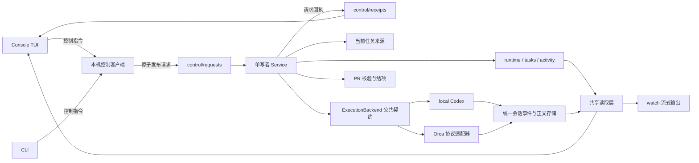

# 控制台升级：Spec + Plan 总览

状态：PR 1（#12）、PR 2（#13）与 PR 3（#14）已合并；PR 3 采用 Windows 可见服务窗口方案，当前 Windows 宿主验收已通过。PR 4A 在 Windows 验收，Linux 保持架构兼容但不设原生运行或构建验收门槛。后续分为 4A、4B、4C、5，并从各阶段开始时的最新 `origin/main` 实施。初始评估基线：`63ff023`。

目标：把现有 viewer 升级为本机控制台 TUI，用户通过控制台选择任务开始执行、查看运行状态、处理人工决策和恢复。控制台只使用服务查询与命令接口，不绑定具体任务来源。

长期结构：local Codex 与 Orca 都是正式执行后端，共用业务状态机、执行契约、会话读模型和契约测试。过程消息 commentary 与最终回复 final_answer 分开展示；一轮 turn 明确结束后自动折叠过程，未解决问题仍可见。会话结束、执行结束和业务任务完成不可混同。

## 与最新主线的集成约束

- PR #8 已提供任务详情、完整 Runtime 读取、activity/conversation/raw 三种日志视图和布局修复。实施本组计划时在这些功能上增量修改，不能以旧基线文件覆盖它们；Plan 中已经完成的接口提取步骤转为核对与复用。
- [执行架构共同约束](execution-architecture.spec.md) 约束中心状态机与远程执行。本组控制接口面向本机 local/Orca terminal v2，不把当前单 Run/单执行槽固化为未来 QueryService/CommandService 的业务唯一性约束。
- 控制台通过观察/命令接口访问状态，文件是当前传输/存储实现。若目标架构的 SQLite 权威存储与执行模型在某一后续 PR 开始前已经合入，该 PR 必须复用已落地的权威接口并同步调整其 Spec/Plan，不能再建立竞争的业务状态写者。
- 本组停服终止 worker 的规则适用于现有本机执行路径；未来受监管远端执行遵循目标架构中“中心停机与取消远端 worker 分开”的规则。

## 执行与审核约定

用户已授权按依赖顺序实施、提 PR、审核修复及合并。每个实现 PR 使用独立 Codex 任务，模型固定 `gpt-6-luna`、推理强度 `xhigh`。协调任务在实现 PR 提交后审核最终 diff、修复确认的问题、完成必要验证并合并；确认合并后才创建下一个实现任务。实现任务自行提交和推送分支、创建 PR，不自行合并，也不启动下一阶段。

PR 3 的服务窗口实现已合入；后续阶段读取此处的七阶段安排和已合入的共同约束，不沿用旧五阶段顺序。

## PR 拆分与依赖

| PR | 交付内容 | 文档 | 前置依赖 |
| --- | --- | --- | --- |
| 1 | 统一读取契约，修复日志与选中项一致性 | [Spec](pr-01-observation.spec.md) · [Plan](pr-01-observation.plan.md) | 无 |
| 2 | 服务控制协议、定向启动、派发模式与回执 | [Spec](pr-02-control.spec.md) · [Plan](pr-02-control.plan.md) | PR 1 |
| 3 | Windows 服务窗口、连接、停止与实例识别 | [Spec](pr-03-service-lifecycle.spec.md) · [Plan](pr-03-service-lifecycle.plan.md) | PR 2 |
| 4A | 长期双执行后端契约与接入 | [Spec](pr-04a-execution-backends.spec.md) · [Plan](pr-04a-execution-backends.plan.md) | PR 3 |
| 4B | 统一会话事件、完整回复与持久读取 | [Spec](pr-04b-conversation-events.spec.md) · [Plan](pr-04b-conversation-events.plan.md) | PR 4A |
| 4C | 多项目控制台、任务启动与按轮次折叠 | [Spec](pr-04-console.spec.md) · [Plan](pr-04-console.plan.md) | PR 4B |
| 5 | 完整决策交互、在线恢复与应用证明 | [Spec](pr-05-intervention.spec.md) · [Plan](pr-05-intervention.plan.md) | PR 4C |

按 1 → 2 → 3 → 4A → 4B → 4C → 5 串行审核合并，共七个交付阶段。原 PR4 文件路径保留，但对应 4C；4A/4B 是新增前置。这里的阶段名不是 GitHub PR 编号，不能用“已合并五个 PR”判断整批完成。各阶段 Spec 是行为契约、Plan 是实施与验证要求；架构衔接要求在本总览及对应阶段 Spec 内明确。

## 已选定的产品行为

1. **界面形态**：沿用 Go + Bubble Tea，在当前 TUI 基础上升级，主入口为 `steerline console`；不保留旧 watch/viewer 协议入口。
2. **打开控制台**：读取配置和已有状态。Windows 没有服务时显示离线信息与固定服务窗口入口；控制台不从自身进程树启动服务。
3. **启动服务**：Windows 用户从安装目录的启动器或快捷方式独立打开可见服务窗口，可最小化；服务初始为手动派发模式，不因此领取新的 ready 任务。它会恢复 PR 核验和既有人工答案的消费。已提交答案本身就是续跑授权，启动界面需显示此类待应用答案。Linux 已有独立启动路径按平台展示。
4. **开始任务**：用户选择一个 ready 任务，服务重新核验后领取并启动。槽忙或任务失去资格时给出原因，本期不建立另一套持久执行队列。
5. **自动调度**：用户可显式启用。现有 `steerline run` 默认自动调度的 CLI 行为保留，控制台清楚显示连接到的实际模式。
6. **暂停派发**：阻止新的领取和显式重试，当前 worker、决策续跑和 PR 核验继续。它不表示冻结 agent。
7. **停止服务**：停止新派发，按现有 `shutdown_grace` 等待当前 worker，超时终止其执行并保留现场。操作文案说明这个实际后果；与关闭控制台分开。
8. **关闭控制台**：退出 viewer/TUI 时，只要 Windows 服务窗口仍开着，服务与 worker 继续运行。关闭服务窗口会结束服务；正常维护使用显式 stop 或 Ctrl+C，窗口 X/强制结束按异常退出恢复。
9. **状态权威**：服务持有仓库与运行目录锁，单写当前业务状态；UI/CLI 提交指令，服务执行状态转换。Orca 执行事实和 PR 平台事实仍由各自来源核验。
10. **恢复支持范围**：保留现有恢复条件。自动化 retry 首期只支持 local；Orca 支持现有同终端决策续跑和人工结果接回，不在本轮加入死亡终端中新起 agent 的续跑。
11. **能力差异**：以目标/协议/agent/版本的证据报告驱动可用操作；unsupported/not_tested 不能伪装成功。后端输入接受、轮次开始与答案应用分开记录，不隐式跨后端回退。
12. **消息折叠**：可靠 turn/phase 才支持精确逐轮体验；只有原始输出时明确使用执行过程/执行摘要。最终回复完整可读，错误、缺口、待回答问题在折叠区外。手动展开与阅读位置跨刷新/重开保留。

这些是本设计采用的具体选择，实施时无需重新推断“开始执行”或“暂停”的含义。

## 结构与数据流

采用既有本机指令通道，复用现有原子写入能力和状态目录。请求有唯一身份和独立回执，不能把“文件写成功”当作“任务已启动”。4A/4B 增加版本化执行绑定、操作和会话记录；如 SQLite 权威已落地则复用其事务，不建立竞争文件写者。本批不主动引入网络监听、Web 前端或新数据库。

## 交付边界

- 可浏览的任务范围是提供方的 ready 候选以及本机已记录 runs。外部尚未 ready 的完整 DAG、任务创建/拆分/编辑、任务优先级调整不属于本轮。
- 单项目保持一个执行槽；不同仓库仍可各有一个服务。人工决策和 unknown 执行保留现有调度阻塞约束。
- 任务、run、attempt、decision、command 身份分开。重试保持 task_id/run_id，日志切换到新 attempt；每轮决策有独立 decision_id。
- 保留 `watch --json/--raw/--no-tui` 的脚本接口和离线日志读取。
- PR 合并仍由外部人工流程完成；控制台展示状态与链接，完成判定继续通过平台核实和结项回读。
- Windows 服务窗口需保持打开；本轮不提供无窗口后台运行、注销/重启后继续运行、开机自启、计划任务或 Windows 系统服务。

## 版本与发布

- PR 1 不改变 runtime schema。
- PR 2/3 的现有控制实现是重构输入。4A/4B/5 为新绑定、Operation、会话与应用证明确定一套当前格式；不提供旧客户端或 runtime v1–v4 读者。未知状态格式阻止有副作用操作，当前格式内的重启恢复仍需验证。
- 老二进制不能读 v4。首次升级需显式停服后安装同版本服务和控制台；安装器已有的运行中 exe 占用错误继续保留。
- 每份 Plan 列明需要更新的既有文档。这一目录描述目标；现有 README 和协议文档在对应实现 PR 合并时才改成新行为。

## 整体验收场景

1. 空项目打开控制台 → 按固定入口打开 Windows 服务窗口 → manual ready 列表出现；在点击开始前没有 claim、worktree 创建或 agent 启动。
2. 选择 B 开始 → 只领取 B；反复按键或两个控制台同时操作不能启动两个 worker，也不能因 B 不可用而改跑 A。
3. 保持服务窗口打开，退出 viewer/TUI 再打开 → 连接原服务和原运行，service/worker 身份不变，日志续读、状态和命令结果可恢复。
4. agent 请求决策 → 显示完整问题与选项 → 人工提交 → 明确区分已提交、服务已接受、续跑中和失败；同一轮答案不被另一个窗口覆盖。
5. 自动调度中暂停派发 → 当前执行和 PR 跟踪继续，后续 ready 任务不被领取；恢复后按所选模式运行。
6. 服务崩溃 → 状态显示过期/未知，旧实例的命令不在新实例自动执行，未知执行不被自动重跑。
7. local 启动失败 → 控制台核验后重试原任务；Orca 不支持的 retry 显示原因。人工修复后的合规 PR 可通过控制台接回。
8. 两个项目、两个控制台、相同仓库的不同配置并存时，仓库锁、目标实例与任务身份仍正确。
9. local 与 Orca 运行共同契约测试和原生隔离验收：默认配置改变、身份换代、停止失败、动作回执丢失与重启均不产生替代执行；UI 退出与停止执行分开。
10. 两链路的多轮进度/工具/final 到达 → 本轮结束自动收起一次 → final 完整保留；late final、失败/取消、等待和历史缺口准确显示；重开仍保留手动展开及历史。
11. 答案已保存、服务接受、后端接受、轮次开始、答案应用逐层可查；没有应用证明不解锁新问题，超时不重复发送。

验收报告按 B-A、E-A、U-A、H-A 逐项记录真实版本、环境、证据和未执行项。精确双链路 turn/final 能力需两侧原生证据；上游缺口明确记为未验收和前置依赖，不能把降级、mock 或 skipped 当成目标通过。必需门槛未满足不推进下一阶段。

## 初始基线问题与后续检查点

以下是初始评估的问题清单；其中观察与控制问题已在 PR 1/2 修复。实施时以最新主线为准核验，不重复覆盖已完成修复。

- `Service.run` 启动时立即 dispatch，因此 Windows 服务窗口必须显式传入 `-dispatch manual`；服务窗口启动后由控制协议决定是否启用自动派发。
- `MarkStopped` / `AcceptResult` 现在是停服维护入口，会设置 service stopped 并清理槽；迁入在线控制流程前必须拆开这层副作用。
- `FileSource.Activity` 与 `watch.followLines` 的实现不同，前者缺少半行处理和原始流 fallback，后者对等长/更大文件替换的检测也需补齐。
- viewer 用下标保存选择、用 run_id 判断日志是否切换，分别会受到排序和同 run 重试的影响。
- 决策文件目前使用固定文件名，答案可覆盖；多窗口控制台需要补齐冲突规则和多轮留档。

设计依据：当前 [状态模型](../state-model.md)、[数据契约](../data-contract.md)、[人工决策](../decisions.md)、[Hosting v2 实现](hosting-spec.md)、[目标 Hosting 红线](../hosting.md)、[Activity 契约](../activity.md)。
