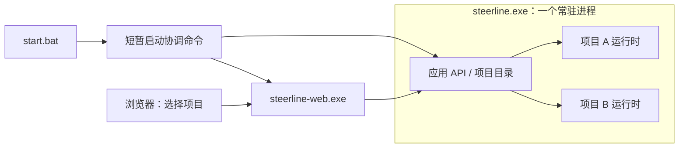

# Spec：统一启动与多项目共进程宿主

状态：2026-10-15 用户要求重新规划并编写 Spec + Plan；仅规划，未实施、未验收。配套 [Plan](unified-startup.plan.md)、[专属验收](../acceptance/unified-startup.md)。普通开发，无 roadmap Task ID，不修改 execution-map。用户明确 TUI 已在移除，本任务不支持 TUI，不以其接线、兼容或移除完成为交付内容。

## 1. 目标、范围与前序契约

日常操作收敛为：双击安装目录的 `start.bat`，自动启动后端和 Web，网页展示项目目录，用户选择项目进入。产品常驻进程固定为一个 `steerline.exe` 和一个 `steerline-web.exe`；启动协调命令短暂存在，任务执行所需的 Git、Codex 等工作进程另计。

本任务在[独立 Web 与项目切换](web-project-switch.spec.md)成果上重构：保留双 exe、浏览器认证、项目切换和命令回执；替换“只读应用网关 + 每项目独立服务进程”、分开的启动 bat、项目原生 HTTP 转发及按 PID 判断单个项目停服的机制。前序 WPS-A5 的“应用入口重启不影响项目服务”在新宿主中不再成立，既有验收事实仍按原版本保留。

本批不合并项目数据库或 Task/DAG，不新增跨项目业务调度器、项目热加载、项目添加/结构核验、自动重跑任务、常驻第三方守护进程、远程 Web 或旧服务模式兼容。[项目添加](project-onboarding.spec.md)仍为后续批次，其登记与准入能力消费本宿主，不重建另一套项目服务；本任务不实现该批次能力。

## 2. 进程、资源与写入所有权

后端宿主持有本 home 单实例租约、应用 API 和多个项目运行时。每项目拥有独立配置快照、context、actor/命令队列、调度循环、数据库连接、仓库/状态目录锁、worker 资源和日志。任务应用与 execution actor 仍为各项目原子提交边界；宿主不取得绕过它们修改任务库的能力。

项目运行循环和耗时 I/O 不在全局目录锁内运行；启动采用有界并发和逐项目期限。可处理的项目启动/运行错误只使该项目失败；不将一个子项目 context 取消传播给兄弟项目。不承诺进程级故障隔离：后端致命崩溃会影响全部项目，不以通用 recover 掩盖不再可信的运行时。

后端按项目独立关闭并聚合错误；未确认运行循环结束、资源释放和锁归属前，不能报告该项目已干净停止，也不能在相同状态目录创建替代写者。

## 3. 项目自动发现与启动

1. 项目来源为当前 home 的 `etc/*.json`，沿用现有配置及 common-dir 项目身份算法。不扫描任意磁盘仓库、不新增平行成员清单。
2. 启动先固定配置文件集合及内容快照，规范化仓库身份和运行目录，再检查同 common-dir、相同或互相包含的状态目录及别名路径冲突。所有涉及冲突的配置均禁止启动，不能先启动其中一个再发现重复。
3. 有效且无冲突的项目依次取得原仓库/运行目录互斥，完成原准入及当前格式状态核对后，才允许初始化/打开其原生权威和启动 actor。构造始终消费同一配置快照，不按文件路径悄悄重新加载新正文；打开前复核真实仓库/目录身份，变化则该项目失败，不改绑新目标。另一 home 的写者不自动接管。坏配置、身份错误和锁冲突不得为该项目建库或覆盖状态。
4. 项目启动表示管理服务开始运行，默认 manual 调度。首次启动不自动领取任务；后端换代对已有执行仅按正式恢复规则取证、结算，新启动、输入和答案投递仍需原规定的授权。
5. 应用 API 可用后即可展示目录及逐项目的启动进度，不等待最慢项目完成。零项目、所有项目失败、共享执行环境不可用均不阻止目录和 Web 展示；需区分“应用已就绪”和“项目可执行”。全局租约或应用 API 建立失败才是宿主启动失败。
6. 目录状态采用 `starting / ready / failed / stopping / stopped` 的运行时投影，附具体诊断；配置身份未解析成功的行可用 config ID 展示错误，不伪造 project ID。状态不成为第二份业务事实库。
7. 首版配置集合按后端启动快照固定。运行中配置文件增删改不自动启停项目，不改变活动执行的绑定；Web 刷新只刷新该快照内的运行状态。下次后端启动采用新配置。

目录查询、项目选择和浏览器刷新本身不初始化数据库。显式启动宿主加载已配置项目是本批允许的初始化入口，与前序仅列目录的行为区分。后续项目添加实施时须将其成员准入接入该入口，不能利用自动发现绕过其核验/登记门槛。

## 4. 应用 API 与运行时身份

应用协议升级为 `steerline-application/v2`，原生路由使用 `/v2/application`；Web 浏览器的项目 URL 和页面路由保持已有语义。同一后端只有一个原生应用 HTTP 端点及一套 home 私有 discovery，Web 自动发现并核验同 home 端点，不手填后端地址。

| 入口 | 行为 |
| --- | --- |
| `GET /v2/application/identity` | home、宿主实例、精确 OS 进程和应用 ready；ready 不代表全部项目成功 |
| `GET /v2/application/projects` | 固定配置集合、项目身份、运行状态及逐项诊断 |
| `GET /v2/application/projects/{id}/identity` | 项目逻辑运行时实例、所属宿主及其真实可用性 |
| `GET /v2/application/projects/{id}/…` | 复用原允许的项目查询、原请求回执和错误语义 |
| `POST /v2/application/projects/{id}/commands` | 校验原项目命令信封，交由该项目原命令/actor 入口办理 |
| `POST /v2/application/shutdown` | 本机原生管理客户端正常停止宿主及全部项目运行时；浏览器不可调用 |

应用 handler 直接访问进程内项目端口，复用现有查询用例、命令 dispatcher、资格核验、持久化回执及错误编码；项目不再发布独立 HTTP listener、服务发现凭证，也不经 HTTP 回环访问自身。提取必要的传输无关处理能力，不能将原 handler 复制到应用层，不能通过内存伪造 HTTP 请求保留旧转发链。

身份链为 home → 宿主实例 → 项目 ID → 项目运行时实例。所有项目的 OS PID/创建时间可以相同，项目实例仍各自唯一，重建运行时必须换代；进程存活不证明某项目运行时存活。原命令信封中的 instance ID 继续绑定项目运行时，经宿主目录核对归属，不以共享 PID 或宿主实例代替。

新写请求的旧实例、错误项目/版本按原规则拒绝。结果未知的旧请求保留完整原信封，按原 request ID 查询原持久事实；不得改绑新实例重交。不能读取权威时返回不可用，不能伪装成 command_not_found。JSON 大整数和原始业务正文不经浮点重编码。

认证继续使用当前用户私有凭证、精确 loopback/Host、禁止浏览器 Origin 的原生入口，以及 Web 的一次性票据、会话 cookie、CSRF 和 CSP。原生凭证不进入浏览器；私有文件写入不修改整个 home 的 ACL/继承规则。Web 重连后核验新的同 home 宿主身份，再逐项目刷新运行时身份及写入资格。

## 5. 统一启动、重复启动和可观测性

| 入口 | 职责 |
| --- | --- |
| `start.bat` → `steerline start` | 统一发现/启动两个产品进程，核验就绪，最后授权打开浏览器 |
| `steerline start --no-open` | 同一启动流程，跳过浏览器打开；供自动验证及明确的无浏览器启动使用 |
| `steerline serve` | 后端常驻入口，自动宿主全部有效配置；无单项目 config 参数 |
| `steerline status --json` | 只读核验后端/Web 精确身份、状态、地址及逐项目状态，复用启动观察能力 |
| `stop.bat` → `steerline stop` | 正常停止 Web 和全部项目宿主，独立尝试两者并聚合失败 |
| `steerline-web serve / open / stop` | 保留底层 Web 命令，供独立开发重启、浏览器授权与测试驱动使用 |

bat 为薄入口，固定 home，不依赖双击时 cwd。安装入口始终定位该 home 的两份 exe；源构建入口只产出文件，不隐式更新安装。启动协调在 Go 中完成，成功后退出，不留下第三个常驻 supervisor。

start/stop 在本 home 的同一短协调锁内串行检查与创建/停止，常驻服务仍分别持有自己的租约。并发双击、已有一个进程、两者已运行分别只启动缺少的实例；复用前核验 home、协议、实例和精确进程身份。无法核实的旧 discovery、启动中实例或创建结果不明不能被视为不存在并补起替代写者，不按进程名称结束或接管对象。

就绪依次核验后端 API 可用与项目启动调度已建立、Web 正确连接该宿主且自身身份可核实；不只检测文件存在、PID 存在、端口可连或等待固定 sleep。启动协调总等待上限 180 秒，不要求全部项目在该期限内 ready；超时报告当前阶段和诊断，禁止无限“正在启动”。两个产品进程就绪且请求的浏览器打开动作成功时，start 返回 0；项目部分/全部失败以 degraded 和数量明确展示，不误报全部项目成功。缺少产品进程、未核实状态或请求的浏览器打开失败返回非零。

安装 Web 默认固定 `127.0.0.1:18742`，配置存 `web.json`，重启不自动改端口。唯一调试生成器默认生成双产物与新统一拓扑，WebProjects 仅表示项目数量；未显式指定 WebAddress 时选择当时空闲的独立端口，写入 manifest/配置后固定。启动时仍须检查，冲突不能悄悄漂移 Origin。外部或其他 home 占用端口时报告端口、可获得的 PID/程序路径及 home，不停止占用者、不用探测到的页面代替本 home Web。

失败不自动回滚已经就绪的后端。Web 失败时返回“后端已启动 / Web 失败”和日志路径，下次启动仅补 Web；浏览器打开失败也不停止两个服务。成功显示地址、精确 PID、项目就绪/失败数量和日志位置，失败保留 bat 窗口及非零退出码。显示信息和日志不得泄露私有 token 或可重复利用的授权材料。

日志写入本 home 的宿主、Web 和逐项目日志；普通 bat 退出、浏览器关闭不作为停服信号。安装目录有空格/中文、从任意 cwd 启动及现有 launcher ACL 均须正确。

## 6. 停止、换代与恢复

正常整体停止先将宿主置为 stopping，阻止全部项目接受新业务操作；请求 Web 正常退出，并向全部项目运行时发出停止。逐项目并发执行原停止流程、保存事实、关闭连接和释放锁，最后关闭应用端点并核验精确后端进程退出。Web 停止失败不跳过项目停止，项目 A 失败不跳过项目 B 收尾。

单个运行时停止/失败的确认依据是原实例的循环结束、资源结算与锁归属，不能等待或杀掉共享后端 PID。其诊断在宿主仍运行时保留；本批不增加浏览器逐项目启停/重启入口。整体停止协调上限 120 秒，不重置原资源的冻结期限；超时返回未核实的具体项目/资源，原所有者继续可核实的收尾，不能通过强杀共享 PID 伪造正常停止，也不自动启动替代宿主。

Worker 规则唯一来源为[worker-lifecycle](../product-design/worker-lifecycle.md)及[停服恢复契约](worker-stop-recovery.spec.md)。本次仅扩大宿主停止覆盖范围、拆分进程和项目运行时生命周期，重点关联 W18 / E04、E05、E07 / V06、V07；不重写初始化、重试、输入和恢复状态机。

Web 单独停止/重启不改变任何项目 actor、worker、会话或轮次。后端正常重启使所有项目运行时换代；按每个冻结执行的 stop_execution / continue_execution 策略处理原资源，重开允许原事实核验与结算，新副作用仍需正式授权。后端崩溃按未正常停止处理，不假设 worker 已退出或业务请求未执行。

## 7. 删除与交接

删除分开的 start-app/stop-app、start-web/stop-web、web 和 per-project service-window 启动入口及独立项目 run/start-service/stop-service 接线；保留 worker/模型适配器所需的终端能力，TUI 移除不等同移除 Orca agent 终端。CLI 查询、控制、任务及答案操作统一通过应用客户端选定项目，不再隐式拉起单项目服务或离线写库。

新启动器集合不生成 console.bat，已知归属的旧 console 启动器清理与现有 TUI 移除成果同步；不为 console 命令保留项目接线或增加兼容路由。

安装器仅清理其明确拥有的旧启动器名称/模板；不通配删除用户 bat，不碰配置、数据库或活动服务。调试生成器、模拟启动冻结、测试驱动和样例同步采用新拓扑；不存在保留旧进程布局的备用方案。双 exe 构建、Web 资源归属和运行中拒绝覆盖继续保留。

后续项目添加通过本宿主的成员准入与项目装载入口整合，仍保持其“登记不自动运行/派发”的边界；本批不据此引入热加载。前序不可同时成立的产品设计和运行指南在实现交付时统一更新，历史 Spec 的固定版本和验收证据不追改。

## 8. 最小验收

要求与结果归[专属验收](../acceptance/unified-startup.md)，本表不表示已通过。

| ID | 通过条件 |
| --- | --- |
| UST-A1 | 一个 bat 启动并核验双进程、默认授权打开浏览器；重复/并发启动及只缺一个实例均无重复所有者，失败可见且退出码准确 |
| UST-A2 | 两个真实项目共享后端 PID、实例/数据库/actor 隔离；零项目、坏/慢配置、同仓或状态目录冲突及跨 home 写者隔离；配置快照与 manual 默认正确 |
| UST-A3 | 统一 API 无项目 HTTP 回环，CLI/Web 走原命令/查询边界；认证、错项目/实例、原 ID 对账、数值/正文和跨项目同号任务隔离成立 |
| UST-A4 | Web 重启保持原项目实例、worker/session/turn；后端整体停止/换代覆盖两项目，原资源按冻结策略结算，重开零自动新输入，旧请求不改绑 |
| UST-A5 | 项目部分失败不停止兄弟，单项目退出不依赖 PID 退出；整体收尾分别办理，未知停止不假报成功；缺 exe、端口冲突、超时及 Web 失败保留后端有可见诊断 |
| UST-A6 | 默认 bat 双 exe 构建/资源/安装守卫正确；新旧 launcher 删除范围、中文/空格/cwd、home ACL、日志和调试包端口/冻结规则正确，无 TUI 支持或新增依赖 |
| UST-A7 | 新生成双项目 simulate 包中真实 Edge 经统一入口完成授权、选项目/两标签、一次命令及丢回执原 ID 查询、Web 活动轮次重启、后端停启与恢复授权检查；记录本包精确进程/实例及清理结果 |

UST-M1：自动通过后用户体验双击启动、失败提示、项目选择和整体停止，窗口待安排，仅阻塞日常体验签收，可后置。
