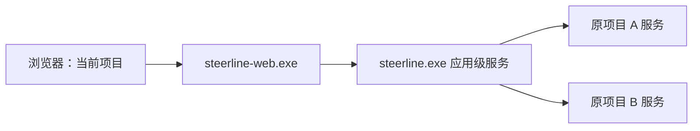

# Spec：独立 Web 程序与已有项目切换

> 后续变更：本文原 TUI 保留/组装条款已由[TUI 退役](tui-retirement.spec.md)取代；独立 Web、应用目录与项目切换要求继续有效，历史验收事实不改写。

状态：2026-10-15 已实现，WPS-A1～WPS-A6 自动验收通过，WPS-M1 待人工体验；实际验证结果归专属验收。普通开发，无 roadmap Task ID，不改 execution-map。配套 [Plan](web-project-switch.plan.md)、[专属验收](../acceptance/web-project-switch.md)。[添加项目](project-onboarding.spec.md)另立规格并后置，不是本批前置。

## 1. 问题与目标

当前 `web/server` 固定一个原生项目客户端，随项目服务启动、停止；浏览器端口放在项目配置中。更新 Web 会牵连项目进程，也无法在一个地址内切换项目。

本批交付独立 `steerline-web.exe`，用一个稳定本机浏览器地址访问当前应用 home 已配置的项目。主界面仍围绕当前项目，不改为跨项目任务大盘。Web 可以独立调试和重启，项目服务、worker、数据库及已提交业务请求继续由原所有者管理。

## 2. 本批范围与边界

| 本批交付 | 本批不交付 |
| --- | --- |
| 独立 Web exe、嵌入静态资源、Vite 调试、独立启动/退出 | 项目添加/删除/改名/移动、准备提示词生成、结构清单核验与纳管建库 |
| Go 应用级入口：现有项目目录、连接状态、按项目转接 | 浏览器启动/停止项目服务、合并项目服务/数据库、统一调度器 |
| 单端口项目选择器、深链接、标签页及异步结果隔离 | 远程 Web、账号系统、SSE/完整过程采集 |
| 构建、安装与唯一调试生成流程的双 exe 产物 | 安装现场部署、数据迁移、旧按项目 Web 模式兼容 |

本批项目目录来源仍是应用 home 的 `etc/*.json`。它们是“已配置项目”，不表示通过了后续的文档结构/纳管审核；不要求 `.steerline/project.json`，不调用添加项目流程，也不因列出项目创建数据库。TUI 保留已有查询、反馈和项目选择，不新增项目管理 UI。

## 3. 进程与职责

- Web 程序只负责静态资源、浏览器认证和受控 API 转接；不扫描项目配置、不解析仓库身份、不读项目数据库、不持有项目进程/worker 的终止句柄。
- 应用级服务由 Go 后端拥有，承担项目目录和路由。它没有项目任务数据库，零配置、全项目离线或某个配置损坏时仍可启动；不使用某个临时项目充当管理服务。其停止不停止项目服务。
- 每项目服务继续拥有原 native HTTP、Task/DAG、执行和数据库。应用级服务通过既有 httpclient 连接，不直接重建产品适配器或 SQLite 权威。
- 多加一层应用入口是为了把项目发现、连接和路由留在后端，并支持后续无项目时的添加；不能把这层实现成 Web 私有的另一套项目管理。

同一 home 的应用服务、Web 服务分别单实例，各自有精确进程身份和私有 discovery；不同 home 不混用目录、令牌或客户端。Web 关闭/重启、应用服务关闭/重启及项目服务关闭是三个独立事件。

## 4. 项目目录与连接

应用服务只读解析 etc 的现有项目配置和规范 Git common-dir，项目 ID 沿用原 `httpcontract.ProjectID`。解析逻辑不得依赖 TUI；优先复用/提取现有 consoleapp 的只读连接配置解析，不把完整执行环境 preflight 放进列表加载。

目录返回配置项标识、显示名、仓库简要位置、可解析的项目 ID、配置错误/冲突、在线状态和诊断。坏配置无有效项目 ID 时仅作为不可选诊断行；不伪造项目身份。同 common-dir 多份配置按现有冲突语义禁用写入并说明冲突，不按任意顺序挑选。不同仓库可同名，通过位置区分。

目录枚举与每项目解析/连接分别有界；不等待所有项目在线才返回目录，不因一个慢项目冻结其他项目。提供刷新目录入口。配置删除、仓库身份/目标改变时，撤销旧映射，不把原请求转给新路径。离线项目可以选择查看状态和当前标签页已有缓存，但禁写；应用服务不为离线读取初始化数据库，也不退回本地库查询。

连接使用当前用户受限 discovery 与原生 Bearer，核对项目、实例、进程、协议和配置归属。项目服务重启后只读重新发现原项目的新实例；浏览器刷新身份与资格，旧命令保持原信封，不改绑新实例。连接替换/关闭须保证在途调用安全结算，不能把转接错误伪装成权威 `command_not_found`。

## 5. 应用 API 与认证边界

增加独立应用协议 `steerline-application/v1`，不冒充原 `steerline-client/v1` 的单项目 identity。应用级 discovery 位于 `<home>/application-api/`，独立于项目运行目录，复用当前用户 ACL、原子发布、严格 loopback/Host/Bearer、无浏览器 Origin 和禁止重定向的机制。

本批最小语义入口如下，实施按此统一维护契约与客户端：

| 原生应用入口 | 语义 |
| --- | --- |
| `GET /v1/application/identity` | home 身份、应用实例/进程、协议及 ready；不要求某个项目在线 |
| `GET /v1/application/projects` | 当前配置目录与各项目诊断，数据不创建业务状态 |
| `GET /v1/application/projects/{id}/identity` | 该原生项目的真实 identity 或明确的离线/冲突错误 |
| `GET /v1/application/projects/{id}/…` | 明确允许的原项目查询；映射到该项目 native `/v1/projects/{id}/…` |
| `POST /v1/application/projects/{id}/commands` | 原命令信封透传，保留原 request/project/instance/目标/版本/payload |
| `POST /v1/application/shutdown` | 仅本机原生 CLI 请求应用服务正常退出；Web 浏览器代理不开放此路由，不停止项目服务 |

转接按原协议允许的查询路由与正式 commands 限制方法和路径，不接受任意 URL/文件路径作为代理目标。只访问服务目录中的项目；路由项目 ID、信封项目 ID 与真实客户端身份必须一致，原 native 服务仍最终核验命令。回执及原信封不增加另一个“成功”状态；未连接、错误身份或读失败返回不可用，只有原权威的缺失事实可作为 `command_not_found`。

Web 浏览器 API 同源转接至应用 API。浏览器会话绑定当前 Web 实例与 home，不再绑定单个项目；原生应用/项目凭证都不进入浏览器。保留一次性 60 秒票据、HttpOnly/SameSite Strict、CSRF、精确 Origin/Host、生产 CSP 等现有边界。会话有效期沿用 12 小时。Web 重启后重新授权，稳定 Origin 下 IndexedDB 草稿和原信封仍可读取。应用服务重启后 Web 验证同 home 的新应用身份再恢复连接，不借旧连接绕过核验。

## 6. 当前项目与浏览器隔离

URL 使用 `/projects/{project_id}/dag`、`/projects/{project_id}/runs`、`/projects/{project_id}/settings`。项目名称位置提供切换器，显示名称、位置和连接状态；可搜索并记住本标签页选择。首次打开优先显式深链接，其次本浏览器最近有效项目，否则显示项目选择页；零项目显示“尚无已配置项目”和只读说明。

不提供可用的“添加项目”按钮、向导或假成功。显示名重名不能导致同名路由。切换后只保留页面类型，不把原项目同号 Task/候选带入另一项目；不存在的项目显示不可访问及重新选择入口。

每标签页独立当前项目，服务端及同源 localStorage 不保存全局当前项目强制其他标签同步。最近使用偏好允许共享，不能抢改正在打开的标签页。

切换时：保存原项目草稿，取消旧查询、资格检查及尚未发送的回调；查询 key、页面选择、草稿、原请求、锁均按 home/项目/实例及所需执行身份隔离。同源只是共享存储空间，不共享业务目标。已提交或结果未知的命令留在原项目按原 ID 查证，不能因切换重新构造命令。旧响应不得覆盖当前项目正文、final、错误提示或按钮状态。服务实例变化时重核业务资格，不能把旧草稿自动发给新 Decision。

## 7. 入口、构建及删除安排

拟交付入口：`steerline.exe serve-app` / `stop-app` 启动/正常停止应用级服务；`steerline-web.exe serve` / `stop` 启动/正常停止 Web；`steerline-web.exe open [-project <id>] [-print-url]` 授权打开已有 Web 实例。Web 不自动创建项目服务；打开/启动失败说明缺少哪个进程，不能隐式派发。停止入口从本 home 私有 discovery 核验精确实例/进程，请求对应原生管理路由，再核实进程退出/锁释放，不结束项目服务。Web 的停止路由仅接受原生 launcher 凭证且无浏览器 Origin，不以会话 cookie 提供浏览器停服按钮。

Web 地址存 `<home>/web.json`（`version:1`、固定 `address`，默认 `127.0.0.1:18742`）；每项目 `web_address`、同项目托管接线、按项目 Web discovery 和旧 `steerline web -config` 入口删除，不留旧监听或回退。旧项目配置显式移除该字段，按新示例重新配置；不自动改用户配置或旧数据。

新增 `cmd/steerline-web`，复用 `web/server`、npm 工程与原认证代码。`build.ps1 -Web` 构建两份 exe，页面只嵌入 Web exe；普通 `build.ps1` 仍可在无 Node 环境构建业务 exe。两份程序各自明确安装至所选 home，启动器分别启动应用/Web/项目；安装失败不得混称整个套件已更新，正在运行的目标不覆盖。运行 Web 不依赖 Node。

唯一调试生成器继续维护：启用 Web 时产出双 exe、应用级配置和启动器；原 `-WebAddress` 参数用于应用级 Web 配置。支持双项目测试时，两份独立 SteerlineTest clone/common-dir 与各自 provider 状态位于同一新包；不能使用 linked worktree 假造两个项目。所有调试先生成新包、显式 `--simulate`，不改安装目录。

## 8. 验收要求

自动/人工结果归[本任务验收](../acceptance/web-project-switch.md)，当前执行结果以专属验收记录为准。

| ID | 必须达到的行为 |
| --- | --- |
| WPS-A1 | 双 exe/构建/安装/启动器正确；业务 exe 无页面/Node 前置，旧按项目托管退出，固定单端口资源及调试接线可用 |
| WPS-A2 | 应用服务零项目可用；目录只读、坏/慢/重复配置隔离，查询不建库，跨 home/项目访问被拒绝 |
| WPS-A3 | 应用与 Web 认证、原生客户端身份和路径检查保留；原信封/回执及原 ID 对账不改语义，错误不冒充缺失 |
| WPS-A4 | 当前项目切换、深链接、同号 Task、重名项目、两标签、草稿/final/晚到响应与离线隔离成立 |
| WPS-A5 | 独立 Web 重启及应用服务重启不停止项目服务/worker；按正确新实例重连，旧请求不改绑 |
| WPS-A6 | 新双项目 simulate 包中真实 Edge 完成授权、项目切换、一次原生业务提交及丢回执对账、受控活动轮次中重启 Web、释放并完成原轮次；随后清理本包进程/端口 |

WPS-M1：自动检查后由用户体验项目切换布局与日常独立重启入口，可后置，不阻塞无关工作。本批不改变 worker 流程、恢复或重试规则，不把启动新 worker 当重连方式。
