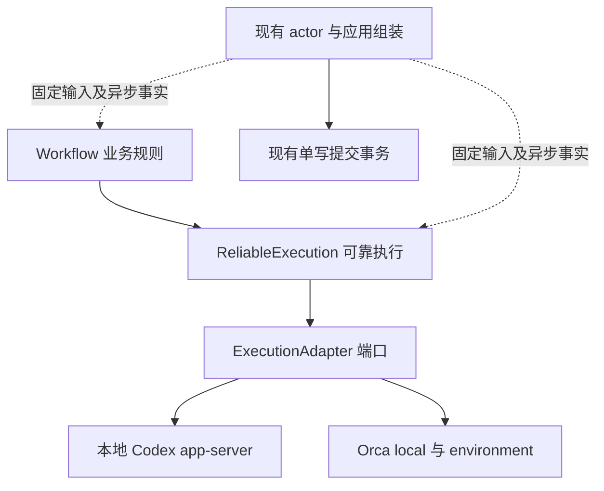

# Spec Worker 三层职责重构

状态：已获用户授权实施（2026-10-14）；不包含安装更新或现场恢复。普通开发，不分配 Task ID，不修改 roadmap 或 execution-map。

[Plan](worker-three-layer.plan.md) · [专属验收](../acceptance/worker-three-layer.md) · [长期流程规则](../product-design/worker-lifecycle.md)。源码调查基线为 `1b7468b07f4fdcec31c59d2e3eb0d740816f4179`；当前聊天新增的 worker 流程文档和维护规则属于本次设计输入。实际实现开始时固定文档与源码的真实 Git 版本，不把此调查 commit 当作尚未提交文档的版本。

## 问题与目标

当前共享 worker 的准备、投递、观察、恢复、业务步骤和持久化大量集中在 `internal/execution.Service`。`workerFlowContext` 同时携带 WorkflowRun、Execution、Attempt、Config 和 RunView；`worker_lifecycle.go`、`worker_events.go`、`worker_completion.go` 与 `staged_flow.go` 相互读写业务步骤及执行状态。平台接口已有一定隔离，但不构成独立的可靠执行中层。

本次形成三层：Workflow 决定业务意图和后继；ReliableExecution 管理与业务步骤无关的执行可靠性；ExecutionAdapter 执行原生动作并提供可核实事实。本地 Codex app-server、Orca 本机和 environment 一起接入，保持当前 development/v3、原生协议、授权和交付行为。

验收以实际依赖、输入/输出、状态所有权和故障行为为准，不能仅移动文件、增加转发接口或给现有 Service 改名。

## 范围与非目标

本次包含三层契约、代码归属调整、现有可靠性规则收口、两个 adapter 的接入、actor 组装、存储提交映射和受影响测试。保留已有模型、存储事务和原生取证算法；必要内部类型可以调整，但不为代码分层主动变更持久格式。

本次不新增初始化完成取证、有限启动重试、准备阶段新会话采纳、Orca 替代终端恢复、额外环境探针或新的自动业务重跑。这些缺口在长期文档保留，后续能力建设使用新的 Spec/Plan。安装任务 22 的会话恢复、安装更新和运行数据库调整不属于本次交付。

不增加服务、数据库、消息总线、通用 DAG 引擎、策略插件注册表或独立 RecoveryManager；不支持新执行后端，不改变公开 UI/CLI/API 操作及权限，不迁移或兼容旧开发格式。

## 三层契约

actor 与存储是三层的共同宿主，不是另一套业务或可靠性状态机。层间方向单向；后台 I/O 只返回原操作的事实，不直接修改 actor 状态。

### Workflow

拥有 development/v3 的步骤选择、提示词和结构化业务结果解释、报告来源关联、业务问题/反馈路由以及阶段后继。它可以消费“执行明确失败”“需要处理条件”“原结果未知”等执行事实，决定暂停或产生有授权的新业务意图。

技术重试、退避、连接、进程存活、原生请求对账、terminal/provider/thread 身份与旧写者资格不进入 Workflow。Workflow 不能读 Execution 的原生 binding、Operation 原生回执或 adapter envelope 来选择动作。

实现失败后新的实施输入、报告格式补报和发布后的业务反馈属于业务选择，不是中层自动重试；保留当前次数及授权边界。PR 平台核验与 TaskDelivery 继续使用已有 publication/任务应用能力，不放入 ReliableExecution，也不并入执行 adapter。

### ReliableExecution

提供准备执行、提交固定输入、观察原执行、回复原请求、核验恢复、执行有授权的恢复、停止和清理能力。拥有已有期限、未知副作用对账、原身份保护、恢复资格、接受/开始/结束事实、结果来源核验和迟到事实处理。

输入仅含执行/Attempt 标识、冻结执行配置及不透明平台材料、资源/工作区意图、固定输入及摘要、当前执行事实、操作事实和有效授权。WorkflowRun ID、Task ID 或业务关联 ID 可以作为不透明关联键存在，不能据其值推导步骤或资格。

中层不得接收 WorkflowRunRecord、StageInput、StageResult、TaskRecord、TaskDelivery、业务 DecisionRecord、完整 RunView、Service 或项目 Config；也不得解释 implement/report/publish、Spec/Plan 内容、业务结果 JSON 或 PR 状态。由 actor 把现有记录映射为有限执行快照和授权值。

输出为执行变化、待持久化的操作意图、原异步操作事实和规范通知，例如 prepared、input accepted、turn started、interaction required、turn ended、recovery required。具体类型在 Plan 中细化，通知至少区分原生结局、结果可用性和当前会话资格，不能用一个 success 代替这些独立事实。

中层不生成恢复业务提示词，不自动回答问题，不合并 PR 或关闭 Task。它只在授权和现有能力允许时执行意图；没有新增能力的节点继续返回现有不可用/未核实原因。

执行生命周期的技术可靠性契约统一由第二层对外承担，包括准备/就绪资格、操作是否可重试、期限/预算、原请求对账、输入与结果去重、身份/代次、恢复和停止资格。Workflow 提交业务意图后，只消费规范结果或待处理条件，不再补做这些检查或直接调用 adapter 绕过中层。后续新增初始化重试等能力也在第二层归口，但本任务仅迁移现有规则，不要求补齐其缺失能力。

机制不要求全部写在第二层：adapter 负责证明原生事实；actor/存储负责原子保存、CAS、持久化成功确认和异步执行。actor 必须在意图提交成功且中层执行资格仍有效后才驱动外部动作，不能自行另立技术重试/恢复判定。Task 领取、报告格式、PR 归属和唯一交付属于各自业务契约，第二层不解释它们。

### ExecutionAdapter

保留原生启动、握手、thread/terminal 准备、输入调用、状态/历史读取、原请求核验、原生问题回复、停止及精确资源恢复能力。提供固定 binding、部分成功事实、操作结果、完整结果来源和能力限制。

不持有中心业务存储、Workflow、Task 或 Decision 写权限，不决定业务后继、不管理中心重试预算。原生连接建立或一次 API 调用内部的有界等待可以保留；全流程重试和恢复资格由中层决定。

现有 `LifecyclePort` 可按职责收窄和重组，不要求每个方法单独建接口。通用 Next/准备推进规则归中层；app-server 的连接/握手/thread 准备等必要原生复合动作可保留在 adapter 内，但必须返回部分成功与失败位置，不能重复执行结果未知的副作用。

不要求两条路径使用相同原生调用序列。本地 app-server 不增加 READY 模型调用；Orca 不模拟 OS owned 进程。未来路径实现 adapter 并消费同一可靠性契约，不在 Workflow 或中层按 backend/protocol/PID 类型新增判断。

## 状态所有权与原子提交

| 事实 | 逻辑所有者 | 保存方式 |
| --- | --- | --- |
| 业务步骤、业务输入版本、报告 source 和业务结果 | Workflow | actor 映射到现有 WorkflowRun/阶段记录 |
| 执行准备、Attempt、输入派发/轮次、Operation、恢复资格 | ReliableExecution | actor 映射到现有 Execution/Attempt/Operation 及关联记录 |
| 原生身份、回执和来源证据 | adapter | 不透明材料随原操作提交，只有其 owner 解码 |
| Decision、用户授权和 Task/交付 | 现有应用及 actor | 正式产品命令验证后提供窄授权/交互值；沿现有事务 |

层内可以有不同用途的状态值，不能把同一持久状态复制成两套可写权威。ReliableExecution 的快照是调用输入，转换结果是待提交变化，不是新的数据库或长期 checkpoint。

原执行结果接受、对应 Workflow 结果结算、后继步骤和下一输入意图仍在一个现有业务事务中提交。actor 验证绑定、前值、版本和声明写集合后提交；层内规则不能先自行保存一半，再让另一层补另一半。

外部调用前提交固定意图和原目标；外部 I/O 不进入 SQLite 事务。意图保存失败时零外部调用。外部成功但本地提交失败时只核验原操作/补提交原事实，不重复副作用。新 Attempt 的指针推进、旧 Attempt 结算和不可变 binding 保持既有原子边界。

## 必须保持的行为

统一异常规则引用长期文档 W01–W18、E01–E07、V01–V08；本次移动其实现归属，不把该文档中的待补能力全部实施。

1. 未派发、明确拒绝、accepted、started、已结束和结果未知分别保留。accepted 未 started、RPC 超时、进程退出和静默不证明业务未执行。
2. 原输入未知只对账原请求，零换 ID 重发、零补 Enter、零替代 worker。没有可靠原生证据不能推进。
3. 当前 Orca 就绪/完成仅使用原 main-agent、pane/provider、原生状态和完整原始回复；不恢复屏幕、draft、tui-idle、可见标记或正文展示比对门槛。
4. 成功缺完整 final 保留缺口；明确失败/中断无 final 按现有规则进入恢复资格。报告 done 不覆盖源失败或未核实执行。
5. 原会话活动只重接观察；Codex 原写者停止且原 thread 可核实时按现有授权用新 Attempt 恢复同 thread；Orca 原终端可重接，替代 provider/terminal 仍不可用。
6. 冻结 stop_execution/continue_execution 不变。服务换代可以只读核验、补记结果和交付；未获当前授权时零新启动、探针、业务输入或答案投递。
7. 原问题、已保存答案、真实投递和轮次开始分别保存；旧答案不改投新 call/turn。授权版本失效、Task 终态或原操作未知不能由“继续”绕过。
8. 同事实轮询不重复 Decision/版本/结果；迟到、旧实例或旧 Attempt 事实不推进当前执行、不污染兄弟候选、不阻塞其独立观察。
9. development/v3、现有一次报告格式修正、PR 复用和原发布对账保持；不增加成果快照或候选 SHA 锁。任一合格候选真实合并可提交唯一交付，closed 后停止所有候选 PR 查询。
10. 停止/清理按精确身份和真实回执结算；清理失败不撤销 Delivery，不 reset 工作区或复制安装材料准备现场。

## 代码与删除要求

新建 `internal/execution/workflow` 与 `internal/execution/reliable` 作为实际职责所有者；现有 `backend` 继续维护中层与 adapter 的必要纯契约。`internal/execution` 根保留 actor、记录转换、事务组装、应用接线及 Task/PR 业务桥接，不能继续隐藏完整准备/重试/恢复算法。

Workflow 与 ReliableExecution 不导入具体 adapter、原生协议或 SQLite。ReliableExecution 不导入 workflow、混合的 `execution/model`、`execution/reconstruction` 或根 Service；Workflow 通过中层契约消费执行能力，不直接导入 adapter/backend。现有混合持久模型保留在 actor/存储侧，中层使用必要的窄值，避免为分层一次性重写持久模型。

保留共享 Git、进程、provider owner 和现有原生取证实现。删除旧的重复推进、恢复分类和仅转发的 worker 入口；三层接通后没有旧/新两套可选执行路径或兼容 façade。保留调用必须说明它属于 actor 组装或数据映射，而非重复业务/可靠性规则。

内部接口调整不要求持久版本升级。若实施发现必须改变存储/冻结字段含义，先在 Spec/Plan 明确实际格式影响与受影响 owner，再按项目规则拒绝旧格式；不偷偷升版、默认迁移、填零值兼容或承诺接管安装任务。

## 自动验收

具体步骤、映射与结果归[专属验收](../acceptance/worker-three-layer.md#自动验收项)。

| ID | 通过条件 |
| --- | --- |
| TL-A01 | 三层具有实际单向依赖和窄值契约；Workflow 不处理技术可靠性，中层不认识业务步骤，adapter 无中心写权限；负例可被边界检查拒绝 |
| TL-A02 | 无真实平台的中层测试完成已有准备/输入/观察/恢复规则；部分绑定、未知操作、身份冲突和期限保留；上层用中层 fixture 证明步骤及补报规则 |
| TL-A03 | 原意图先提交、结果及后继意图原子保存、新旧 Attempt/绑定不可覆盖；提交失败及迟到回执不重复外部动作或影响兄弟 |
| TL-A04 | 本地 Codex 与 Orca local/environment 都通过新中层；保留原生参数/身份/就绪/结果与能力差异，未知输入零重发，未恢复屏幕核验 |
| TL-A05 | 运行中答案、业务反馈、服务换代、原会话恢复与停服能力保持；正式授权只消费一次，未知/失效目标不能继续 |
| TL-A06 | 实现/报告/发布、原结果来源、格式补报、PR 复用/对账、真实合并门槛和唯一交付保持；Task closed 后零 PR 查询与新业务 |
| TL-A07 | 原重复路径和平台分支已删除，app/查询/fixture/测试接线完整；公开行为、持久格式及支持边界没有被无意改变，长期文档与源码归属同步 |

不设阻塞交付的专属人工项；公开界面不在本次改动范围。实际执行中发现公开行为或原生取证改变时，修订范围及最小验证安排，不能凭结构测试宣称新平台能力通过。
