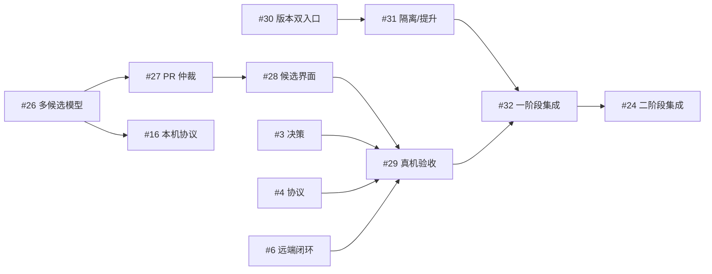

# 第一阶段任务创建与 DAG 回读

本记录证明规格固定、中心建任务及补边成功，不代表 #26–#32 的功能已实现或验收完成。

- 规格提交：`7372c04c8fdd7bea0965e9c5592e9e15cad918ad`。
- 原创建请求：`8affb9f68d154ef494f3360be51f69e9`；中心批次：`43401da45ac4cab03dcc695fffdc29f1`。
- 新建 #26–#32 共七项，批次内九条边；随后受控追加 #26 → #16、#32 → #24。
- 图版本依次为 3 → 4 → 5 → 6；最终 21 个节点、30 条边，回读无截断。
- #16/#24 由 open/version 1 变为 open/version 2；原任务固定契约、其他任务内容、既有边、原 abandoned 运行及交付记录保持。
- #25 的实现已合入且未在中心补造历史任务；其 ID/Spec/Plan 保留，已从活动规划表移出。

创建前原项目为 manual、未暂停，服务没有活动 WorkflowRun。先通过原服务 pause_dispatch/stop-service 取得 applied、process_exited 和 locks_released 回执，再对原 SQLite 做一致备份。用由固定提交构建的独立 CLI 执行 create/add-predecessors，没有覆盖安装二进制，也没有启动任务 worker。

变更后已重新打开原服务窗口，并通过原服务恢复 manual、未暂停状态；服务 running/ready，原数据库下没有新 WorkflowRun。SteerlineTest 服务和控制台未作为此次变更目标。构建程序、配置、备份路径与摘要保存在创建意图中。

创建时固定规格提交尚未合入 main；任务执行前须将该提交集成到配置的目标分支，并保留原规格 commit 可核验。当前依赖就绪节点为 #3/#4/#6/#14/#15/#26/#30；依赖就绪不等于工作区/固定规格/平台资格已通过，也不等于任务已经启动。

## 回执与验证

[审计整改](spec-audit.md) · [创建输入](task-batch.json) · [持久意图](creation-intent.json) · [CLI 校验](validation.json) · [创建回执](receipt.json) · [#16 补边](add-16-receipt.json) · [#24 补边](add-24-receipt.json)

[创建前快照](before.json) · [创建后查询](after.json) · [中心 DAG](dag.json) · [精确核对](verification.json) · [恢复后的服务状态](service-restored.json)

[暂停回执](service-pause.stdout.txt) · [停服与锁释放](service-stop.stdout.txt) · [Windows 窗口要求](service-restart.stdout.txt) · [窗口恢复](service-window-launch.json) · [恢复派发设置](service-resume.stdout.txt)

核对覆盖新任务集合/标题/固定 Spec/Plan/共同引用/摘要、原契约内容和摘要、全部预期依赖边、Task 版本变化，以及前后 WorkflowRun/TaskDelivery 集合。业务变更全部通过原生命令完成；SQLite 只读查询用于回读，一致备份未作为业务权威使用。

## 第一阶段与第二阶段的连接

此图只突出新增部分；原有第二阶段边完整保留在 dag.json。
