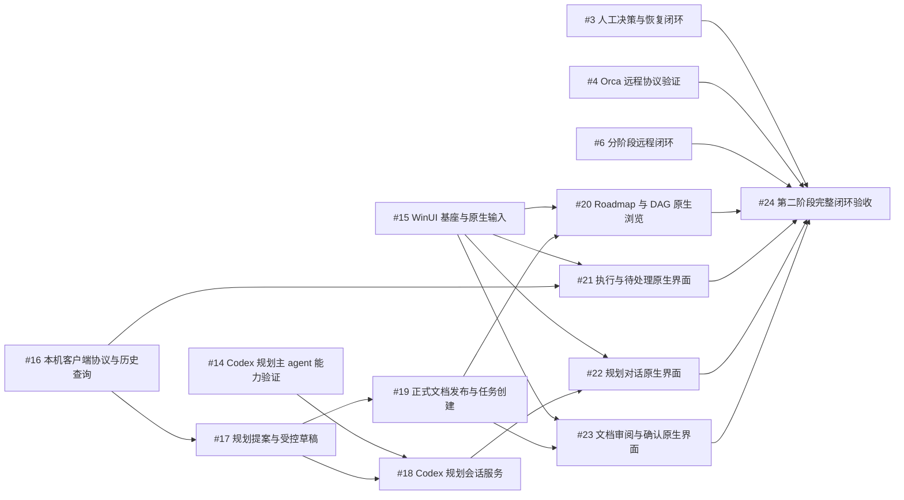

# 第二阶段任务创建与 DAG 回读

本记录只证明规划任务创建，不代表各任务的实现或验收已完成。

- 规格提交：12626a9de970d5a865ed676cffddfb7916fe443d
- 原创建请求：e4756c06b2e1403eb6442154a659f2a0
- 中心批次：24df9e6c3acdb83621ed94306e085df8
- 新增任务 #14–#24；现有 #3/#4/#6 保留原契约和状态。
- 图版本 2；14 个节点、19 条依赖，无截断；新增依赖就绪项为 #14/#15/#16。
- 原服务 manual/paused 且没有运行，已按 stop-service 协议确认退出和锁释放后建图；派发仍暂停，未启动 worker。
- 规格提交位于 codex/phase2-specs-dag，创建时尚未合入 main；执行前须将固定规格合入目标分支。服务可由用户从既有 service-window.bat 入口重开。

## 创建输入与证据

[批次输入](task-batch.json) · [创建意图](creation-intent.json) · [真实校验](validation.json) · [中心回执](receipt.json) · [创建前](before.json) · [创建后](after.json) · [原生 DAG](dag.json) · [核对结果](verification.json) · [停止服务回执](service-stop.stdout.txt)

核对每个新任务的标题、固定 Spec/Plan/共同约束引用及摘要、原批次身份和全部依赖边；旧任务契约未改写。图的当前状态以中心查询为准，本文件是创建时快照。

## 创建时的依赖图

